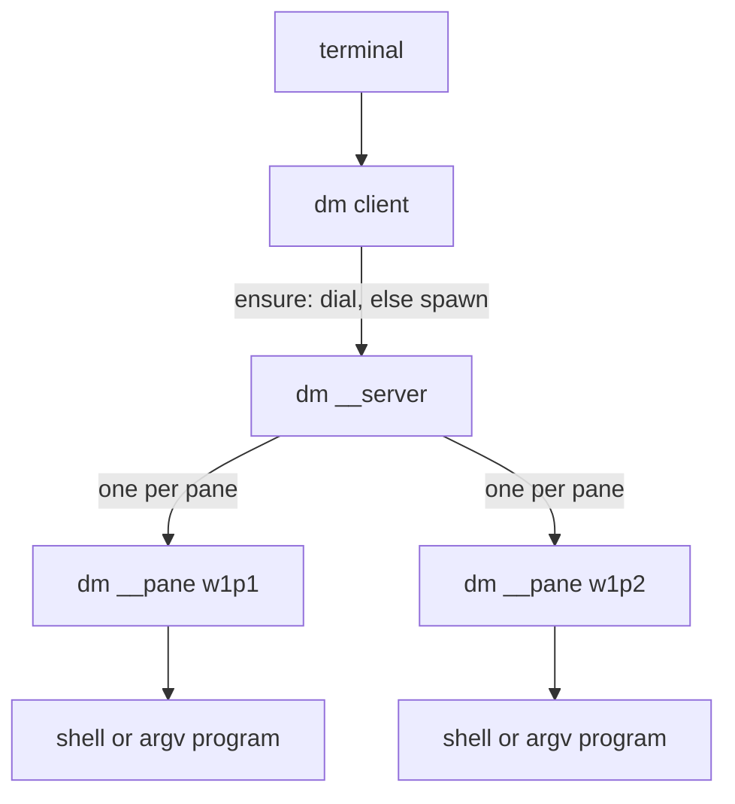
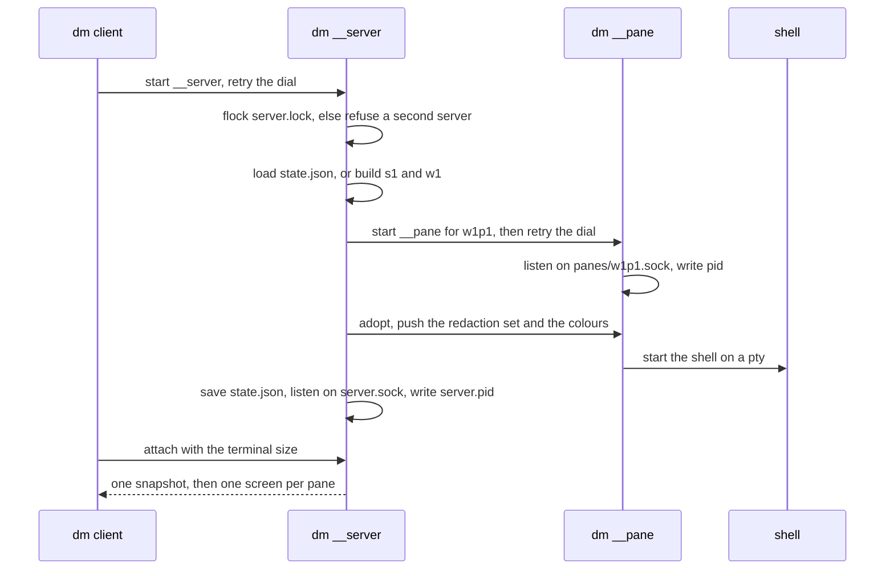

# Entry point

`dm` is one Go binary that runs as one of five process roles. This page answers
which word starts which role, who spawns whom, where the files live, and where
you add a role of your own.

A session is one named layout, with its own server, its pane daemons and its
directory, `sessions/<name>` under the state root
(`internal/paths/paths.go#SessionDirAt`). The state root is `$DM_STATE`, else
`$XDG_STATE_HOME/dm`, else `~/.local/state/dm` (`internal/paths/paths.go#StateDir`).
[Lifecycle and state](02-lifecycle.md) defines the four nouns: a layout is a
tree of workspaces, a workspace holds windows, a window splits into panes, and
a pane is one terminal.

## The six roles

`main` (`main.go#main`) switches on `os.Args[1]` before anything else. A
sentinel word stops there. A sentinel word is a first argument that names a
process role, never a command, and it never reaches `cli.Run`, the command
parser behind every user-facing word (`internal/cli/cli.go#Run`).

| Word | Runs | Role | Starts |
|---|---|---|---|
| `__server` | `server.Run` (`internal/server/server_core.go#Run`) | one per session: the state (`state.json`, the saved layout and pane records), its clients, one connection per pane | pane daemons |
| `__pane` | `pane.Run` (`internal/pane/pane.go#Run`) | one per pane: a PTY, the screen (the cell grid parsed from its output), the scrollback buffer (a byte budget from `history-lines`: 2.5 MiB at the default 10000 lines, `internal/keymap/config_model.go#Config.HistoryBytes`) | a shell or a named program |
| `__client` | `client.RunResumed` (`internal/client/client_model.go#RunResumed`) | a restart's continuation: the same terminal and the same alternate screen, so the client that follows draws over the handover instead of leaving and re-entering the screen | a server, on its first dial |
| `__probe` | `runProbe` (`probe.go#runProbe`) | a terminal test harness, with no state and no daemon | nothing |
| `__update-check` | `client.RunUpdateCheck` (`internal/client/update.go#RunUpdateCheck`) | a one-shot release refresh: one read of the latest tag, one cache write, then exit | nothing |
| anything else, once the `help` branch has passed (`main.go#main`) | `cli.Run` (`internal/cli/cli.go#Run`) | the CLI, and the client for an attach | the server, on its first dial |

The server passes that budget on every spawn, so `ringDefault`
(`internal/pane/pane.go#ringDefault`) is only the `dm __pane` flag default.

`runProbe` writes the OSC 7501 query, `ESC ] 7501 ; ?`, which asks the terminal
whether it speaks the program-status escape that dm defines
(`probe.go#runProbe`). It waits for the reply, reports `working` on its own
terminal, holds, then clears.

## What the fallback does

Everything that is not a sentinel word and not a help request goes to
`cli.Run`. That one process is both the CLI and the client:

- no arguments and `attach` call `client.Run` in process
  (`internal/cli/cli.go#Run`).
- an RPC verb calls `transport.RPC`
  (`internal/transport/transport.go#RPC`). It dials the session socket,
  `server.sock`, and spawns the server when nothing answers.
- `ls`, `kill`, `reset` and `purge` work on the session directory and the pid
  files beside the sockets (`internal/cli/cli.go#Run`). `ls` reads a dead
  session's state file directly. A live session answers from its server with a
  snapshot, the layout a client draws from (`internal/cli/cli.go#runLs`).
- the `default` case treats a bare word as a session name and attaches
  (`internal/cli/cli.go#Run`).

The `help` branch renders from the command table, the list of published verbs
in `internal/clidoc/clidoc.go#cliCommands`, and sits inside the same switch
(`main.go#main`). An unknown topic is an error, never an attach (`main.go#main`).
An error prints as `dm: <err>` and exits 1 (`main.go#exit`).

This layer holds no state and decides no layout. It picks a process, and the
state belongs to the server that process starts.

## Why sentinels stay hidden

1. The switch runs before the fallback, so `__server` is a reserved word and not
   a session name. `paths.ValidSessionName`
   (`internal/paths/paths.go#ValidSessionName`) accepts the spelling, so the
   reservation lives in `main.go` alone.
2. The AST test, which parses `cli.Run` and fails on a `case` the command
   table does not cover (`internal/clidoc/clidoc_test.go#runCLICases`). It reads
   `cli.Run` and not `main.go`, so a sentinel needs no row and gets no help
   text.
3. The word is a process identity. `transport.isDMProcess`
   (`internal/transport/transport.go#isDMProcess`) reads `/proc/<pid>/cmdline`
   and requires argv[1] to equal the sentinel exactly before anything signals
   the pid. A user-facing spelling would make that check ambiguous with a
   session name.

## Who starts whom

Each spawner runs the same executable with a sentinel word. Nothing goes
through a shell: both spawners call `exec.Command` with `os.Executable`, so the
next spawn always runs the file on disk.

- The client calls `transport.EnsureAt`
  (`internal/transport/transport.go#EnsureAt`). It dials `server.sock`, and on
  failure creates the session directory and `server.log`, then starts
  `dm __server -s <name>` in a new POSIX session with `Setsid`. The server then
  outlives the terminal that spawned it.
- `EnsureAt` rewrites `DM_STATE` in the child's environment, so an explicit
  state root survives the spawn. The server rebuilds its paths from
  `paths.StateDir` (`internal/paths/paths.go#StateDir`).
- The server calls `server.ensurePane` for every pane the state file lists
  (`internal/server/server_core.go#server.ensurePane`). It dials
  `panes/<id>.sock` first. On failure it builds `dm __pane` with `paneCommand`,
  starts it with `Setsid`, and points stdout and stderr at `panes/<id>.log`.
- The pane starts the shell with `pty.StartWithSize` in `startShell`
  (`internal/pane/pane.go#paneProc.startShell`), so the shell leads its own
  process group and `paneProc.reap` can kill that group
  (`internal/pane/pane.go#paneProc.reap`).

Pane ids are `w<N>p<M>`, with `M` counting per window, so `w1p1` is window 1's
first pane. [Lifecycle and state](02-lifecycle.md) owns the id scheme.

## The startup sequence

A bare `dm` on a machine with no state, in order:

`server.Run` calls `paths.LockSession`, which takes an exclusive `flock` on
`sessions/<name>/server.lock`, before it loads state
(`internal/server/server_core.go#Run`, `internal/paths/lock_unix.go#LockSession`).
A second server for the same name stops there instead of fighting over the
socket.

To adopt a pane is to dial its daemon and keep the connection. The server hands
it the redaction set, the secret values it must blank out of its output, and the
terminal's colour pair, the answers the pane gives to OSC 10 and OSC 11 colour
queries (`internal/server/server_core.go#server.adoptPane`).

An attach brings no backlog and no replay of earlier output. The client gets one
snapshot, the layout it draws, then one screen per pane
(`internal/server/server_view.go#server.attach`). It asks for scrollback with a
`replay` request when it needs it.

## Where the sockets live

One session is one directory, `sessions/<name>`
(`internal/paths/paths.go#SessionDirAt`), holding these files.

| Path | Who creates it | Who opens it |
|---|---|---|
| `server.lock` | `paths.LockSession` (`internal/paths/lock_unix.go#LockSession`) | `paths.SessionLockHeld` (`internal/paths/lock_unix.go#SessionLockHeld`) asks whether a live server owns the directory. Every path that removes a directory takes the lock first |
| `server.sock` | `server.Run` (`internal/server/server_core.go#Run`) | `transport.EnsureAt` (`internal/transport/transport.go#EnsureAt`), CLI RPC (`internal/transport/transport.go#RPCAt`), `dm ls` (`internal/transport/transport.go#ListSessionsAt`), and a sibling session's server pushing the secret values it must redact (`internal/server/server_secrets.go#server.coverSiblings`) |
| `panes/<id>.sock` | `pane.Run` (`internal/pane/pane.go#Run`) | the server, in `ensurePane` and every pane request; `dm wait`, which dials the pane to stream its output until a command ends |
| `panes/<id>.sock.pid` | the pane (`internal/pane/pane.go#Run`) | `transport.reapPanes` (`internal/transport/transport.go#reapPanes`) |
| `server.pid` | the server (`internal/server/server_core.go#writePID`) | `transport.KillSessionAt` (`internal/transport/transport.go#KillSessionAt`), `transport.stopServer` |
| `server.log` | `transport.EnsureAt` (`internal/transport/transport.go#EnsureAt`) | you, after a start that failed. `EnsureAt` quotes its tail in the error it returns |
| `panes/<id>.log` | `server.ensurePane` (`internal/server/server_core.go#server.ensurePane`) | you, after a pane stops |
| `webpush.json` | the phone page handler, on a subscribe (`internal/webui/push.go#Handler.pushSubscribe`) | the server's push sender (`internal/server/push_notify.go`) |
| `webpush.key` | the phone page handler, on first use (`internal/webui/push.go#Handler.vapidKeys`) | the server's push sender (`internal/server/push_notify.go`) |

There are no fifos. Both sockets come from `net.Listen("unix", ...)`
(`internal/server/server_core.go#Run`, `internal/pane/pane.go#Run`), and each is
chmod 0600 at creation. `server.lock` is 0600 too. Pane and server output go to
plain log files beside them.

## Add a process role

Do these in order. This path skips the CLI surface on purpose.

1. `main.go`: add a case to the switch, before the `cli.Run` fallback, that
   calls the new package's `Run`.
2. That package: parse its own flags with a `flag.FlagSet` named after the
   sentinel, as `parsePaneArgs` does (`internal/pane/pane.go#parsePaneArgs`).
3. The spawner: name the word in the command line. The two existing sites are
   `transport.EnsureAt` and `server.ensurePane`.
4. A pid file: teach `transport.reapPanes` the word. It looks for `__pane` by
   name, and `transport.isDMProcess` matches argv[1] exactly
   (`internal/transport/transport.go#reapPanes`).
5. Do not touch `internal/clidoc`. A user-facing verb belongs in `cli.Run` and
   the command table instead, and [CLI and config](10-config.md) has that
   recipe.

## See also

- [Lifecycle and state](02-lifecycle.md)
- [The protocol](03-protocol.md)
- [The server](04-server.md)
- [The pane](05-pane.md)
- [CLI and config](10-config.md)
