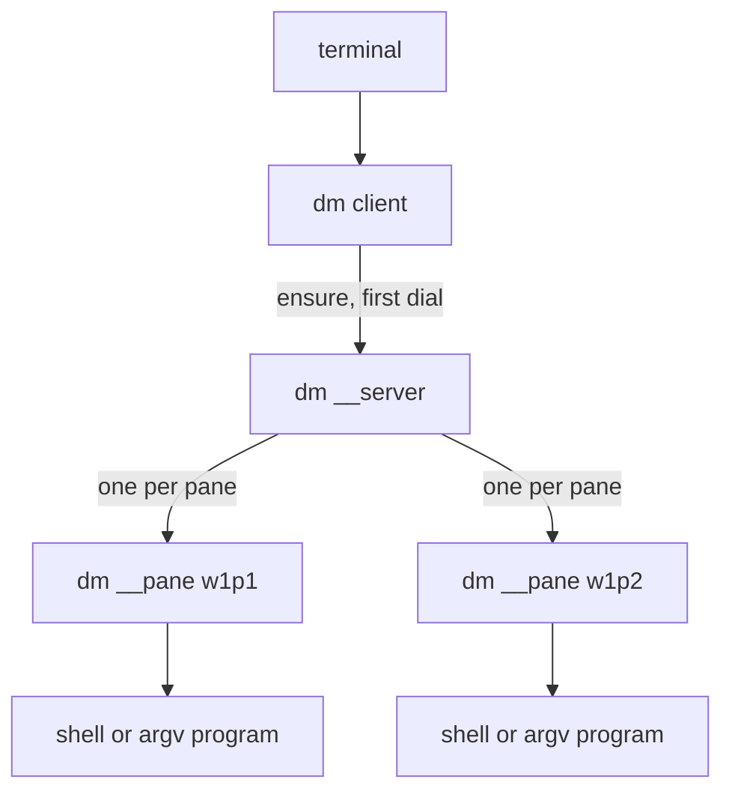
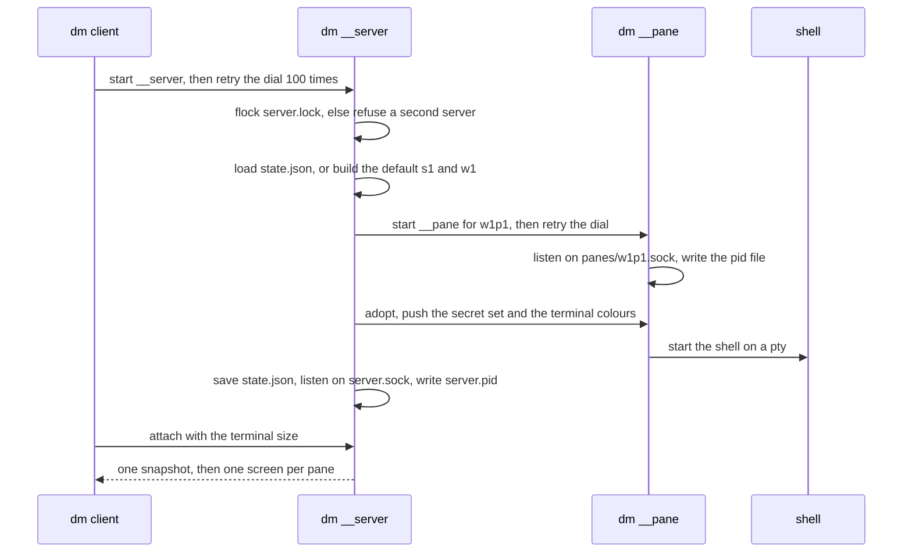

# Entry point: one binary, three processes

`dm` is a single Go binary that runs as one of three processes: the client, the
session server, or a pane daemon. This page answers which command line word
starts which one, who spawns whom, where the sockets live, and where you add a
fourth process role. The server's internals are in [The server](04-server.md);
the bytes on the sockets are in [The protocol](03-protocol.md).

## The three roles

`main` in `main.go:17` switches on `os.Args[1]` before anything else and never
returns to the CLI for the three sentinel words.

| Word | Runs | Role | Starts |
|---|---|---|---|
| `__server` | `server.Run` (`internal/server/server_core.go:530`) | one per session: state, clients, pane links | pane daemons |
| `__pane` | `pane.Run` (`internal/pane/pane.go:651`) | one per pane: pty, VT screen, output ring | a shell or an argv program |
| `__probe` | `runProbe` (`probe.go:17`) | a terminal test harness, no state, no daemon | nothing |
| anything else, after the help branch | `cli.Run` (`internal/cli/cli.go:426`) | the CLI, and the client for an attach | the server, on its first dial |

`runProbe` writes the OSC 7501 query, waits for the reply, reports `working`,
holds, then clears (`probe.go:33-73`). It is a terminal harness, not a session.

## What the fallback does

Everything that is not a sentinel word and not a help request goes to
`cli.Run`. That one process is both the CLI and the client:

- no arguments and `attach` call `client.Run` in process (`internal/cli/cli.go:429`,
  `internal/cli/cli.go:444`).
- an RPC verb calls `transport.RPC`, which dials the session socket and spawns
  the server when nothing answers (`internal/transport/transport.go:139`).
- `ls`, `kill`, `reset` and `purge` work on the directory and the pid files.
  `ls` reads a dead session's file and asks a live session's server for its
  snapshot (`internal/cli/cli.go:469`, `internal/cli/cli.go:1969`).
- the `default` case treats a bare word as a session name and attaches
  (`internal/cli/cli.go:858`).

The `help` branch renders from the command table and is part of the same
switch (`main.go:27`). An unknown topic is an error, never an attach
(`main.go:41`). An error prints as `dm: <err>` and exits 1 (`main.go:50`).

What this layer does not do: it holds no state and decides no layout. It picks a
process, and the state belongs to the server that process starts.

## Why the sentinel verbs are hidden

1. The switch runs before the fallback, so `__server` is a reserved word, not a
   session name. `paths.ValidSessionName` (`internal/paths/paths.go:36`) would
   accept the spelling, so the reservation lives in `main.go` alone.
2. The published CLI surface is the command table in
   `internal/clidoc/clidoc.go:68`. The AST gate that pairs every case in
   `cli.Run` with a table row reads `cli.Run`, not `main.go`
   (`internal/clidoc/clidoc_test.go:14`). A sentinel therefore needs no row and
   gets no help text.
3. The word is a process identity. `isDMProcess` reads `/proc/<pid>/cmdline` and
   requires argv[1] to equal the sentinel exactly before anything signals the
   pid (`internal/transport/transport.go:299`). A user-facing spelling would
   make that check ambiguous with a session name.

## Who starts whom

Each spawner runs the same executable with a sentinel word. Nothing goes through
a shell: both call `exec.Command` with `os.Executable`.

- The client calls `transport.EnsureAt` (`internal/transport/transport.go:53`).
  It dials `server.sock`, and on failure creates the session directory and
  `server.log`, then starts `dm __server -s <name>` in a new session with
  `Setsid` (`transport.go:84`).
- `DM_STATE` is rewritten in the child's environment, so an explicit state root
  survives the spawn (`transport.go:83`). The server rebuilds its paths from
  `paths.StateDir` (`internal/paths/paths.go:12`).
- The server calls `ensurePane` for every pane in the state
  (`internal/server/server_core.go:774`). It dials `panes/<id>.sock` first. On
  failure it builds `dm __pane` with `paneCommand`
  (`internal/server/server_core.go:739`), starts it with `Setsid`
  (`server_core.go:812`), and points stdout and stderr at `panes/<id>.log`.
- The pane starts the shell with `pty.StartWithSize` in `startShell`
  (`internal/pane/pane.go:802`), so the shell leads its own process group and
  `reap` can signal the group (`pane.go:868`).

Both spawners resolve the binary through `os.Executable`, so the next spawn
always runs the file on disk.

## The startup sequence

A bare `dm` on a machine with no state, in order:

`server.Run` takes an exclusive `flock` on `server.lock` before it loads state
(`internal/server/server_core.go:546`). A second server for the same name fails
there instead of fighting over the socket. `attach` sends no backlog: the
client asks for history with `replay` when it wants it
(`internal/server/server_view.go:786`).

## Where the sockets live

The root is `$DM_STATE`, else `$XDG_STATE_HOME/dm`, else
`~/.local/state/dm` (`internal/paths/paths.go:12`). One session is one
directory, `sessions/<name>` (`paths.go:25`).

| Path | Listener | Dialers |
|---|---|---|
| `server.sock` | `server.Run` (`server_core.go:651`) | `transport.EnsureAt` (`transport.go:58`), CLI RPC (`transport.go:142`), liveness probes (`transport.go:191`), a sibling session's secrets push (`internal/server/server_secrets.go:370`) |
| `panes/<id>.sock` | `pane.Run` (`pane.go:685`) | the server, in `ensurePane` and every pane request, plus `dm wait`, which dials the pane directly |
| `panes/<id>.sock.pid` | written by the pane (`pane.go:690`) | `transport.reapPanes` (`transport.go:271`) |
| `server.pid` | written by the server (`server_core.go:1190`) | `transport.KillSessionAt`, `transport.stopServer` |

There are no fifos. Every socket is chmod 0600 at creation. Pane output and
server output go to plain log files beside them.

## Where a process-level verb is added

Do these in order. This path skips the CLI surface on purpose.

1. `main.go`: add a case to the switch, before the `cli.Run` fallback, that
   calls the new package's `Run`.
2. That package: parse its own flags with a `flag.FlagSet` named after the
   sentinel, as `parsePaneArgs` does (`internal/pane/pane.go:612`).
3. The spawner: name the word in the command line. The two existing sites are
   `transport.EnsureAt` and `server.ensurePane`.
4. A pid file: teach the reaper. `transport.isDMProcess` matches argv[1]
   exactly, and `reapPanes` looks for `__pane` by name (`transport.go:284`).
5. Do not touch `internal/clidoc`. A user-facing verb belongs in `cli.Run` and
   the table instead, and [CLI and config](10-config.md) has that recipe.

## See also

- [Lifecycle and state](02-lifecycle.md)
- [The protocol](03-protocol.md)
- [The server](04-server.md)
- [The pane](05-pane.md)
- [CLI and config](10-config.md)
