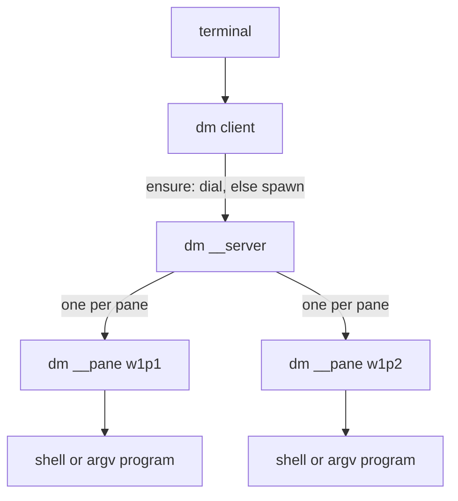
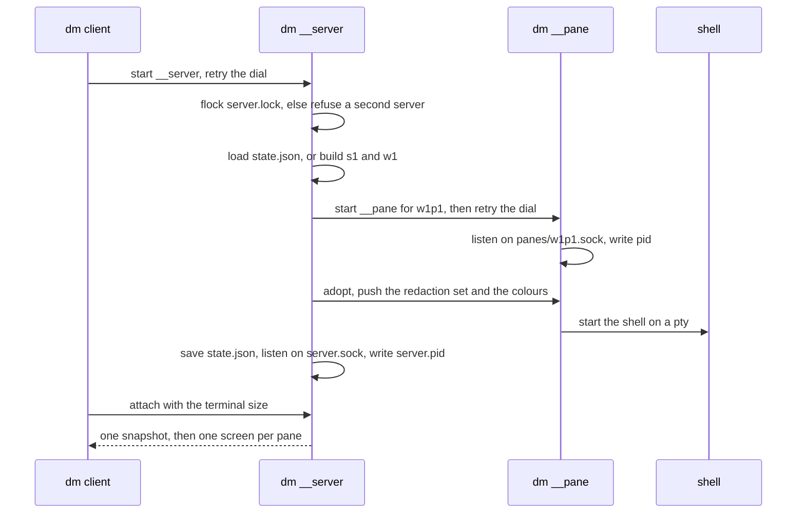

# Entry point: one binary, three processes

`dm` is a single Go binary that runs as one of three processes: the client, the
process that owns the terminal, the session server, or a pane daemon. A session
is one named layout, with its own server, its pane daemons and its directory,
`sessions/<name>` under the state root (`internal/paths/paths.go:25`), which is
`$DM_STATE`, else `$XDG_STATE_HOME/dm`, else `~/.local/state/dm` (`paths.go:12`).
A layout is a tree of workspaces; a workspace holds windows; a window splits
into panes; and a pane is one terminal: a daemon that owns the shell and the
socket the server dials to reach it (`internal/pane/pane.go:31`). This page
answers which command line word starts which one, who spawns whom, where the
sockets live, and where you add a fourth process role.

## The three roles

`main` in `main.go:17` switches on `os.Args[1]` before anything else and never
returns to the CLI, the command parser behind every user-facing word
(`cli.Run`, `internal/cli/cli.go:426`), for the three sentinel words. A
sentinel word is a first argument that names a process role, never a command.

| Word | Runs | Role | Starts |
|---|---|---|---|
| `__server` | `server.Run` (`internal/server/server_core.go:530`) | one per session: the state (the saved layout and pane records, `state.json`), clients, a connection to each pane | pane daemons |
| `__pane` | `pane.Run` (`internal/pane/pane.go:651`) | one per pane: a pty (the pseudo-terminal the shell runs on), the screen (the cell grid parsed from its output), the ring of recent bytes (512 KiB by default, `pane.go:373`) | a shell or a named program |
| `__probe` | `runProbe` (`probe.go:17`) | a terminal test harness, no state, no daemon | nothing |
| anything else, once `main`'s `help` branch has passed (`main.go:27`) | `cli.Run` (`internal/cli/cli.go:426`) | the CLI, and the client for an attach | the server, on its first dial |

`runProbe` writes the OSC 7501 query, `ESC ] 7501 ; ?`, which asks the terminal
whether it speaks the program-status escape dm defines, waits for the reply,
reports `working` on its own terminal, holds, then clears (`probe.go:33-73`).

## What the fallback does

Everything that is not a sentinel word and not a help request goes to
`cli.Run`. That one process is both the CLI and the client:

- no arguments and `attach` call `client.Run` in process (`cli.go:429`, `cli.go:444`).
- an RPC verb calls `transport.RPC`, which dials the session socket, `server.sock`,
  and spawns the server when nothing answers (`transport.go:139`).
- `ls`, `kill`, `reset` and `purge` work on the session directory and the pid
  files beside the sockets, `server.pid` and `panes/<id>.sock.pid`. `ls` reads a
  dead session's state file and asks a live session's server for its snapshot,
  the layout the client draws from (`cli.go:469`, `cli.go:1969`).
- the `default` case treats a bare word as a session name and attaches
  (`internal/cli/cli.go:858`).

The `help` branch renders from the command table, the list of published verbs in
`internal/clidoc/clidoc.go:68`, and is part of the same switch (`main.go:27`).
An unknown topic is an error, never an attach (`main.go:41`). An error prints
as `dm: <err>` and exits 1 (`main.go:50`).

What this layer does not do: it holds no state and decides no layout. It picks a
process, and the state belongs to the server that process starts.

## Why the sentinel words are hidden

1. The switch runs before the fallback, so `__server` is a reserved word, not a
   session name. `paths.ValidSessionName` (`internal/paths/paths.go:36`) would
   accept the spelling, so the reservation lives in `main.go` alone.
2. The AST gate, a test that parses `cli.Run` and fails on a `case` the command
   table does not cover (`internal/clidoc/clidoc_test.go:14`), reads `cli.Run`,
   not `main.go`. A sentinel needs no row and gets no help text.
3. The word is a process identity. `isDMProcess` reads `/proc/<pid>/cmdline` and
   requires argv[1] to equal the sentinel exactly before anything signals the
   pid (`internal/transport/transport.go:299`). A user-facing spelling would
   make that check ambiguous with a session name.

## Who starts whom

Each spawner runs the same executable with a sentinel word. Nothing goes through
a shell: both spawners, the client and the server, call `exec.Command` with
`os.Executable`, so the next spawn always runs the file on disk. Ids are `s<N>`
for a workspace, `w<N>` for a window and `w<N>p<M>` for a pane, `M` counting per
window, so `w1p1` is window 1's first pane (`internal/session/state.go:441`).

- The client calls `transport.EnsureAt` (`internal/transport/transport.go:53`).
  It dials `server.sock`, and on failure creates the session directory and
  `server.log`, then starts `dm __server -s <name>`, where `-s` names the session
  as on the CLI, in a new POSIX session with `Setsid` (`transport.go:84`), so the
  server outlives the terminal that spawned it.
- `DM_STATE` is rewritten in the child's environment, so an explicit state root
  survives the spawn (`transport.go:83`). The server rebuilds its paths from
  `paths.StateDir` (`internal/paths/paths.go:12`).
- The server calls `ensurePane` for every pane the state file lists
  (`server_core.go:774`). It dials `panes/<id>.sock` first. On failure it builds
  `dm __pane` with `paneCommand` (`server_core.go:739`), starts it with `Setsid`
  (`server_core.go:812`), and points stdout and stderr at `panes/<id>.log`.
- The pane starts the shell with `pty.StartWithSize` in `startShell`
  (`internal/pane/pane.go:802`), so the shell leads its own process group and
  `paneProc.reap` can kill that group (`pane.go:868`).

## The startup sequence

A bare `dm` on a machine with no state, in order:

`server.Run` takes an exclusive `flock` on `sessions/<name>/server.lock` before
it loads state (`internal/server/server_core.go:546`), so a second server for the
same name fails there instead of fighting over the socket. To adopt a pane,
meaning to dial its daemon and keep the connection, the server hands it the
redaction set, the secret values it must blank out of its output, and the
terminal's colour pair, the answers the pane gives to OSC 10 and OSC 11 colour
queries (`server_core.go:851-865`). The server sends no backlog on an attach, no
replay of earlier output: one snapshot, the layout a client draws, then one
screen per pane, and the client asks for scrollback with `replay` when it wants
it (`internal/server/server_view.go:786`).

## Where the sockets live

One session is one directory, `sessions/<name>` (`paths.go:25`), holding these files.

| Path | Who creates it | Who opens it |
|---|---|---|
| `server.lock` | `server.Run`'s `flock` (`server_core.go:541`) | nobody: it holds a lock, not a message |
| `server.sock` | `server.Run` (`server_core.go:651`) | `transport.EnsureAt` (`transport.go:58`), CLI RPC (`transport.go:142`), the probe `dm ls` dials (`transport.go:191`), a sibling session's server, pushing the secret values it must redact in its panes (`internal/server/server_secrets.go:337`) |
| `panes/<id>.sock` | `pane.Run` (`pane.go:685`) | the server, in `ensurePane` and every pane request; `dm wait`, which dials the pane to stream its output until a command ends |
| `panes/<id>.sock.pid` | the pane (`pane.go:690`) | `transport.reapPanes` (`transport.go:271`) |
| `server.pid` | the server (`server_core.go:1190`) | `transport.KillSessionAt`, `transport.stopServer` |

There are no fifos: both sockets are `net.Listen("unix", ...)` (`server_core.go:651`,
`pane.go:685`), and each is chmod 0600 at creation (`server_core.go:656`,
`pane.go:689`). Pane and server output go to plain log files beside them.

## Where a process-level verb is added

Do these in order. This path skips the CLI surface on purpose.

1. `main.go`: add a case to the switch, before the `cli.Run` fallback, that
   calls the new package's `Run`.
2. That package: parse its own flags with a `flag.FlagSet` named after the
   sentinel, as `parsePaneArgs` does (`internal/pane/pane.go:612`).
3. The spawner: name the word in the command line. The two existing sites are
   `transport.EnsureAt` and `server.ensurePane`.
4. A pid file: teach the reaper, `transport.reapPanes`, the code that kills
   every pane daemon of a session. `transport.isDMProcess` matches argv[1]
   exactly, and `reapPanes` looks for `__pane` by name (`transport.go:284`).
5. Do not touch `internal/clidoc`. A user-facing verb belongs in `cli.Run` and
   the table instead, and [CLI and config](10-config.md) has that recipe.

## See also

- [Lifecycle and state](02-lifecycle.md)
- [The protocol](03-protocol.md)
- [The server](04-server.md)
- [The pane](05-pane.md)
- [CLI and config](10-config.md)
