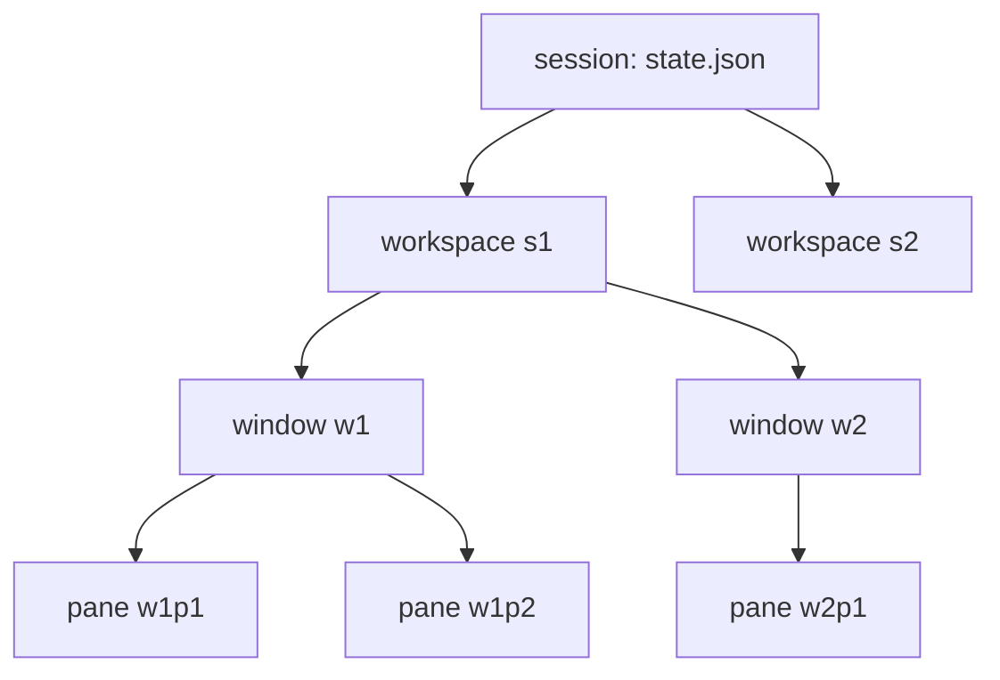
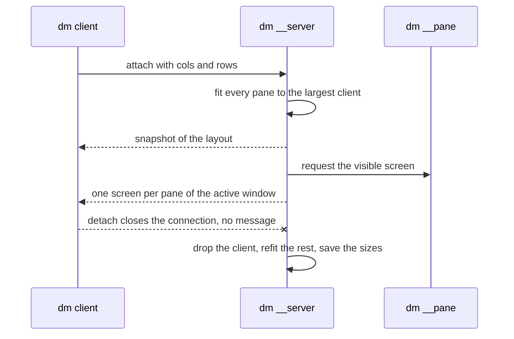

# Lifecycle and state

A session outlives the client that opened it and, after a crash, the server that
owned it. This page answers what a session, workspace, window and pane are in
the state model, what the state file holds, what attach and detach do, what each
teardown word destroys, and what to run when a session is wedged.

## The model

One session is one directory, one server and its pane daemons. The directory
holds the layout; the panes hold the content. `paths.ValidSessionName`
(`internal/paths/paths.go#ValidSessionName`) checks the name before any path is
built.

Ids are `s<N>` for a workspace, `w<N>` for a window and `w<N>p<M>` for a pane,
with `M` counting per window. A pane id names its window and never its
workspace (`internal/session/state.go#State.NewWorkspaceID`). A collapsed group
is a set of sidebar rows hidden behind a header. A group colour is the theme
colour that header keeps.

- **Workspace** (`internal/session/state.go#Workspace`): id, name, and an optional
  project: a label several workspaces share. Workspaces that carry the same
  project stay contiguous. It holds its windows, the index of the window on
  screen, and one collapsed flag.
- **Window** (`internal/session/state.go#Window`): id, name, whether the user
  named it, and the split tree in `Root`. A `Root` is a `layout.Node`: a split
  with `Kids` and `Sizes`, or one pane id. A window also holds its focused pane,
  its pane counter, `Unfolded` (show its pane rows in the sidebar) and `Sync`
  (mirror every write to all its panes).
- **Pane** (`internal/session/state.go#PaneState`): what a restart needs. Shell,
  cwd, cols, rows, argv, and the environment a plugin adds. A plugin is a pane
  that a `plugin` block in `dm/config.kdl` under `$XDG_CONFIG_HOME` or
  `~/.config` declares (`internal/keymap/config_load.go#defaultConfigPath`,
  `internal/keymap/config_parse.go#findPlugins`). A pane also records the agent
  name a `set-pane-name` request set
  (`internal/server/server_rpc.go#server.handleReq`), the app name its program
  last reported (`internal/session/state.go#PaneState.App`), whether it reported
  at all, and a `restarted` mark. The split tree names a pane by id, and the
  `Panes` map holds its record.

A window also keeps the last preset `select-layout` applied to it:
`even-horizontal`, `even-vertical`, `main-horizontal`, `main-vertical` or
`tiled`. A manual edit empties that field (`internal/session/state.go#Window`).

A pane's screen, the cell grid its terminal is showing, and its scrollback, the
buffer of recent output bytes it holds, stay in the pane process. A restart
reloads a layout and never a screen.

## The state file

`state.json` sits in the session directory (`internal/paths/paths.go#StatePathAt`)
and holds `State` (`internal/session/state.go#State`), in seven groups:

| Group | Fields |
|---|---|
| Session | name, cols, rows, active workspace, sidebar width and `railSet`, the flag that separates an explicit zero (a hidden sidebar) from a state file written before the sidebar existed, project groups and their colours |
| Tree | workspaces, windows, each window's root, every `PaneState` |
| Counters | `nextWorkspace`, `nextWindow`, `idVersion` |
| Message log | the entries, in one append-only log any pane can post into, and `boxSeq`, the last sequence number it handed out |
| Ask | the questions an agent puts to the reader, oldest first. Each holds its tool call and, once answered, the answer. `askSeq` is the last ask id handed out |
| Secrets | the registry, one record per secret: `tool`, the command that prints the value; `reference`, what that tool resolves; `upstream`, the URL a request is forwarded to; `header`, the template the value is filled into. A record never holds a value (`internal/session/secret.go#Secret`). The server proxies a request to `upstream`, so a program uses the secret without holding it ([Secrets](09-secrets.md)) |
| Shelved panes | `shelf`, the pane ids set aside; `shelfActive`, the member on screen; `shelfFolded`, whether the sidebar hides their rows (`internal/session/state.go#State`) |

`State.Save` (`internal/session/state.go#State.Save`) writes indented JSON to a
temp file in the session directory, calls `Sync`, then renames it into place. A
reader sees the old file or the new one, never a torn one. The session's server
is the only writer, and the flock in `server.Run` keeps it that way. Nothing
takes a read lock, so `dm ls` reads a dead session's file directly
(`internal/cli/cli.go#sessionSummary`).

## Where state is saved

| Site | When it fires |
|---|---|
| `server.Run` (`internal/server/server_core.go#Run`) | at startup, before the socket exists |
| `server.mutation` (`internal/server/server_mutate.go#server.mutation`) | around most mutating actions |
| a handler that saves itself | a sidebar width (`internal/server/server_view.go#server.setRail`), a collapsed group (`internal/server/server_mutate.go#server.toggleFold`), a project group (`internal/server/server_mutate.go#server.toggleProjectFold`), a pane cwd (`internal/server/server_mutate.go#server.setPaneCwd`), a status report (`internal/server/server_view.go#server.noteStatus`), a pane exit (`internal/server/server_view.go#server.paneExited`), a log post (`internal/server/server_box.go#server.boxStoreLocked`), a log clear (`internal/server/server_box.go#server.boxClear`), and a size fit, which is why a detach rewrites the file (`internal/server/server_view.go#server.syncSizes`) |
| `LoadStateAt` (`internal/session/state.go#LoadStateAt`) | on load, when a migration changed something |

A migration is a load-time rewrite of an older state file
(`internal/session/state.go#LoadStateAt`).

To add a field, extend `State` (`internal/session/state.go#State`) or
`PaneState` (`internal/session/state.go#PaneState`), default it in
`LoadStateAt`, and make every mutation that changes it save. The zero value must
mean the old behaviour, as `railSet` does.

## Attach and detach

Attach registers a client and builds one snapshot: the layout and its ids, not a
backlog (`internal/server/server_view.go#server.attach`). The client asks for
history with a `replay` request when it enters scrollback. Several clients may
attach at once and share one layout. `server.fitToClientsLocked` takes the size
from the largest terminal, and a smaller client's copy is clipped to its own
screen (`internal/server/server_view.go#server.fitToClientsLocked`).

Detach sends nothing. The client sets `quit`
(`internal/client/client_keys.go#tui.runAction`) and closes the socket. The
server's `serve` defer drops it, refits the remaining clients and pushes a
snapshot (`internal/server/server_view.go#server.serve`). The client does not
reconnect: a dead connection ends it
(`internal/client/client_model.go#runSession`).

Kill the client and nothing is lost. Reattach and the layout, the panes and
their scrollback come back.

## What survives a crash

| Crash | Panes | Session directory | Recovery |
|---|---|---|---|
| the server dies or exits, by `kill -9` or a logout | keep running, sockets intact | untouched | the client exits. The next dial spawns a server that adopts each pane |
| a pane daemon dies | its shell loses the PTY and exits | kept, and `state.json` is rewritten when the record goes (`internal/server/server_view.go#server.paneExited`) | `server.watcherLoop` re-dials a lost connection (`internal/server/server_core.go#server.watcherLoop`). When that dial is refused or finds the socket gone, the record goes and the split collapses. Focus moves to a live neighbour |
| the last pane exits | none left | removed by `server.endSession` (`internal/server/server_view.go#server.endSession`) | the session is gone, and every attached client returns to its shell |
| machine reboot | gone | intact | fresh panes spawn from the state, each marked `restarted` (`internal/server/server_core.go#server.ensurePane`) |

Adoption is the whole trick. The server dials `panes/<id>.sock` before it
considers a spawn (`internal/server/server_core.go#server.ensurePane`), so a
surviving daemon keeps its screen, its scrollback and the terminal colours it
answers the OSC 10 and OSC 11 queries with.

## Teardown words

| Word or actor | What it does | Panes | Session directory |
|---|---|---|---|
| `dm kill` | SIGTERM to the pid in `server.pid`, after checking that `/proc` names `__server` (`internal/transport/transport.go#KillSessionAt`) | survive | kept |
| `dm reset --force` | SIGTERM, then SIGKILL the server, reap every pane group, remove the directory (`internal/transport/transport.go#ResetSessionAt`) | killed | removed |
| `dm purge` | remove a directory whose server does not answer and whose pids are dead (`internal/cli/cli.go#runPurge`) | already gone | removed |
| the pane, every 5 s | check its own socket path (`internal/pane/pane.go#paneProc.reapOrphans`). If the path is gone or names another file, kill the shell group and exit | itself | untouched |

To reap a pane is to kill its shell's process group and then the daemon. `reset`
needs `--force`. Without it, it prints the plan, one `would reset <name>` line
per session, and refuses (`internal/cli/cli.go#runReset`). `purge` skips a
session whose socket answers, then one whose `server.pid` names a running
process, then one whose `panes/*.sock.pid` names a running process
(`internal/cli/cli.go#runPurge`). `reapPanes` reads `panes/*.sock.pid`, kills
each shell group, then the daemon
(`internal/transport/transport.go#reapPanes`).

## The id scheme

A fresh state starts at `s1` and `w1`, and the first window mints `w1p1`
(`internal/session/state.go#Window.NewPaneID`). Counters only move forward, so
a closed id is never reused and a script can hold one across a restart.
`idVersion` marks the scheme. A state file whose `idVersion` is below 2 is
renumbered once at load: workspaces and windows in slice order, panes in tree
order, every focus and every `Panes` key remapped
(`internal/session/state.go#State.MigrateIDs`). The same load renames legacy
numeric window names after their folder, the last element of the focused pane's
cwd (`internal/session/state.go#LoadStateAt`,
`internal/paths/paths.go#FolderName`), and rewrites the file once.

## A wedged session

1. `dm ls` shows `live` or `dead` per session. It reads a dead session's state
   file without spawning a server (`internal/cli/cli.go#runLs`).
2. Read `sessions/<name>/server.log` and `panes/<id>.log`. `EnsureAt` quotes the
   log tail in its own error (`internal/transport/transport.go#EnsureAt`).
3. `dm kill -s <name>` stops a hung server and leaves the panes adoptable. `-s`
   names the session, on every word that takes one. The next `dm` restarts the
   server and reconnects them.
4. `dm reset -s <name> --force` when the panes are wedged too. It stops the
   server, reaps each pane group, and removes the directory.
5. `dm purge --dry-run`, then `dm purge`, to clear directories no process owns.

`dm list -s <name>` lists the panes of one session, so it needs a server and
spawns a missing one. An RPC to a live but silent server fails on a ten second
read deadline (`internal/transport/transport.go#RPCAt`).

## See also

- [Entry point](01-entry-point.md)
- [The protocol](03-protocol.md)
- [The server](04-server.md)
- [The layout](07-layout.md)
- [CLI and config](10-config.md)
