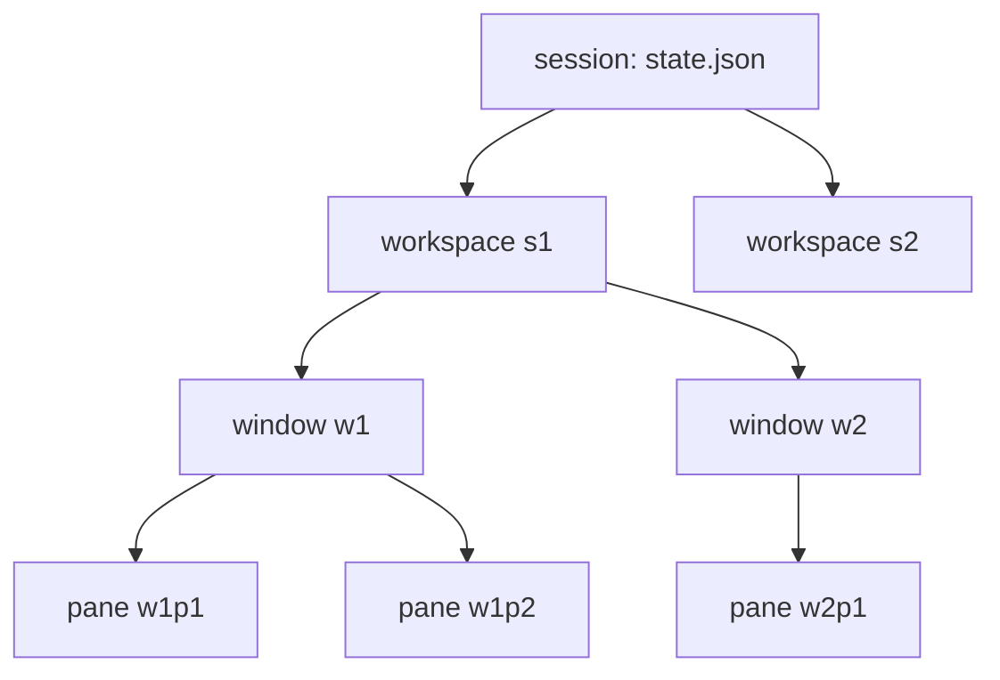
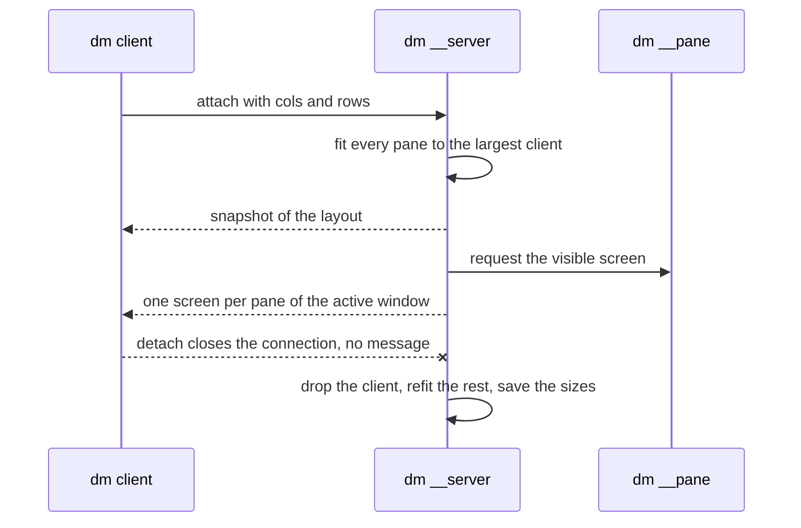

# Lifecycle and state

A session outlives the client that opened it and, after a crash, the server that
owned it. This page answers what a session, workspace, window and pane are in
the state model, what the state file holds, what attach and detach do, what each
teardown word destroys, and what to run when a session is wedged.

## The model

One session is one directory, one server and its pane daemons. The directory
holds the layout; the panes hold the content. `paths.ValidSessionName`
(`internal/paths/paths.go#ValidSessionName`) checks the name before any path is built.

Ids are `s<N>` for a workspace, `w<N>` for a window and `w<N>p<M>` for a pane,
`M` counting per window, so a pane id names its window and never its workspace
(`internal/session/state.go#State.NewWorkspaceID`). The rail is the client's left sidebar, one
row per workspace, window and pane. A fold collapses a group of rail rows to its
header, and an accent is the theme colour a rail group keeps.

- **Workspace**, `Workspace` (`internal/session/state.go#Workspace`): id, name, an
  optional project, a shared label: workspaces that carry the same label stay
  contiguous, its windows, the index of the window on screen, one fold flag.
- **Window**, `Window` (`internal/session/state.go#Window`): id, name, whether the user named it, the
  split tree in `Root` (a `layout.Node`: a split with `Kids` and `Sizes`, or one
  pane id), the focused pane, the pane counter, `Unfolded` (show its panes in the
  rail) and `Sync` (mirror every write to all its panes), and the last preset the
  `select-layout` command applied: `even-horizontal`, `even-vertical`,
  `main-horizontal`, `main-vertical` or `tiled`, empty after manual edits.
- **Pane**, `PaneState` (`internal/session/state.go#PaneState`): what a restart needs. Shell, cwd, cols,
  rows, argv, the environment a plugin adds (a plugin is a pane a `plugin` block
  in `dm/config.kdl` under `$XDG_CONFIG_HOME` or `~/.config` declares,
  `internal/keymap/config_load.go#defaultConfigPath`, `internal/keymap/config_parse.go#findPlugins`), the agent name a `set-pane-name`
  request set (`internal/server/server_rpc.go#server.handleReq`), the app name its program last reported
  (`internal/session/state.go#PaneState.App`), whether it ever reported, and a `restarted` mark. The tree
  names the pane by id; the `Panes` map holds its record.

A pane's screen, the cell grid its terminal is showing, and its scrollback, the
ring of recent output bytes it holds, are not in the state: they live in the pane
process, so a restart reloads a layout, never a screen.

## The state file

`state.json` sits in the session directory (`internal/paths/paths.go#StatePathAt`) and
holds `State` (`internal/session/state.go#State`), in six groups:

| Group | Fields |
|---|---|
| Session | name, cols, rows, active workspace, rail width and `railSet`, the flag that separates an explicit zero (a hidden rail) from a state file written before the rail existed, project folds and accents |
| Tree | workspaces, windows, each window's root, every `PaneState` |
| Counters | `nextWorkspace`, `nextWindow`, `idVersion` |
| Box | the message box, an append-only log any pane can post into, and `boxSeq`, the last sequence number it handed out |
| Ask | the questions an agent puts to the reader, oldest first, each with its tool call and, once answered, the answer, plus `askSeq`, the last ask id it handed out |
| Secrets | the registry, one record per secret: `tool`, the command that prints the value, `reference`, the address it resolves, `upstream`, the URL a request is forwarded to, `header`, the template the value is filled into. Never a value (`internal/session/secret.go#Secret`). The server runs one loopback proxy for these (`internal/server/server_secrets.go#server.secretProxyRegister`): a request on 127.0.0.1 under a secret's random path goes to that secret's `upstream` with the value in `header`, so a program uses the secret without holding it |

`Save` (`internal/session/state.go#State.Save`) writes indented JSON to a temp file in the session
directory, calls `Sync`, then renames it into place, so a reader sees the old
file or the new one, never a torn one. The session's server is the only writer,
and the flock in `server.Run` keeps it that way. Nothing takes a read lock, so
`dm ls` reads a dead session's file directly (`internal/cli/cli.go#sessionSummary`). The
server writes it at startup, before the socket exists (`internal/server/server_core.go#Run`);
through `mutation`, which most mutating actions use (`internal/server/server_mutate.go#server.mutation`); in a
request handler that saves itself rather than through `mutation`: a rail change
(`internal/server/server_view.go#server.setRail`), a fold in `toggleFold` (`internal/server/server_mutate.go#server.toggleFold`), a project
fold (`internal/server/server_mutate.go#server.toggleProjectFold`), a pane cwd (`internal/server/server_mutate.go#server.setPaneCwd`), a status
report (`internal/server/server_view.go#server.noteStatus`), a pane exit (`internal/server/server_view.go#server.paneExited`), a box post
(`internal/server/server_box.go#server.boxStoreLocked`), a box clear (`internal/server/server_box.go#server.boxClear`) and a size fit, which is
why a detach rewrites it (`internal/server/server_view.go#server.syncSizes`); and on load, when a migration
changed anything (`internal/session/state.go#LoadStateAt`). A migration is a load-time rewrite of an older
state file (`internal/session/state.go#LoadStateAt`).

To add a field, extend `State` (`internal/session/state.go#State`) or `PaneState` (`internal/session/state.go#PaneState`),
default it in `LoadStateAt` (`internal/session/state.go#LoadStateAt`), and make every mutation that
changes it save. The zero value must mean the old behaviour, as `railSet` does.

## Attach and detach

Attach registers a client and builds one snapshot, the layout and ids, not a
backlog, the output it missed (`internal/server/server_view.go#server.attach`). The client asks for history
with a `replay` request when it enters scrollback. Several clients may attach at
once and share one layout: the largest terminal sets the size, and a smaller
client's copy is clipped to its own screen (`README.md:1425`).

Detach sends nothing. The client sets `quit` (`internal/client/client_keys.go#tui.runAction`)
and closes the socket; the server's `serve` defer drops it, refits the remaining
clients and pushes a snapshot (`internal/server/server_view.go#server.serve`). The client does not
reconnect: a dead connection ends it (`internal/client/client_model.go#runSession`).

## What survives a crash

| Crash | Panes | Session directory | Recovery |
|---|---|---|---|
| the server dies or exits | keep running, sockets intact | untouched | the client exits; the next dial spawns a server that adopts each pane |
| a pane daemon dies | its shell loses the pty and exits | kept, and `state.json` is rewritten when the record goes (`internal/server/server_view.go#server.paneExited`) | the server's watch loop re-dials a lost connection (`internal/server/server_core.go#server.watcherLoop`); when that re-dial is refused or finds the socket gone, the record goes and the split collapses (`internal/server/server_core.go#server.watcherLoop`), and focus moves to a neighbour |
| the last pane exits | none left | removed by `endSession` (`internal/server/server_view.go#server.endSession`) | the session is gone |
| machine reboot | gone | intact | fresh panes spawn from the state, each marked `restarted` (`internal/server/server_core.go#server.ensurePane`) |

Adoption is the whole trick: the server dials `panes/<id>.sock` before it
considers a spawn (`internal/server/server_core.go#server.ensurePane`), so a surviving daemon keeps its screen,
its ring and the terminal colours it answers the OSC 10 and OSC 11 queries with.

## Kill, reset, purge, and the pane's own reap

| Word or actor | What it does | Panes | Session directory |
|---|---|---|---|
| `dm kill` | SIGTERM to the pid in `server.pid`, after checking `/proc` names `__server` (`internal/transport/transport.go#KillSessionAt`) | survive | kept |
| `dm reset --force` | SIGTERM, then SIGKILL the server, reap every pane group, remove the directory (`internal/transport/transport.go#ResetSessionAt`) | killed | removed |
| `dm purge` | remove a directory whose server does not answer and whose pids are dead (`internal/cli/cli.go#runPurge`) | already gone | removed |
| the pane, every 5 s | checks its own socket path (`internal/pane/pane.go#paneProc.reapOrphans`); if it is gone or names another file, kill its shell group and exit | itself | untouched |

To reap a pane is to kill its shell's process group and then the daemon. `reset`
needs `--force`, else it prints the plan, one `would reset <name>` line per
session, and refuses (`internal/cli/cli.go#runReset`). `purge` skips a session whose socket
answers, then one whose `server.pid` names a running process, then one whose
`panes/*.sock.pid` names a running process (`internal/cli/cli.go#runPurge`). `reapPanes` reads
`panes/*.sock.pid`, kills each shell group, then the daemon (`internal/transport/transport.go#reapPanes`).

## The id scheme

A fresh state starts at `s1` and `w1`, and the first window mints `w1p1`
(`internal/session/state.go#Window.NewPaneID`). Counters only move forward, so a closed id is never reused and
a script can hold one across a restart. `idVersion` marks the scheme. A state
file whose `idVersion` is below 2 is renumbered once at load: workspaces and
windows in slice order, panes in tree order, every focus and every `Panes` key
remapped (`internal/session/state.go#State.MigrateIDs`). The same load renames legacy numeric window names
after their folder, the last element of the focused pane's cwd (`internal/session/state.go#LoadStateAt`,
`internal/paths/paths.go#FolderName`), and rewrites the file once.

## When a session is wedged

1. `dm ls` shows `live` or `dead` per session, and reads a dead one's state file
   without spawning a server (`internal/cli/cli.go#runLs`).
2. Read `sessions/<name>/server.log` and `panes/<id>.log`. `EnsureAt` quotes the
   log tail in its own error (`internal/transport/transport.go#EnsureAt`).
3. `dm kill -s <name>` (`-s` names the session, on every word that takes one)
   stops a hung server and leaves the panes adoptable. The next `dm` restarts the
   server and reconnects them.
4. `dm reset -s <name> --force` when the panes are wedged too. It stops the
   server, reaps each pane group, and removes the directory.
5. `dm purge --dry-run`, then `dm purge`, to clear directories no process owns.

`dm list -s <name>` lists the panes of one session, so it needs a server and
spawns a missing one. An RPC to a live but silent server fails on a ten second
read deadline (`internal/transport/transport.go#RPCAt`).

## See also

- [Entry point](01-entry-point.md)
- [The protocol](03-protocol.md)
- [The server](04-server.md)
- [The layout](07-layout.md)
- [CLI and config](10-config.md)
