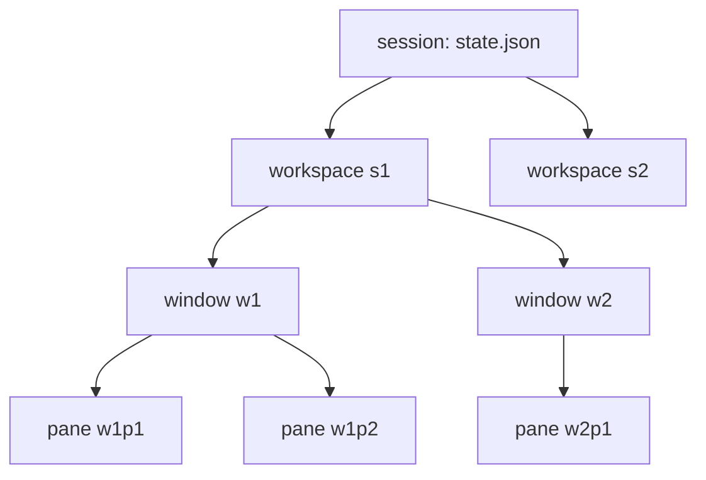
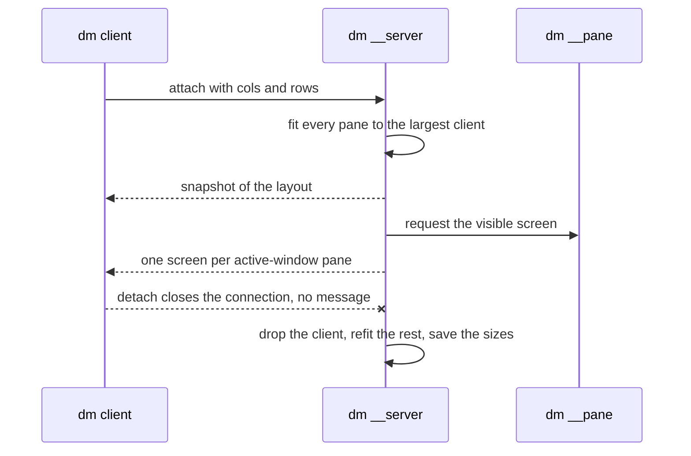

# Lifecycle and state

A session outlives the client that opened it and, after a crash, the server that
owned it. This page answers what a session, workspace, window and pane are in
the state model, what the state file holds, what attach and detach do, what each
teardown word destroys, and what to run when a session is wedged.

## The model

One session is one directory, one server and its pane daemons. The directory
holds the layout; the panes hold the content. `paths.ValidSessionName`
(`internal/paths/paths.go:36`) checks the name before any path is built.

- **Workspace**, `Workspace` (`internal/session/state.go:37`): id, name, optional
  project, its windows, the active window index, one fold flag. Workspaces that
  share a project name are contiguous.
- **Window**, `Window` (`state.go:15`): id, name, whether the user named it, the
  split tree in `Root`, the focused pane, the pane counter, the `Unfolded` and
  `Sync` flags, and the last preset layout.
- **Pane**, `PaneState` (`state.go:70`): what a restart needs. Shell, cwd, cols,
  rows, argv, plugin environment, the reported agent and app, a `restarted` mark.
  The split tree names the pane by id; this map holds its record.

The tree is `layout.Node` in [The layout](07-layout.md). A pane's screen,
scrollback and ring are not in the state: they live in the pane process, so a
restart reloads a layout, never a screen.

## The state file

`state.json` sits in the session directory (`internal/paths/paths.go:69`) and
holds `State` (`state.go:94`), in five groups:

| Group | Fields |
|---|---|
| Session | name, cols, rows, active workspace, rail width and `railSet`, project folds and accents |
| Tree | workspaces, windows, each window's root, every `PaneState` |
| Counters | `nextWorkspace`, `nextWindow`, `idVersion` |
| Box | the message log and `boxSeq` (see [Surfaces](08-surfaces.md)) |
| Secrets | the registry: tool, reference, upstream, header, never a value (`internal/session/secret.go:12`) |

`Save` (`state.go:216`) writes indented JSON to a temp file in the session
directory, calls `Sync`, then renames it into place, so a reader sees the old
file or the new one, never a torn one. The session's server is the only writer,
and the flock in `server.Run` keeps it that way. Nothing takes a read lock, so
`dm ls` reads a dead session's file directly (`internal/cli/cli.go:2021`).

The server writes it at startup, before the socket exists
(`internal/server/server_core.go:645`); through `mutation`, which most mutating
actions use (`internal/server/server_mutate.go:300`); in the handler's own save
for a rail change (`internal/server/server_view.go:71`), a fold in `toggleFold`
(`server_mutate.go:29`), a project fold (`server_mutate.go:61`), a pane cwd
(`server_mutate.go:1149`), a status report (`server_view.go:202`), a pane exit
(`server_view.go:368`), a box post (`internal/server/server_box.go:54`), a box
clear (`server_box.go:133`) and a size fit, which is why a detach rewrites it
(`server_view.go:699`); and on load, when a migration changed anything
(`state.go:318`).

To add a field, extend `State` (`state.go:94`) or `PaneState` (`state.go:70`),
default it in `LoadStateAt` (`state.go:260`), and make every mutation that
changes it save. The zero value must mean the old behaviour, as `railSet` and
`idVersion` do.

## Attach and detach

Attach registers a client and builds one picture, not a backlog
(`internal/server/server_view.go:786`). The client asks for history with a
`replay` request when it enters scrollback. Several clients may attach at once
and share one layout: the largest terminal sets the size, a smaller one clips
(`README.md:1395`).

Detach sends nothing. The client sets `quit` (`internal/client/client_keys.go:900`)
and closes the socket; the server's `serve` defer drops it, refits the remaining
clients and pushes a snapshot (`server_view.go:709`). The client does not
reconnect: a dead connection ends it (`internal/client/client_model.go:725`).

## What survives a crash

| Crash | Panes | Session directory | Recovery |
|---|---|---|---|
| the server dies or exits | keep running, sockets intact | untouched | the client exits; the next dial spawns a server that adopts each pane |
| a pane daemon dies | its shell loses the pty and exits | a refused dial drops the pane's record and collapses the split | focus moves to a neighbour |
| the last pane exits | none left | removed by `endSession` (`server_view.go:462`) | the session is gone |
| machine reboot | gone | intact | fresh panes spawn from the state, each marked `restarted` (`server_core.go:799`) |

Adoption is the whole trick: the server dials `panes/<id>.sock` before it
considers a spawn (`server_core.go:790`), so a surviving daemon keeps its screen,
ring and colours.

## Kill, reset, purge, reap

| Word | What it does | Panes | Session directory |
|---|---|---|---|
| `dm kill` | SIGTERM to the pid in `server.pid`, after checking `/proc` names `__server` (`internal/transport/transport.go:207`) | survive | kept |
| `dm reset --force` | SIGTERM, then SIGKILL the server, reap every pane group, remove the directory (`transport.go:233`) | killed | removed |
| `dm purge` | remove a directory whose server does not answer and whose pids are dead (`internal/cli/cli.go:1802`) | already gone | removed |
| reap, by the pane | the pane sees its socket gone or replaced and kills its shell group, then exits (`internal/pane/pane.go:845`) | itself | untouched |

`reset` needs `--force`, else it prints the plan and refuses (`cli.go:1778`).
`purge` skips a live server, a live server pid or any live pane pid
(`cli.go:1813`). `reapPanes` reads `panes/*.sock.pid`, kills each shell group,
then the daemon (`transport.go:271`).

## The id scheme

Ids are readable and constructible: a workspace is `s<N>`, a window `w<N>`, a
pane `w<N>p<M>` with `M` per window (`state.go:441`). A fresh state starts at
`s1` and `w1`, and the first window mints `w1p1` (`state.go:455`). Counters only
move forward, so a closed id is never reused and a script can hold one across a
restart. `idVersion` marks the scheme. A file below 2 is renumbered once at load:
workspaces and windows in slice order, panes in tree order, every focus and every
`Panes` key remapped (`state.go:462`). The same load renames legacy numeric
window names after their folder and rewrites the file once (`state.go:302`).

## When a session is wedged

1. `dm ls` shows `live` or `dead` per session, and reads a dead one's state file
   without spawning a server (`cli.go:1969`).
2. Read `sessions/<name>/server.log` and `panes/<id>.log`. `EnsureAt` quotes the
   log tail in its own error (`internal/transport/transport.go:106`).
3. `dm kill -s <name>` stops a hung server and leaves the panes adoptable. The
   next `dm` restarts the server and reconnects them.
4. `dm reset -s <name> --force` when the panes are wedged too. It stops the
   server, reaps each pane group, and removes the directory.
5. `dm purge --dry-run`, then `dm purge`, to clear directories no process owns.

`dm list -s <name>` needs a server, so it spawns a missing one. An RPC to a live
but silent server fails on a ten second read deadline (`transport.go:153`).

## See also

- [Entry point](01-entry-point.md)
- [The protocol](03-protocol.md)
- [The server](04-server.md)
- [The layout](07-layout.md)
- [CLI and config](10-config.md)
