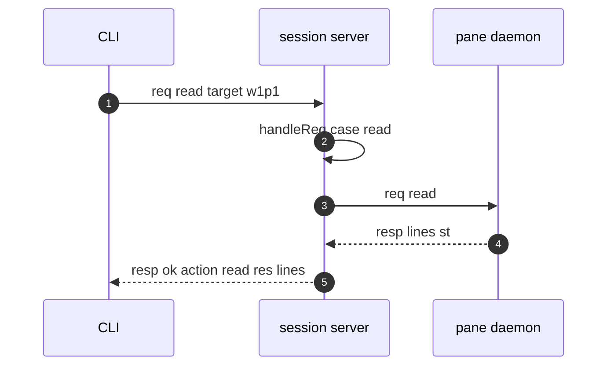
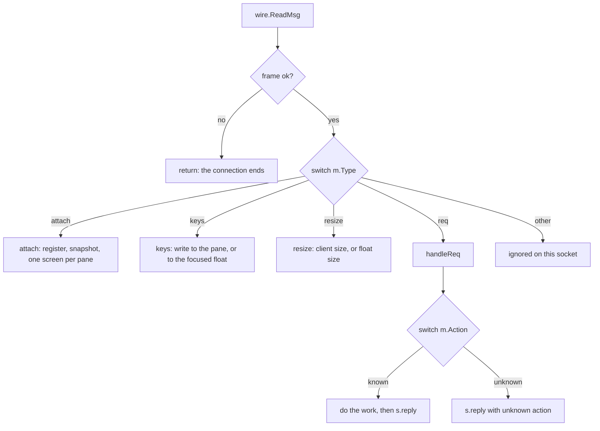

# The protocol

Every dm process talks over a unix socket and nothing else: why the call crosses it, what bytes cross, and how to add another.

## Why a message boundary

dm is five kinds of process: the server, one daemon per pane, the TUI (`internal/client`), the CLI, and a sibling
session's server. A pane outlives its server (`internal/pane/pane.go:32`), the CLI starts the server on a failed
dial (`internal/transport/transport.go:53`), and a sibling server reaches in over the socket
(`internal/server/server_secrets.go:369`). No two share a lifetime, so a call cannot be a function call; it becomes a
message.

The boundary costs three things. Serialisation: an encode, a decode, often a re-encode, while a `read` reply carries
the whole screen and a `replay` the ring, 8 MiB at most. A new failure mode: a peer can be absent, wedged, or torn
mid-frame, and a stream cannot resynchronise, so a timed-out write poisons that pane connection for good
(`internal/server/server_core.go:110`). No compile-time link: the action is a string in a `switch` on each side, so an
action typo is a runtime error and a field-name typo is dropped by `json.Unmarshal` in silence.

## The frame

One frame is a 4-byte big-endian uint32 length, then that many bytes of JSON: no newline, no other delimiter
(`internal/wire/wire.go:252`, `:270`). `wire.MaxFrame` is `16 << 20` (`:249`). `WriteMsg` refuses a bigger payload
before writing it, and `ReadMsg` refuses a zero or oversize length; a bad frame ends the connection. One writer per
connection, under a mutex (`transport.Conn.Send`, `internal/transport/transport.go:30`).

## The envelope

`wire.Msg` (`internal/wire/wire.go:17`) is the one envelope, on both sockets, in both directions. The `Type` comment
is stale: it lists eleven values, the tree sends nineteen.

| field | carries |
| --- | --- |
| `Type` | the kind: `req`, `resp`, `attach`, `keys`, `resize`, `snapshot`, `bytes`, `replay`, `scrub`, `screen`, `exit`, `status`, `cwd`, `title`, `mode`, `close`, `box`, `watch`, `msg` |
| `Action`, `ID`, `OK`, `Error`, `Res` | the call: name, tag, verdict, error text, and the action's JSON body |
| `Target`, `Dir`, `Other`, `Ratio`, `Index`, `Name`, `Window`, `Project`, `Cwd`, `Layout`, `On`, `NoFocus` | which pane, which way, which slot or label |
| `Msg`, `Keys`, `Enter`, `Argv`, `Count`, `History`, `Cols`, `Rows`, `Float` | what to type, what to run, how many, how big |
| `FG`, `BG` | the terminal colour pair the client detected |
| `Tool`, `Ref`, `Upstream`, `Header`, `Env`, `Path`, `Trust` | the secret family: fetch program, reference, proxy, mapping file, trust verdict |
| `St`, `Data`, `Lines`, `VTSnap`, `Snap`, `Exit`, `WaitReason` | what came back: a status, a ring, rows, a picture, a snapshot, a wait ending |

## The type and action matrix

The server switches on `Type`, then `Action` (`internal/server/server_view.go:732`); the pane switches on `Action`
alone (`internal/pane/pane.go:1301`). `handleReq` (`internal/server/server_rpc.go:15`) has 63 cases and 68 action
names. The last column is the typed caller: `cli` a `dm` verb, `tui` the client, `sib` a sibling server, and
`exec` no typed caller (only `dm exec`, `internal/cli/cli.go:572`).

| action | request fields | reply `res` | sender |
| --- | --- | --- | --- |
| `ping` | none | `session` | cli |
| `term-colours` | `fg`, `bg` | none | tui |
| `list`, `ls` | none | `snapshot`, `tree` | cli (`list`), exec (`ls`) |
| `read` | `target` | `lines`, `status` | cli, tui |
| `history` | `target`, `count` | `lines` | cli |
| `screen` | `target` | a `screen` frame, then `pane` | tui |
| `replay` | `target` | a `replay` frame, then `pane` | tui |
| `yank` | `target` | `lines`, `start`, `rows`, `anchor` | cli, tui |
| `status` | `target` | `st`, or every pane's status | cli |
| `write-to` | `target`, `msg`, `enter` | `pane` | cli |
| `exec` | `target`, `msg`, `enter` forced | `pane` | exec |
| `keys` | `target`, `keys` | none | exec |
| `synchronize-panes` | `on` | `sync` | tui |
| `toggle-secrets` | `target` | `pane`, `enabled` | tui |
| `split` | `target`, `dir`, `cwd`, `ratio`, `nofocus`, `argv` | `pane` | cli, tui |
| `zoom-pane` | none | `zoom` | tui |
| `reload` | none | `pad` | tui |
| `set-rail` | `index` | `rail` | tui |
| `swap-panes` | `target`, `other` or `dir` | none | tui |
| `move-pane` | `target`, `other`, `dir` | `pane` | exec |
| `resize-split` | `target`, `other`, `ratio` | none | tui |
| `select-layout` | `layout` | `layout` | tui |
| `focus`, `focus-dir`, `focus-window`, `focus-workspace` | `target`, or `dir` | none | cli, tui |
| `next-pane`, `prev-pane`, `next-window`, `prev-window` | none | none | cli, tui |
| `close-pane`, `close-window`, `close-workspace` | `target` | none | tui |
| `move-window`, `move-workspace` | `target`, `dir` | none | tui |
| `new-window` | `name`, `cwd`, `nofocus`, `argv` | `window`, `pane` | cli, tui |
| `select-window` | `index` | none | tui |
| `new-workspace` | `name`, `window`, `cwd`, `project`, `nofocus`, `argv` | `workspace`, `window`, `pane` | tui |
| `next-workspace`, `prev-workspace`, `list-workspaces`, `list-panes` | none | none, a bare array, or `panes` | tui, exec |
| `pane` | `target` | ids, names, `cwd` | exec |
| `set-pane-name` | `target`, `name` | `pane`, `name` | tui |
| `rename-window` | `target`, `name` | none | tui |
| `rename-workspace` | `target`, `name` | `workspace`, `name` | cli, tui |
| `set-project` | `target`, `name` | `workspace`, `project` | cli, tui |
| `toggle-fold` | `target` | `target`, `unfolded` | tui |
| `run-plugin` | `target`, `res{name,where,source}` | `pane` | cli, tui |
| `plugin-list` | none | `plugins` | cli |
| `float-open` | `float`, `target`, `cols`, `rows`, `res{command,label}` | `command`, `label` | tui |
| `float-close` | `float` | none | tui |
| `msg-post`, `msg-list`, `msg-clear`, `msg-wait`, `msg-sub`, `msg-watchers`, `msg-schema` | `res` | `entry`, `entries`, `trimmed`, `cleared`, `watchers`, `schema`, or a stream | cli, tui |
| `secret-register`, `secret-list`, `secret-revoke`, `secret-use`, `secret-hydrate`, `secret-type` | each action's own fields, `name` for most | `name`, `endpoint`, `path`, `pane`, `warning`, `uncovered` | cli |
| `secret-sync` | `path`, `trust` | `mapping`, `registered`, `kept`, `files`, `warning`, `uncovered` | cli |
| `secret-cover` | `res{session, valuesB64, values}` | `panes`, `dropped` | sib |
| anything else | | error `unknown action %q` (`internal/server/server_rpc.go:702`) | |

## The pane's own actions

The pane takes 16 actions on its own socket, and the server keeps two channels to it. Most actions ride a one-shot
dial: `paneRequest` (`internal/server/server_view.go:960`) dials `panes/<id>.sock` with a one second timeout, sends one
request, and reads its reply under a two second deadline (`:962`, `:971`); `paneScreenRequest` (`:832`) and
`readPaneReplay` (`:922`) do the same for a picture or a ring. The five push actions ride the persistent connection
`adoptPane` builds (`internal/server/server_core.go:841`), written with `paneConn.send` (`:110`): `write`, `resize`,
`kill`, `set-secrets` and `term-colours`. `dm wait` dials the pane itself (`internal/cli/cli.go:2199`).

| action | request fields | reply |
| --- | --- | --- |
| `write`, `resize` | `msg` or `keys` and `enter`, or `cols` and `rows` | none |
| `read` | none | `resp` with `lines`, `st`, `res{title,dead}` |
| `status`, `cwd` | none | `resp` with `st`, or with `cwd` |
| `screen`, `reflow` | none, or `cols` and `rows` | one `screen` frame: `vtsnap`, `res{alt,mouse,paste}` |
| `yank` | none | `resp` with `res{lines,start,rows,anchor}` |
| `replay` | none | one `replay` frame: `data`, `st`, `res{title,dead,alt,mouse,paste}` |
| `ping`, `term-colours` | `fg`, `bg`, or none | `resp` OK |
| `set-history` | `history` | `resp` OK, or an error outside the pane's range |
| `set-secrets`, `toggle-secrets` | `res{valuesB64,values}`, or none | `resp` OK, or `res{enabled}` |
| `wait` | none | `resp` with the tail, then `resp` with `exit` and `waitReason` |
| `kill` | none | `resp` OK, then the daemon exits |

## How a call is sent

1. `EnsureAt` (`internal/transport/transport.go:53`) dials `sessions/<name>/server.sock`, or spawns the server;
   `RPCAt` (`:142`) sets `Type: "req"`, `ID: 1` and a 10 s read deadline.
2. `server.serve` (`internal/server/server_view.go:706`) takes `case "req"`, `handleReq` works, and `s.reply`
   (`:983`) queues `{type, action, id, ok, error, res}` through `client.deliver`
   (`internal/server/server_core.go:208`); one writer goroutine sends it. `RPCAt` reads until `Type == "resp"`.

**Two flows.** `dm read w1p1`: `Run` (`internal/cli/cli.go:426`) takes `case "read"` (`:593`) and calls
`transport.RPC` (`:608`); `handleReq` calls `s.paneLines` (`internal/server/server_mutate.go:91`), which calls
`paneRequest`; `paneProc.serve` (`internal/pane/pane.go:1356`) replies with `lines` and `st`; `s.reply` returns them
in `res`.

`dm split w1p1 --dir right`: `Run` (`:682`) sends `dir`, `handleReq` (`internal/server/server_rpc.go:300`) calls
`s.split` (`internal/server/server_mutate.go:867`) inside `s.mutation`, and `s.ensurePane`
(`internal/server/server_core.go:774`) spawns the daemon. `s.afterMutation` (`:312`) resyncs, which pushes one
`snapshot`, one `screen` and one `replay` per pane (`:319`). `s.reply` returns `pane: w1p2`.

**Errors.** An error is a reply with `ok` false and `error` set, and `printRPC` (`internal/cli/cli.go:1103`) turns it
into a Go error. A pane answers nothing to an unknown action, so `paneRequest` returns a deadline error.

## What the protocol does not do

- No version or handshake. `wire.Msg` carries no version and no capability list, and `json.Unmarshal` drops a field
  the reader does not know (`internal/wire/wire.go:284`). On the pane socket a dialled conn is a subscriber at once, so
  a peer that sends nothing is a reader (`internal/pane/pane.go:1281`). On the server socket a conn joins the
  broadcast only after `attach` (`internal/server/server_view.go:737`), and `broadcastLocked` writes to `s.clients`
  alone (`internal/server/server_core.go:1156`).
- No resynchronisation or authentication. A bad frame ends the connection, and the socket is a local file with mode
  0600 (`internal/pane/pane.go:689`).

## Add an action

1. Add a `case` to `handleReq` (`internal/server/server_rpc.go:15`) ending in `s.reply`, and wrap a layout change in
   `s.mutation` and `s.afterMutation`; a spawn must not run under the lock. A new `wire.Msg` field is additive and
   `omitempty` (`internal/wire/wire.go:17`).
2. If a pane must act, add the `case` to `paneProc.serve` (`internal/pane/pane.go:1277`), call it through
   `paneRequest`, and keep the reply a `resp` frame.
3. Add the verb as a `case` in `Run` (`internal/cli/cli.go:426`) and a row to `cliCommands`
   (`internal/clidoc/clidoc.go:68`), then add the name to `manActionNames` (`internal/clidoc/man.go:64`) and
   `actionExamples` (`internal/clidoc/actions.go:16`).
4. Refresh `docs/` with `dm man -o docs/dm.1`, `dm llms -o docs/llms.txt` and `dm html -o docs/dm.html`, and add a
   test to `internal/server/rpc_actions_test.go`; `TestUnknownActionFails` pins the default arm.

## Compatibility

A pane daemon outlives the server, so old and new binaries talk during every upgrade. Keep these shapes.

- The frame, the envelope keys `type`, `action`, `id`, `ok`, `error` and `res`, and the `resp` shape, with new fields
  additive and `omitempty`. `Lines` stays in the envelope on the `read` reply, pinned by
  `TestReadReplyStaysBackwardCompatible` (`internal/wire/wire_test.go:14`).
- `set-secrets` and `secret-cover` accept a plain `values` list beside `valuesB64` (`internal/pane/scrub.go:375`).
- Action names are the `dm exec` surface too, so renaming one breaks a script.

## See also

- [The server](04-server.md)
- [One pane, one process](05-pane.md)
- [The client](06-client.md)

Print the field list from the code with `go doc dm/internal/wire Msg`.
