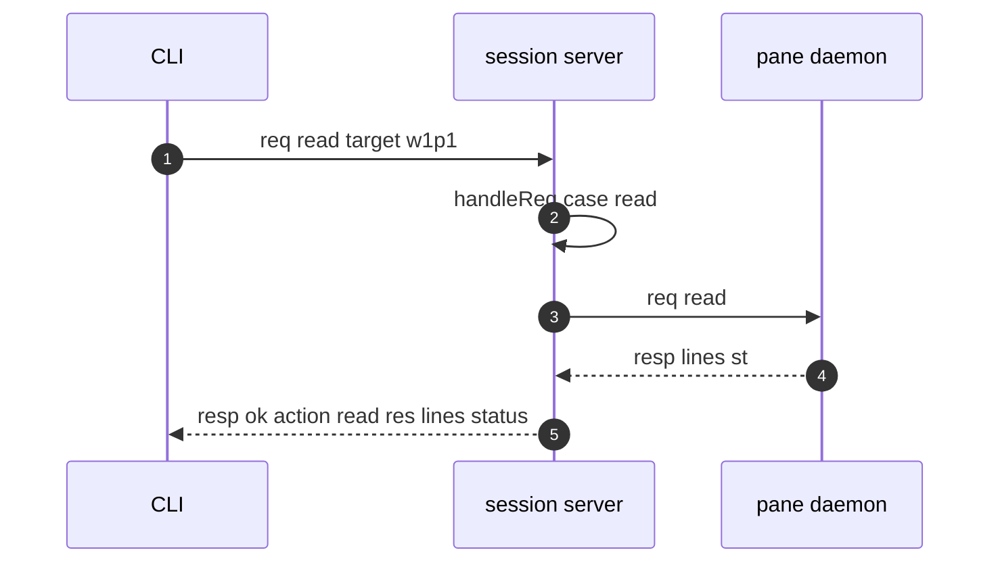
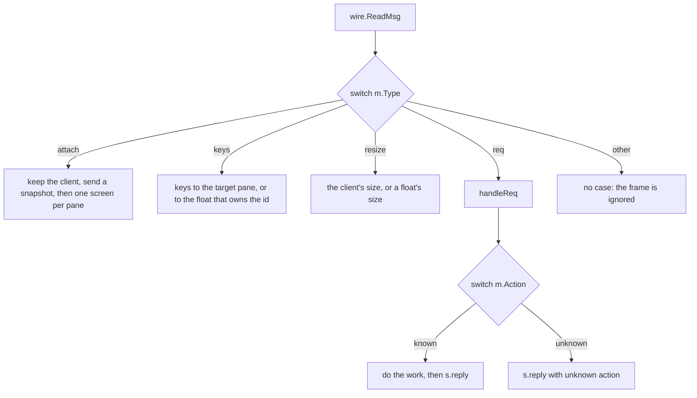

# The protocol

Every dm process reaches another over a unix socket. Read this page to see what crosses that socket, and to add an action to it.

## The terms

| term | meaning |
| --- | --- |
| session | one server and the panes it owns, under `sessions/<name>/`. |
| server | the process that owns a session's layout, its `state.json` file and its client connections. |
| sibling | another session under the same state directory. |
| pane | one process running a program in a rectangle of the layout. |
| pane id | `w` + the window number + `p` + the pane number, as in `w1p2`. |
| workspace | a named group of windows. |
| window | one tab of panes. |
| sidebar | the column that lists the workspaces, the windows and the panes. |
| message log | the session's append-only log, which any pane posts into and any caller waits on. |
| reader position | one reader's place in the message log: its pane, its key, its cursor and whether it waits. |
| floating pane | a command pane one client owns outside the layout. |
| scrollback buffer | a pane's raw output bytes, kept for replay. |
| VT screen | a pane's emulated terminal: its visible text and its modes. |
| snapshot | the session's layout and pane facts, plus the questions the store lists. |
| tree | the layout tree of the active window. |
| status | `{state, message, app}`, a status word, a note and the reporting program. |

The state directory is `$DM_STATE`, else `$XDG_STATE_HOME/dm`, else `~/.local/state/dm` (`internal/paths/paths.go#StateDir`). The pane id shape comes from `internal/session/state.go#State`.

## One message boundary

dm runs these processes: a session server, one daemon per pane, the TUI
(`internal/client`), the CLI, and a sibling session's server.

They share no address space, so a call cannot be a function call. It becomes a message.

Three properties need the boundary. A pane outlives its server (`internal/pane/pane.go#paneProc`). The CLI starts the server when a dial fails (`internal/transport/transport.go#EnsureAt`). A sibling server reaches in over the socket (`internal/server/server_secrets.go#server.coverSession`).

The boundary costs three things.

Serialisation costs an encode, a decode and often a re-encode. A `read` reply carries a whole screen, and a `replay` reply carries a whole scrollback buffer. The buffer holds at most 8 MiB (`ringMax`, `internal/pane/pane.go#ringMax`), so both replies fit under the 16 MiB frame limit.

A peer can be absent, wedged or torn mid-frame. A stream cannot resynchronise, so a timed-out write poisons that pane connection for good (`internal/server/server_core.go#paneConn.send`).

The action is a string in a `switch` on each side, so there is no compile-time link. An action typo is a runtime error. A field-name typo disappears in silence, because `json.Unmarshal` drops a field it does not know.

## The frame

One frame is a 4-byte big-endian uint32 length, then that many bytes of JSON. It carries no newline and no other delimiter (`internal/wire/wire.go#WriteMsg`, `internal/wire/wire.go#ReadMsg`).

`wire.MaxFrame` is `16 << 20` (`internal/wire/wire.go#MaxFrame`). `WriteMsg` refuses a bigger payload before it writes one. `ReadMsg` refuses a zero length or an oversize one. Either refusal ends the connection.

One writer writes per connection, under a mutex (`transport.Conn.Send`, `internal/transport/transport.go#Conn.Send`).

## The envelope

`wire.Msg` (`internal/wire/wire.go#Msg`) is the one envelope. Both sockets use it, in both directions, and `Type` names the frame kind.

The socket carries twenty one types.

| type | sender | carries |
| --- | --- | --- |
| `req` | client, server | one action, named in `action`. |
| `resp` | server, pane | `ok`, `error` and `res`: the verdict, the text and the body. |
| `attach` | client | the first frame of a client connection. |
| `keys` | client | key bytes, in `keys`. |
| `resize` | client, server | a size, in `cols` and `rows`. |
| `snapshot` | server | the layout and pane facts, in `snap`. |
| `screen` | pane, server | the VT screen, in `vtsnap`. |
| `replay` | pane, server | the scrollback buffer in `data`, and a status in `st`. |
| `bytes` | pane | pty output, in `data`. |
| `status` | pane | the pane status, in `st`. |
| `session` | pane | `res{sessionFile,sessionID}`: the pane's OSC 7502 session, empty when cleared. |
| `cwd` | pane | the working directory, in `cwd`. |
| `title` | pane | `res{title}`: the pane's OSC title. |
| `mode` | pane | `res{alt,mouse,paste}`: the modes the program asked for. |
| `exit` | pane | the pane exited. |
| `scrub` | pane | the repainted screen, in `vtsnap`. |
| `box` | server | the message log changed. |
| `watch` | server | a reader position changed. |
| `msg` | server | `res{entry,trimmed}`: one message log entry. |
| `close` | server | the session ended. |
| `sizer` | server | `sizing`: whether this client sizes the layout panes. |

The envelope has forty five fields.

| field | carries |
| --- | --- |
| `Type` (`type`) | the frame kind, from the table above. |
| `Action` (`action`) | the action name on a `req`. |
| `ID` (`id`) | the request tag, echoed on the reply. |
| `OK` (`ok`) | the verdict on a `resp`. |
| `Error` (`error`) | the error text on a failed reply. |
| `Res` (`res`) | the action's JSON body, request or reply. |
| `Target` (`target`) | the pane id the action names. |
| `Other` (`other`) | the second pane of a two-pane action. |
| `Dir` (`dir`) | the direction: `left`, `right`, `up` or `down`. |
| `Index` (`index`) | a slot number, or the sidebar width on `set-rail`. |
| `Name` (`name`) | a pane, window, workspace, project or secret name. |
| `Window` (`window`) | the new window's name on `new-workspace`. |
| `Project` (`project`) | the project name on `new-workspace`. |
| `Cwd` (`cwd`) | a directory. |
| `Layout` (`layout`) | a preset name on `select-layout`, or a layout document on `layout`. |
| `On` (`on`) | the switch on `synchronize-panes`; nil toggles. |
| `NoFocus` (`nofocus`) | suppress the focus move. |
| `Ratio` (`ratio`) | the split ratio on `split` and `resize-split`. |
| `Argv` (`argv`) | the program a new pane runs, program first, instead of a shell. |
| `Msg` (`msg`) | the text to type. |
| `Keys` (`keys`) | the key bytes. |
| `Enter` (`enter`) | the line end on `write-to` and `exec`. |
| `Paste` (`paste`) | true when `msg` is a pasted block, which never submits. |
| `Count` (`count`) | how many rows above the screen on `history`. |
| `History` (`history`) | the scrollback budget in bytes on `set-history`. |
| `Cols`, `Rows` (`cols`, `rows`) | the size. |
| `Float` (`float`) | the client-chosen id of a floating pane. |
| `FG`, `BG` (`fg`, `bg`) | the terminal colour pair the client detected. |
| `Tool` (`tool`) | the fetch program on `secret-register`. |
| `Ref` (`ref`) | the reference the tool resolves. |
| `Upstream` (`upstream`) | the proxy upstream URL the value is spent on. |
| `Header` (`header`) | the proxy header template, with `{}` at the value slot. |
| `Env` (`env`) | extra `KEY=VALUE` entries the fetch tool needs. |
| `Path` (`path`) | the file `secret-hydrate` writes, or the mapping file `secret-sync` applies. |
| `Trust` (`trust`) | the `secret-sync` verdict: the mapping may register secrets and read files anywhere. |
| `St` (`st`) | a pane status. |
| `Data` (`data`) | the scrollback buffer bytes. |
| `Lines` (`lines`) | text rows. |
| `VTSnap` (`vtsnap`) | the VT screen. |
| `Snap` (`snap`) | the session snapshot. |
| `Exit` (`exit`) | the pane's exit code. |
| `WaitReason` (`waitReason`) | how a `wait` ended: `mark`, `children` or `dead`. |
| `Sizing` (`sizing`) | whether this client sizes the layout panes. |

## The action matrix

`handleReq` (`internal/server/server_rpc.go#server.handleReq`) switches on `Action` and has 72 cases over 77 names. The pane switches on `Action` alone (`internal/pane/pane.go#paneProc.serve`). The server switches on `Type` first (`internal/server/server_view.go#server.serve`).

Every action ends in a `resp` frame, except `msg-sub`, which streams.

The `res` column names the keys of the reply's `res` object. `none` means an empty `res`. The request and reply columns use the JSON keys from the envelope table, as in `target`, `msg`, `res` and `waitReason`. `res{name,where}` means a `res` object with those keys. The server's `read` reply puts rows in `res.lines` and the pane's in `Lines`.

The sender column names the caller. `cli` is a `dm` verb and `tui` is the client. `web` is the phone page's action endpoint, `/api/action`, which sends the request the way the CLI does. `sib` is a sibling server. `exec` is no typed verb, only `dm exec '<json>'` (`internal/cli/cli.go#Run`).

| action | request fields | reply `res` | sender |
| --- | --- | --- | --- |
| `ping` | none | `session` | cli |
| `list`, `ls` | none | `snapshot`, `tree` | cli (`list`), exec (`ls`) |
| `read` | `target` | `lines`, `status` | cli, tui |
| `history` | `target`, `count` | `lines` | cli |
| `screen` | `target` | a `screen` frame, then `pane` | tui |
| `replay` | `target` | a `replay` frame, then `pane` | tui |
| `yank` | `target` | `lines`, `start`, `rows`, `anchor` (a command start was recorded) | cli, tui |
| `status` | `target` | a status, or a map from pane id to status | cli |
| `write-to`, `exec` | `target`, `msg`, `enter` (`exec` forces it) | `pane` | cli, exec |
| `synchronize-panes` | `on` | `sync` (the synchronize-panes flag) | tui |
| `toggle-secrets` | `target` | `pane`, `enabled` | tui |
| `split` | `target`, `dir`, `cwd`, `ratio`, `nofocus`, `argv` | `pane` | cli, tui |
| `zoom-pane` | none | `zoom` (the zoomed pane id, empty for none) | tui |
| `reload` | none | `pad` (the pane padding in cells) | tui |
| `restart` | none | `session`. The reply leaves first, then the server removes its socket and exits, and every client is told to reconnect (`wire.CloseRestart`) | cli, tui |
| `set-rail` | `index` | `rail` (the sidebar width in cells) | tui |
| `move-pane` | `target`, `other`, `dir` | `pane` | exec |
| `select-layout` | `layout` | `layout` | tui |
| `layout` | none | `layout` (a layout document) | cli |
| `web-info` | none | `auto`, `url`, `addr`, `error` (the web listener the daemon holds right now) | cli, tui |
| `focus` | `target` | none | cli, tui |
| `focus-dir` | `dir` | none | tui |
| `focus-window` | `target` | none | tui |
| `focus-workspace` | `target` | none | tui |
| `next-pane`, `prev-pane` | none | none | cli, tui |
| `next-window`, `prev-window` | none | none | cli, tui |
| `next-workspace`, `prev-workspace` | none | none | tui |
| `select-window` | `index` | none | tui |
| `close-pane` | `target` | none | tui |
| `close-window` | `target` | none | tui |
| `close-workspace` | `target` | none | tui |
| `move-window`, `move-workspace` | `target`, `dir` | none | tui |
| `rename-window` | `target`, `name` | none | tui |
| `swap-panes` | `target`, `other` or `dir` | none | tui |
| `resize-split` | `target`, `other`, `ratio` | none | tui |
| `keys` | `target`, `keys` | none | exec |
| `term-colours` | `fg`, `bg` | none | tui |
| `new-window` | `name`, `cwd`, `nofocus`, `argv` | `window`, `pane` | cli, tui |
| `new-workspace` | `name`, `window`, `cwd`, `project`, `nofocus`, `argv` | `workspace`, `window`, `pane` | tui |
| `list-workspaces` | none | an array of `{id, name, project, active, windows}` | exec |
| `list-panes` | none | `panes` (an array of `{id, name, app, status, message, workspace, workspaceName, window}`) | exec |
| `pane` | `target` | `id`, `workspace`, `window`, `workspaceName`, `windowName`, `name`, `cwd` | exec |
| `set-pane-name` | `target`, `name` | `pane`, `name` | tui |
| `rename-workspace` | `target`, `name` | `workspace`, `name` | cli, tui |
| `set-project` | `target`, `name` | `workspace`, `project` | cli, tui |
| `toggle-fold` | `target` | `target`, `unfolded` | tui |
| `run-plugin` | `target`, `res{name,where,source}` | `pane` | cli, tui |
| `plugin-list` | none | `plugins` (a `{name, exec, cwd, where, env}` array) | cli |
| `float-open` | `float`, `target`, `cols`, `rows`, `res{command,label}` | `command`, `label` | tui |
| `float-close` | `float` | none | tui |
| `shelve-pane` | `target` | `pane` | cli, tui |
| `pop-pane` | `target` | `pane` | cli, tui |
| `msg-post`, `msg-clear` | `res` | `entry`, or `cleared` | cli, tui |
| `msg-list` | `res` | `entries`, `trimmed` | cli, tui |
| `msg-wait` | `res` | `entry`, `trimmed` | cli, tui |
| `msg-sub` | `res` | a stream of `msg` frames, no reply | cli, tui |
| `msg-watchers`, `msg-schema` | `res` | `watchers`, or `schema` | cli, tui |
| `secret-register`, `secret-revoke` | `name` | `name` | cli |
| `secret-list` | none | `secrets` | cli |
| `secret-use` | `name` | `name`, `endpoint`, `warning`, `uncovered` | cli |
| `secret-hydrate` | `name`, `path` | `path`, `warning`, `uncovered` | cli |
| `secret-type` | `name`, `target` | `pane`, `warning` | cli |
| `secret-cover` | `res{session, valuesB64, values}` | `panes` (a count), `dropped` | sib |
| `secret-sync` | `path`, `trust` | `mapping`, `registered`, `kept`, `files`, `warning`, `uncovered` | cli |
| `ask-open` | `target`, `res{toolCallId,questions}` | `id` | cli |
| `ask-await` | `target`, `res{timeoutMs}` | `pending`, or `answer` | cli |
| `ask-answer` | `target`, `res{items,globalNote,cancel}` | the answer (`at`, `items`, `globalNote`, `cancel`) | cli, tui, web |
| `ask-close` | `target` | `closed` (whether this close removed one) | cli |
| `ask-list` | none | `asks` (an array of ask requests, answers included) | cli |
| anything else | none | error `unknown action %q` (`internal/server/server_rpc.go#server.handleReq`) | |

## Layout actions

`swap-panes` trades two pane ids in place. Every rectangle keeps its shape, and the focused pane keeps its id and its focus. The server refuses a swap naming a pane that is not a leaf. A request may name `dir` with no `other`, and then the focused pane swaps with the neighbour `focus-dir` would reach.

`move-pane` moves a leaf to the edge of another: `target` moves, `other` is where it lands, and `dir` is the side. The moved pane takes the focus. A split left with one child collapses. Both ids must be leaves of the same window. The server refuses a target outside that window.

`select-layout` rebuilds the active window's panes as one of five presets, over the pane ids in tree order. The rebuild preserves the pane set, so the focus survives. A `layout` of `next` cycles the presets forward from the stored name and wraps. The window stores the preset name, and a manual tree change clears it. The server refuses a window with fewer than two panes, and the error names the count.

`synchronize-panes` sets the active window's sync flag. A request with no `on` toggles it, and the reply carries the new value as `sync`. The flag lives in the window state, so a restart keeps it. With sync on, a `write-to`, `exec`, `keys` or paste frame reaches every live pane of the window, in tree order. That includes the target pane, which receives its own keys back.

`toggle-fold` takes a window id as `target` and replies the new `unfolded` state. `history` takes `target` and a positive `count`. It replies up to that many text rows above the live screen, oldest first, with trailing blanks trimmed.

A shelved pane sits in no window's tree and has no rectangle. `shelve-pane` takes `target`, the focused pane when the field is empty, and refuses the last pane of a window. A shelved pane keeps its id, its process, its scrollback and its status. A detach and a server restart leave it running. `pop-pane` takes `target`, the active shelved pane when the field is empty, and splits the focused pane to its right with it. A `focus` naming a shelved pane moves the active shelved pane and leaves the window focus alone. A `resize` naming one sizes its PTY, which fits it to the rectangle the client draws.

A window never holds zero panes. `close-pane` refuses the last tree pane while the shelf holds a member. A pane that exits as the last pane of its window promotes the active shelved pane into that window instead.

A plugin is a program the config declares with a name, `exec`, `cwd`, `where` and `env`. `run-plugin` opens it in a pane. `where` is `split` or `window`, and `source` is `cli` or `key`, whoever launched it.

## Question actions

The five `ask-*` actions share one store, and the store is session state. A client that attaches mid-question sees the open ones. `NewAskID` (`internal/session/state.go#State.NewAskID`) hands out `a1`, `a2` and so on, and never reuses an id.

A question set holds one to many questions: a header, the question text, a multi-select flag, and options with a label, a description and a preview.

The store is bounded. One session lists at most 64 asks (`MaxListed`, `internal/ask/ask.go#MaxListed`). Those asks carry at most 256 KiB of question, header, option, description and preview text (`MaxListedBytes`, `internal/ask/ask.go#MaxListedBytes`). One ask holds at most 64 questions of 64 options (`MaxQuestions`, `MaxOptions`).

The store refuses an `ask-open` past either cap with `E_FULL`, so a refused open leaves it untouched. It refuses a second open for a tool call an ask already covers with `E_EXISTS`. It refuses an `ask-open` on a pane outside the tree with `invalid_payload`.

An `ask-open` gives the pane the focus as well as the question. The client paints a question only on the focused pane of the active window. A question on any other pane would arrive unseen. `askOpen` (`internal/server/server_ask.go#server.askOpen`) stores the question, then calls `askFocus` (`internal/server/server_ask.go#server.askFocus`). `askFocus` activates the pane's workspace and its window, then sets the window focus. The focus is session state, so every client sees it and a detach keeps it.

A reader who already has an open ask on screen keeps the focus. The question panel in front of them carries picks they typed. Taking the focus would throw those picks away. A second question therefore waits in the store (`openAskOnLocked`, `internal/server/server_ask.go#server.openAskOnLocked`). A focus that moves drops the zoom. The zoom is one view of one focus, so that open resyncs instead of pushing a snapshot.

`ask-await` parks for at most 25 seconds (`DefaultAwait`, `internal/ask/ask.go#DefaultAwait`) and then replies `pending`.

An answer is not part of a snapshot. A client that attaches between the answer and the close draws the question as open. `ask-list` carries the answers. A closed or dead pane takes its questions with it, answered or not. The store drops an answered question after `SettleGrace`, ten minutes (`internal/ask/ask.go#SettleGrace`).

## Message log actions

The seven `msg-*` actions read and write one append-only log. One entry is a `box.Entry` (`internal/box/box.go#Entry`), and every field always travels.

| field | carries | cap |
| --- | --- | --- |
| `seq` | the entry number: it starts at 1, only grows and never repeats. | |
| `at` | the post time, truncated to the second, in UTC. | |
| `from` | the posting pane's id, empty when the poster is no pane of the session. | |
| `key` | the topic: a flat string, which a publisher branches with `msg/` and `reply/`. | 128 bytes |
| `state` | one of `note`, `working`, `blocked`, `done` or `error`. | |
| `msg` | the one-line text. | 2000 bytes |
| `body` | the long text under the message line. | 16 KiB |

`key` and `msg` must be valid UTF-8 with no control characters. `body` follows the same rule with one exception: it may carry newlines. `clear` is a pane status, not a log state, and `msg-post` rejects it.

A read names an exact topic with `key` or a branch with `keyPrefix`, never both. `timeoutMs` runs from 1 to 3600000. `limit` clamps to the log, and zero or less means the whole log. `afterSeq` takes 0 or more, and leaving it out differs from 0. An unknown field, an unknown action, an unknown state or a `from` outside the tree fails the request.

Without `afterSeq` a wait reads the newest entry under its topic. With `afterSeq` a wait reads the oldest entry past that cursor.

The log keeps at most 1000 entries and 256 KiB (`box.MaxEntries`, `internal/box/box.go#MaxEntries`, and `box.MaxBytes`, `internal/box/box.go#MaxBytes`). Past either bound the oldest entries go. The log lives in `state.json`, so a restart keeps every entry, its order and its `seq`.

`trimmed` on a list or a wait reply says the cursor sat behind the oldest entry the log still keeps. `msg-sub` holds one connection open and sends one `msg` frame per matching entry. It sends no completion reply, and a frame that cannot enter the client's queue ends the connection.

Every read from a pane and every wait from a pane leaves a reader position: the pane, its filter and the highest `seq` it served. `msg-watchers` replies one row per reader position, with `pane`, `key`, `keyPrefix`, `cursor`, `parked` and `at` (`internal/box/box.go#Watch`). The registry lives in server memory, so a restart begins empty. An idle reader position expires after ten minutes, and a waiting one never expires. [Surfaces](08-surfaces.md) owns what the log delivers and when.

## Pane actions

The pane takes 17 actions on its own socket. The server keeps two channels to it.

Most actions ride a one-shot dial. `paneRequest` (`internal/server/server_view.go#paneRequest`) dials `sessions/<name>/panes/<id>.sock` with a one second timeout and sends one request. It reads the reply under a two second deadline. `paneScreenRequest` (`internal/server/server_view.go#paneScreenRequest`) and `readPaneReplay` (`internal/server/server_view.go#readPaneReplay`) do the same for a screen or a scrollback buffer.

Five push actions ride the persistent connection `adoptPane` builds (`internal/server/server_core.go#server.adoptPane`), written with `paneConn.send` (`internal/server/server_core.go#paneConn.send`): `write`, `resize`, `kill`, `set-secrets` and `term-colours`.

The server writes a push and never reads it. One watcher goroutine per pane (`watcherLoop`, `internal/server/server_core.go#server.watcherLoop`) reads the connection. Its `Type` switch has no `resp` case, so it drops a `resp` the pane sends (`internal/server/server_core.go#server.watchConn`). `dm wait` dials the pane itself (`internal/cli/cli.go#runWaitAt`).

`screen-sub` makes one connection a screen subscriber. The pane sends a `screen` frame at once, then one `screen` frame per output burst, and never a `bytes` frame (`internal/pane/pane.go#subConn.pics`). The phone page's thumbnail stream uses it (`internal/webui/thumbs.go#Handler.shots`).

In a pane reply, `lines` and `st` are envelope fields on `read` and `status`. `yank` and `wait` put their rows in `res`. A `screen` frame carries the VT screen as `VTSnap` (`vtsnap`). A `replay` frame carries the scrollback buffer as `Data` and the status as `St`. `alt`, `mouse` and `paste` mean the program wants the alternate screen, mouse reporting and bracketed paste.

| action | request fields | reply |
| --- | --- | --- |
| `write`, `resize` | `msg` or `keys` and `enter`, or `cols` and `rows` | none |
| `read` | none | `resp` with `lines`, `st`, `res{title,dead}` |
| `status`, `cwd` | none | `resp` with `st`, or with `cwd` |
| `screen`, `reflow` | none, or `cols` and `rows` | one `screen` frame: `vtsnap`, `res{alt,mouse,paste}` |
| `screen-sub` | none | one `screen` frame, then a `resp`, then one `screen` frame per output burst |
| `yank` | none | `resp` with `res{lines,start,rows,anchor}`, `anchor` true when a command start was recorded |
| `replay` | none | one `replay` frame: `data`, `st`, `res{title,dead,alt,mouse,paste}` |
| `ping`, `term-colours` | `fg`, `bg`, or none | `resp` OK |
| `set-history` | `history` | `resp` OK, or an error outside 64 KiB..8 MiB |
| `set-secrets`, `toggle-secrets` | `res{valuesB64,values}`, or none | `resp` OK, or `res{enabled}` |
| `wait` | none | `resp` with the tail (`res{lines,start,rows,anchor}`, the output so far), then `resp` with `exit` and `waitReason` |
| `kill` | none | `resp` OK, then the daemon exits |

## Sending a call

`EnsureAt` (`internal/transport/transport.go#EnsureAt`) dials `sessions/<name>/server.sock`, or spawns the server. `RPCAt` (`internal/transport/transport.go#RPCAt`) sets `Type: "req"`, `ID: 1` and a 10 s read deadline.

`server.serve` (`internal/server/server_view.go#server.serve`) takes `case "req"`. `handleReq` does the work, and `s.reply` (`internal/server/server_view.go#server.reply`) queues the reply through `client.deliver` (`internal/server/server_core.go#client.deliver`). `RPCAt` reads until `Type == "resp"`.

**The split flow.** `dm split w1p1 --dir right`: `Run` (`internal/cli/cli.go#Run`) sends `dir`. `handleReq` (`internal/server/server_rpc.go#server.handleReq`) calls `s.split` (`internal/server/server_mutate.go#server.split`), which releases the layout lock. Then `s.ensurePane` (`internal/server/server_core.go#server.ensurePane`) spawns the daemon, and `s.reply` returns `pane: w1p2`.

**Errors.** `printRPC` (`internal/cli/cli.go#printRPC`) turns a reply with `ok` false into a Go error. A pane answers nothing to an unknown action, so `paneRequest` times out.

## Protocol limits

There is no version and no handshake. `wire.Msg` carries no version and no capability list, and `json.Unmarshal` drops a field the reader does not know (`internal/wire/wire.go#ReadMsg`).

On the server socket a connection joins `s.clients` only after `attach` (`internal/server/server_view.go#server.serve`), and `broadcastLocked` sends to `s.clients` alone (`internal/server/server_core.go#server.broadcastLocked`).

On the pane socket a connection is a subscriber at once. `serve` adds it to `p.subs` (`internal/pane/pane.go#paneProc.subs`), and the pane's broadcast writes to every connection there (`internal/pane/pane.go#paneProc.broadcastLocked`). A silent connection still reads the pane's frames.

There is no resync and no auth. A bad frame ends the connection, and the socket is mode 0600 (`internal/pane/pane.go#Run`).

## Add an action

1. Add a `case` to `handleReq` (`internal/server/server_rpc.go#server.handleReq`) ending in `s.reply`. Wrap a layout change in `s.mutation`, which saves, and `s.afterMutation`, which resyncs. A new `wire.Msg` field is additive and `omitempty`.
2. If a pane must act, add the `case` to `paneProc.serve` (`internal/pane/pane.go#paneProc.serve`) and call it through `paneRequest`. Keep the reply a `resp` frame.
3. Add the verb as a `case` in `Run` (`internal/cli/cli.go#Run`) and a row to `cliCommands` (`internal/clidoc/clidoc.go#cliCommands`). Add the name to `manActionNames` (`internal/clidoc/man.go#manActionNames`) and `actionExamples` (`internal/clidoc/actions.go#actionExamples`), and a test to `internal/server/rpc_actions_test.go`. `TestUnknownActionFails` pins the default arm.
4. Refresh the generated docs with `dm man -o docs/dm.1`, `dm llms -o docs/llms.txt` and `dm html -o docs/dm.html`.

## Compatibility rules

Keep the frame, the envelope keys `type`, `action`, `id`, `ok`, `error` and `res`, and the `resp` shape. New fields are additive and `omitempty`. `TestReadReplyStaysBackwardCompatible` (`internal/wire/wire_test.go#TestReadReplyStaysBackwardCompatible`) pins `Lines` in the envelope on the pane's `read` reply.
