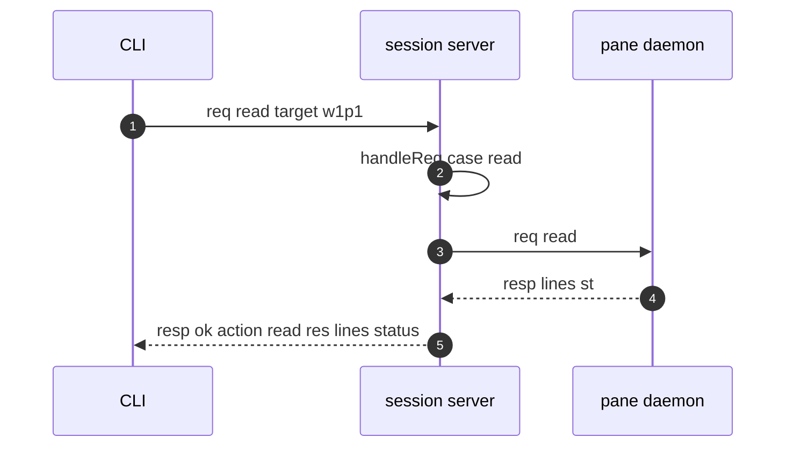
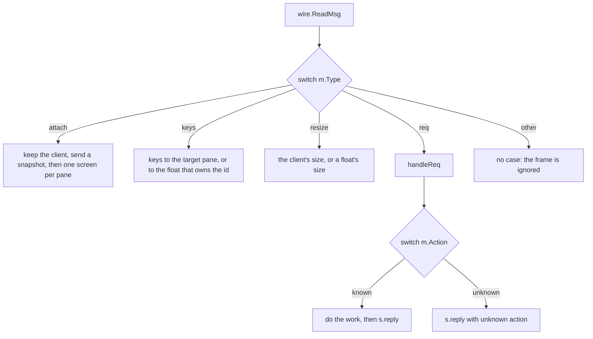

# The protocol

Every dm process talks over a unix socket and nothing else: why the call crosses it, what bytes cross, and how to add another.

## Words

| term | meaning |
| --- | --- |
| session, server, sibling | a session is one server and the panes it owns, under `sessions/<name>/`; the server owns its layout, its `state.json` file and client connections; a sibling is another session under the same dm state dir (`$DM_STATE`, else `$XDG_STATE_HOME/dm`, else `~/.local/state/dm`, `internal/paths/paths.go:12`) |
| pane, pane id | a pane is one process running a program (a shell by default) in a rectangle of the layout; its id is `w` + window number + `p` + pane number, e.g. `w1p2` (`internal/session/state.go:102`) |
| workspace, window, rail | a workspace groups windows, a window is one tab of panes, the rail is the sidebar that lists them |
| box, float | the box is the session's append-only message log; a box watcher is one reader's place in it (pane, key, cursor, parked); a float is a floating command pane, a process one client owns outside the layout |
| ring, VT screen | the ring is a pane's scrollback buffer of raw output bytes; the VT screen is its emulated terminal, visible text plus modes |
| snapshot, tree, status | a snapshot is the session's layout and pane facts (name, workspaces, windows, panes, focus, sizes); the tree is the layout tree of the active window; a status is `{state, message, app}`, a status word, a note and the reporting program |

## Why a message boundary

dm is five kinds of process: a session server, one daemon per pane, the TUI (`internal/client`), the CLI, and a
sibling session's server. They are separate processes with no shared address space, so a call cannot be a function
call; it becomes a message. A pane outlives its server (`internal/pane/pane.go:32`), the CLI starts the server on a
failed dial (`internal/transport/transport.go:53`), and a sibling server reaches in over the socket
(`internal/server/server_secrets.go:369`). The boundary costs three things. Serialisation: an encode, a decode,
often a re-encode, and a `read` (the screen) or `replay` (the scrollback) reply carries a whole screen or ring, the
ring at most 8 MiB (`ringMax`, `internal/pane/pane.go:375`), under the 16 MiB frame. A new failure mode: a peer can
be absent, wedged, or torn mid-frame, and a stream cannot resynchronise, so a timed-out write poisons that pane
connection for good (`internal/server/server_core.go:110`). No compile-time link: the action is a string in a
`switch` on each side, so an action typo is a runtime error and a field-name typo is dropped by `json.Unmarshal` in
silence.

## The frame

One frame is a 4-byte big-endian uint32 length, then that many bytes of JSON: no newline, no other delimiter
(`internal/wire/wire.go:252`, `:270`). `wire.MaxFrame` is `16 << 20` (`:249`). `WriteMsg` refuses a bigger payload
before writing it, and `ReadMsg` refuses a zero or oversize length; a bad frame ends the connection. One writer per
connection, under a mutex (`transport.Conn.Send`, `internal/transport/transport.go:30`).

## The envelope

`wire.Msg` (`internal/wire/wire.go:17`) is the one envelope, both sockets, both directions. Its stale `Type` comment
lists eleven values; the code sends twenty. `req`, `resp` and `attach` are requests and replies; `keys` and
`resize` carry a client's key bytes and size; the rest are pushes: `snapshot`, `screen` (VT screen), `replay` (ring),
`bytes` (pty output), `status` (pane status), `session` (the pane's OSC 7502 session file, empty when cleared), `cwd` (working directory), `title` (the pane's OSC title), `mode`
(the pane's alt, mouse or paste mode changed), `exit` (pane exited), `scrub` (repainted screen), `box` (the box
changed), `watch` (a box watcher changed), `msg` (box entry), `close` (session ended).

| field | carries |
| --- | --- |
| `Type` | the frame kind, above |
| `Action`, `ID`, `OK`, `Error`, `Res` | `Action` names the action, `ID` tags the request, `OK` is the verdict, `Error` the text, `Res` the action's JSON body |
| `Target`, `Other`, `Dir` | `Target` names the pane, `Other` the second pane of a two-pane action, `Dir` the direction: left, right, up, down |
| `Index`, `Name`, `Window`, `Project`, `Cwd`, `Layout`, `On`, `NoFocus` | `Index` a slot number, or the rail width on `set-rail`; `Name` a pane, window, workspace or secret name; `Window` a new window's name; `Project` a project name; `Cwd` a directory; `Layout` a preset name; `On` an optional switch (nil toggles); `NoFocus` suppress the focus move |
| `Msg`, `Keys`, `Enter`, `Argv`, `Count`, `History`, `Cols`, `Rows`, `Float` | `Msg` the text to type, `Keys` the key bytes, `Enter` the line end, `Argv` the program to run, `Count` how many rows, `History` the ring budget in bytes, `Cols`/`Rows` the size, `Float` the float id |
| `FG`, `BG` | the terminal colour pair the client detected |
| `Tool`, `Ref`, `Upstream`, `Header`, `Env`, `Path`, `Trust` | `Tool` the fetch program, `Ref` the reference it resolves, `Upstream` the proxy URL, `Header` the proxy header template, `Env` extra environment entries, `Path` the file to write, `Trust` the sync verdict |
| `St`, `Data`, `Lines`, `VTSnap`, `Snap`, `Exit`, `WaitReason` | `St` a status, `Data` the ring bytes, `Lines` text rows, `VTSnap` the VT screen, `Snap` the session snapshot, `Exit` a code, `WaitReason` how a wait ended |

## The type and action matrix

`handleReq` (`internal/server/server_rpc.go:15`) switches on `Action` and has 71 cases over 76 names; the pane
switches on `Action` alone (`internal/pane/pane.go:1277`). The server switches on `Type` first
(`internal/server/server_view.go:732`). Every action ends in a `resp` frame except `msg-sub`, which streams; the
`res` column names the keys of that reply's `res` object, and `none` means `res` is empty. The request and reply
columns use the JSON keys from the envelope table (`target`, `msg`, `res`, `waitReason`), and `res{name,where}`
means a `res` object with those keys. The server's `read` reply puts rows in `res.lines`; the pane's in `Lines`.
The sender column names the caller: `cli` a `dm` verb, `tui` the client, `sib` a sibling server; `exec` no typed
verb, only `dm exec '<json>'` (`internal/cli/cli.go:572`).

| action | request fields | reply `res` | sender |
| --- | --- | --- | --- |
| `ping` | none | `session` | cli |
| `list`, `ls` | none | `snapshot`, `tree` | cli (`list`), exec (`ls`) |
| `read` | `target` | `lines`, `status` | cli, tui |
| `history` | `target`, `count` | `lines` | cli |
| `screen` | `target` | a `screen` frame, then `pane` | tui |
| `replay` | `target` | a `replay` frame, then `pane` | tui |
| `yank` | `target` | `lines`, `start`, `rows`, `anchor` (a command start was recorded) | cli, tui |
| `status` | `target` | a status, or a map from pane id to status | cli |
| `write-to`, `exec` | `target`, `msg`, `enter` (`exec` forces it) | `pane` | cli, exec |
| `synchronize-panes` | `on` | `sync` (the synchronize-panes flag) | tui |
| `toggle-secrets` | `target` | `pane`, `enabled` | tui |
| `split` | `target`, `dir`, `cwd`, `ratio`, `nofocus`, `argv` | `pane` | cli, tui |
| `zoom-pane` | none | `zoom` (the zoomed pane id, empty for none) | tui |
| `reload` | none | `pad` (the pane padding in cells) | tui |
| `set-rail` | `index` | `rail` (the sidebar width in cells) | tui |
| `move-pane` | `target`, `other`, `dir` | `pane` | exec |
| `select-layout` | `layout` | `layout` | tui |
| `new-window` | `name`, `cwd`, `nofocus`, `argv` | `window`, `pane` | cli, tui |
| `new-workspace` | `name`, `window`, `cwd`, `project`, `nofocus`, `argv` | `workspace`, `window`, `pane` | tui |
| `list-workspaces` | none | an array of `{id, name, project, active, windows}` | exec |
| `list-panes` | none | `panes` (an array of `{id, name, app, status, message, workspace, workspaceName, window}`) | exec |
| `pane` | `target` | `id`, `workspace`, `window`, `workspaceName`, `windowName`, `name`, `cwd` | exec |
| `set-pane-name` | `target`, `name` | `pane`, `name` | tui |
| `rename-workspace` | `target`, `name` | `workspace`, `name` | cli, tui |
| `set-project` | `target`, `name` | `workspace`, `project` | cli, tui |
| `toggle-fold` | `target` | `target`, `unfolded` | tui |
| `run-plugin` | `target`, `res{name,where,source}` | `pane` | cli, tui |
| `plugin-list` | none | `plugins` (a `{name, exec, cwd, where, env}` array) | cli |
| `float-open` | `float`, `target`, `cols`, `rows`, `res{command,label}` | `command`, `label` | tui |
| `float-close` | `float` | none | tui |
| `shelve-pane` | `target` | `pane` | cli, tui |
| `pop-pane` | `target` | `pane` | cli, tui |
| `msg-post`, `msg-clear` | `res` | `entry`, or `cleared` | cli, tui |
| `msg-list` | `res` | `entries`, `trimmed` | cli, tui |
| `msg-wait` | `res` | `entry`, `trimmed` | cli, tui |
| `msg-sub` | `res` | a stream of `msg` frames, no reply | cli, tui |
| `msg-watchers`, `msg-schema` | `res` | `watchers`, or `schema` | cli, tui |
| `secret-register`, `secret-revoke` | `name` | `name` | cli |
| `secret-list` | none | `secrets` | cli |
| `secret-use` | `name` | `name`, `endpoint`, `warning`, `uncovered` | cli |
| `secret-hydrate` | `name`, `path` | `path`, `warning`, `uncovered` | cli |
| `secret-type` | `name`, `target` | `pane`, `warning` | cli |
| `secret-cover` | `res{session, valuesB64, values}` | `panes` (a count), `dropped` | sib |
| `secret-sync` | `path`, `trust` | `mapping`, `registered`, `kept`, `files`, `warning`, `uncovered` | cli |
| `ask-open` | `target`, `res{toolCallId,questions}` | `id` | cli |
| `ask-await` | `target`, `res{timeoutMs}` | `pending`, or `answer` | cli |
| `ask-answer` | `target`, `res{items,globalNote,cancel}` | the answer (`at`, `items`, `globalNote`, `cancel`) | cli |
| `ask-close` | `target` | `closed` (whether this close removed one) | cli |
| `ask-list` | none | `asks` (an array of ask requests, answers included) | cli |
| anything else | none | error `unknown action %q` (`internal/server/server_rpc.go:784`) | |

The layout verbs reply `none`: `focus`, `focus-window`, `focus-workspace`, `close-pane`, `close-window` and
`close-workspace` take `target`; `focus-dir` takes `dir`; `move-window` and `move-workspace` take `target` and `dir`;
`next-pane`, `prev-pane`, `next-window`, `prev-window`, `next-workspace` and `prev-workspace` take nothing;
`select-window` takes `index`; `rename-window` takes `target` and `name`; `swap-panes` takes `target` and `other` or `dir`;
`resize-split` takes `target`, `other` and `ratio`. `keys` takes `target` and `keys`, `term-colours` takes `fg` and
`bg`. `keys` is `exec`; `focus` and the next/prev pane and window verbs are `cli` and
`tui`; the rest are `tui`.

A shelved pane is in no window's tree and has no rect. `shelve-pane` takes `target`, the focused pane when the field
is empty, and refuses the last pane of a window. `pop-pane` takes `target`, the shelf's active member when the field
is empty, and splits the focused pane to its right with it. A `focus` naming a shelved pane moves the shelf's active
index and leaves the window focus alone, and a `resize` naming one sizes its PTY, which is how a summon fits it to
the box the client draws. A plugin is a program the config declares with a name, `exec`, `cwd`, `where` and `env`;
`run-plugin` opens it in a pane, `where` is `split` or `window`, and `source` is `cli` or `key`, who launched it.

## The pane's own actions

The pane takes 16 actions on its own socket, and the server keeps two channels to it. Most actions ride a one-shot
dial: `paneRequest` (`internal/server/server_view.go:960`) dials `sessions/<name>/panes/<id>.sock` with a one second
timeout, sends one request, and reads its reply under a two second deadline (`:962`, `:971`); `paneScreenRequest`
(`:832`) and `readPaneReplay` (`:922`) do the same for a picture or a ring. The five push actions ride the persistent
connection `adoptPane` builds (`internal/server/server_core.go:841`), written with `paneConn.send` (`:110`): `write`,
`resize`, `kill`, `set-secrets` and `term-colours`. A push is written, never read: one watcher goroutine per pane
(`watcherLoop`, `internal/server/server_core.go:897`) reads the conn, and its `Type` switch has no `resp` case, so
a `resp` the pane sends is dropped (`:975`). `dm wait` dials the pane itself (`internal/cli/cli.go:2199`).

In a pane reply, `lines` and `st` are envelope fields (`Lines`, `St`) on `read` and `status`; `yank` and `wait`
put their rows in `res`. A `screen` frame carries the VT screen as `VTSnap` (`vtsnap`); a `replay` frame carries the
ring as `Data` and the status as `St`.
`alt`, `mouse` and `paste` mean the program wants the alternate screen, mouse reporting and bracketed paste.

| action | request fields | reply |
| --- | --- | --- |
| `write`, `resize` | `msg` or `keys` and `enter`, or `cols` and `rows` | none |
| `read` | none | `resp` with `lines`, `st`, `res{title,dead}` |
| `status`, `cwd` | none | `resp` with `st`, or with `cwd` |
| `screen`, `reflow` | none, or `cols` and `rows` | one `screen` frame: `vtsnap`, `res{alt,mouse,paste}` |
| `yank` | none | `resp` with `res{lines,start,rows,anchor}`, `anchor` true when a command start was recorded |
| `replay` | none | one `replay` frame: `data`, `st`, `res{title,dead,alt,mouse,paste}` |
| `ping`, `term-colours` | `fg`, `bg`, or none | `resp` OK |
| `set-history` | `history` | `resp` OK, or an error outside 64 KiB..8 MiB |
| `set-secrets`, `toggle-secrets` | `res{valuesB64,values}`, or none | `resp` OK, or `res{enabled}` |
| `wait` | none | `resp` with the tail (`res{lines,start,rows,anchor}`, the output so far), then `resp` with `exit` and `waitReason` |
| `kill` | none | `resp` OK, then the daemon exits |

## How a call is sent

1. `EnsureAt` (`internal/transport/transport.go:53`) dials `sessions/<name>/server.sock`, or spawns the server;
   `RPCAt` (`:142`) sets `Type: "req"`, `ID: 1` and a 10 s read deadline.
2. `server.serve` (`internal/server/server_view.go:706`) takes `case "req"`, `handleReq` works, and `s.reply`
   (`:983`) queues the reply through `client.deliver` (`internal/server/server_core.go:208`). `RPCAt` reads until
   `Type == "resp"`.

**The split flow.** `dm split w1p1 --dir right`: `Run` (`:682`) sends `dir`, `handleReq`
(`internal/server/server_rpc.go:300`) calls `s.split` (`internal/server/server_mutate.go:867`), which releases the
layout lock, then `s.ensurePane` (`internal/server/server_core.go:774`) spawns the daemon. `s.reply` returns
`pane: w1p2`. **Errors:** `printRPC` (`internal/cli/cli.go:1103`) turns a reply with `ok` false
into a Go error; a pane answers nothing to an unknown action, so `paneRequest` times out.

## What the protocol does not do

- No version or handshake. `wire.Msg` carries no version or capability list, and `json.Unmarshal` drops a field the
  reader does not know (`internal/wire/wire.go:284`). On the server socket a conn joins `s.clients` only after
  `attach` (`internal/server/server_view.go:737`), and `broadcastLocked` sends to `s.clients` alone
  (`internal/server/server_core.go:1156`). On the pane socket a conn is a subscriber at once: `serve` adds it to
  `p.subs` (`internal/pane/pane.go:1281`), and the pane's broadcast writes to every conn there
  (`internal/pane/pane.go:1035`), so a silent conn still reads the pane's frames.
- No resync or auth: a bad frame ends the connection, and the socket is mode 0600 (`internal/pane/pane.go:689`).

## Add an action

1. Add a `case` to `handleReq` (`internal/server/server_rpc.go:15`) ending in `s.reply`, and wrap a layout change in
   `s.mutation` (which saves) and `s.afterMutation` (which resyncs). A new `wire.Msg` field is additive and `omitempty`.
2. If a pane must act, add the `case` to `paneProc.serve` (`internal/pane/pane.go:1277`) and call it through
   `paneRequest`; keep the reply a `resp` frame.
3. Add the verb as a `case` in `Run` (`internal/cli/cli.go:426`) and a row to `cliCommands`
   (`internal/clidoc/clidoc.go:68`), the name to `manActionNames` (`internal/clidoc/man.go:64`) and
   `actionExamples` (`internal/clidoc/actions.go:16`), and a test to `internal/server/rpc_actions_test.go`;
   `TestUnknownActionFails` pins the default arm. Refresh `docs/` with `dm man -o docs/dm.1`,
   `dm llms -o docs/llms.txt` and `dm html -o docs/dm.html`.

## Compatibility

Keep the frame, the envelope keys `type`, `action`, `id`, `ok`, `error` and `res`, and the `resp` shape, with new
fields additive and `omitempty`. `Lines` stays in the envelope on the pane's `read` reply, pinned by
`TestReadReplyStaysBackwardCompatible` (`internal/wire/wire_test.go:14`).
