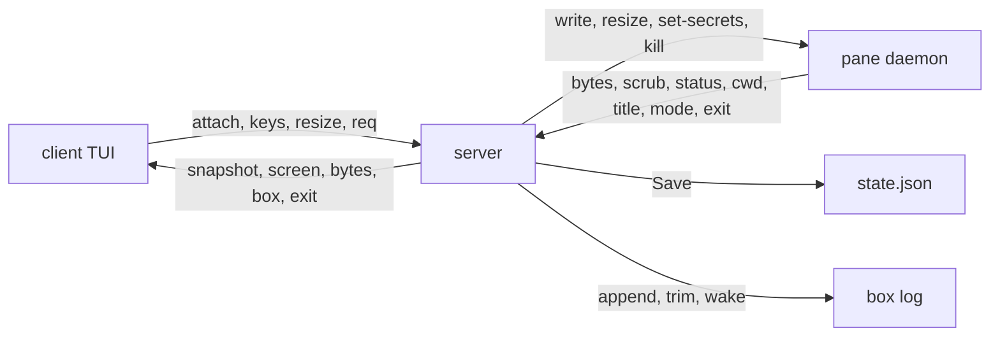

# The server

This page answers what the server owns, how it stays concurrent, how the twelve
files in `internal/server` divide the work, and where the next thing goes.

## What the server owns

`server.Run` (`internal/server/server_core.go:530`) starts one server per
session and holds `s.mu` (`server_core.go:403`) over everything below.

- The state, `s.st`: trees, focus, rail, folds, accents, pane state, the box and
  the secret registry. `State.Save` (`internal/session/state.go:216`) writes it.
- Clients in `s.clients`, pane connections in `s.panes`, the spawn, adopt and
  watch logic, and the shared view: the largest client's size
  (`fitToClientsLocked`, `internal/server/server_view.go:24`) and the snapshot
  (`snapshotLocked`).
- Subprocesses a client cannot start: pane daemons, floats, plugin panes.

## Concurrency

- One goroutine per client connection (`go s.serve(c)`, `server_core.go:672`),
  one writer per client (`writeLoop`, `server_core.go:287`), one watcher per pane
  (`watcherLoop`, `server_core.go:897`). A wedged pane stops its watcher after
  three redials (`paneWedgeLimit`).

| lock | guards | not held across |
| --- | --- | --- |
| `client.mu` | one client's queue, 1 MiB bound | a socket write |
| `paneConn.mu` | one pane write, 5s deadline | nothing |
| `s.mu` | state, panes, clients, floats, watches | a send, a dial, a spawn |
| `s.secretPush`, `s.branchMu` | the redaction push, the git cache | nothing |

`...Locked` functions require `s.mu` and must not send, dial or spawn.
`broadcastLocked` (`server_core.go:1156`) only enqueues, through `client.deliver`
(`server_core.go:208`), so a stalled client never blocks a pane read. Past the
bound it rebuilds from one snapshot and a screen per pane (`resyncClient`).

## The twelve files

| file | owns |
| --- | --- |
| `server_core.go` | `server` and `client` types, `Run`, spawn, adopt, pane watcher, broadcast |
| `server_rpc.go` | `handleReq` (`server_rpc.go:15`), 68 action names in 63 cases |
| `server_mutate.go` | layout changes, `mutation`, `resync`, `writeTo`, `sendKeys` |
| `server_view.go` | snapshot, size fit, `syncSizes`, screens, `reply`, `serve` |
| `server_box.go` | box writes, waiters, subscribers, watches, trimming |
| `server_secrets.go` | registry, activation, proxy, cover, type, hydrate |
| `server_sync.go` | `.dm-secrets.kdl` parsing and file ingestion |
| `server_float.go` | floating command PTYs and their lifetime |
| `server_labels.go` | git branch and change-count cache |
| `server_plugin.go` | plugin declarations and the launch context |
| `server_state.go` | project accent slot allocation |
| `notify_server.go` | notify producers and the operator-focus test |

## Component graph

## RPC handling

`serve` (`server_view.go:706`) switches on `Type`: `attach` registers, `keys`
writes to a pane or a float, `resize` refits, and `req` goes to `handleReq`
(`internal/server/server_rpc.go:15`), which switches on `Action`: 63 case
clauses, 68 action names, five naming two. A branch answers through `s.reply`
(`server_view.go:983`); `msg-sub` streams and never answers.

## Mutation

`mutation` (`internal/server/server_mutate.go:300`) runs the change function,
then saves under `s.mu`. That function takes `s.mu` itself: a split spawns a
pane, and a spawn must not hold the lock. `afterMutation`
(`server_mutate.go:312`) drops the zoom and calls `resync`
(`server_mutate.go:319`): resize, one snapshot, then a screen and a replay per
active-window pane. A repaint-only branch calls `pushSnapshot`
(`server_view.go:528`). Ids come from the state (`internal/session/state.go:445`);
names go through `checkName` (`server_mutate.go:468`).

## View and snapshot sync

`snapshotLocked` (`server_view.go:122`) is the client's whole picture: session,
workspace, windows, focus, size, rail, zoom, padding, the tree and one
`PaneInfo` per pane, with the tree cloned so no marshal races a split.

`paneRectsLocked` (`server_view.go:80`) turns the tree into one rectangle per
pane through `layout.Layout` and `layout.InsetBox`, from the screen size, the
rail width and the padding. `syncSizes` (`server_view.go:665`) writes each
rectangle into its pane's state and sends a `resize`. Only a width change
re-wraps the line model, so one settle asks each of those panes for a fresh
`screen` (`armReflowLocked`, `server_view.go:582`).

## The box

`boxStoreLocked` (`internal/server/server_box.go:35`) owns `seq` and `at`, trims,
wakes the waiters and saves, then broadcasts `{"box"}` so an open view refetches.
A `msg-wait` parks on a `boxWaiter` and re-checks under `s.mu` on each wakeup.

## Notify

`notify.StateChange` (`internal/notify/notify.go:21`) runs in the pane status
reader (`server_core.go:1003`) and decides which transitions get a box entry:
blocked, done and error, from a different state. `notifyBoxEntryLocked`
(`server_box.go:66`) then applies the caller's suppress flag, set with
`operatorSeesLocked` (`internal/server/notify_server.go:10`), and
`notify.Urgent` (`notify.go:37`), which pops only blocked and error.

## Secrets and proxy registration

`secretUse` (`internal/server/server_secrets.go:616`) fetches, activates through
`secretActivate` (`server_secrets.go:695`), which checks identity under `s.mu`
so a raced revoke wins, then mints the prefix through `secretProxyRegister`
(`server_secrets.go:727`) when the live record has an upstream; that call starts
the loopback proxy on first use. `secretHydrate` (`server_secrets.go:771`)
writes the value to `--to` at 0600; `secretType` (`server_secrets.go:924`)
types it in. The adopt send (`adoptSecretScrub`, `server_secrets.go:252`)
goes out even when empty, the pane's cue to start its shell. `pushSecretScrub`
(`server_secrets.go:163`) reaches every adopted pane and every sibling server.

## Reload

`reloadConfig` (`server_core.go:680`) re-reads the operator's KDL file, swaps
`s.cfg`, pushes the new history budget, and only `reload` calls it
(`server_rpc.go:336`). The other keys are read where used: padding
(`server_rpc.go:342`), diff command (`server_rpc.go:159`) and plugins
(`server_plugin.go:42`); the default fold only at startup (`applyDefaultFold`,
`server_core.go:604`).

## What the server does not do

- It does not parse terminal output, keep scrollback, redact text or render.
  The pane and the client do.
- It does not start the proxy early, watch a file, or reap a wedged pane. It
  posts a notify entry and waits (`notifyPaneWedge`, `server_core.go:1151`).

## Where the next thing goes

- Next action. Add the field to `wire.Msg`, then a `case` to `handleReq`
  (`internal/server/server_rpc.go:15`) that answers through `s.reply`. Wrap a
  state change in `s.mutation` (`server_mutate.go:300`), then call
  `s.afterMutation` (`server_mutate.go:312`) or `s.pushSnapshot`.
- Next store field. Add it to `session.State` (`internal/session/state.go:94`),
  write it in the mutator, and let `State.Save` persist it. A client-visible
  field also goes to `wire.Snapshot` and `snapshotLocked`.
- Next broadcast. Call `s.broadcastLocked` (`server_core.go:1156`) under `s.mu`
  with a new `Type`, and read it in `apply`
  (`internal/client/client_model.go:758`); a frame one client asked for goes
  through `cl.deliver`.

## See also

- [Entry point](01-entry-point.md), [Lifecycle](02-lifecycle.md), [The protocol](03-protocol.md)
- [The pane](05-pane.md), [The client](06-client.md), [Layout](07-layout.md)
- [Surfaces](08-surfaces.md), [Secrets](09-secrets.md), [Config and CLI](10-config.md)
