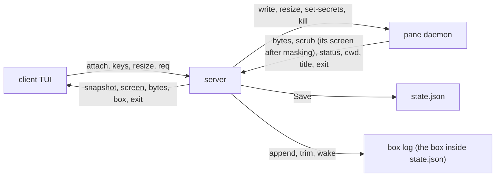

# The server

One server process per session accepts the wire, owns the state and runs the pane daemons. The wire
is one length-prefixed JSON envelope per call, `wire.Msg` (`internal/wire/wire.go:17`), whose `Type`
names the frame. This page covers what a session is, what the server owns, the twelve files, and
where to add code. `file.go:line` means `internal/server`; `(:line)` is the file before it.

A session is one named tree of panes with its own directory, `sessions/<name>` in the state root,
`~/.local/state/dm` (`internal/paths/paths.go:10`), holding `state.json`, `server.lock`, the
server's socket and one socket per pane. The name defaults to `main`; the operator is the human who
attaches a client. One server per session: `Run` takes a `flock` on that lock.

## What the server owns

`Run` (`internal/server/server_core.go:530`) starts the session's server and holds `s.mu`
(`server_core.go:403`), the main mutex. Four levels: a session holds workspaces; a workspace is a
named group of windows, optionally tagged with a project (a label several workspaces share); a
window holds a split tree of panes; a pane is one leaf; a pane daemon is the process behind it.

- The state, `s.st`: the tree, the focus (the pane keys go to), the rail (the sidebar), rail folds
  (a group collapsed) and accents (one hue per project), each pane's saved record, the box (the
  session's append-only message log) and the secret registry (names and fetch tools, never values).
  `State.Save` (`internal/session/state.go:216`) writes it.
- Clients in `s.clients`, pane connections in `s.panes`, and the spawn, adopt and watch logic.
  Adopting a pane is dialling its daemon's socket and registering it, which is how a restarted
  server recovers a pane that outlived it.
- The shared view: the largest client's size (`fitToClientsLocked`,
  `internal/server/server_view.go:24`) and the snapshot (`snapshotLocked`). Every client draws the
  same layout, so the largest terminal sets the size.
- Subprocesses a client cannot start: pane daemons, floats (a command the client opens in a floating
  panel of its own, which it types into and which dies with it) and plugin panes (a pane a `plugin`
  declaration in the operator's config file launches).

## Concurrency

- One goroutine per client connection (`go s.serve(c)`, `server_core.go:672`), one writer per client
  (`writeLoop`, `server_core.go:287`), one watcher per pane (`watcherLoop`, `server_core.go:897`). A
  watcher reads one pane's connection, fans its bytes out and re-dials when it dies. Three
  connections in a row that die before one survives two seconds mean the pane is wedged: the watcher
  stops, the pane stays registered, and the next write, resize or secret action re-arms it.

| lock | serialises | never held across |
| --- | --- | --- |
| `client.mu` | one client's queue, bounded at 1 MiB | a socket write |
| `paneConn.mu` | one frame to one pane's socket | a write over 5s (`paneSendTimeout`) |
| `s.mu` | state, panes, clients, floats, watches | a send, a dial, a spawn |
| `s.secretPush`, `s.branchMu` | the push that tells each pane which values to mask, and the git cache | any blocking call |

`...Locked` functions need `s.mu` and must not send, dial or spawn. `broadcastLocked`
(`server_core.go:1156`) enqueues via `client.deliver` (`server_core.go:208`), so a stalled client
never blocks a pane read. Past the 1 MiB cap the client is marked stale and rebuilt from a snapshot
and a screen per pane (`resyncClient`, `server_view.go:903`); a screen is a pane's terminal picture.

## The twelve files

| file | owns |
| --- | --- |
| `server_core.go` | `server` and `client` types, `Run`, spawn, adopt, pane watcher, broadcast |
| `server_rpc.go` | `handleReq` (`server_rpc.go:15`), the action switch |
| `server_mutate.go` | layout changes, `mutation`, `resync`, `writeTo`, `sendKeys` |
| `server_view.go` | snapshot, size fit, `syncSizes`, screens, `reply`, `serve` |
| `server_box.go` | box writes, waiters, subscribers, watches, trimming |
| `server_secrets.go` | registry, activation, proxy, cover (other sessions), type (into a pane), hydrate (to a file) |
| `server_sync.go` | the `.dm-secrets.kdl` file the `secret-sync` action is pointed at: secrets to register, files to ingest |
| `server_float.go` | floats and their lifetime |
| `server_labels.go` | git branch and uncommitted line counts |
| `server_plugin.go` | plugin declarations and the launch context |
| `server_state.go` | which accent hue each project gets |
| `notify_server.go` | notify producers and the operator-focus test |

## Component graph

## RPC handling

`serve` (`server_view.go:706`) switches on `Type`: `attach` registers, `keys` writes to a pane or a
float, `resize` refits, and `req` goes to `handleReq` (`server_rpc.go:15`), which switches on
`Action`: 63 `case` clauses, 68 actions, five cases naming two each. A branch answers through
`s.reply` (`server_view.go:983`); the `msg-sub` action streams box entries and never answers.

## Mutation

`mutation` (`server_mutate.go:300`) runs the change function without holding `s.mu`, then takes it
to save. The change function locks `s.mu` where it needs it: `split` creates a pane, and a spawn
must not hold the lock. `afterMutation` (`server_mutate.go:312`) drops the zoom (a pane shown alone
at full window size) and calls `resync` (`server_mutate.go:319`): resize, one snapshot, then a
screen and a replay (the pane's scrollback) per pane of the active window, the only one on screen. A
change that only repaints (a focus, a rename, a status) calls `pushSnapshot` (`server_view.go:528`)
instead. A new pane, window or workspace id comes from the state (`internal/session/state.go:445`);
a client-supplied name goes through `checkName` (`server_mutate.go:468`): 128 bytes, valid UTF-8, no
control characters, because it lands in `state.json`.

## View and snapshot sync

`snapshotLocked` (`server_view.go:122`) is the client's whole picture: the session, workspace,
windows, focus, size, rail, zoom, padding, the tree and one `PaneInfo` per pane, the tree cloned so
no marshal races a split. It serialises as `wire.Snapshot` (`internal/wire/wire.go:216`).

`paneRectsLocked` (`server_view.go:80`) turns the tree into one rectangle per pane through
`layout.Layout` and `layout.InsetBox`, from the screen size, the rail and the padding (the margin a
pane keeps inside its rectangle). `syncSizes` (`server_view.go:665`) writes each rectangle into its
pane state and sends a `resize`. Only a width change re-wraps lines, so a settle (`armReflowLocked`,
`server_view.go:582`, `reflowSettle` after 150ms of quiet) asks each widened pane for a screen.

## The box

The box is the session's append-only log: one `box.Entry` (`internal/box/box.go:46`) per post.
`boxStoreLocked` (`server_box.go:35`) stamps `seq` and `at`, its number and time, trims the log,
wakes the waiters and saves, then broadcasts `{"box"}` so a view refetches. The `msg-wait` action
parks a waiter (`boxWaiter`, `server_box.go:140`) on the log and re-checks under `s.mu`.

## Notify

`notify.StateChange` (`internal/notify/notify.go:21`) runs when the pane watcher reads a `status`
frame (`server_core.go:1003`) and decides whether the pane's status moved into blocked, done or
error from a different state. `notifyBoxEntryLocked` (`server_box.go:66`) then decides whether the
entry also raises a desktop notification: the caller's suppress flag, computed by
`operatorSeesLocked` (`notify_server.go:10`), true when a client is attached and focused there, and
`notify.Urgent` (`notify.go:37`), which allows only blocked and error.

## Secrets and proxy registration

`secretUse` (`internal/server/server_secrets.go:616`) fetches a secret's value and activates it
through `secretActivate` (`:695`), which checks the registry record's identity under `s.mu` so a
raced revoke wins. With an upstream (a host the value is spent on), it mints a URL prefix through
`secretProxyRegister` (`:727`), which starts the loopback proxy: an HTTP proxy on 127.0.0.1 that
forwards a request under it to the upstream with the value in the header; the `secretUse` reply
names that prefix as the endpoint. The other uses are `secretHydrate` (`:771`), which writes it to
the file `--to` names at 0600, and `secretType` (`:924`), which types it into a pane. The adopt send
(`adoptSecretScrub`, `:252`) is the mask list (a `set-secrets` frame) an adopted pane gets, even
when empty: it cues the pane to start the shell. `pushSecretScrub` (`:163`) reaches every adopted
pane and every sibling session's server, which masks the value in panes this one cannot reach.

## Reload

`reloadConfig` (`server_core.go:680`) re-reads the operator's config file,
`$XDG_CONFIG_HOME/dm/config.kdl` or `~/.config/dm/config.kdl` (`internal/keymap/config_load.go:29`),
swaps `s.cfg` and pushes the new history budget to every pane: how much scrollback each keeps. Only
the `reload` action calls it (`server_rpc.go:336`). The other keys are read where used: padding
(`server_rpc.go:342`), the diff command a float runs when it names none (`:159`), plugins
(`server_plugin.go:42`); `default-fold`, a restored window's rail fold, only at startup
(`applyDefaultFold`, `server_core.go:709`).

## What the server does not do

It does not parse terminal output, keep scrollback, redact text or render: the pane and the client
do. It does not start the proxy early, watch a file or reap a wedged pane; it posts a notify entry
and waits (`notifyPaneWedge`, `server_core.go:1151`).

## Where the next thing goes

- Next action. Add the field to `wire.Msg`, then a `case` to `handleReq` (`server_rpc.go:15`) that
  answers through `s.reply`. Wrap a state change in `s.mutation` (`server_mutate.go:300`), then call
  `s.afterMutation` (`server_mutate.go:312`) or `s.pushSnapshot`.
- Next store field. Add it to `session.State` (`internal/session/state.go:94`), write it in the
  mutator, and let `State.Save` persist it. A client-visible field also goes to `wire.Snapshot` and
  `snapshotLocked`.
- Next broadcast. Call `s.broadcastLocked` (`server_core.go:1156`) under `s.mu` with a new `Type`,
  and read it in `apply` (`internal/client/client_model.go:758`); a frame one client asked for goes
  through `cl.deliver` (`server_core.go:208`), where `cl` is that client.

## See also

- [Entry point](01-entry-point.md), [Lifecycle](02-lifecycle.md), [The protocol](03-protocol.md)
- [The pane](05-pane.md), [The client](06-client.md), [Layout](07-layout.md)
- [Surfaces](08-surfaces.md), [Secrets](09-secrets.md), [Config and CLI](10-config.md)
