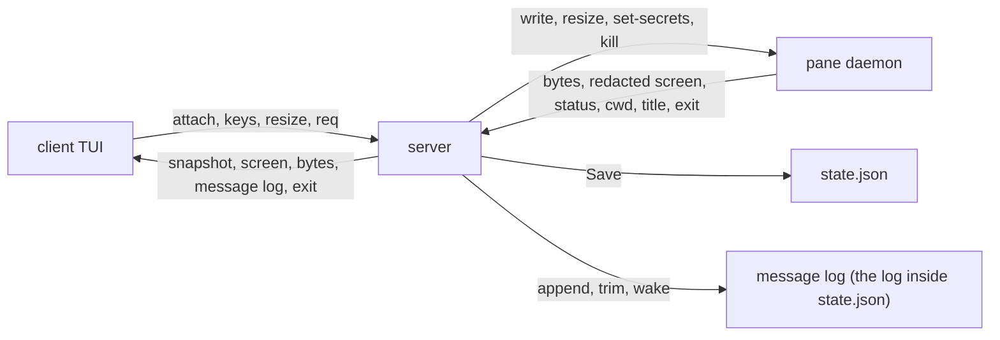

# The server

One server process per session accepts the socket protocol, owns the state and runs the pane daemons. Read this page to see what the server owns and where your change goes.

The socket protocol is one length-prefixed JSON envelope per call, `wire.Msg` (`internal/wire/wire.go#Msg`), and its `Type` names the frame. [The protocol](03-protocol.md) carries the frame, the fields and the actions.

A citation is `path#symbol`: the file from the module root, then the declaration in it. A bare `server_core.go` means `internal/server/server_core.go`.

## What a session is

A session is one named tree of panes with its own directory, `sessions/<name>` in the state root (`internal/paths/paths.go#StateDir`). The state root is `$DM_STATE`, else `$XDG_STATE_HOME/dm`, else `~/.local/state/dm`. The name defaults to `main`, and the operator is the human who attaches a client.

The directory holds `state.json`, `server.lock`, the server's socket and one socket per pane. `Run` (`internal/server/server_core.go#Run`) takes a `flock` on `server.lock`, so one server runs per session.

The layout has four levels. A session holds workspaces. A workspace is a named group of windows, optionally tagged with a project, a label several workspaces share. A window holds a split tree of panes. A pane is one leaf, and a pane daemon is the process behind it.

The server holds `s.mu` (`internal/server/server_core.go#server.mu`), the main mutex.

## What the server owns

The state, `s.st`, holds everything a restart reads back. It holds the tree and the focus, the sidebar and its collapsed groups, and the group colours. It also holds each pane's saved record, the message log and the secret list. The focus is the pane the keys go to. A group colour is the hue one project's rows share. The secret list holds names and fetch tools, never values. `State.Save` (`internal/session/state.go#State.Save`) writes it.

Clients sit in `s.clients` and pane connections in `s.panes`, with the spawn, adopt and watch logic. Adopting a pane means dialling its daemon's socket and registering it, which recovers a pane that outlived the server.

Every client draws the same layout, so the largest client's terminal sets the size (`fitToClientsLocked`, `internal/server/server_view.go#server.fitToClientsLocked`). `snapshotLocked` (`internal/server/server_view.go#server.snapshotLocked`) builds the frame they all draw.

The server starts the subprocesses a client cannot: pane daemons, floating panes and plugin panes. A floating pane is a command the client opens in a panel of its own. The client types into it, and it dies with the client. A plugin pane is one a `plugin` declaration in the operator's config file launches.

## Durability rules

A pane daemon runs with `setsid`, so it survives a server exit. On start the server reads `state.json` and adopts a pane daemon that still runs.

A reboot leaves no daemon to adopt. The server then spawns each pane's recorded `argv`, or a shell, in the same place, and marks the pane `restarted: true`.

A pane whose shell or `argv` program exits leaves the layout, and its split collapses. Focus moves to a live neighbour.

The last pane of a window closes the window. The last window ends the session, and `endSession` (`internal/server/server_view.go#server.endSession`) removes the state directory. A live shelved pane keeps a window. When the exit empties the last window, the active shelved pane takes it.

A SIGTERM is not a session end. `terminate` (`internal/server/server_view.go#server.terminate`) keeps the session directory, so the panes keep their sockets and stay adoptable.

## Concurrency model

One goroutine serves each client connection (`go s.serve(c)`, `internal/server/server_core.go#Run`). One writer serves each client (`writeLoop`, `internal/server/server_core.go#client.writeLoop`). One watcher serves each pane (`watcherLoop`, `internal/server/server_core.go#server.watcherLoop`).

A watcher reads one pane's connection, fans its bytes out and re-dials when it dies. Three connections in a row that die before one survives two seconds mean the pane is wedged. The watcher stops, the pane stays registered, and the next write, resize or secret action re-arms it.

| lock | serialises | never held across |
| --- | --- | --- |
| `client.mu` | one client's queue, bounded at 1 MiB | a socket write |
| `paneConn.mu` | one frame to one pane's socket | a write over 5s (`paneSendTimeout`) |
| `s.mu` | state, panes, clients, floating panes, reader positions | a send, a dial, a spawn |
| `s.secretPush`, `s.branchMu` | the push that tells each pane which values to mask, and the git cache | any blocking call |

A `...Locked` function needs `s.mu` and must not send, dial or spawn. `broadcastLocked` (`internal/server/server_core.go#server.broadcastLocked`) enqueues through `client.deliver` (`internal/server/server_core.go#client.deliver`), so a stalled client never blocks a pane read.

Past the 1 MiB cap the server marks the client stale and rebuilds it from a snapshot and a screen per pane (`resyncClient`, `internal/server/server_view.go#server.resyncClient`). A screen is a snapshot of one pane's terminal.

## The server files

| file | owns |
| --- | --- |
| `server_core.go` | `server` and `client` types, `Run`, spawn, adopt, pane watcher, broadcast |
| `server_rpc.go` | `handleReq` (`internal/server/server_rpc.go#server.handleReq`), the action switch |
| `server_mutate.go` | layout changes, `mutation`, `resync`, `writeTo`, `sendKeys` |
| `server_view.go` | snapshot, size fit, `syncSizes`, screens, `reply`, `serve` |
| `server_box.go` | message log writes, waiters, subscribers, reader positions, trimming |
| `server_ask.go` | the question store: open, await, answer, close, list, its caps, the pane prune, and the snapshot's listed questions |
| `server_secrets.go` | the secret list, activation, proxy, cover (other sessions), type (into a pane), hydrate (to a file) |
| `server_sync.go` | the `.dm-secrets.kdl` file the `secret-sync` action applies: secrets to register, files to ingest |
| `server_float.go` | floating panes and their lifetime |
| `server_labels.go` | git branch and uncommitted line counts |
| `server_plugin.go` | plugin declarations and the launch context |
| `server_state.go` | which group colour each project gets |
| `notify_server.go` | notify producers and the operator-focus test |

## Component graph

## RPC handling

`serve` (`internal/server/server_view.go#server.serve`) switches on `Type`. `attach` registers the client, `keys` writes to a pane or a floating pane, `resize` refits, and `req` goes to `handleReq`.

`handleReq` (`internal/server/server_rpc.go#server.handleReq`) switches on `Action`: 71 `case` clauses over 76 actions, five cases naming two each. A branch answers through `s.reply` (`internal/server/server_view.go#server.reply`). The `msg-sub` action streams message log entries and never answers.

## Mutation path

`mutation` (`internal/server/server_mutate.go#server.mutation`) runs the change function without holding `s.mu`, then takes the lock to save. The change function locks `s.mu` where it needs it: `split` creates a pane, and a spawn must not hold the lock.

`afterMutation` (`internal/server/server_mutate.go#server.afterMutation`) drops the zoom, a pane shown alone at full window size. It then calls `resync` (`internal/server/server_mutate.go#server.resync`), which resizes the panes and sends one snapshot. A screen and a replay follow, per pane of the active window, the only one on screen.

A change that only repaints calls `pushSnapshot` (`internal/server/server_view.go#server.pushSnapshot`) instead. A focus, a rename and a status change are repaints.

A new pane, window or workspace id comes from the state (`internal/session/state.go#State.NewWorkspaceID`). A client-supplied name goes through `checkName` (`internal/server/server_mutate.go#checkName`): 128 bytes, valid UTF-8, no control characters, because the name lands in `state.json`.

## View and snapshot sync

`snapshotLocked` (`internal/server/server_view.go#server.snapshotLocked`) is everything a client draws: the session, workspaces, windows, focus, size, sidebar, zoom, padding, the tree and one `PaneInfo` per pane. It clones the tree, so no marshal races a split. It serialises as `wire.Snapshot` (`internal/wire/wire.go#Snapshot`).

`paneRectsLocked` (`internal/server/server_view.go#server.paneRectsLocked`) turns the tree into one rectangle per pane through `layout.Layout` and `layout.InsetBox`. It works from the screen size, the sidebar and the padding. The padding is the margin a pane keeps inside its rectangle. `syncSizes` (`internal/server/server_view.go#server.syncSizes`) writes each rectangle into its pane state and sends a `resize`.

Only a width change re-wraps lines. A settle therefore asks each widened pane for a screen: `armReflowLocked` (`internal/server/server_view.go#server.armReflowLocked`) waits for `reflowSettle` of quiet, 150ms.

## The message log

The message log is the session's append-only log, one `box.Entry` (`internal/box/box.go#Entry`) per post.

`boxStoreLocked` (`internal/server/server_box.go#server.boxStoreLocked`) stamps `seq` and `at`, the number and the time. It trims the log, wakes the waiters and saves. It then broadcasts `{"box"}`, so a view refetches.

The `msg-wait` action parks a waiter (`boxWaiter`, `internal/server/server_box.go#boxWaiter`) on the log and re-checks under `s.mu`.

## Notify path

`notify.StateChange` (`internal/notify/notify.go#StateChange`) runs when the pane watcher reads a `status` frame (`internal/server/server_core.go#server.watchConn`). It decides whether the pane's status moved into blocked, done or error from a different state.

`notifyBoxEntryLocked` (`internal/server/server_box.go#server.notifyBoxEntryLocked`) then decides whether the entry also raises a desktop notification. Two things decide it. `operatorSeesLocked` (`internal/server/notify_server.go#server.operatorSeesLocked`) computes the caller's suppress flag, which is true when a client is attached and focused there. `notify.Urgent` (`internal/notify/notify.go#Urgent`) allows only blocked and error.

## Secrets and proxy

`secretUse` (`internal/server/server_secrets.go#server.secretUse`) fetches a secret's value and activates it through `secretActivate` (`internal/server/server_secrets.go#server.secretActivate`). The activation checks the registry record's identity under `s.mu`, so a raced revoke wins.

A secret with an upstream, a host the value is spent on, gets a URL prefix from `secretProxyRegister` (`internal/server/server_secrets.go#server.secretProxyRegister`). That call starts the loopback proxy: an HTTP proxy on 127.0.0.1 that forwards a request under the prefix to the upstream with the value in the header. The `secretUse` reply names that prefix as the endpoint.

`secretHydrate` (`internal/server/server_secrets.go#server.secretHydrate`) writes the value to the file `--to` names, at 0600. `secretType` (`internal/server/server_secrets.go#server.secretType`) types it into a pane.

`adoptSecretScrub` (`internal/server/server_secrets.go#server.adoptSecretScrub`) sends the mask list, a `set-secrets` frame, to an adopted pane, even when the list is empty. That frame cues the pane to start the shell. `pushSecretScrub` (`internal/server/server_secrets.go#server.pushSecretScrub`) reaches every adopted pane and every sibling session's server, which masks the value in panes this one cannot reach.

## Config reload

`reloadConfig` (`internal/server/server_core.go#server.reloadConfig`) re-reads the operator's config file, `$XDG_CONFIG_HOME/dm/config.kdl` or `~/.config/dm/config.kdl` (`internal/keymap/config_load.go#defaultConfigPath`). It swaps `s.cfg` and pushes the new history budget to every pane, how much scrollback each keeps. Only the `reload` action calls it (`internal/server/server_rpc.go#server.handleReq`).

The server reads the other keys where it uses them. `handleReq` (`internal/server/server_rpc.go#server.handleReq`) reads the padding and the diff command a floating pane runs when it names none. `plugin` (`internal/server/server_plugin.go#server.plugin`) reads the plugins. `applyDefaultFold` (`internal/server/server_core.go#applyDefaultFold`) reads `default-fold`, the collapsed state a restored window's sidebar gets, only at startup.

## Out of scope

It does not parse terminal output, keep scrollback, redact text or render. The pane and the client do.

It does not start the proxy early or watch a file.

It does not reap a wedged pane. It posts a notify entry and waits (`notifyPaneWedge`, `internal/server/server_core.go#server.notifyPaneWedge`).

## Where changes go

- Next action. Add the field to `wire.Msg`, then a `case` to `handleReq` (`internal/server/server_rpc.go#server.handleReq`) that answers through `s.reply`. Wrap a state change in `s.mutation` (`internal/server/server_mutate.go#server.mutation`), then call `s.afterMutation` (`internal/server/server_mutate.go#server.afterMutation`) or `s.pushSnapshot`.
- Next store field. Add it to `session.State` (`internal/session/state.go#State`), write it in the mutator, and let `State.Save` persist it. A client-visible field also goes to `wire.Snapshot` and `snapshotLocked`.
- Next broadcast. Call `s.broadcastLocked` (`internal/server/server_core.go#server.broadcastLocked`) under `s.mu` with a new `Type`, and read it in `apply` (`internal/client/client_model.go#tui.apply`). A frame one client asked for goes through `cl.deliver` (`internal/server/server_core.go#client.deliver`), where `cl` is that client.

## See also

- [Entry point](01-entry-point.md), [Lifecycle](02-lifecycle.md), [The protocol](03-protocol.md)
- [The pane](05-pane.md), [The client](06-client.md), [Layout](07-layout.md)
- [Surfaces](08-surfaces.md), [Secrets](09-secrets.md), [Config and CLI](10-config.md)
