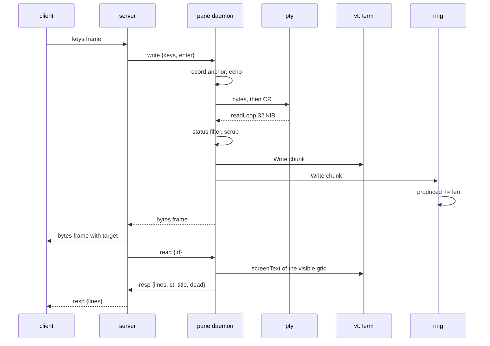

# The pane daemon

What this page answers: what one pane daemon is, why each pane is its own process, how it spawns a PTY and a screen from that PTY, how it keeps scrollback and replays it, how it records the last Enter so a copy starts at the right byte, how it answers the OSC 7501 status protocol, how a caller waits for output, how it resizes, and where you add its next action. The page stops at the daemon's socket: the protocol and the server side are [The protocol](03-protocol.md) and [The server](04-server.md).

## One process per pane

A pane daemon is the process that owns one PTY, one VT screen, one scroll ring and one status. It is `dm __pane` in the process table, drawn at `internal/pane/pane.go:651` and built at `internal/pane/pane.go:33`.

The server starts it, and then does not own its life. Three lines argue the split:

- `internal/pane/pane.go:32`: "The session server comes and goes; this process does not."
- `internal/server/server_core.go:812` starts the daemon with `Setsid: true`, so the pane leaves the server's session and process group. A server crash signals nothing in the pane.
- `internal/wire/wire.go:99`: "pane daemons outlive servers".

So the pane talks to a socket, not to a caller: `sessions/<name>/panes/<id>.sock` from `paths.PaneSock` (`internal/paths/paths.go:66`), joined in `PaneSockAt` (`internal/paths/paths.go:61`), mode 0600. The server dials it (`ensurePane`, `internal/server/server_core.go:774`), `dm wait` dials it directly (`internal/cli/cli.go:2199`), and any number of connections read from it at once. The daemon never dials out.

The daemon does police its own lifetime. `reapOrphans` (`internal/pane/pane.go:845`) stats the socket every 5 seconds and kills the shell's process group and exits when the path is gone or names another file. When the shell itself exits, the daemon shuts the pty, waits 2 seconds for attach clients to read the exit, removes the socket and exits (`startShell`, `internal/pane/pane.go:802`).

## The spawn and its environment

The server builds the command in `paneCommand` (`internal/server/server_core.go:739`): `--id`, `--session`, `--cwd`, `--shell`, `--cols`, `--rows`, `--history`, then optional `--argv` (a comma separated program and arguments) and `--plugin-env` (a JSON array of `KEY=VALUE` pairs), then optional `--fg` and `--bg` when the client reported its terminal colours. `parsePaneArgs` (`internal/pane/pane.go:612`) validates all of it before `Run` touches a pty or a socket.

A pane with no `--argv` runs `o.shell -l` (`paneCmd`, `internal/pane/pane.go:597`), so the shell the child gets is exactly the `--shell` the server passed, and an absent `--shell` execs an empty program name. The server fills that flag from `os.Getenv("SHELL")` (`internal/server/server_core.go:732`). `Run` computes `resolveShell` (`internal/pane/pane.go:146`) into `paneProc.shell`, but no spawn path reads that field, so the `$SHELL` and `/bin/sh` fallbacks there do not reach the child today. The program runs in `--cwd` and is told its own ids: `DM_PANE` and `DM_SESSION`, set last, always.

The rest of the environment is an allowlist, not an inheritance (`Env`, `internal/pane/env.go:38`). A name survives when it is in `paneEnvKeep` (PATH, HOME, USER, LOGNAME, SHELL, TERM, TERM_PROGRAM, COLORTERM, LANG, TZ, TMPDIR, DISPLAY, SSH_AUTH_SOCK, XAUTHORITY, DM_STATE), when it starts with `LC_` or `XDG_`, or when it is a `*_SOCK` name holding an absolute path and not shaped like a credential (`envPathName`, `internal/pane/env.go:121`). Everything else is dropped. The reason is not secrecy, the comment says so at `internal/pane/env.go:32`: a variable that reaches a shell is published twice, on the screen and in every read-back, and the server's redaction only knows the values it registered. Plugin pairs ride on top of the allowlist.

## The PTY and its two loops

`startShell` (`internal/pane/pane.go:802`) calls `pty.StartWithSize` with the grid's current size, then starts `readLoop` and `watchShell`, then waits on the shell process. One goroutine reads the master; one dedicated goroutine writes it.

- Inbound: `queueWrite` (`internal/pane/pane.go:1089`) never blocks. It pushes one `ptyWrite{b, enter}` onto a 256 deep channel and counts a drop when the channel is full. `drainPtyWrites` (`internal/pane/pane.go:1109`) is the only writer, and writes `\r` after the payload when `enter` is set. A pty whose reader is gone cannot stall the control socket.
- Outbound: `readLoop` (`internal/pane/pane.go:876`) reads 32 KiB at a time, runs the OSC filter, runs the redaction stage, and hands the clean bytes to `publishLocked` (`internal/pane/pane.go:946`).

`publishLocked` is the one place output becomes state. It writes the chunk to the VT, writes it to the ring, adds to a byte counter, broadcasts a `bytes` frame, and arms the quiet flush timer. It then clears the yank anchor if the alternate screen was entered or left inside that chunk, and broadcasts a `mode` frame when the alternate screen, mouse reporting or bracketed paste changed.

The flush matters. The parser holds the last grapheme cluster until the next rune proves it complete, so `armFlushLocked` (`internal/pane/pane.go:1003`) places it after 16 ms of quiet (`flushIdle`). A program that writes once and waits still sees its last character on the grid.

## The screen model, and where the parser lives

The screen is `internal/vt`, not `internal/pane`. `vt.Term` (`internal/vt/term.go:6`) holds a grid, a parser and the parser's pending state; `vt.Term.Write` (`internal/vt/term.go:90`) is the whole entry point. The pane never parses bytes itself: it holds a `*vt.Term` and calls `Write`, `Flush`, `Grid()`, `Snapshot()` and the OSC 133 mark readers.

The parser is a byte state machine (`internal/vt/parser.go:23`): ground, escape, CSI, OSC, DCS, charset. Each state survives a chunk boundary, so a sequence split across two pty reads parses exactly as one read would. Ground state accumulates one grapheme cluster at a time and calls back into `Term.place`; the CSI families are split by concern in `csi_cursor.go`, `csi_edit.go`, `csi_erase.go`, `csi_margin.go`, `csi_rect.go`, `csi_report.go`, `csi_scroll.go`, `csi_sgr.go`, `csi_tab.go` and `csi_mode.go`. OSC is one file, `internal/vt/osc.go`; the grid that owns the cells, the scroll region, the modes and the saved cursors is `internal/vt/grid.go`.

Two stages sit before the VT. `osc.Filter` (`internal/osc/osc.go:16`) answers the queries a terminal is expected to answer (OSC 10/11/12/4 colours, DA1, DA2, cursor position, status report) and consumes OSC 7501 entirely. The redaction stage (`internal/pane/scrub.go`) then rewrites secret values. Everything downstream sees those bytes already cleaned: the grid, the ring, the broadcasts and every read-back. That is why `apply` and yank cannot leak a value the pane was told to hide.

## The ring, the scrollback and the replay

The ring is a fixed circular byte buffer, `scrollRing` (`internal/pane/pane.go:394`), created by `NewRing` (`internal/pane/pane.go:401`). It holds the raw filtered output stream, not rows. Its budget comes from the `history-lines` config key (`internal/keymap/config_parse.go:102`), which `HistoryBytes` (`internal/keymap/config_model.go:185`) turns into bytes at 256 per line and clamps to 64 KiB..8 MiB (`ringMin`, `ringMax`, `internal/pane/pane.go:374`) with a 512 KiB floor. The pane sets its own memory limit to that plus 32 MiB headroom. Writing wraps in place, so a burst never grows the heap. `Resize` copies the newest bytes into a fresh buffer.

The ring is not the TUI's scrollback. Three consumers exist, and they differ:

- The TUI asks the server for the ring with a `replay` request when the operator scrolls (`internal/client/client_input.go:1258`), caches it in `t.hist`, and builds a tall terminal from it with `vt.ReplayRows` (`internal/client/client_input.go:1266`). The ring arrives on a `replay` frame (`internal/client/client_model.go:889`). The `bytes` frames feed the live screen and drop the cached ring, so the next scrollback asks again (`internal/client/client_model.go:912`).
- The pane's ring is the authority. `replay` hands the whole ring to the server (`case "replay"`, `internal/pane/pane.go:1414`), which is how a client that fell behind, or a scrollback opened after a redaction toggle, gets a scrubbed copy.
- `dm history` replays the pane's ring into a terminal of the pane's own pty size, never the layout rect, and returns the rows above the live screen (`paneHistory`, `internal/server/server_mutate.go:116`).

`vt.ReplayRows` (`internal/vt/replay.go:27`) is why replay is correct at all. The app wrote its escapes for its own screen size, so the replay uses that size and counts scrolls itself; a taller terminal loses the picture, and a screen-region clear must flush the rows to history first. Nothing is captured while the alternate screen is up.

## The Enter anchor and the echo record

`yank` and `wait` must answer one question: where does the last command's output start and end in a byte stream? A prompt redraw puts bytes before the output, the pty echoes the command line back, and the prompt after the command is not output.

The pane records a position, not a picture. `write` with `enter` set, or with a CR or LF in the bytes, stores `anchor = produced` and sets `anchorSet`, before the write reaches the pty, so the output the Enter causes lands after it (`internal/pane/pane.go:1302`). It also stores the text it wrote in `echo`, capped at 4096 bytes (`echoMax`), because a longer write is a paste and not a command line.

`yankTailLocked` (`internal/pane/pane.go:1610`) then slices the ring:

1. Start at the anchor. Prefer the shell's OSC 133 C mark when the shell reported one at or after the anchor, because a prompt that repaints the line on Enter puts non-output between the two.
2. Without a mark, drop the recorded echo when the ring bytes at that offset still match it, then drop the CR/LF the pty echoed, but only when nothing but line ends sits before the newline.
3. End at the OSC 133 D mark, or at the next A mark, or at the current end of the stream.
4. Replay the slice through a terminal at the pane's size and skip leading blank rows (`yankRows`, `internal/pane/pane.go:1674`). Trailing blank rows are dropped by the client, at `internal/client/client_input.go:1783`.

The resize case never reads or writes `p.anchor`. Only a write records it (`internal/pane/pane.go:1312`), and only an alternate-screen excursion clears it (`internal/pane/pane.go:961`).

## OSC 7501 status, and what the server does with it

A program reports its state by writing an OSC 7501 sequence into its own stdout. The filter parses it with `osc.ParseStatus` (`internal/osc/osc.go:276`) and never forwards the sequence. The wire format is `state=working:app=pi:msg=<b64>`; the JSON and bare-state forms are still accepted. The state is validated against a closed set, `idle`, `working`, `blocked`, `done`, `error`, `unknown` (`knownState`, `internal/osc/osc.go:254`); `clear` and any unknown word become `unknown`, so a report can never put free text into a place the CLI prints.

`setStatus` (`internal/pane/pane.go:1221`) redacts the message and the app name under the pane lock, stores the result and broadcasts a `status` frame when it changed. The server's `watchConn` (`internal/server/server_core.go:995`) takes that frame and does four things: records the state on the pane conn, persists the reporting app and the "this pane is an agent" mark in the state file (`noteStatus`, `internal/server/server_view.go:185`), stamps the second the state moved (`noteStatusChange`, `internal/server/server_view.go:170`), and pushes a snapshot so the rail repaints. On a transition into `blocked`, `done` or `error` it also posts to the pane's notify topic (`notifyPaneState`, `internal/server/notify_server.go:21`).

The pane answers a probe. An application that writes `ESC ] 7501 ; ?` asks whether the terminal speaks the protocol; `replyQuery` (`internal/pane/pane.go:1045`) writes back the pane's current status with the leading `?` echoed. The pane is the program's terminal, so the status it already holds is the honest answer. These replies go into the pty through the same write queue as keystrokes.

## Waiting for output

`wait` is a streaming request on the pane socket, used by `dm wait`. It sends a `resp` first, the yank-shaped tail of the command in flight, then streams the pane's `bytes` frames to that connection, then sends one final `resp` carrying `exit` and `waitReason`.

Two completion paths exist, and the pane picks by what the shell told it:

- Mark path. When the VT has seen an OSC 133 prompt or command mark, the wait ends on a D mark at or after its start anchor, and the exit code comes from the most recent coded D mark at or after that anchor (`waitEndLocked`, `internal/pane/pane.go:1732`). Publish runs the same check, so the final reply lands after the bytes it belongs to and before anything later.
- Children path. With no marks, `pollWaitChildren` (`internal/pane/pane.go:1769`) samples the shell's direct children from `/proc` every 500 ms. The wait records `childSeen` from the sample it takes before it registers, and the poll ends the wait on the first empty sample once `childSeen` is set. A wait that a reflow demotes gets `looseStart`, so one empty sample ends it. The exit code is unobservable there, so the reason is `children`, not `mark`.

A shell that is already dead ends the wait at once with reason `dead`. A second concurrent wait on the same pane is refused with `a wait is already running`. A reflow demotes a marked wait to the children path: the case sets `looseStart` and starts the poll itself (`internal/pane/pane.go:1392`).

`read` is the simpler sibling: it returns the visible screen as lines, plus the status and `{title, dead}`. The ring keeps output whether or not anyone is attached, so `read` always sees the current screen, but a caller that wants the stream must connect before the bytes it wants.

## Resize and reflow

The server pushes `resize` from `syncSizes` (`internal/server/server_view.go:665`) with the pane's rectangle, and the pane does two things in order (`case "resize"`, `internal/pane/pane.go:1325`):

- Width changed: try `Grid.Rewrap` (`internal/vt/rewrap.go:25`). It joins autowrapped rows into logical lines and wraps them again at the new width, trimming trailing blanks, moving the cursor with its line, and keeping rows that fall off the top in the ring. It refuses on the alternate screen or under an application scroll region and returns false; the pane then takes the plain `Grid.Resize`.
- Height only: plain `Grid.Resize`. There is nothing to re-wrap.

The grid takes the new size before the shell is signalled, so a spawn that has not happened yet picks it up. Then `pty.Setsize` tells the shell.

A drag produces many width changes. The server merges them and, 150 ms after the last one, asks each affected pane for `reflow` (`settleReflow`, `internal/server/server_view.go:620`). `reflow` replays nothing and re-wraps nothing: it returns the snapshot plus the modes, and the server broadcasts it. That is the picture handshake, and it is why a drag repaints once at its final width instead of on every column.

## The pane's own actions

The pane switches on `Action` only and has no default case (`serve`, `internal/pane/pane.go:1277`). Sixteen actions exist: `write`, `resize`, `read`, `screen`, `reflow`, `yank`, `replay`, `status`, `cwd`, `term-colours`, `set-history`, `set-secrets`, `toggle-secrets`, `ping`, `wait`, `kill`. An unknown action gets no reply at all, so a caller must set a read deadline and must filter frames by `Type`: the pane also pushes `bytes`, `status`, `cwd`, `title`, `mode`, `scrub` and `exit` unasked. `scrub` is the repaint after a redaction toggle comes back on (`internal/pane/pane.go:998`): a fresh snapshot of the repaired grid.

The rest of what the daemon produces is sampling, not requests: `watchShell` (`internal/pane/pane.go:1172`) reads the shell's cwd from `/proc/<pid>/cwd` and its title from the VT every 500 ms, and broadcasts only on a change.

## The key bytes in, and the read reply out

## What the pane daemon does not know

It has no idea what a window is. It does not import the layout, session or keymap packages. It knows its own id, its session name, a cwd, a shell, a size, a screen, a ring and a status. It cannot see a workspace, a window, a focus change, a split ratio, a sibling pane, a client or a name. It does not know how many readers it has beyond a subscriber set, and it does not care which one is focused.

Three consequences follow. Sizing arrives as `cols` and `rows`, never as a rectangle, so a pane in a hidden workspace keeps its old size until the server syncs it. Closing a pane is the server's decision: it sends `kill` (`internal/server/server_mutate.go:652`) or removes the socket, and the reaper collects the daemon. And a pane cannot answer a question about the session, so anything naming a window belongs in the server's snapshot.

## Where the next pane action goes

1. Add the case to the `serve` switch in `internal/pane/pane.go:1301`, in action name order with its neighbours.
2. Give it a field on `wire.Msg` if an existing one will not do (`internal/wire/wire.go:17`). Add the key additively and pin the encoding with a test in `internal/wire/wire_test.go`.
3. Add the forwarding case to `handleReq` in `internal/server/server_rpc.go:15` if a client should reach it, and send the frame with `pc.send` or `paneRequest` (`internal/server/server_view.go:960`).
4. If it reads a picture or the ring, lock `p.mu`, copy, and do the expensive work outside the lock, the way `yank` does.
5. Answer with an `ID` echo when the server is expected to match a reply. `screen` and `replay` do not, and their readers filter by `Type` instead.

## See also

- [The protocol](03-protocol.md) for the frame, the envelope and the full action matrix.
- [The server](04-server.md) for the pane spawn, the watcher and the resync.
- [Layout](07-layout.md) for the rectangles a pane is sized to.
- [The client](06-client.md) for the TUI's own ring and its scrollback.
- [Secrets](09-secrets.md) for the redaction stage this daemon runs.
- [README](../../README.md) for the OSC 7501 protocol as a program author writes it.
