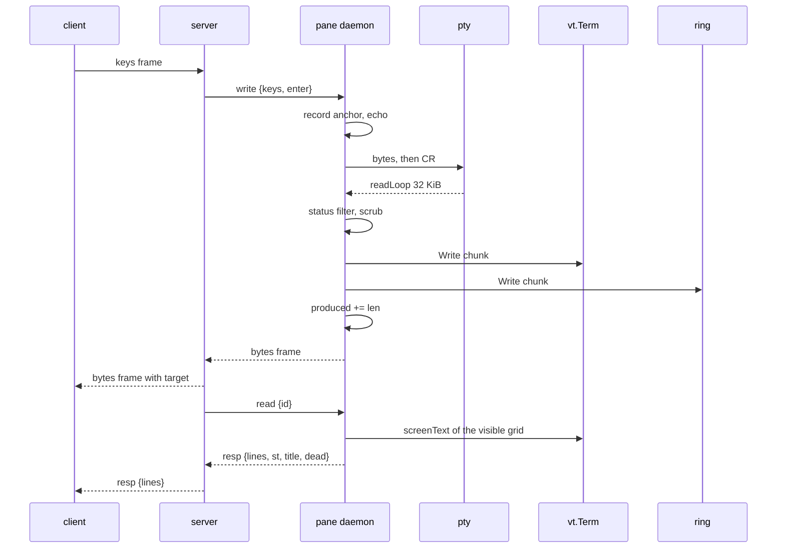

# The pane daemon

A pane daemon is the process that owns one pane. It holds the pane's pseudo terminal, its terminal emulator, its scrollback buffer and its status. Read this page to change how a pane runs a program, keeps history or answers the status protocol. The page stops at the daemon's socket. [The protocol](03-protocol.md) owns the frames and [The server](04-server.md) owns the process that starts and watches a daemon.

A PTY (pseudo terminal) is a device pair. The daemon holds the master file descriptor and the shell reads and writes the slave. A VT screen is the terminal emulator on the other side of that PTY. It turns the shell's bytes into cells, a cursor and rows. A grid is the screen's table of cells. A scrollback buffer is a fixed-size byte buffer of recent output. A screen snapshot is the screen as it stands: the cells, the cursor, the styles and the modes. `Term.Snapshot` returns one (`internal/vt/snapshot.go#Term.Snapshot`).

## One process per pane

A pane daemon owns one pane: one PTY, one VT screen, one scrollback buffer and one status. It runs as `dm __pane`, which `main` dispatches (`main.go#main`). `Run` fills the `paneProc` struct that the package's methods hang off (`internal/pane/pane.go#Run`, `internal/pane/pane.go#paneProc`).

The pane is a separate process for two reasons. The first is lifetime: the daemon must outlive the server that spawned it.

- `internal/pane/pane.go#paneProc`: "The session server comes and goes; this process does not."
- `internal/server/server_core.go#server.ensurePane` starts the daemon with `Setsid: true`, so the pane leaves the server's session and process group. A server crash signals nothing in the pane.
- `internal/wire/wire.go#Msg`: "pane daemons outlive servers".

The second reason is memory. A pane's memory limit is a GC setting for a whole process (`debug.SetMemoryLimit`, `internal/pane/pane.go#Run`). Each pane keeps its own scrollback budget. The pane can change that budget while it runs (`set-history`, `internal/pane/pane.go#paneProc.serve`). A shared daemon could not hold one limit per pane.

The pane talks to a socket, not to a caller. The socket is `sessions/<name>/panes/<id>.sock`, built by `paths.PaneSock` and `PaneSockAt` (`internal/paths/paths.go#PaneSock`, `internal/paths/paths.go#PaneSockAt`), with mode 0600. The server dials it from `ensurePane` (`internal/server/server_core.go#server.ensurePane`). The `dm wait` subcommand dials it directly (`internal/cli/cli.go#runWaitAt`). Any number of connections may read at once, and the daemon never dials out.

The daemon also guards its own lifetime. `reapOrphans` stats the socket every 5 seconds. It kills the shell's process group and exits when the path is gone or names another file (`internal/pane/pane.go#paneProc.reapOrphans`). When the shell exits, the daemon shuts the PTY and waits 2 seconds for attach clients to read the exit. Then it removes the socket and exits (`startShell`, `internal/pane/pane.go#paneProc.startShell`).

## The spawn

The server builds the command in `paneCommand` (`internal/server/server_core.go#paneCommand`). It passes `--id`, `--session`, `--cwd`, `--shell`, `--cols`, `--rows` and `--history` first. It adds `--argv` (a comma separated program and arguments) and `--plugin-env` (a JSON array of `KEY=VALUE` pairs). It adds `--fg` and `--bg` when the client reported its terminal colours. `parsePaneArgs` validates all of it into a `paneOpts` before `Run` touches a PTY or a socket (`internal/pane/pane.go#parsePaneArgs`).

A pane with no `--argv` runs the shell the server passed, with `-l` and nothing else (`paneCmd`, `internal/pane/pane.go#paneCmd`). The child gets exactly the `--shell` value, and an absent `--shell` execs an empty program name. The server fills that flag from `os.Getenv("SHELL")` (`internal/server/server_core.go#server.addPaneStateAt`). `Run` computes `resolveShell` into `paneProc.shell` (`internal/pane/pane.go#resolveShell`). No spawn path reads that field, so its `$SHELL` and `/bin/sh` fallbacks never reach the child. The program runs in `--cwd` and learns its own ids last: `DM_PANE` and `DM_SESSION`, always.

The rest of the environment is an allowlist, not an inheritance (`Env`, `internal/pane/env.go#Env`). A name survives in one of three cases. It is in `paneEnvKeep` (PATH, HOME, USER, LOGNAME, SHELL, TERM, TERM_PROGRAM, COLORTERM, LANG, TZ, TMPDIR, WAYLAND_DISPLAY, DISPLAY, SSH_AUTH_SOCK, XAUTHORITY, DM_STATE). It starts with `LC_` or `XDG_`. It ends in `_SOCK`, holds an absolute path, and carries no credential word in its name. The credential words are TOKEN, SECRET, PASSWD, PASSWORD, CREDENTIAL, API_KEY, PRIVATE_KEY, AUTH and COOKIE, as `envPathName` decides (`internal/pane/env.go#envPathName`). Everything else is dropped. So `MY_SOCK=/run/x.sock` passes, `MY_SOCK=pass:secret` fails on the value, and `MY_TOKEN_SOCK=/run/t.sock` fails on the name. The reason is not secrecy, and the comment at `internal/pane/env.go#Env` says so. A variable that reaches a shell is published twice: on the screen and in every read-back. The server's redaction only knows the values it registered. Plugin pairs ride on top of the allowlist.

## The two loops

`startShell` calls `pty.StartWithSize` with the grid's current size (`internal/pane/pane.go#paneProc.startShell`). It starts `readLoop` and `watchShell`, then waits on the shell process. One goroutine reads the master and one dedicated goroutine writes it.

- Inbound: `queueWrite` never blocks (`internal/pane/pane.go#paneProc.queueWrite`). It pushes one `ptyWrite{b, enter}` onto a 256 deep channel and counts a drop when the channel is full. `drainPtyWrites` is the only writer, and it writes `\r` after the payload when `enter` is set (`internal/pane/pane.go#paneProc.drainPtyWrites`). A PTY whose reader is gone cannot stall the control socket.
- Outbound: `readLoop` reads 32 KiB at a time (`internal/pane/pane.go#paneProc.readLoop`). It runs the OSC filter, then the redaction stage, and hands the clean bytes to `publishLocked` (`internal/pane/pane.go#paneProc.publishLocked`).

`publishLocked` is the one place output becomes state. It writes the chunk to the VT and to the scrollback buffer. Then it adds to `produced`, the count of bytes the PTY has produced after the filter. It broadcasts a `bytes` frame and arms the quiet flush timer. It clears the Enter anchor if the alternate screen was entered or left inside that chunk. It broadcasts a `mode` frame when the alternate screen, mouse reporting or bracketed paste changed.

The flush matters. The parser holds the last grapheme cluster until the next rune proves it complete. One rune cannot say whether the next one joins it. A cluster placed early would paint one cell for the base and another for the mark that belonged to it (`internal/vt/parser.go#parser.rune`). So `armFlushLocked` places the cluster after 16 ms of quiet (`internal/pane/pane.go#paneProc.armFlushLocked`, `flushIdle`). A program that writes once and waits sees its last character on the grid.

## The screen model

The screen is `internal/vt`, not `internal/pane`. `vt.Term` holds a grid, a parser and the parser's pending state (`internal/vt/term.go#Term`). `vt.Term.Write` is the whole entry point (`internal/vt/term.go#Term.Write`). The pane never parses bytes itself: it holds a `*vt.Term` and calls `Write`, `Flush`, `Grid()`, `Snapshot()` and the OSC 133 mark readers.

The parser is a byte state machine (`internal/vt/parser.go#parserState`). Its states are ground, escape, CSI, OSC, DCS and charset. Each state survives a chunk boundary, so a sequence split across two reads parses as one read would. Ground state accumulates one grapheme cluster at a time and calls back into `Term.place`. The CSI families sit in their own files: `csi_cursor.go`, `csi_edit.go`, `csi_erase.go`, `csi_margin.go`, `csi_rect.go`, `csi_report.go`, `csi_scroll.go`, `csi_sgr.go`, `csi_tab.go` and `csi_mode.go`. OSC is one file, `internal/vt/osc.go`. An OSC is a string the terminal reads: `ESC ]`, a number, `;`, the body, then `ESC \\`. The grid that owns the cells, the scroll region, the modes and the saved cursors is `internal/vt/grid.go`.

Two stages sit before the VT. `osc.Filter` answers the queries a terminal is expected to answer (`internal/osc/osc.go#Filter`). Those are the OSC 10, 11, 12 and 4 colours and the cursor position report. They also include the primary and secondary device attributes, DA1 and DA2. The same filter consumes OSC 7501 and OSC 7502 entirely, so neither frame reaches the VT. OSC 7501 reports the program's status and OSC 7502 names the JSONL session file it writes (`osc.ParseSession`, `internal/osc/osc.go#ParseSession`). The redaction stage (`internal/pane/scrub.go`) then rewrites secret values. Everything downstream sees the cleaned bytes: the grid, the scrollback buffer, the broadcasts and every read-back. That is why a copy and a replay cannot leak a value the pane was told to hide. Both read the scrollback buffer, and the buffer only ever holds redacted bytes.

## The scrollback buffer

The scrollback buffer is `scrollRing`, a fixed circular byte buffer created by `NewRing` (`internal/pane/pane.go#scrollRing`, `internal/pane/pane.go#NewRing`). It holds the raw filtered output stream, not rows. Its budget comes from the `history-lines` config key (`internal/keymap/config_parse.go#parseKeymaps`). `HistoryBytes` turns that row count into bytes at 256 per line, keeps at least 512 KiB and caps at 8 MiB (`internal/keymap/config_model.go#Config.HistoryBytes`). The pane accepts a budget from 64 KiB to 8 MiB and refuses anything else (`historyBudget`, `internal/pane/pane.go#historyBudget`). `Run` sets the daemon's GC memory limit to that budget plus 32 MiB of headroom (`debug.SetMemoryLimit`, `internal/pane/pane.go#Run`). Writing wraps in place, so a burst never grows the heap. `Resize` copies the newest bytes into a fresh buffer.

Three consumers read that buffer, and they differ:

- The client asks the server for a `replay` when the operator scrolls (`internal/client/client_input.go#tui.requestHistory`). It caches the reply in `t.hist`, the per-pane buffer map on `tui` (`internal/client/client_model.go#tui.hist`). It builds a tall terminal from the reply with `vt.ReplayRows` (`internal/client/client_input.go#tui.buildScroll`). A later `bytes` frame drops the cached copy, so the next scrollback asks again (`internal/client/client_model.go#tui.apply`).
- The pane's buffer is the authority. The `replay` action hands the whole buffer to the server (`case "replay"`, `internal/pane/pane.go#paneProc.serve`). That is how a client that fell behind, or a scrollback opened after a redaction toggle, gets a clean copy.
- `dm read <pane> --scrollback N` replays the pane's buffer into a terminal of the pane's own PTY size. It never uses the layout rect, and it returns the rows above the live screen (`paneHistory`, `internal/server/server_mutate.go#server.paneHistory`).

`vt.ReplayRows` is why a replay is correct at all (`internal/vt/replay.go#ReplayRows`). The program wrote its escapes for its own screen size, so the replay uses that size and counts scrolls itself. A taller terminal loses the screen. A scroll region is the row range a program sets with DECSTBM to keep its own output inside it. A clear inside a scroll region must push the rows it clears into the buffer first, or the history loses them. Nothing is captured while the alternate screen is up.

## The Enter anchor

`yank` and `wait` must answer one question. Where does the last command's output start and end in a byte stream? A prompt redraw puts bytes before the output. The PTY echoes the command line back. The prompt after the command is not output.

The shell can help. With shell integration on, it writes OSC 133 marks into its own output. `A` comes before the prompt, `B` after it, `C` at the command start and `D` at the command end. A `D` can carry the exit status, as in `D;0;130`. There `130` is the status and the leading `0` is padding the shell integration adds (`internal/vt/osc.go#Term.oscPrompt`). The VT records each mark as a stream byte offset, in the same coordinates as `produced`.

The pane records a position, not a screen. A `write` with `enter` set, or with a CR or LF in the bytes, stores `anchor = produced`. It sets `anchorSet` before the write reaches the PTY (`internal/pane/pane.go#paneProc.serve`). The output the Enter causes therefore lands after the anchor. The pane also stores the text it wrote in `echo`, capped at 4096 bytes (`echoMax`). A longer write is a paste, not a command line.

`yankTailLocked` then slices the buffer (`internal/pane/pane.go#paneProc.yankTailLocked`):

1. Start at the anchor. Prefer the shell's OSC 133 C mark when the shell reported one at or after the anchor. A prompt that repaints the line on Enter puts non-output between the two.
2. Without a mark, drop the recorded echo when the buffer bytes at that offset match it. Then drop the CR or LF the PTY echoed, but only when nothing but line ends sits before the newline.
3. End at the OSC 133 D mark, at the next A mark, or at the current end of the stream.
4. Replay the slice through a terminal at the pane's size and skip leading blank rows (`yankRows`, `internal/pane/pane.go#yankRows`). The client drops trailing blank rows at `internal/client/client_input.go#tui.takeYank`.

A resize never reads or writes `p.anchor`. Only a write records it (`internal/pane/pane.go#paneProc.serve`), and only an alternate-screen excursion clears it (`internal/pane/pane.go#paneProc.publishLocked`).

## The status protocol

A program reports its state by writing an OSC 7501 sequence into its own stdout: `ESC ] 7501 ; state=working:app=pi:msg=<b64> ESC \`. The filter parses it with `osc.ParseStatus` and never forwards it (`internal/osc/osc.go#ParseStatus`). The protocol also accepts a JSON form and a bare state. The state is validated against a closed set: `idle`, `working`, `blocked`, `done`, `error` and `unknown` (`knownState`, `internal/osc/osc.go#knownState`). `clear` and any unknown word become `unknown`, so a report can never put free text into a place the CLI prints. A status is that report: the state word, the app that sent it and an optional message.

`setStatus` redacts the message and the app name under the pane lock (`internal/pane/pane.go#paneProc.setStatus`). It stores the result and broadcasts a `status` frame when the status changed. The server's `watchConn` takes that frame and does four things (`internal/server/server_core.go#server.watchConn`). It records the state on the pane connection. It persists the reporting app and the agent mark in the state file (`noteStatus`, `internal/server/server_view.go#server.noteStatus`). It stamps the second the state moved (`noteStatusChange`, `internal/server/server_view.go#server.noteStatusChange`). It pushes the session snapshot, which is the server's whole state (`wire.Snapshot`, `internal/wire/wire.go#Snapshot`), so the sidebar repaints. On a transition into `blocked`, `done` or `error`, it also posts to the pane's notify topic (`notifyPaneState`, `internal/server/notify_server.go#server.notifyPaneState`).

An application probes support before it reports. It writes `ESC ] 7501 ; ?`, and `replyQuery` answers with the pane's current status and the leading `?` echoed (`internal/pane/pane.go#paneProc.cursorPos`). The reply reads `ESC ] 7501 ; ? state=<state>[:app=<app>][:msg=<b64>] ESC \` (`formatStatusQuery`, `internal/pane/pane.go#formatStatusQuery`). The pane is the program's terminal, so the status it already holds is the honest answer. These replies enter the PTY through the same write queue as keystrokes.

`dm __probe` is the test harness for that handshake (`probe.go#runProbe`). It reports, clears and prints `PROBE-REPLY=ok`, `PROBE-REPORTED` and `PROBE-CLEARED` inside a pane. Run it in a pane to check a build.

## OSC 7502 session

A program that writes a structured session names its file with an OSC 7502 frame: `session=<base64 path>;id=<id>`. The filter parses it with `osc.ParseSession` and never forwards it (`internal/osc/osc.go#ParseSession`). Three outcomes exist. A decoded path sets the session. An empty `session=` value clears it, because the agent that wrote the file is gone. A frame with no `session` key, or a path that does not decode, changes nothing. The pane keeps the last good value.

`setSession` keeps the pair on the pane and broadcasts a `session` frame when the pair changed (`internal/pane/pane.go#paneProc.setSession`). A reader that attaches later draws it from the replay reply. The server's `watchConn` records it on the pane connection (`internal/server/server_core.go#server.watchConn`). `allPanesLocked` publishes it as `SessionFile` and `SessionID`, and an empty pair clears it (`internal/server/server_view.go#server.allPanesLocked`). A pane exit drops it. The session is never persisted, so a restart or a respawn means the program starts a new one.

## Waiting for output

`wait` is a streaming request on the pane socket, used by `dm wait`. It sends a `resp` first: the yank-shaped tail of the command in flight. It then streams the pane's `bytes` frames to that connection. It ends with one final `resp` carrying `exit` and `waitReason`.

Two completion paths exist, and the pane picks by what the shell told it:

- Mark path. When the VT has seen an OSC 133 prompt or command mark, the wait ends on a D mark. That mark must sit at or after the start anchor. The exit code comes from the most recent D mark at or after that anchor that carried one. It does not come from the latest D. The shell's prompt hook can print a bare D after the command's own coded mark (`waitEndLocked`, `internal/pane/pane.go#paneProc.waitEndLocked`). Publish runs the same check, so the final reply lands after the bytes it belongs to and before anything later.
- Children path. With no marks, `pollWaitChildren` samples the shell's direct children from `/proc` every 500 ms (`internal/pane/pane.go#paneProc.pollWaitChildren`). The wait records `childSeen` from the sample it takes before it registers. The poll ends the wait on the first empty sample once `childSeen` is set. A wait that a reflow demotes gets `looseStart`, the flag that drops the `childSeen` requirement. The command can start and finish before the demotion, so an empty sample alone ends it. The exit code is unobservable there, so the reason is `children`, not `mark`.

A shell that is already dead ends the wait at once with reason `dead`. A second concurrent wait on the same pane is refused with `a wait is already running`. A reflow demotes a marked wait to the children path: the `reflow` case sets `looseStart` and starts the poll itself (`internal/pane/pane.go#paneProc.serve`).

`read` is the simpler sibling. It returns the visible screen as lines, plus the status and `{title, dead}`. The scrollback buffer keeps output whether or not anyone is attached, so `read` always sees the current screen. A caller that wants the stream must connect before the bytes it wants.

## Resize and reflow

The server pushes `resize` with the pane's `cols` and `rows` (`syncSizes`, `internal/server/server_view.go#server.syncSizes`). The pane takes one of two paths (`case "resize"`, `internal/pane/pane.go#paneProc.serve`):

- A width change, with or without a height change: try `Grid.Rewrap` (`internal/vt/csi_margin.go#csiSetTopBottomMargins`). It joins autowrapped rows into logical lines and wraps them at the new width. It refuses on the alternate screen or under an application scroll region, and returns false. The pane then takes the plain `Grid.Resize`.
- A height change alone: plain `Grid.Resize`. There is nothing to re-wrap.

The grid takes the new size before the shell is signalled, so a spawn that has not happened yet picks it up. Then `pty.Setsize` tells the shell.

A drag produces many width changes. The server merges them, waits 150 ms after the last one, and then asks each affected pane for `reflow` (`settleReflow`, `internal/server/server_view.go#server.settleReflow`). `reflow` replays nothing and re-wraps nothing. It returns the screen snapshot plus the modes, and the server broadcasts it. A drag therefore repaints once at its final width, not on every column.

## The pane's actions

The pane switches on `Action` only and has no default case (`serve`, `internal/pane/pane.go#paneProc.serve`). Seventeen actions exist.

| action | what it does |
| --- | --- |
| `write` | writes keys to the PTY, with an Enter when the frame sets it |
| `resize` | takes a new size, then rewraps or resizes the grid |
| `read` | returns the visible screen as lines, plus the status, title and dead flag |
| `screen` | returns a screen snapshot and the modes |
| `reflow` | returns a screen snapshot after a drag, with no replay |
| `screen-sub` | returns a snapshot at once, then one after every output burst |
| `yank` | returns the rows the last command produced |
| `replay` | returns the scrollback buffer, plus the status, title and modes |
| `status` | returns the current status |
| `cwd` | returns the shell's working directory |
| `term-colours` | takes the terminal's foreground and background colours |
| `set-history` | sets the scrollback budget |
| `set-secrets` | sets the values the redaction stage hides |
| `toggle-secrets` | masks or reveals the registered secret values |
| `ping` | answers to prove the daemon is alive |
| `wait` | streams output until the command ends |
| `kill` | answers, then shuts the daemon down |

An unknown action gets no reply at all. A caller must set a read deadline and filter frames by `Type`, because the pane also pushes frames unasked.

| pushed frame | meaning |
| --- | --- |
| `bytes` | new output for the pane |
| `status` | the program's status changed |
| `cwd` | the shell's working directory changed |
| `title` | the terminal title changed |
| `mode` | the alternate screen, mouse reporting or bracketed paste changed |
| `scrub` | the pane repainted after the redaction switch came back on |
| `exit` | the shell exited |

`screen-sub` is for a renderer that wants screens, not bytes. It sends one snapshot at once, then a coalesced snapshot after every burst of output. The frames queue under the lock, so an older screen cannot land after a newer one.

`scrub` is the repaint after the redaction switch is turned back on (`internal/pane/pane.go#paneProc.scrubPaintedLocked`). The pane rewrites its scrollback buffer and its grid from the same value list. Then it sends a fresh screen snapshot of the result.

The rest of what the daemon produces is sampling, not requests. `watchShell` reads the shell's cwd from `/proc/<pid>/cwd` and its title from the VT every 500 ms. It broadcasts only on a change (`internal/pane/pane.go#paneProc.watchShell`).

## Write and read

`target` in the diagram is the pane id, `id` the request id, `st` the status and `produced` the byte counter.

## What it cannot see

The daemon has no idea what a window is. It does not import the layout, session or keymap packages. It knows its own id, its session name, a cwd, a shell, a size, a screen, a scrollback buffer and a status. It cannot see a workspace, a window, a focus change, a split ratio, a sibling pane, a client or a name. It does not know how many readers it has beyond a subscriber set, and it does not care which one is focused.

Three consequences follow. Sizing arrives as `cols` and `rows`, never as a rectangle. A pane in a hidden workspace keeps its old size until the server syncs it. Closing a pane is the server's decision: it sends `kill` (`internal/server/server_mutate.go#killPanes`) or removes the socket, and the reaper collects the daemon. A pane cannot answer a question about the session, so anything naming a window belongs in the server's session snapshot.

## Adding an action

1. Add the case to the `serve` switch in `internal/pane/pane.go#paneProc.serve`, in action name order with its neighbours.
2. Give it a field on `wire.Msg` (`internal/wire/wire.go#Msg`, the one struct every frame is encoded from) if an existing field will not do. Add the key additively and pin the encoding with a test in `internal/wire/wire_test.go`.
3. Add the forwarding case to `handleReq` in `internal/server/server_rpc.go#server.handleReq` when a client must reach it. Send the frame with `pc.send` (`internal/server/server_core.go#paneConn.send`) or `paneRequest` (`internal/server/server_view.go#paneRequest`).
4. If the action reads a screen snapshot or the scrollback buffer, lock `p.mu`. That mutex guards the VT, the buffer and the status. Copy, then do the expensive work outside the lock, the way `yank` does.
5. Answer with an `ID` echo when the server is expected to match a reply. `screen` and `replay` do not, and their readers filter by `Type` instead.

## See also

- [The protocol](03-protocol.md) for the frame, the envelope and the full action matrix.
- [The server](04-server.md) for the pane spawn, the watcher and the resync.
- [Layout](07-layout.md) for the rectangles a pane is sized to.
- [The client](06-client.md) for the client's own scrollback and its sidebar.
- [Secrets](09-secrets.md) for the redaction stage this daemon runs.
- [README](../../README.md) for the OSC 7501 protocol as a program author writes it.
