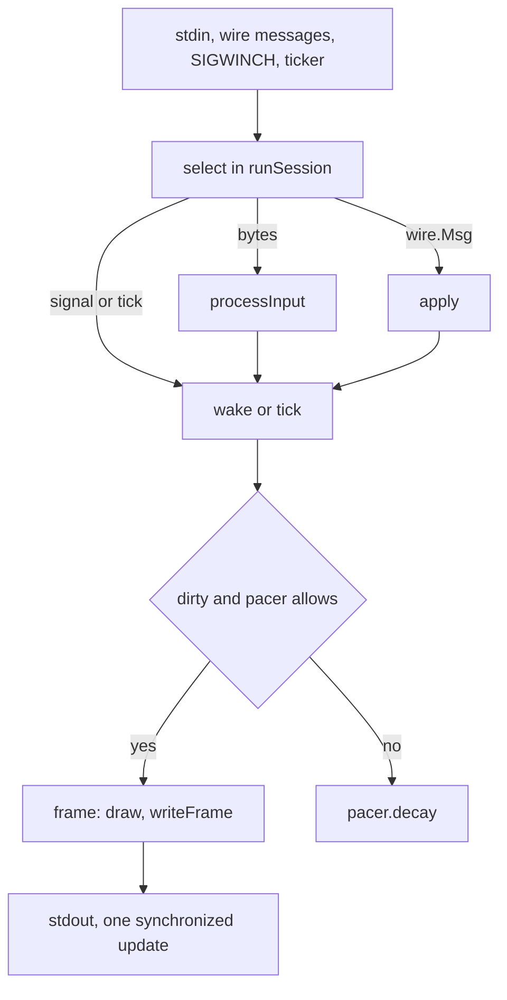
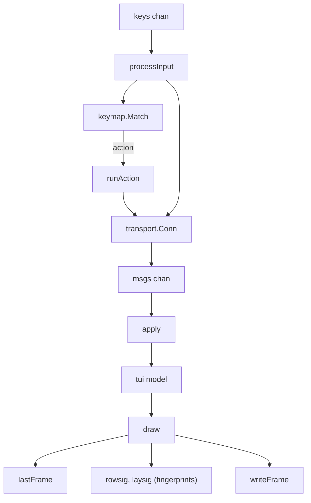

# The client

The client is one process of three: dm is one binary that runs the client, a session server and one pane daemon per pane (`main.go:18`, `main.go:21`). The client owns the terminal and talks to one session. The session is the session server: the daemon that owns the pane tree and listens on the session socket, `$XDG_STATE_HOME/dm/sessions/<name>/server.sock` (`internal/paths/paths.go:52`). "The server" on this page always means that daemon. A message is one `wire.Msg` on that socket: a length-prefixed JSON envelope with a `type`, read one at a time by `wire.ReadMsg` (`internal/wire/wire.go:17`).

A session holds a tree of workspaces, windows and panes (`internal/session/state.go:94`). A pane is one program with its own pty and its own screen, and the pane's daemon owns both, plus the scroll ring, the pane's history in raw bytes (`internal/pane/pane.go:31`), so a pane outlives the client and the server. A workspace is a named group of windows, and it may carry a project name: workspaces that share a project name form one group in the rail. A window is a set of panes. The rail is the sidebar down the left edge that lists that tree, one project, workspace, window or pane row per line, and it is server state and client paint. The server gives every pane and the rail a rectangle, called a rect, and the arrangement of those rectangles is the layout.

The client runs no pane process and no shell, and owns no layout. It keeps a local terminal (`vt.Term`: a grid, a parser and the styles, `internal/vt/term.go:6`) per visible pane, feeds each one the bytes the server sends, and paints the result plus its own chrome. The chrome is the furniture around the panes: the pane borders; the grips, the one-cell drag marks between two panes; the divider, the gap between two panes; the rail; the tab bar, the window tabs; and the bar, the status line. A frame is one paint: the bytes that one `draw` hands to the terminal.

The client paints on a damage diff. Damage is the set of rows a change touched, so a frame rewrites only the rows whose contents moved, plus the bands whose rows an overlay took or left; a band is one screen region painted from its own buffer. An overlay is a widget that paints over the panes and owns the keyboard, and the overlay table below lists them.

Every change of session state is a request to the server, never a local edit. What the client draws before the server agrees is only its own state: the selection (the text range the mouse dragged), the hover (the link under the pointer while ctrl is held) and whatever an overlay holds. This page answers how all of that works, and where you add a key action, an overlay or a band.

## File map

All paths are `internal/client/`. 21 files, 11552 lines without tests, measured at commit `0073d23` (2026-11-18). A bare `:N` on this page is a line in the file named just before it. `damage_test.go`, `shot_oracle_test.go` and `pace_loop_test.go` hold the client to its behaviour: they build a `tui` (the client model, `internal/client/client_model.go:60`) with its frame sink `t.out` pointed at a `bytes.Buffer`, and call `draw` or `tick` directly, so no terminal is involved.

| file | owns |
| --- | --- |
| `client_model.go` | the `tui` model, `Run`, `runSession`, the tick, `apply` |
| `client_input.go` | byte decoding, mouse, paste, scrollback, the inline inputs, `processInput` |
| `client_keys.go` | `runAction`, menus, picker, dashboard keys, reload, `action` |
| `client_view.go` | `draw`, the band and row diff, `writeFrame`, `cursorBlock` |
| `pacing.go` | the frame pacer |
| `render_pane.go`, `render_bar.go`, `render_tabbar.go`, `render_toast.go`, `render_modal.go` | pane content, the pane borders, the grips, the divider, the bar, the tab bar, toasts, pickers, help |
| `command_palette.go`, `layout_switcher.go` | the two palettes (a centred list of commands, and of layouts) |
| `client_floats.go`, `client_float.go`, `client_float_cmd.go` | the box, keymap view, float stack, floating command |
| `client_notify_float.go`, `client_notify.go` | the notification centre and its catch-up |
| `client_body_reader.go`, `client_clip.go`, `scroll_search.go` | body reader, clipboard, scrollback search |
| `switcher_wire.go` | the dashboard (the full-screen table of every pane in the session, `internal/switcher/switcher.go:63`): open, close, pick |

## The loop

`Run` (`internal/client/client_model.go:493`) sets raw mode, asks the outer terminal (the terminal emulator dm runs in) for its foreground and background colours (OSC 10 and OSC 11) and for its clipboard (OSC 52), starts the stdin reader and the `SIGWINCH` handler, and only then enters the alternate screen with mouse reporting and bracketed paste, a pasted block wrapped in markers. It then calls `runSession` in a loop. A session switch, which is the client leaving this session without ending it, returns a new name and the loop draws again with the same raw terminal.

`runSession` (`:660`) dials the server, sends `attach` (the first message: this client exists, and this is its terminal size), starts one reader goroutine over `wire.ReadMsg`, and selects on four sources: stdin bytes, messages, `SIGWINCH` and the pacer's ticker, the frame timer. A change sets `dirty`, the flag that says the screen needs a frame.

`wake` (`:641`) floors the pacer and draws at once when a frame is due. `tick` (`:612`) runs the expiry timers (a toast's lifetime, a stalled paste, a partial OSC reply, the dashboard's preview, a stalled key sequence and an overlay's lone escape), places a quiet pane's pending grapheme cluster, and draws at most one frame. The cluster is the parser's held rune: it waits for the next rune to prove it complete, so a program that writes once and waits would show one character short, and `flushIdle` places it after `idleFlush` (16ms, `:57`) of quiet. Both `wake` and `tick` end in `frame` (`:649`), which clears `dirty` and tells the pacer whether the frame wrote any bytes. The pacer is a value, not a goroutine (`internal/client/pacing.go:16`): it floors the interval at 16ms, doubles it on empty ticks to 250ms, and resets it on a wake, so a burst coalesces and an idle client almost never wakes. The `decay` node in the diagram is `pacer.decay` (`internal/client/pacing.go:66`), the empty tick's doubling. A frame is delayed, never dropped: `dirty` is a flag, so the next frame carries the newest state. `apply` updates the model and marks it dirty, and the pacer decides when the pixels follow.

The second diagram is the same loop with the input half expanded. `stdinReader` (`internal/client/client_model.go:575`) writes each read into `keys`, the reader goroutine (`:692`) writes each message into `msgs` (256 buffered), and `transport.Conn` is the socket with a write mutex (`internal/transport/transport.go:24`). The model is `tui`, whose fields fall into the three groups of the next section, and `lastFrame` is the paint memory at `internal/client/client_model.go:353`.

## The model a frame is built from

`tui` (`internal/client/client_model.go:60`) holds three groups.

- The server's truth: `snap` (a `wire.Snapshot` with the pane rects, the rail width, the focused pane, the zoom and the pane list, `internal/wire/wire.go:216`; zoom is the one pane drawn full screen) and `vts`, one `vt.Term` per visible pane. `hist` holds a pane's replay ring only after a scrollback entry asked for it: scrollback is the history above the live screen, entered by the scrollback action or the wheel, and the replay ring is the raw bytes of that history, which the server forwards untouched. The ring has three names here: the scroll ring the pane's daemon keeps, the replay ring the client receives, and the history ring a scrollback shows. `histMeta` records the rect and whether the reply landed.
- Local overlays: `floats` (a `[]*panel.FloatingPane` stack; a float is a pane-shaped box with its own content, painted over the layout at an arbitrary rectangle, in no tree, `internal/panel/float.go:14`), `box` (the message box), `keys` (the keymap view), `ncentre` (the notification centre), `lsw` and `cp` (the layout and command palettes), `sw` (the dashboard), `float` (the floating command), `menu` (a row menu), `toasts` and `mode`, the string that says which one owns the keyboard. The `keys` field is not the `keys` channel, and the `float` field is not the `float` mode.
- Paint memory: `last` (`internal/client/client_model.go:353`), one `paint` per band (the bytes a band wrote and the screen rows they cover), `rowsig` (one fingerprint per pane row) and `laysig` (the shape of the picture).

A frame reads nothing from the server: it is computed from those fields alone, which is why every test can draw one without a socket.

## How a frame reaches the terminal

`draw` (`internal/client/client_view.go:42`) renders every band into its own buffer: the pane borders, the grips, the divider, the rail, the tab bar, the bar, the toasts, the overlays, then the float stack. Each band keeps its last bytes in `last`; a band whose bytes did not change is not written.

Pane content is compared per row. `paneRowSigs` (`:395`) folds every cell, its colours and attributes, the selection, the hover and the scrollback row into one `uint64` per row, so `draw` repaints a row only when its fingerprint moved. `drawPaneRow` (`internal/client/render_pane.go:184`) writes a row with an absolute cursor move, which is how `bandRows` (`internal/client/client_view.go:465`) recovers the screen rows a band touched. A band that moves the cursor another way breaks the diff, and `TestBandsUseAbsoluteCursorMoves` fails.

`layoutSig` (`:315`) names the shape: the size, the rail, the zoom, every pane and float rect, the window list, the active window, the focus, the mode, the scrollback pane and the dashboard rect. When it changes the next frame repaints whole and may clear. The rest is damage: the rows whose fingerprints moved, and the rows an overlay took or left. `rowsHit` and `rowsOverlap` decide which bands must re-ink those rows.

The body ends with `cursorBlock` (`:540`). The frame opens with `ESC[?7l` to turn wrapping off while the body is written, and `ESC[?7h` restores it before `ESC[?2026l` closes the synchronized update that `ESC[?2026h` opened, so the terminal swaps the frame in whole. `writeFrame` (`:304`) writes to `t.out`: a counting wrapper over `os.Stdout` in a session, a buffer in a test. Damage routing exists because a full repaint is both slow and visible, and the commit that introduced it says so: "Stop repainting the screen when one cell changed. This is the flicker." (`df1e39a`). A 60Hz client that cleared and repainted would flicker under every keystroke and through a nested pty: a pane's program runs on a pty, and that program can be dm. `TestFrameSteadyStateWritesNothing` and `TestFrameRepaintsOneRow` pin the win.

## Input decoding and the keymap handoff

`processInput` (`internal/client/client_input.go:299`) is the only decoder. It works on `t.inbuf` and loops until the buffer stops making progress, so one read can carry a paste, a mouse event and a keystroke in any order. The order is fixed.

1. An OSC 10, 11 or 52 reply: the terminal's foreground colour, its background colour, or its clipboard. It never reaches a pane. A partial one waits up to 500ms (`pasteTimeout`, `internal/client/client_model.go:40`), then falls through to the steps below as ordinary input.
2. The dashboard, the command palette, the help view, the box, the notification centre and the float, while each is up. Those own every key.
3. A bracketed paste, framed or bare (framed when the pane's program asked for bracketed paste, so the text arrives inside `ESC[200~` and `ESC[201~`; bare otherwise, `internal/wire/wire.go:133`), which closes an overlay and goes to the focused pane as one `keys` message, or a mouse event via `parseMouse`, dispatched by `handleMouse` (`internal/client/client_input.go:2068`).
4. The mode handlers: `rename`, `search`, `sessions`, `menu`, `layout`, `scroll`. `menu` is the row menu: a right press on a pane or a rail row opens a list of actions at that point (`openMenu`, `internal/client/client_keys.go:246`, `openRailMenu` at `:261`).
5. The prefix: the key that puts the client in front of the pane, `ctrl+b` in the default config (`internal/keymap/config_parse.go:867`). A prefix in the buffer arms the client (`armed`, `internal/client/client_keys.go:975`) and the bytes before it go to the pane. `expirePrefix` (`internal/client/client_input.go:829`) sends a stalled prefix to the pane as plain input.
6. Armed: `armedKey` (`:661`) asks the keymap for one action.

The handoff is one call: `t.km().Match("main", buf)` (`internal/keymap/config_model.go:327`). `"main"` is the keymap block name the client's own keys live in, and `km` is the keymap loaded from the config file `$XDG_CONFIG_HOME/dm/config.kdl` (written with the defaults on first run), or the built-in one when the file is missing. The call returns the action, the bytes consumed, and `Match`, `Partial` or `NoMatch`. `Partial` keeps the bytes and re-asks on the next read; `expireArmed` (`internal/client/client_input.go:774`) drops a stalled sequence after `escTimeout` (40ms, `internal/client/client_model.go:33`). A matched action goes to `runAction` (`internal/client/client_keys.go:804`), which either acts locally (`openBoxView`, `t.quit = true`, `disarm`) or sends a request through the functions `action` or `actionOn` (`:989`, `:997`). Those two are functions, not the keymap action and not the `action` field of a request.

An unbound key notifies and disarms: it never reaches a pane, because dm is not a passthrough for keys it has claimed. Most overlays resolve keys through a keymap mode: `menu`, `picker`, `switcher`, `layout`, `scroll`, `rename`, `box` (the box and the notification centre) and `help`. Three keymap mode names differ from the client's `mode` strings: the sessions picker is keymap mode `picker` and client mode `sessions`; the dashboard is `switcher` and `dashboard`; the notification centre is `box` and `notif`. The rest share one name: `menu`, `layout`, `scroll`, `rename`, `box` (the message box) and `help`. The command palette has neither a `mode` nor a keymap mode, and the floating command reads its keys by hand inside its own `float` mode. A config file that predates a mode falls back to the built-in keymap, as `keymapKey` does for `help` (`internal/client/client_floats.go:331`).

## Overlays and the float layer

Every overlay is one field, one open and close pair, one key handler, one paint function. The open sets a `mode` or a pointer, clears `armed`, drops buffered input and marks the frame dirty. The close clears both and drops `inbuf`, so a late escape never reaches a pane. The mode column is the client's `mode` string; the last column is the handler function, not a key.

| overlay | opened by | mode | key handler |
| --- | --- | --- | --- |
| message box | `openBoxView` (`client_floats.go:24`) | `box` | `boxKey` |
| notification centre | `openNotifyCentre` (`client_notify_float.go:244`) | `notif` | `notifKey` |
| keymap view | `openKeymapView` (`client_floats.go:278`) | `help` | `keymapKey` |
| sessions picker | `openPicker` (`client_input.go:2667`) | `sessions` | `pickerKey` |
| command palette | `openCommandPalette` (`command_palette.go:107`) | none | `commandPaletteKey` |
| layout palette | `openLayoutSwitcher` (`layout_switcher.go:76`) | `layout` | `layoutKey` |
| row menu | `openRailMenu` (`client_keys.go:261`) | `menu` | `menuKey` |
| dashboard | `openSwitcher` (`switcher_wire.go:22`) | `dashboard` when full screen | `switcherKey` |
| floating command | `openFloatFor` (`client_float_cmd.go:153`) | `float` | `floatKey` |
| scrollback | `startScroll` (`client_input.go:1220`) | `scroll` | `scrollKey` |
| rename prompt (a one-line input) | `openRenamePrompt` (`client_input.go:2702`) | `rename` | `renameKey` |

Two more keyboard owners are sub-modes, not overlays: the scrollback search (`openSearch`, `client_input.go:1001`, mode `search`) and the prefix help box (`arm`, `client_keys.go:975`, no mode). Two overlays differ from the rest: the dashboard and the command palette are checked by pointer, not by `mode` (`processInput` tests `t.sw` and `t.cp` before it looks at `mode`), so they take the keyboard first. Every other overlay is checked by its `mode` string, which is the `mode` column above. The dashboard is the full-screen table of every pane in the session, with a preview band for the selected pane, and it takes its own `mode` only when it is full screen, because as a palette it leaves the panes live under it (`openSwitcher`, `switcher_wire.go:22`). It also keeps its own preview terminals (`swVT`) for panes outside the active window, filled by `screen` replies, because those panes have no bytes stream. Scrollback is a mode over a pane, not a float: `startScroll` asks for one `replay` ring and builds a tall `vt.Term` from it (`buildScroll`), a terminal as tall as the pane plus the history window in lines (`history-lines`, 2000 by default). The live pane keeps updating behind it and the tall terminal stays frozen, and `exitScroll` (`internal/client/client_input.go:1198`) drops the view, the offset and any search.

Every screen-owning mode hides the cursor; `cursorBlock` decides that from the mode, the float and the focused pane. `expireMode` (`internal/client/client_input.go:786`) closes any overlay whose lone escape stalled, so a lost byte cannot trap the keyboard. A float is a `panel.FloatingPane` in `t.floats`, painted by the same bands and keyed by id in `last.floats`; a toast is a message that expires after three seconds (`toastLifetime`, `client_model.go:50`). The floating command is the odd one: the server owns its pty, its bytes arrive as `bytes` messages with that float's id, and its exit arrives as `exit`. The client only routes keys to it, with a target.

## The rail

The rail is server state and client paint: the server publishes the width (`Rail`, `RailWant`) and the panes the rows are built from (`Snapshot.All`, every pane in the session, `internal/wire/wire.go:225`), and enforces everything; the client groups those panes into project, workspace, window and pane rows, and the thin rail keeps one pane row per pane and no group row. It draws them with `rail.DrawRail` (`internal/rail/rail.go:896`), hit-tests with `rail.RailItemAt` (`:830`) and sends a request for every change. The rail hover is `railHoverRow` (`internal/client/client_input.go:2340`), which turns the pointer cell into a row for the paint. The client never reorders the rail locally: it paints the drop marker, the insertion line where a dragged row would land, and waits for the snapshot.

- Toggle: `toggleRail` (`:2885`) sends `set-rail` with the width `railToggleWidth` picks. `railWant` remembers the last expanded width so a hidden rail comes back at it.
- Grip: the last rail column is the drag strip (`railGripAt`), unrelated to the pane grips. A drag sends `set-rail`, throttled to one request per 30ms and forced on release (`railDragTo`).
- Clicks: a caret, the fold triangle in a project, workspace or window row, sends `toggle-fold`; a row sends `focus` for the first pane the row names; a double click opens the rename prompt; a row drag sends `move-window` or `move-workspace` with the direction; a right press opens the row menu (`openRailMenu`).

## Reconnect and detach

Detach is local: the `detach` action sets `t.quit` and `runSession` returns. The deferred close runs, the terminal modes are restored, and the shell returns. Panes and the session file survive, and the session file is the saved tree, `state.json` under the session's state directory (`paths.StatePath`, `internal/paths/paths.go:69`), written by the server. A session switch is the same exit with a name: `pickSession` (`internal/client/client_input.go:2654`) sets `switchTo`, and `Run` re-enters `runSession` under the new name with raw mode still on. There is no in-place redial. When the server closes the socket the reader goroutine returns, `msgs` is closed, and the client leaves the alternate screen. The server sends `close` when the last pane ends the session, so that path quits without a read error. To get back in, attach again. Panes keep running across a server restart, and re-attaching rebuilds the client from one snapshot and one screen per pane (`s.attach`, `internal/server/server_view.go:786`). The one resync inside a connection is the server's: a client whose queue overflowed is rebuilt the same way (`resyncClient`, `internal/server/server_view.go:903`), and the client handles it as an ordinary `snapshot` plus `screen` message pair.

## The contract with the server

The client is a view with a request API. It sends four message types.

| sent | carries | meaning |
| --- | --- | --- |
| `attach` | `cols`, `rows` | this client exists and its size counts toward the shared layout, which the server sizes to the largest attached client (`internal/server/server_view.go:24`) |
| `resize` | `cols`, `rows` | the terminal changed size |
| `keys` | raw `keys`, optional `target` | typed bytes; only the floating command sets a target |
| `req` | `action` plus fields | the requests that change state (focus, split, close, move, zoom, layout, rename, the rail, the plugin and reload requests, `float-open` and `float-close` for the floating command, the secrets switch `toggle-secrets`: on, it masks the value of each registered secret (a credential the secrets store holds an address for) in a pane's screen and history; off, it reveals them) and the reads: `read` (a pane's recent lines), `screen` (a pane's visible screen), `replay` (a pane's history ring), `yank` (copy output) and the `msg-*` family (`msg-list`, `msg-clear`, `msg-watchers`) |

It receives ten types, each handled by `apply` (`internal/client/client_model.go:758`): `resp` (the reply to a `req`, with its action, an optional id and the result), `snapshot` (the whole chrome: the pane tree, every rect, the focus, the rail width), `screen` (one pane's visible screen, applied by target), `replay` (one pane's raw history ring, applied by target), `scrub` (a pane rewrote its ring and screen after `toggle-secrets` came back on), `bytes` (output for one pane, or for one float), `close` (the session ended), `exit` (a pane or a float ended), `box` (the message log changed) and `watch` (a watcher changed: a watcher is one pane's filtered read of the message log, its cursor is the highest sequence number served to it, and parked means a `msg-wait` (a reader's request that waits for the next matching entry) is outstanding on that filter; a watcher goes when its pane leaves the tree or, unparked, after `boxWatchTTL` (10 minutes, `internal/server/server_box.go:190`) with no read).

The rules that hold it together:

- The server owns layout, focus, names, rail width and pane life. The client never edits them locally.
- The client numbers its own requests in `wire.Msg.ID` (`yankID` for `yank`, `toggleID` for `toggle-secrets`, `floatID` for `float-open`, `notifyID` for the `msg-*` reads) and matches a reply by action and id, so an older one is dropped and a late failure never toasts over newer state. An unnumbered failure toasts.
- `replay` is asked once per rect and the ring is cached by rect (`histMeta`). A `screen` request carries an id, and the server answers it twice: a `screen` message carrying the picture, which has no id and is applied by target, and a `resp` that the ordinary resp path sees.
- The dashboard re-asks every `previewEvery` (250ms) and caches the terminal by pane in `swVT`.
- The client never writes a pane's screen itself. It feeds the bytes into a local `vt.Term` and paints what the terminal holds.
- Bytes are authoritative. The client never replays bytes into a live terminal; a replay fills the history ring only. The snapshot is the whole truth for the chrome, and a message the client does not know is ignored.

The full action matrix is in [The wire protocol](03-protocol.md).

## Where to add the next thing

A new key action: bind it in the default `keymap "main"` block (`internal/keymap/config_parse.go:867`), add a case in `runAction` (`internal/client/client_keys.go:804`), and send the request through `action` or `actionOn`. Every case ends the switch, so a case that handles the key locally must call `t.disarm()` itself before it returns. If the server needs an action that does not exist, add it in `handleReq` (`internal/server/server_rpc.go:15`) first.

A new overlay: add a field to `tui` (`internal/client/client_model.go:60`), write `openX` and `closeX`, give it a key handler, add it to the dispatch chain in `processInput` (`internal/client/client_input.go:299`) and to `expireMode` (`internal/client/client_input.go:786`), add a `paint` to the `lastFrame` field `last` (`internal/client/client_model.go:353`), add a band to the `bands` slice (`internal/client/client_view.go:42`), draw it in a `render_*.go` file, and bind an action that opens it.

A new frame row or band: write a draw function that uses absolute cursor moves, add its `paint` to `last`, add a `band` entry in `draw` with the right `over` list and `overlay` flag, and add an oracle case in `damage_test.go`. `over` holds the indices of the earlier bands this band paints over: when one of them rewrites, this one re-inks the cells it took. If the band never moves independently, it belongs in an existing buffer instead.

## See also

- [Entry point and lifecycle](02-lifecycle.md), [The wire protocol](03-protocol.md), [The server](04-server.md), [The pane](05-pane.md)
- [Layout](07-layout.md), [The box and the notify bus](08-surfaces.md), [Secrets](09-secrets.md), [Config and keymap](10-config.md), [Layers](11-layers.md)
