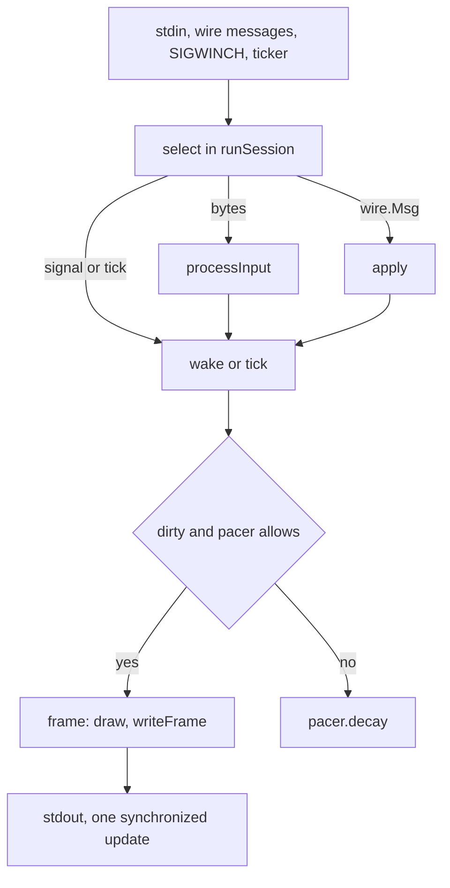
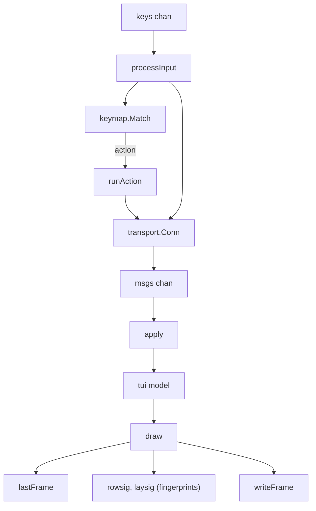

# The client

The client draws dm's screen and turns your keys into requests. Read this page to add a key action, an overlay or a screen strip, and to find the file that answers for a paint.

The client is the process you talk to when you run `dm`. It owns your terminal and attaches to one session. It runs no pane process and no shell, and it owns no layout.

A session is the server's saved tree of workspaces, windows and panes (`internal/session/state.go#State`). The session server is the daemon that owns that tree and listens on the session socket, `$XDG_STATE_HOME/dm/sessions/<name>/server.sock` (`internal/paths/paths.go#ServerSockAt`). "The server" on this page means that daemon. A message is one `wire.Msg` on that socket. It is a length-prefixed JSON envelope with a `type`, read one at a time by `wire.ReadMsg` (`internal/wire/wire.go#Msg`).

A pane is one program with its own PTY and its own screen. The pane daemon owns both, plus the pane's scrollback buffer, so a pane outlives the client and the server (`internal/pane/pane.go#paneProc`). [The pane](05-pane.md) owns that process.

A workspace is a named group of windows. It can carry a project name. Workspaces that share a project name form one group in the sidebar. A window is a set of panes. The sidebar is the column down the left edge that lists that tree, one project, workspace, window or pane row per line. It is server state and client paint. The server gives every pane and the sidebar a rectangle, called a rect, and the arrangement of those rectangles is the layout. [Layout](07-layout.md) owns the arithmetic.

The client keeps a local terminal for each visible pane (`vt.Term`: a grid, a parser and the styles, `internal/vt/term.go#Term`). It feeds each terminal the bytes the server sends, then paints the result plus its own chrome. The chrome is the furniture around the panes. It holds the pane borders, the drag handles between two panes, and the divider gap. It also holds the sidebar, the tab bar and the status bar.

A frame is one paint. A screen strip is one region of the screen, painted from its own buffer. The pane boxes are a screen strip, the status bar is a screen strip, and each overlay is a screen strip. A frame rewrites only the rows whose contents moved, plus the rows a screen strip or an overlay took or left. That comparison is the diff. A floating pane is a pane-shaped panel with its own content, painted over the layout at its own rect. It sits in no tree. An overlay is a widget that paints over the panes and takes the keyboard.

Every change of session state is a request to the server, never a local edit. The client draws only its own state before the server agrees. That state is the selection, the hover, the sidebar scroll and whatever an overlay holds.

## The loop

`Run` sets raw mode. It asks the outer terminal for its foreground and background colours (OSC 10 and OSC 11). It also asks for the clipboard (OSC 52) (`internal/client/client_model.go#Run`). It starts the stdin reader and the `SIGWINCH` handler. Only then does it enter the alternate screen, with mouse reporting and bracketed paste, and a pasted block wrapped in markers. It then calls `runSession` in a loop. A session switch is the client leaving one session without ending it. The switch returns a new name, and the loop draws again on the same raw terminal.

`runSession` dials the server and sends `attach` as the first message (`internal/client/client_model.go#runSession`). That message says this client exists and gives its terminal size. The function starts one reader goroutine over `wire.ReadMsg`. It then selects on stdin bytes, messages, `SIGWINCH` and the pacer's ticker, the frame timer. A change sets `dirty`, the flag that says the screen needs a frame.

`wake` floors the pacer and draws at once when a frame is due (`internal/client/client_model.go#tui.wake`). `tick` runs the expiry timers, then draws at most one frame (`internal/client/client_model.go#tui.tick`). The timers cover a toast's lifetime, a stalled paste, a partial OSC reply and the dashboard's preview. They also cover a stalled key sequence and an overlay's lone escape. `tick` also places a quiet pane's pending grapheme cluster. That cluster is the rune the parser holds back. It waits for the next rune to prove it complete. A program that writes once and waits would otherwise show one character short. `flushIdle` places it after 16 ms of quiet (`internal/client/client_model.go#idleFlush`).

Both `wake` and `tick` end in `frame`, which clears `dirty` and tells the pacer whether the frame wrote any bytes (`internal/client/client_model.go#tui.frame`). The pacer is a value, not a goroutine (`internal/client/pacing.go#pacer`). It floors the interval at 16 ms, doubles it on empty ticks up to 250 ms, and resets it on a wake. A burst therefore coalesces, and an idle client almost never wakes. `pacer.decay` is the empty tick's doubling (`internal/client/pacing.go#pacer.decay`). A frame is delayed, never dropped, because `dirty` is a flag: the next frame carries the newest state. `apply` updates the model and marks it dirty, and the pacer decides when the screen follows (`internal/client/client_model.go#tui.apply`).

The second diagram is the same loop with the input half expanded. `stdinReader` writes each read into `keys` (`internal/client/client_model.go#stdinReader`). The reader goroutine writes each message into `msgs`, which holds 256 (`internal/client/client_model.go#runSession`). `transport.Conn` is the socket with a write mutex (`internal/transport/transport.go#Conn`). The model is `tui`, whose fields fall into the three groups of the next section, and `lastFrame` is the paint memory (`internal/client/client_model.go#lastFrame`).

## The file map

All paths are `internal/client/`. One row per file, and what that file owns.

| file | owns |
| --- | --- |
| `client_ask.go` | the ask floating pane: open on a snapshot, keys, the answer send |
| `client_body_reader.go` | the message body reader |
| `client_clip.go` | the clipboard: the OSC 52 query and write, and the external carriers |
| `client_float.go` | adding a floating pane, removing one, and a floating pane's terminal paint |
| `client_float_cmd.go` | the floating command: open, label default, keys, diff split |
| `client_floats.go` | the message log view and the keymap view |
| `client_git.go` | the git facts box |
| `client_input.go` | byte decoding, mouse, paste, scrollback, the sidebar wheel, OSC replies |
| `client_keys.go` | key handling: `runAction`, menus, the arm and disarm helpers |
| `client_model.go` | the `tui` model, `Run`, `runSession`, the tick, `apply` |
| `client_notify.go` | the notify catch-up, its toasts and the status bar badge |
| `client_shelf.go` | the shelved panes tray |
| `client_view.go` | `draw`, the screen strips, the row diff, the frame writer, the cursor block |
| `command_palette.go` | the command palette |
| `layout_switcher.go` | the layout palette |
| `pacing.go` | the frame pacer |
| `prefs.go` | the choices kept between runs in `prefs.json` |
| `render_bar.go` | the status bar, the row menu, the shelved panes chip |
| `render_modal.go` | the sessions picker, the rename prompt, the search row, the help box |
| `render_pane.go` | pane content, one row at a time |
| `render_tabbar.go` | the window tab bar |
| `render_toast.go` | the toasts |
| `resize_js.go` | no resize signal in a browser |
| `resize_unix.go` | the terminal resize signal |
| `scroll_search.go` | the scrollback search model |
| `switcher_wire.go` | the dashboard: open, close, pick and the preview terminals |
| `update.go` | the startup update check and its cache |
| `update_js.go` | detaching that check in a browser |
| `update_unix.go` | detaching that check on a Unix |

`damage_test.go`, `shot_oracle_test.go` and `pace_loop_test.go` hold the client to its behaviour. They build a `tui` with its frame sink `t.out` pointed at a `bytes.Buffer`. They then call `draw` or `tick` directly, so no terminal is involved.

## The frame model

`tui` holds three groups (`internal/client/client_model.go#tui`).

The server's truth is `snap`, a `wire.Snapshot`. It carries the pane rects, the sidebar width, the focused pane, the zoom and the pane list (`internal/wire/wire.go#Snapshot`). Zoom is the one pane drawn full screen. `vts` holds one `vt.Term` per visible pane. `hist` holds the scrollback buffer's bytes after a scrollback opens. Scrollback is the history above the live screen, entered by the scrollback action or the wheel. Call those bytes the scrollback buffer, and the open view the scrollback. `histMeta` records the rect and whether the reply landed.

Local overlays are `floats`, `box`, `keys`, `lsw`, `cp`, `sw`, `float`, `ask`, `menu`, `toasts` and `mode`. The `floats` field is a `[]*panel.FloatingPane` stack (`internal/panel/float.go#FloatingPane`). The `keys` field is the keymap view, not the `keys` channel. The `float` field is the floating command, not the `float` mode. `mode` is the string that says which overlay owns the keyboard.

Paint memory is `last`, one `paint` per screen strip (`internal/client/client_model.go#tui.last`). A `paint` holds the bytes a screen strip wrote and the screen rows those bytes cover (`internal/client/client_model.go#paint`). `rowsig` holds one fingerprint per pane row and `laysig` holds the shape of the screen (`internal/client/client_model.go#tui.rowsig`, `internal/client/client_model.go#tui.laysig`).

A frame reads nothing from the server. It is computed from those fields alone, which is why every test can draw one without a socket.

## Paint primitives

Five packages hold the primitives a view shares, and none of them keeps state between frames. `cells` measures and cuts text by cell, with clipping, padding and elision (`internal/cells/cells.go#Cells`). A `segment.Seg` is one styled run: text, foreground, background, weight and the pin mark (`internal/segment/seg.go#Seg`). The pin mark holds a run in the block anchored to the last column. That is how the status bar pins `PREFIX ` to the right edge. `hintbar` builds the one key-hint row. It draws a filled cap around each key, then its label, with a faint pipe between the hints. The bar fits the cells the caller gives it (`internal/hintbar/hintbar.go#Bar`). `panel` builds a box. `PaintPanel` clips the interior to a rect, writes the title row and paints a hint bar on the bottom border (`internal/panel/panel.go#PaintPanel`). `DrawPaneBox` paints the border around content (`internal/panel/panel.go#DrawPaneBox`).

`ui` holds the values a view shares. A component is a value plus a pure draw, and the client keeps the state. There is no retained tree.

- `ui.Viewport` is the scrolling window a list draws through. It holds the row count, height, offset and selected row. Its steps move the window and keep the selection in view (`internal/ui/viewport.go#Viewport`).
- `ui.MessageList` is the list behind the message view. It holds the entries, the topic filter, the selection window, the read mark and the row painter (`internal/ui/messagelist.go#MessageList`).
- `ui.Input` is one line of editable text: the runes and the cursor, and the methods that insert, delete and move (`internal/ui/input.go#Input`). `DrawInput` reads the value and writes the row, the prompt, the text and the trailing text into the caller's buffer (`internal/ui/input.go#DrawInput`).
- `ui.Search` is one query over rows the caller owns. It holds the draft, the committed query and the matching rows with a cursor (`internal/ui/search.go#Search`). The scrollback search is one of these (`internal/client/scroll_search.go#ScrollSearch`).

`dm html` prints every component's props, state, keys, focus and composition rules. Read it before you change a component.

A floating pane paints with a shadow behind it (`panel.PaintShadow`, `internal/panel/shadow.go#PaintShadow`). A new overlay is a painter plus a screen strip entry.

## Drawing a frame

`draw` renders every screen strip into its own buffer (`internal/client/client_view.go#tui.draw`). The screen strips paint in a fixed order. The pane boxes and their chrome come first. The toasts and the overlays follow, then the floating panes, and the rename prompt last.

Each screen strip keeps its last bytes in `last`, and a screen strip whose bytes did not change is not written. Pane content is compared per row instead. `paneRowSigs` folds every cell, its colours and attributes, the selection, the hover and the scrollback row into one `uint64` per row (`internal/client/client_view.go#paneRowSigs`). `draw` repaints a row only when its fingerprint moved. `drawPaneRow` writes a row with an absolute cursor move, which is how `bandRows` recovers the screen rows a screen strip touched (`internal/client/render_pane.go#drawPaneRow`, `internal/client/client_view.go#bandRows`). A screen strip that moves the cursor another way breaks the diff, and `TestBandsUseAbsoluteCursorMoves` fails.

`layoutSig` names the shape of the screen (`internal/client/client_view.go#tui.layoutSig`). It covers the size, the sidebar, the zoom and every pane rect and every floating pane rect. It also covers the window list, the active window, the focus, the mode, the scrollback pane and the dashboard rect. When it changes, the next frame repaints whole and can clear the screen. The rest is damage, the rows a change touched. Those are the rows whose fingerprints moved, and the rows an overlay took or left. `rowsHit` and `rowsOverlap` decide which screen strips must paint those rows again (`internal/client/client_view.go#rowsHit`, `internal/client/client_view.go#rowsOverlap`).

The frame opens with `ESC[?2026h` and turns wrapping off with `ESC[?7l` (`internal/client/client_view.go#frameOpen`). It restores wrapping with `ESC[?7h` and closes the synchronized update with `ESC[?2026l` (`internal/client/client_view.go#frameClose`). The terminal therefore applies the frame in one go. The body ends with `cursorBlock` (`internal/client/client_view.go#tui.cursorBlock`). `writeFrame` writes to `t.out`, a counting wrapper over `os.Stdout` in a session and a buffer in a test (`internal/client/client_view.go#tui.writeFrame`).

A steady frame writes nothing. A written frame sits in one synchronized update, so the terminal applies it whole. The client repaints the whole screen only when the screen is not stable. That happens on a resize, a pane added, closed or moved, a focus change, or a change of view. `damage_test.go`, `shot_oracle_test.go` and `pace_loop_test.go` pin the steady frame, the one-row repaint, the screen strip cursor moves and the pace.

## The sidebar

The sidebar is server state and client paint. The server publishes its width (`Rail`, `RailWant`) and the panes the rows are built from (`Snapshot.All`, `internal/wire/wire.go#Snapshot.All`), and it enforces every change. The client builds the rows with `RailItems` (`internal/rail/rail.go#RailItems`). It paints them with `DrawRail` and hit-tests them with `RailItemAt` (`internal/rail/rail.go#DrawRail`, `internal/rail/rail.go#RailItemAt`). It sends a request for every change. The client never reorders the sidebar locally. It paints the drop marker, the insertion line where a dragged row would land, and waits for the snapshot.

Every row kind has its own content:

| row | carries |
| --- | --- |
| project header | the group colour bar, the project name, the workspace count |
| workspace | the fold arrow, the name, the pane count, one blank row between blocks |
| window | the fold arrow, the label from the `window-label` template, the branch, the dirty counts, a dim note row when the source pane has a commit message |
| pane | the recorded name, the last `app=`, the pane id and the state glyph in the last content cell |
| shelved pane | the pane row shape, under a shelf header |

The source pane is the pane a window row reads. It is the focused pane when that pane carries a branch. Otherwise it is the first pane in the window that carries one. Failing both, it is the focused pane, then the window's first pane (`WindowSource`, `internal/rail/rail.go#WindowSource`).

A group row paints the worst state of its members. A window row shows the worst of its panes. A workspace row shows the worst of its windows, and a project row the worst of its workspaces (`WorstState`, `internal/rail/rail.go#WorstState`). An unknown state never wins a rollup. A count appears only on a folded project or workspace row, where it is the only evidence of what the fold hides.

A project name hashes to one of six group colours (`RailAccentSlot`, `internal/rail/rail.go#RailAccentSlot`). When two live projects hash to the same slot, the later one takes the next free slot. Two projects in one session never share a hue (`RailItems`, `internal/rail/rail.go#RailItems`). The server pins the slot to the project name and carries it in the snapshot. A project keeps its colour when its neighbours join and leave.

A window row inside a repository carries a git field. It has two columns of six cells, added lines then removed, then a mark cell and a blank cell before its state. The field stands down whole first and the mark last. A narrow row elides its label and keeps the cell that opens the facts box. The facts box is a floating pane. It shows the branch, the head commit and the changed files for one pane's repository (`tui.gitFloat`, `internal/client/client_git.go#gitFloat`). The mark is painted when the worktree changes, or when the branch is ahead of or behind its upstream. It is also painted on a clean row under the pointer. The facts box therefore stays reachable. A pane row carries its own git mark only when its repository root differs from its window's source pane (`RailItem.PaneMark`, `internal/rail/rail.go#RailItem`). A click on that mark opens the pane's facts before the row takes the press (`RailPaneGitMarkAt`, `internal/rail/rail.go#RailPaneGitMarkAt`).

A press on the sidebar does one of these things:

| press | result |
| --- | --- |
| the fold arrow on a project, workspace or window row | sends `toggle-fold` |
| a project header | sends `focus` for the first pane of the group's first workspace |
| a workspace, window or pane row | sends `focus` for the first pane the row names |
| a git mark | opens or closes the facts box for that pane |
| a second press on the same row | opens the rename prompt for that row |
| a drag on a window or workspace row | sends `move-window` or `move-workspace` with the direction |
| a right press on a row | opens the row menu (`openRailMenu`, `internal/client/client_keys.go#tui.openRailMenu`) |
| the bottom control row | toggles the sidebar between full and thin |
| a right press on the control row | opens the session menu |

The list can be taller than the sidebar. The client keeps its own scroll offset in `railOff`, the first item row the paint shows (`internal/client/client_model.go#tui.railOff`). The wheel over the sidebar columns moves it three rows (`railWheel`, `internal/client/client_input.go#tui.railWheel`). `ClampOffset` holds it inside the list. Every hit test takes the offset, so a click lands on the row the operator sees. The offset is client view state, never server state.

`prefix b` cycles the sidebar through full, thin and hidden (`toggleRail`, `internal/client/client_input.go#tui.toggleRail`). The last column is the drag strip. A drag sends `set-rail`, throttled to one request per 30 ms and forced on release (`railDragTo`, `internal/client/client_input.go#tui.railDragTo`). The full sidebar is 34 columns by default. It is at most a third of the screen, and never wider than 46 (`layout.DefaultRail`, `internal/layout/layout.go#DefaultRail`, `layout.MaxRail`, `internal/layout/layout.go#MaxRail`).

The thin form is five content cells and the drag strip (`layout.CollapsedRail`, `internal/layout/layout.go#CollapsedRail`). It paints the project bar, the agent mark, the git cell, the state glyph and the question badge, in that order. It lists one row per pane, with no project, workspace or window row. It gives cells up as it narrows. The badge goes first, then the git cell, then the agent mark and the bar. The state keeps its cell longest (`thinCells`, `internal/rail/rail.go#thinCells`). `layout.EffectiveRail` lifts a stored width below six up to the thin form. A saved narrow width opens at the smallest painted sidebar (`internal/layout/layout.go#EffectiveRail`).

## The status bar

The status bar is the last row of the screen. It is one line of segments, with one idea per segment (`drawBar`, `internal/client/render_bar.go#drawBar`). The painter composes it from `segment.Seg` runs and fits them to the screen (`barSegments`, `internal/client/render_bar.go#barSegments`).

The left block runs in a fixed order. The session name comes first, then the workspace name, then one chip per window. The focus chip and the shelved panes chip follow.

| segment | carries |
| --- | --- |
| session name | the session |
| workspace name | the active workspace |
| window chip | the window's 1-based number and the `window-label` label; the active chip leads with a mark and is bold |
| focus chip | the focused pane's state glyph, its id, the sync and zoom marks, its name and its status word |
| shelved panes chip | the shelf mark, its count and the state of the member that asks most |

A missing status reads `unknown`. A shell reports no state, so its chip shows a shell mark instead of a state glyph. The chip names a pane as synced when the server reports a sync. It adds a zoom mark when that pane is zoomed.

The right block is pinned to the last column. Its segments go whole from left to right when it cannot fit (`barPinned`, `internal/client/render_bar.go#barPinned`, `barFitPinned`, `internal/client/render_bar.go#barFitPinned`). It holds `PREFIX ` while the prefix is armed. Then come the transient info, the unread notify badge and the open question. The transient info reads `SCROLL <pane> +<offset>/<max>` while scrolling. It appends ` SEARCH <query> <i>/<n>` while a query is accepted. It reads `drag to resize` while the pointer rests on a divider (`barInfo`, `internal/client/client_input.go#tui.barInfo`).

The left block elides in a fixed ladder, and it stops as soon as the line fits (`barLeft.fit`, `internal/client/render_bar.go#barLeft.fit`):

1. window chips lose their name and keep the number.
2. trailing window chips go, never the active one.
3. the workspace name shrinks with a trailing ellipsis.
4. the session name shrinks with a trailing ellipsis.
5. the focus chip drops the sync mark, then the status word, then the pane name.
6. the focus chip keeps its glyph and its pane id last.

Width is cells, not runes. A wide rune takes two cells, and a wide rune that would straddle a limit is dropped whole rather than split. A width of zero or less paints nothing.

A user theme sets every colour. The built-in values live in `internal/theme/theme.go`.

The toast stack sits above the status bar, bottom right. The bar keeps its full row while toasts paint over the panes, and no toast paints on the bar row.

## The window tab bar

One row sits above the pane area, to the right of the sidebar (`tabBarRect`, `internal/client/render_tabbar.go#tabBarRect`). It is always visible, and the server reserves the row when it computes pane rects. `DrawTabBar` paints one tab per window in the active workspace, in window order (`internal/client/render_tabbar.go#DrawTabBar`). The active tab is highlighted.

A tab is its label plus one padding cell on each side, clamped between a minimum and a maximum width (`tabCells`, `internal/client/render_tabbar.go#tabCells`). The bounds come from the `tab-min-width` and `tab-max-width` config nodes, which default to 8 and 20 cells (`tabWidthFor`, `internal/client/render_tabbar.go#tabWidthFor`). A label wider than the maximum is cut with the elision mark. A minimum below 3 and a maximum below the minimum are config errors.

The tab label comes from the `window-label` template. The sidebar window row's leading label and the status bar window chip use the same template (`wlabel.Render`, `internal/wlabel/wlabel.go#Render`). One window therefore reads the same in every place. A press on a tab sends `select-window` with the tab's index. A second press on the same tab opens the window's rename prompt (`tabBarClick`, `internal/client/client_input.go#tui.tabBarClick`).

## Floating panes

A floating pane is a panel with its own terminal, a rect over the layout and no place in the tree. The `float-open` request runs a command in one, in a PTY the server owns (`internal/server/server_rpc.go#server.handleReq`). The command runs through `sh -c` in the focused pane's folder. The request carries the command and an optional label, and the label paints the panel title. Without a label the title falls back to the command's first word (`floatLabelDefault`, `internal/client/client_float_cmd.go#floatLabelDefault`). A label without a command is an error.

The dashboard's diff key is one instance of the request. It sends no command, so the floating pane runs the `diff-command` node and paints the panel the same way. The floating pane takes every key while the command runs, except the prefix. One press of the prefix kills the floating pane and the command under it, so the command never sees that byte (`floatKey`, `internal/client/client_float_cmd.go#tui.floatKey`). The diff pane also answers the split chord. It closes the floating pane and opens the same command in a pane split off the pane it sat on (`floatDiffSplit`, `internal/client/client_float_cmd.go#tui.floatDiffSplit`).

The server owns the floating pane's PTY. Its bytes arrive as `bytes` messages with its id, and its exit arrives as `exit`. The client routes keys to it with a target. `floatRect` centres the floating pane eight cells clear of the screen sides. It is at most 110 columns wide and four rows shorter than the screen (`internal/client/client_float_cmd.go#floatRect`). A floating pane under 10 rows or 60 columns drops the dashboard's preview screen strip whatever the toggle says.

## The dashboard

The dashboard is a table of every pane in the session, one row per pane (`openSwitcher`, `internal/client/switcher_wire.go#openSwitcher`). It starts when the operator asks and ends when the choice is taken. It never enters the session tree and never survives a detach.

It opens as a palette centred over the panes. The `dashboard-layout` node set to `"full"` takes the whole screen. Only then does the dashboard own a `mode`, because the panes stay live under the palette form (`openSwitcher`, `internal/client/switcher_wire.go#openSwitcher`).

The ordering comes from `prefs.json`, which the sort key writes best effort. A restart opens in the order the operator left (`saveDashboardSort`, `internal/client/prefs.go#tui.saveDashboardSort`). Shelved panes sit in their own section under a shelf header. A pane with an open question leads its agent cell with the ask mark.

The preview screen strip re-asks the server for the selected pane's screen every 250 ms. It caches the terminal by pane in `swVT`, because a pane outside the active window has no bytes stream (`previewEvery`, `internal/client/client_input.go#previewEvery`, `internal/client/client_model.go#tui.swVT`). A read paints the far pane first, and the strip's side comes from the `dashboard-peek` node.

## The overlays

Every overlay is one field, one open and close pair, one key handler and one paint function. An open sets a `mode` or a pointer, clears `armed`, drops buffered input and marks the frame dirty. A close clears both and drops `inbuf`, so a late escape never reaches a pane. The mode column is the client's `mode` string. The last column is the key handler function, not a key.

| overlay | opened by | mode | key handler |
| --- | --- | --- | --- |
| message view | `openBoxView` (`internal/client/client_floats.go#openBoxView`) | `box` | `boxKey` |
| keymap view | `openKeymapView` (`internal/client/client_floats.go#openKeymapView`) | `help` | `keymapKey` |
| sessions picker | `openPicker` (`internal/client/client_input.go#tui.openPicker`) | `sessions` | `pickerKey` |
| command palette | `openCommandPalette` (`internal/client/command_palette.go#openCommandPalette`) | none | `commandPaletteKey` |
| layout palette | `openLayoutSwitcher` (`internal/client/layout_switcher.go#openLayoutSwitcher`) | `layout` | `layoutKey` |
| row menu | `openRailMenu` (`internal/client/client_keys.go#tui.openRailMenu`) | `menu` | `menuKey` |
| dashboard | `openSwitcher` (`internal/client/switcher_wire.go#openSwitcher`) | `dashboard` when full screen | `switcherKey` |
| floating command | `openFloatFor` (`internal/client/client_float_cmd.go#tui.openFloatFor`) | `float` | `floatKey` |
| scrollback | `startScroll` (`internal/client/client_input.go#tui.startScroll`) | `scroll` | `scrollKey` |
| rename prompt | `openRenamePrompt` (`internal/client/client_input.go#tui.openRenamePrompt`) | `rename` | `renameKey` |
| ask floating pane | `syncAsk` on a snapshot (`internal/client/client_ask.go#tui.syncAsk`) | `ask` | `askKey` |

The ask floating pane opens from a snapshot, not from a key. `syncAsk` runs on every snapshot and opens the pane on the focused pane's listed ask (`Snap.Ask`, `internal/wire/wire.go#Snapshot.Ask`). It refreshes that pane and closes it when the ask is answered or gone. An ask that arrives while another overlay owns the keyboard waits on `askDeferred`. Each overlay close re-checks, so a question never paints over a screen in use. The pane shows one question at a time and draws it from the snapshot alone. It shows the header, the question, and each option with its description and preview. On a single-select question it adds a last row that opens the one-line input for a typed answer. That input is mode `rename` with kind `ask`, so the input has one implementation. `enter` sends `ask-answer` with the items and `esc` sends it with `cancel:true`. The reply is the daemon's verdict, and a refusal leaves the pane open with the code on it (`takeAskAnswer`, `internal/client/client_ask.go#tui.takeAskAnswer`).

The daemon focuses the pane an ask belongs to when that ask opens. The client still refuses to paint a question over a window the reader is not in. A listed ask on a pane of another window opens no floating pane. A second question waits in the store, and the status strip carries it. `barAskOf` (`internal/client/client_ask.go#tui.barAskOf`) names the first question the screen is not showing. `waitingAsk` (`internal/client/client_ask.go#tui.waitingAsk`) picks it. It takes the focused pane's own ask first, then the oldest question any other pane holds. The chip reads `ask <pane>` with the key that reaches it. That key is `toggle-ask`. `A` hides the question panel, brings it back, and reaches a question on another pane. The reach is one `focus` request (`jumpToAsk`, `internal/client/client_ask.go#tui.jumpToAsk`). The snapshot that follows opens the floating pane, so the client keeps no jump state. The pane's sidebar row keeps its `?` badge from the same ask list (`RailItem.Ask`). While a question panel is up the strip names nothing. That key would hide the panel instead of reaching the other question.

The client does not walk to the next question when an ask settles. Answering a question is the moment the reader wants the pane it came from. The agent's next line lands there. `toggleAsk` (`internal/client/client_ask.go#tui.toggleAsk`) is the only path to a queued question.

Two more keyboard owners are sub-modes, not overlays: the scrollback search (mode `search`, `openSearch`) and the prefix help box (`arm`, `internal/client/client_input.go#tui.openSearch`, `internal/client/client_keys.go#tui.arm`). Two overlays differ from the rest. The dashboard and the command palette are checked by pointer, not by `mode`. `processInput` tests `t.sw` and `t.cp` before it looks at `mode`, so they take the keyboard first. Every other overlay is checked by its `mode` string.

Every screen-owning mode hides the cursor, and `cursorBlock` decides that from the mode, the floating command and the focused pane. `expireMode` closes any overlay whose lone escape stalled, so a lost byte cannot trap the keyboard (`internal/client/client_input.go#tui.expireMode`). A floating pane is a `panel.FloatingPane` in `t.floats`, painted by the same screen strips and keyed by id in `last.floats`. A toast is a message that expires after three seconds (`toastLifetime`, `internal/client/client_model.go#toastLifetime`).

## Input and keymap

`processInput` is the only decoder (`internal/client/client_input.go#tui.processInput`). It works on `t.inbuf` and loops until the buffer stops making progress. One read can then carry a paste, a mouse event and a keystroke in any order. The order is fixed.

1. An OSC 10, 11 or 52 reply: the terminal's foreground colour, its background colour, or its clipboard. It never reaches a pane. A partial one waits up to 500 ms, then falls through to the steps below as ordinary input.
2. The dashboard, the command palette, the help view, the message view and the floating command, while each is up. Those own every key.
3. A bracketed paste, framed or bare, which closes an overlay and goes to the focused pane as one `keys` message. A paste is framed when the pane's program asked for bracketed paste, so the text arrives inside `ESC[200~` and `ESC[201~`. Otherwise it is bare (`internal/wire/wire.go#PaneInfo.Paste`). A mouse event goes through `parseMouse` and `handleMouse` (`internal/client/client_input.go#tui.handleMouse`).
4. The mode handlers: `rename`, `search`, `sessions`, `menu`, `layout` and `scroll`. `menu` is the row menu. A right press on a pane or a sidebar row opens a list of actions at that point (`openMenu`, `internal/client/client_keys.go#tui.openMenu`).
5. The prefix: the key that puts the client in front of the pane, `ctrl+b` in the default config (`internal/keymap/config_parse.go#defaultConfigKDL`). A prefix in the buffer arms the client, and the bytes before it go to the pane (`arm`, `internal/client/client_keys.go#tui.arm`). `expirePrefix` sends a stalled prefix to the pane as plain input (`internal/client/client_input.go#tui.expirePrefix`).
6. Armed: `armedKey` asks the keymap for one action (`internal/client/client_input.go#tui.armedKey`).

The handoff is one call: `t.km().Match("main", buf)` (`internal/keymap/config_model.go#Config.Match`). `"main"` is the keymap block name the client's own keys live in. `km` is the keymap loaded from `$XDG_CONFIG_HOME/dm/config.kdl`, which the first run writes with the defaults. A missing file falls back to the built-in keymap. The call returns the action, the bytes consumed and one of `Match`, `Partial` or `NoMatch`. `Partial` keeps the bytes and asks again on the next read. `expireArmed` drops a stalled sequence after 40 ms (`internal/client/client_input.go#tui.expireArmed`, `escTimeout`).

A matched action goes to `runAction` (`internal/client/client_keys.go#tui.runAction`). That function either acts locally (`openBoxView`, `t.quit = true`, `disarm`) or sends a request through `action` or `actionOn` (`internal/client/client_keys.go#tui.action`, `internal/client/client_keys.go#tui.actionOn`). Those two are functions, not the keymap action and not the `action` field of a request.

An unbound key notifies and disarms. It never reaches a pane, because dm does not pass through a key it has claimed.

Most overlays resolve keys through a keymap mode: `menu`, `picker`, `switcher`, `layout`, `scroll`, `rename`, `box` (the message view) and `help`. Two keymap mode names differ from the client's `mode` strings. The sessions picker is keymap mode `picker` and client mode `sessions`. The dashboard is `switcher` and `dashboard`. The rest share one name: `menu`, `layout`, `scroll`, `rename`, `box` and `help`. The command palette has neither a `mode` nor a keymap mode. The floating command and the ask floating pane read their keys by hand, inside mode `float` and mode `ask`. A config file that predates a mode falls back to the built-in keymap, as `keymapKey` does for `help` (`internal/client/client_floats.go#tui.keymapKey`).

## Reconnect and detach

Detach is local. The `detach` action sets `t.quit`, and `runSession` returns. The deferred close runs, the terminal modes are restored, and the shell returns. Panes and the session file survive. The session file is the saved tree, `state.json` under the session's state directory, written by the server (`paths.StatePath`, `internal/paths/paths.go#StatePathAt`).

A session switch is the same exit with a name. `pickSession` sets `switchTo`, and `Run` re-enters `runSession` under the new name with raw mode on (`internal/client/client_input.go#tui.pickSession`). There is no in-place redial.

When the server closes the socket, the reader goroutine returns, `msgs` is closed, and the client leaves the alternate screen. The server sends `close` when the last pane ends the session, so that path quits without a read error. To get back in, attach again.

Panes keep running across a server restart. Re-attaching rebuilds the client from one snapshot and one screen per pane (`s.attach`, `internal/server/server_view.go#server.attach`). The one resync inside a connection is the server's: a client whose queue overflowed is rebuilt the same way (`resyncClient`, `internal/server/server_view.go#server.resyncClient`). The client handles it as an ordinary `snapshot` plus `screen` message pair.

## The server contract

The client is a view with a request API. It sends four message types.

| sent | carries | meaning |
| --- | --- | --- |
| `attach` | `cols`, `rows` | this client exists and its size counts toward the shared layout, which the server sizes to the largest attached client (`internal/server/server_view.go#server.fitToClientsLocked`) |
| `resize` | `cols`, `rows` | the terminal changed size |
| `keys` | raw `keys`, optional `target` | typed bytes; only the floating command sets a target |
| `req` | `action` plus fields | the requests that change state (focus, split, close, move, zoom, layout, rename, the sidebar, the plugin and reload requests, `float-open` and `float-close` for the floating command, `toggle-secrets`) and the reads: `read`, `screen`, `replay`, `yank` and the `msg-*` family |

`toggle-secrets` masks the value of each registered secret in a pane's screen and history when it is on. It reveals them when it is off. A registered secret is a credential the secrets store holds an address for.

The client receives eleven types, and `apply` handles each one (`internal/client/client_model.go#tui.apply`).

| received | meaning |
| --- | --- |
| `resp` | the reply to a `req`, with its action, an optional id and the result |
| `snapshot` | the whole chrome: the pane tree, every rect, the focus and the sidebar width |
| `sizer` | whether this client fits each pane's terminal to its rect or keeps the pane's own size (`internal/server/server_sizer.go#server.pushSizer`) |
| `screen` | one pane's visible screen, applied by target |
| `replay` | one pane's raw history, applied by target |
| `scrub` | a pane rewrote its buffer and screen after `toggle-secrets` came back on |
| `bytes` | output for one pane, or for one float |
| `close` | the session ended |
| `exit` | a pane or a float ended |
| `box` | the message log changed |
| `watch` | a reader position changed |

A reader position is one pane's filtered read of the message log. Its cursor is the highest sequence number served to it, and waiting means a `msg-wait` is outstanding on that filter. A reader position goes when its pane leaves the tree, or, when not waiting, after `boxWatchTTL`, 10 minutes (`internal/server/server_box.go#boxWatchTTL`).

The rules that hold it together:

- The server owns layout, focus, names, sidebar width and pane life. The client never edits them locally.
- The client numbers its own requests in `wire.Msg.ID` (`yankID` for `yank`, `toggleID` for `toggle-secrets`, `floatID` for `float-open`, `notifyID` for the `msg-*` reads). It matches a reply by action and id. An older reply is therefore dropped, and a late failure never toasts over newer state. An unnumbered failure toasts.
- `replay` is asked once per rect and the buffer is cached by rect (`histMeta`). A `screen` request carries an id, and the server answers it twice. One answer is a `screen` message carrying the screen snapshot, which has no id and is applied by target. The other is a `resp` that the ordinary reply path sees.
- The dashboard re-asks every 250 ms and caches the terminal by pane in `swVT`.
- The client never writes a pane's screen itself. It feeds the bytes into a local `vt.Term` and paints what the terminal holds.
- Bytes are authoritative. The client never replays bytes into a live terminal, and a replay fills the history only. The snapshot is the whole truth for the chrome, and a message the client does not know is ignored.

The full action matrix is in [The protocol](03-protocol.md).

## Adding to the client

A new key action: bind it in the default `keymap "main"` block (`internal/keymap/config_parse.go#defaultConfigKDL`). Add a case in `runAction` (`internal/client/client_keys.go#tui.runAction`), and send the request through `action` or `actionOn`. Every case ends the switch, so a case that handles the key locally must call `t.disarm()` itself before it returns. If the server needs an action that does not exist, add it in `handleReq` (`internal/server/server_rpc.go#server.handleReq`) first.

A new overlay: add a field to `tui` (`internal/client/client_model.go#tui`), then write `openX` and `closeX`. Give it a key handler, and add it to the dispatch chain in `processInput` and to `expireMode`. Add a `paint` to the `lastFrame` field `last`, and add a screen strip to the `bands` slice in `draw`. Draw it in a `render_*.go` file, and bind an action that opens it.

A new frame row or screen strip: write a draw function that uses absolute cursor moves. Add its `paint` to `last`, and add a `band` entry in `draw` for it, with the right `over` list and `overlay` flag. Add an oracle case in `damage_test.go`. `over` holds the indices of the earlier screen strips this one paints over. When one of them rewrites, this screen strip repaints the cells it took. If the screen strip never moves independently, it belongs in an existing buffer instead.

## See also

- [Entry point and lifecycle](02-lifecycle.md), [The protocol](03-protocol.md), [The server](04-server.md), [The pane](05-pane.md)
- [Layout](07-layout.md), [The message log and the notify bus](08-surfaces.md), [Secrets](09-secrets.md), [Config and keymap](10-config.md), [Layers](11-layers.md)
- [Asks](../../README.md#asks) for the feature from the operator's side: the three surfaces and the pi setup.
