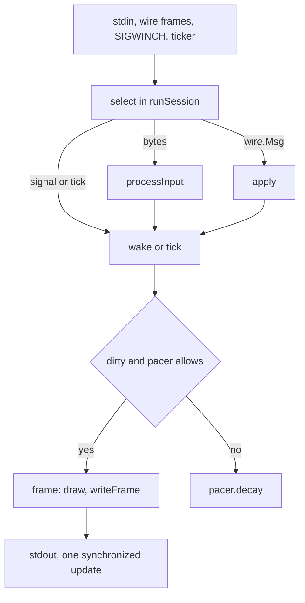
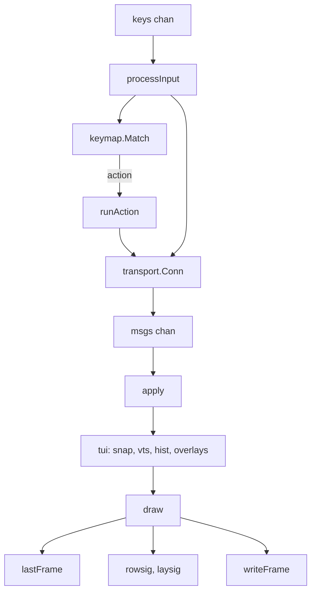

# The client

What this page answers: how the TUI owns the terminal, turns server frames into a screen, turns key bytes into requests, and where you add a key action, an overlay or a row.

The client is one process that dials the session socket and owns one terminal. It holds no panes, runs no shells and owns no layout. It keeps a local terminal per visible pane, feeds it the bytes the server sends, and paints that picture plus its own chrome and overlays on a damage diff. Every change of session state is a request to the server, never a local edit. What it draws before the server agrees is only its own state: selection, hover, prompts, toasts and floats.

## File map

All paths are `internal/client/`. 21 files, 11552 lines without tests, measured at this commit. `damage_test.go`, `shot_oracle_test.go` and `pace_loop_test.go` hold the client to its behaviour: they build a `tui` with a buffer sink and call `draw` or `tick` directly, so no terminal is involved.

| file | owns |
| --- | --- |
| `client_model.go` | the `tui` model, `Run`, `runSession`, the tick, `apply` |
| `client_input.go` | byte decoding, mouse, paste, scrollback, prompts, `processInput` |
| `client_keys.go` | `runAction`, menus, picker, dashboard keys, reload, `action` |
| `client_view.go` | `draw`, the band and row diff, `writeFrame`, `cursorBlock` |
| `pacing.go` | the frame pacer |
| `render_pane.go`, `render_bar.go`, `render_tabbar.go`, `render_toast.go`, `render_modal.go` | pane content, borders, grips, divider, bar, tab bar, toasts, pickers, help |
| `command_palette.go`, `layout_switcher.go` | the two palettes |
| `client_floats.go`, `client_float.go`, `client_float_cmd.go` | box, keymap view, float stack, floating command |
| `client_notify_float.go`, `client_notify.go` | the notification centre and its catch-up |
| `client_body_reader.go`, `client_clip.go`, `scroll_search.go` | body reader, clipboard, scrollback search |
| `switcher_wire.go` | dashboard open, close, pick |

## The loop

`Run` (`internal/client/client_model.go:493`) sets raw mode, asks the outer terminal for its colours and clipboard, starts the stdin reader and the `SIGWINCH` handler, and only then enters the alternate screen with mouse and bracketed paste. It then calls `runSession` in a loop. A session switch returns a new name and the loop draws again with the same raw terminal.

`runSession` (`:660`) dials the server, sends `attach` with its size, starts one reader goroutine over `wire.ReadMsg`, and selects on four sources: stdin bytes, frames, `SIGWINCH` and the pacer's ticker.

`wake` (`:641`) floors the pacer and draws at once when a frame is due. `tick` (`:612`) runs the expiry timers, places a quiet pane's pending grapheme cluster, and draws at most one frame. Both end in `frame` (`:649`), which clears `dirty` and tells the pacer whether the frame wrote any bytes. The pacer is a value, not a goroutine (`internal/client/pacing.go:16`): it floors the interval at 16ms, doubles it on empty ticks to 250ms, and resets it on a wake, so a burst coalesces and an idle client almost never wakes. A frame that lands mid-stream is never dropped. `apply` updates the model and marks it dirty, and the pacer decides when the pixels follow.

## The model a frame is built from

`tui` (`internal/client/client_model.go:60`) holds three groups.

- The server's truth: `snap` (a `wire.Snapshot` with rects, rail width, focus, zoom and the pane list) and `vts`, one `vt.Term` per visible pane. `hist` holds a pane's replay ring only after a scrollback entry asked for it, and `histMeta` records the rect and whether the reply landed.
- Local overlays: `floats` (a `[]*panel.FloatingPane` stack), `box`, `keys`, `ncentre`, `lsw`, `cp`, `sw`, `float`, `menu`, `toasts`, and the `mode` string that says which one owns the keyboard.
- Paint memory: `last` (`:353`), one `paint` of bytes and screen rows per band, `rowsig` (one fingerprint per pane row) and `laysig` (the shape of the picture).

A frame reads nothing from the server: it is computed from those fields alone, which is why every test can draw one without a socket.

## How a frame reaches the terminal

`draw` (`internal/client/client_view.go:42`) renders every band into its own buffer: boxes, grips, divider, rail, tab bar, bar, toasts, the overlays, then the float stack. Each band keeps its last bytes in `last`; a band whose bytes did not change is not written.

Pane content is compared per row. `paneRowSigs` (`:395`) folds every cell, its colours and attributes, the selection, the hover and the scrollback row into one `uint64` per row, so `draw` repaints a row only when its fingerprint moved. `drawPaneRow` (`internal/client/render_pane.go:184`) writes a row with an absolute cursor move, which is how `bandRows` (`internal/client/client_view.go:465`) recovers the screen rows a band touched. A band that moves the cursor another way breaks the diff, and `TestBandsUseAbsoluteCursorMoves` fails.

`layoutSig` (`:315`) names the shape: size, rail, zoom, every pane and float rect, the window list, the active window, the focus, the mode, the scrollback pane and the dashboard rect. When it changes the next frame repaints whole and may clear. Everything else is damage: `rowsHit` and `rowsOverlap` decide which bands must re-ink rows that an overlay took or left.

The body ends with `cursorBlock` (`:540`); `ESC[?7h` restores wrapping, and `ESC[?2026l` closes the synchronized update the frame opened with `ESC[?2026h`, so the terminal swaps the frame in whole. `writeFrame` (`:304`) writes to `t.out`: a counting wrapper over `os.Stdout` in a session, a buffer in a test. Damage routing exists because a full repaint is both slow and visible. The commit that introduced it says so: "Stop repainting the screen when one cell changed. This is the flicker." A 60Hz client that cleared and repainted would flicker under every keystroke and through a nested pty. `TestFrameSteadyStateWritesNothing` and `TestFrameRepaintsOneRow` pin the win.

## Input decoding and the keymap handoff

`processInput` (`internal/client/client_input.go:299`) is the only decoder. It works on `t.inbuf` and loops until the buffer stops making progress, so one read can carry a paste, a mouse event and a keystroke in any order. The order is fixed.

1. An OSC 10, 11 or 52 reply. It never reaches a pane; a partial one waits up to 500ms, then falls through.
2. The dashboard, palette, help view, box, notification centre and float, while each is up. Those own every key.
3. A bracketed paste, framed or bare, which closes an overlay and goes to the focused pane as one `keys` message, or a mouse event via `parseMouse`, dispatched by `handleMouse` (`:2068`).
4. The mode handlers: `rename`, `search`, `sessions`, `menu`, `layout`, `scroll`.
5. The prefix. A prefix in the buffer arms the client and the bytes before it go to the pane. `expirePrefix` (`:829`) sends a stalled prefix to the pane as plain input.
6. Armed: `armedKey` (`:661`) asks the keymap for one action.

The handoff is one call: `t.km().Match("main", buf)` (`internal/keymap/config_model.go:327`). It returns the action, the bytes consumed, and `Match`, `Partial` or `NoMatch`. `Partial` keeps the bytes and re-asks on the next read; `expireArmed` (`internal/client/client_input.go:774`) drops a stalled sequence after `escTimeout`. A matched action goes to `runAction` (`internal/client/client_keys.go:804`), which either acts locally (`openBoxView`, `t.quit = true`, `disarm`) or sends a request through `action` or `actionOn` (`:989`, `:997`).

An unbound key notifies and disarms: it never reaches a pane, because dm is not a passthrough for keys it has claimed. Most overlays resolve keys through a keymap mode: `menu`, `picker`, `switcher`, `layout`, `scroll`, `rename`, `box` (the box and the notification centre) and `help`. The palette and the floating command read bytes by hand and have no mode. A config that predates a mode falls back to the built-in one, as `keymapKey` does for `help` (`internal/client/client_floats.go:331`).

## Overlays and the float layer

Every overlay is one field, one open and close pair, one key handler, one paint function. The open sets a `mode` or a pointer, clears `armed`, drops buffered input and marks the frame dirty. The close clears both and drops `inbuf`, so a late escape never reaches a pane.

| overlay | opened by | mode | keys |
| --- | --- | --- | --- |
| message box | `openBoxView` (`client_floats.go:24`) | `box` | `boxKey` |
| notification centre | `openNotifyCentre` (`client_notify_float.go:244`) | `notif` | `notifKey` |
| keymap view | `openKeymapView` (`client_floats.go:278`) | `help` | `keymapKey` |
| sessions picker | `openPicker` (`client_input.go:2667`) | `sessions` | `pickerKey` |
| command palette | `openCommandPalette` (`command_palette.go:107`) | none | `commandPaletteKey` |
| layout palette | `openLayoutSwitcher` (`layout_switcher.go:76`) | `layout` | `layoutKey` |
| dashboard | `openSwitcher` (`switcher_wire.go:22`) | `dashboard` when full screen | `switcherKey` |
| floating command | `openFloatFor` (`client_float_cmd.go:153`) | `float` | `floatKey` |
| scrollback | `startScroll` (`client_input.go:1220`) | `scroll` | `scrollKey` |
| rename prompt | `openRenamePrompt` (`client_input.go:2702`) | `rename` | `renameKey` |

Two more keyboard owners are sub-modes, not overlays: the scrollback search (`openSearch`, `client_input.go:1001`, mode `search`) and the prefix help box (`arm`, `client_keys.go:975`, no mode). Two overlays differ from the rest. The dashboard and the palette are checked before `mode` in `processInput`, so they take the keyboard first. The dashboard also keeps its own preview terminals (`swVT`) for panes outside the active window, filled by `screen` replies, because those panes have no bytes stream. Scrollback is a mode over a pane, not a float: `startScroll` asks for one `replay` ring and builds a tall `vt.Term` from it (`buildScroll`), the live pane keeps updating behind it and the tall terminal stays frozen, and `exitScroll` (`internal/client/client_input.go:1198`) drops the view, the offset and any search.

Every screen-owning mode hides the cursor; `cursorBlock` decides that from the mode, the float and the focused pane. `expireMode` (`internal/client/client_input.go:786`) closes any overlay whose lone escape stalled, so a lost byte cannot trap the keyboard. A float is a `panel.FloatingPane` in `t.floats`, painted by the same bands and keyed by id in `last.floats`. The floating command is the odd one: the server owns its pty, its bytes arrive as `bytes` frames with that float's id, and its exit arrives as `exit`. The client only routes keys to it, with a target.

## The rail

The rail is server state and client paint. The server publishes the width (`Rail`, `RailWant`) and the rows (`Snapshot.All`) and enforces everything; the client draws `rail.DrawRail` (`internal/rail/rail.go:896`), hit-tests with `rail.RailItemAt` (`:830`) and sends a request for every change. Hover is `railHoverRow` (`internal/client/client_input.go:2340`), which turns the pointer cell into a row for the paint. The client never reorders the rail locally: it paints the drop marker and waits for the snapshot.

- Toggle: `toggleRail` (`:2885`) sends `set-rail` with the width `railToggleWidth` picks. `railWant` remembers the last expanded width so a hidden rail comes back at it.
- Grip: the last rail column is the drag strip (`railGripAt`). A drag sends `set-rail`, throttled to one request per 30ms and forced on release (`railDragTo`).
- Clicks: a caret sends `toggle-fold`; a row sends `focus` for the first pane of that pane, window or workspace; a double click opens the rename prompt; a row drag sends `move-window` or `move-workspace` with the direction; a right press opens `openRailMenu`.

## Reconnect and detach

Detach is local: the `detach` action sets `t.quit` and `runSession` returns. The deferred close runs, the terminal modes are restored, and the shell returns. Panes and the session file survive. A session switch is the same exit with a name: `pickSession` (`internal/client/client_input.go:2654`) sets `switchTo`, and `Run` re-enters `runSession` under the new name with raw mode still on. There is no in-place redial. When the server closes the socket the reader goroutine returns, `msgs` is closed, and the client leaves the alternate screen. The server sends `close` when the last pane ends the session, so that path quits without a read error. To get back in, attach again. Panes keep running across a server restart, and re-attaching rebuilds the client from one snapshot and one screen per pane (`s.attach`, `internal/server/server_view.go:786`). The one resync inside a connection is the server's: a client whose queue overflowed is rebuilt the same way (`resyncClient`, `internal/server/server_view.go:903`), and the client handles it as an ordinary `snapshot` plus `screen` frames.

## The contract with the server

The client is a view with a request API. It sends four frame types.

| sent | carries | meaning |
| --- | --- | --- |
| `attach` | `cols`, `rows` | this client exists and its size counts toward the shared layout |
| `resize` | `cols`, `rows` | the terminal changed size |
| `keys` | raw `keys`, optional `target` | typed bytes; only the floating command sets a target |
| `req` | `action` plus fields | every change: focus, split, move, close, rename, `read`, `screen`, `replay`, `yank`, `msg-*`, `set-rail`, `term-colours` |

It receives ten types: `resp`, `snapshot`, `screen`, `replay`, `scrub`, `bytes`, `close`, `exit`, `box`, `watch`. `apply` (`internal/client/client_model.go:758`) handles exactly those. The rules that hold it together:

- The server owns layout, focus, names, rail width and pane life. The client never edits them locally.
- A numbered reply is matched by action and id (`yankID`, `toggleID`, `floatID`, `notifyID`) and an older one is dropped, so a late failure never toasts over newer state. An unnumbered failure toasts.
- `replay` is asked once per rect and the ring is cached by rect (`histMeta`). A `screen` request carries an id, so its reply lands in the ordinary resp path, and the dashboard re-asks every `previewEvery` (250ms) and caches the terminal by pane in `swVT`. The screen and replay frames carry no id, so the client applies them by target.
- The client never writes a pane's screen itself. It feeds the bytes into a local `vt.Term` and paints what the terminal holds.
- Bytes are authoritative. The client never replays bytes into a live terminal; a replay fills the history ring only. The snapshot is the whole truth for the chrome, and a frame the client does not know is ignored.

## Where to add the next thing

A new key action: bind it in the default `keymap "main"` block (`internal/keymap/config_parse.go:867`), add a case in `runAction` (`internal/client/client_keys.go:804`), and send the request through `action` or `actionOn`. If the server needs an action that does not exist, add it in `handleReq` (`internal/server/server_rpc.go:15`) first. If the action needs a local handler, write one function and return before reaching `disarm`.

A new overlay: add a field to `tui` (`internal/client/client_model.go:60`), write `openX` and `closeX`, give it a key handler, add it to the dispatch chain in `processInput` (`internal/client/client_input.go:299`) and to `expireMode` (`internal/client/client_input.go:786`), add a `paint` to `lastFrame` (`internal/client/client_model.go:353`) and a band to the `bands` slice (`internal/client/client_view.go:42`), draw it in a `render_*.go` file, and bind an action that opens it.

A new frame row or band: write a draw function that uses absolute cursor moves, add its `paint` to `lastFrame`, add a `band` entry in `draw` with the right `over` list and `overlay` flag, and add an oracle case in `damage_test.go`. If the band never moves independently, it belongs in an existing buffer instead.

## See also

- [Entry point and lifecycle](02-lifecycle.md), [The wire protocol](03-protocol.md), [The server](04-server.md), [The pane](05-pane.md)
- [Layout](07-layout.md), [The box and the notify bus](08-surfaces.md), [Config and keymap](10-config.md), [Layers](11-layers.md)
