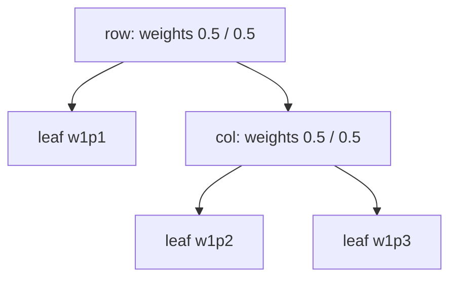

# Layout

This page answers how dm turns a window into cells: the split tree, the arithmetic from terminal
size to a pane rect, and the verbs that mutate the tree.

The words it leans on. A **session** is one dm instance, its state on disk; a **workspace** groups
windows; a **window** is one arrangement of panes; a **pane** is one program with a terminal of its
own; a **cell** is one terminal column on one row. A **client** is a process attached to a terminal,
drawing and typing; the **server** owns the state, the panes and the tree. A **pty** is the
pseudo-terminal pair tying a shell to its terminal. **Tree order** is the depth-first order of the
leaves. `internal/layout` is pure (`internal/layout/layout.go:1`): a tree and a rect in, one rect
per pane out, and it draws nothing.

## The tree

`layout.Node` is the whole structure (`internal/layout/layout.go:10`). It has four fields: `Pane`, a
pane id, which makes it a leaf; `Dir`, `"row"` for kids side by side or `"col"` for stacked; `Kids`,
two or more kids in draw order; `Sizes`, one weight per kid. A weight is a share, not a count, so
`{1, 1}` and `{0.5, 0.5}` are the same split; absent `Sizes` means equal.

Pane ids are addressable: `w1p1` is window 1 pane 1 (`internal/session/state.go:441`). A window of
`w1p1` beside a column of `w1p2` over `w1p3`:

Each label names `Dir` then `Sizes`: a `row` draws its kids side by side, a `col` stacks them, so
`w1p1` is left of the other two and `w1p2` above `w1p3`.

`SplitLeaf(root, target, dir, newID, ratio)` replaces the leaf `target` with that leaf plus a new
pane (`internal/layout/layout.go:53`). `dir` is a direction string: `left` and `up` put the new pane
first, `right` and `down` last, `left` and `right` make a `row`, `up` and `down` a `col`. `ratio` is
the existing pane's share; 0 or 1 falls back to half, the diagram's `0.5 / 0.5`.

## From tree to cells

A rect is `{X, Y, W, H}` in cells, `X` and `Y` from the screen's top left
(`internal/layout/layout.go:18`); a box is the rect one pane is drawn in, a border cell, the content
and a border cell. `cols` and `rows` are the window's size in cells: the server takes each axis from
the largest attached client, so a small client cannot shrink the view of the rest; a size under 20
columns or 5 rows is refused, keeping the last (`internal/server/server_view.go:24`).

The rail is a client sidebar, not a node. `EffectiveRail` clamps the requested width to `MaxRail`,
`cols/3` capped at 46 (`internal/layout/layout.go:404`, `internal/layout/layout.go:392`).
`PaneAreaForWithTabBar` gives the box area `{rail, 1, max(1, cols-rail), max(0, rows-2)}`, a
`{X, Y, W, H}` rect with row 0 for the tab bar and the last row for the status bar
(`internal/layout/layout.go:441`).

`ChildBoxRects` divides the area's width for a `row` and its height for a `col` with `SplitSizes`
(`internal/layout/layout.go:274`). Boxes are adjacent, so the two facing border cells of two
neighbours are the divider: one cell from each box, a 2 cell band (`PadRect`,
`internal/layout/layout.go:303`). `InsetBox(box, pad)` is a leaf's content: one border cell each
side, then `pad` cells of padding, so a box needs `2*(1+pad)+1` cells for one content column
(`internal/layout/layout.go:464`). `pad` is `padding` from `config.kdl` under `$XDG_CONFIG_HOME/dm`
or `~/.config/dm`, an integer 0 to 4 defaulting to 0 (`internal/keymap/config_parse.go:84`). A box
under 3 cells keeps its size; one too small for its padding keeps the border and drops the padding.

`SplitSizes` (`internal/layout/layout.go:482`) floors each kid's share, gives spare cells to the
largest remainders, lowest index first, and keeps every kid at 1 or more. A floor of 1 that
overshoots is reclaimed from the largest counts, so the counts sum to the space. `ChildBoxRects`
raises the space to the kid count (`internal/layout/layout.go:284`), so the boxes extend past the
area. Three equal panes give 16, 15, 15 in 46 cells, and 4, 3, 3 in 10.

Terminal 200x24 with rail 34 is `{34, 1, 166, 22}`, since `MaxRail(200)` is 46. An `even-horizontal`
root of three leaves splits 166 into 56, 55, 55: first content rect `{35, 2, 54, 20}` at pad 0,
divider between the first two `{89, 1, 2, 22}` (`internal/layout/layout.go:303`).

`paneRectsLocked` is the server's layout: the pane area, the zoom override, one rect per pane
(`internal/server/server_view.go:80`). `syncSizes` pushes each pane's width and height into its pane
daemon, the process that owns that pane's pty, screen and socket, which applies them to the pty and
the terminal grid (`internal/server/server_view.go:665`). The snapshot is the broadcast message, one
rect per pane (`internal/wire/wire.go:216`, `internal/wire/wire.go:126`). A drag sends
`resize-split` with the two panes beside the divider, so the server clamps it and each side keeps
`5+2*pad` cells: two border cells, the 3 cell content floor, and the padding twice
(`internal/server/server_mutate.go:961`).

## Presets

A preset rebuilds the tree over the window's pane ids. `ApplyPreset` implements five
(`internal/layout/layout.go:181`): `even-horizontal` one row of equal widths, `even-vertical` one
column of equal heights, `main-horizontal` `panes[0]` on top at half the height, `main-vertical` the
same on the left, and `tiled` a row-major grid of `n` panes over an area `w` wide and `h` tall with
`rows = ceil(sqrt(n*h/w))` rows (`internal/layout/layout.go:237`). Command-like names here are RPC
action names: the `action` field of a `dm exec` request. `selectLayout` applies one and stores it in
`Window.Layout`, the window's preset name (`internal/server/server_mutate.go:1058`). For
`select-layout`, the value `next` walks `presetOrder` and wraps to the first name when none is
stored (`internal/server/server_mutate.go:1048`); a one-pane window refuses. A split, close, swap or
move empties `Window.Layout`, so `next` starts over; a preset rebuild stores its own name, and a
divider resize keeps it.

## Zoom and synchronise

Zoom is a view, not a tree: `paneRectsLocked` overwrites the zoomed pane's rect with `InsetBox` of
the whole pane area at the `pad` the tree was laid out with, and the siblings keep theirs
(`internal/server/server_view.go:80`). The flag lives in server memory, never in `state.json`, and a
focus, split, close, window or workspace change clears it (`internal/server/server_mutate.go:312`).
`synchronize-panes` does not, because a sync toggle is not a new layout
(`internal/server/server_rpc.go:246`). Synchronise is `Window.Sync`, toggled by `synchronize-panes`
(`internal/server/server_mutate.go:286`). While it is on, every write frame and every key aimed at
one pane of the window reaches every live pane of it, in tree order, the target included
(`internal/server/server_mutate.go:240`).

## Swap and move

`Swap` exchanges the pane ids of two leaves and nothing else (`internal/layout/layout.go:94`). Every
rect keeps its shape and both ids stay leaves, so the focused pane keeps its id, its focus and the
other rectangle. `swap-panes` also takes a direction, swapping with the pane `focus-dir` would reach
(`internal/server/server_mutate.go:818`). `Move` prunes the leaf, then splits the pane named by
`target` with the moved pane as the new sibling at half the space (`internal/layout/layout.go:118`).
`PruneLeaf` collapses a parent left with one kid and drops the weight
(`internal/layout/layout.go:142`). The moved pane takes the focus, and both verbs empty
`Window.Layout`. `Neighbor` reads a direction off the rects the server computed, never off what the
client drew; ties go to the upper or leftmost (`internal/layout/layout.go:603`).

## Persist and reload

The tree is session state: `Window` holds `Root`, `Focus`, `Layout` and `Sync`
(`internal/session/state.go:15`), and `state.json` carries the whole shape. That file is
`<state>/sessions/<session>/state.json`, with `<state>` at `$DM_STATE`, else `$XDG_STATE_HOME/dm`,
else `~/.local/state/dm` (`internal/paths/paths.go:70`). The server saves every mutating RPC through
`mutation`, and `afterMutation` then clears the zoom, resizes the panes and pushes the snapshot: one
call ends every layout change (`internal/server/server_mutate.go:300`). Reload is unmarshalling plus
three rules. A start reads the file, then adopts the panes whose socket answers, and one that does
not answer is started again with the same id, argv and name (`internal/server/server_core.go:551`,
`internal/server/server_core.go:774`). A window with no tree gets a fresh pane and the focus
(`internal/server/server_core.go:607`). A pane that exits is pruned and focus moves to the window's
pane at the same index in tree order, or the last one (`internal/server/server_view.go:263`); id
counters only grow, so a closed id never returns (`internal/session/state.go:441`).

## Where the rail and the float get geometry

The server subtracts the rail from the left before the first pane box, and the client paints those
columns with the workspace, window and pane rows. Its width is the stored `Rail` else `DefaultRail`
34, clamped by `EffectiveRail`, so 34 becomes 26 on an 80 column screen; `CollapsedRail` is 4, and 0
hides the rail (`internal/layout/layout.go:381`). `DrawRail` paints rows 0 to `Rows-2` of the
terminal, `Rows` being its height, and keeps `Rows-2` for the control row. The rail's last column
above that row is the drag grip, so its hit area is `x == Rail-1` with `y < Rows-2`
(`internal/rail/rail.go:896`, `internal/client/client_input.go:2364`). A float is a client overlay
and never enters the tree. `panel.FloatingPane` holds an explicit `Rect`
(`internal/panel/float.go:14`), which the client centres: width `cols-8`, capped at 110, or `cols-2`
when the computed width is under 10; height `rows-4`, or `rows-2` when the computed height is under
3; then clamped inside the screen (`internal/client/client_float_cmd.go:59`). The server runs its
process; the client sizes it.

## Invariants a change must preserve

1. A leaf holds a pane id, a split holds two or more kids, and none holds exactly one. `SplitLeaf`,
   `PruneLeaf` and `ApplyPreset` keep this; ids stay unique and the pane set exactly.
2. The pane rects are derived, never stored. The tree, its `Sizes`, the per-window flags
   (`internal/session/state.go:15`) and the pushed cols/rows (`internal/session/state.go:73`,
   `internal/session/state.go:98`) persist, never a rect.
3. Only the server mutates the tree, under `s.mu`, and every mutation ends in `Save`.
4. `Move` writes the new root back through the caller's pointer; `PruneLeaf` callers assign it.

## Where to add the next thing

A new preset: a `case` in `ApplyPreset` and a builder beside `presetMain`
(`internal/layout/layout.go`), the name in `presetOrder` (`internal/server/server_mutate.go:1048`)
and in `layoutPresetNames`, `layoutRowCount` and `layoutCustomRow`
(`internal/client/layout_switcher.go`), and the `layout` flag text (`internal/clidoc/man.go`). A new
layout verb: the request fields on `Msg`, the wire envelope both directions speak
(`internal/wire/wire.go:15`), the tree mutation (`internal/server/server_mutate.go`), a `case` in
`handleReq` that wraps it in `s.mutation` then `s.afterMutation` (`internal/server/server_rpc.go`),
the action in `internal/clidoc/actions.go`, `manActionNames` (`internal/clidoc/man.go:64`) and
`llmsActionGroups` (`internal/clidoc/llms.go:137`), a keymap action if bindable, then `dm man`,
`dm llms` and `dm html`.

## See also

[The entry point](01-entry-point.md), [the server](04-server.md), [the client](06-client.md).
