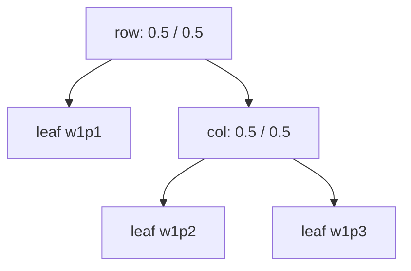

# Layout

This page answers how dm turns a window into cells: the split tree, the arithmetic from terminal
size to a pane rect, and the verbs that mutate the tree. `internal/layout` imports only `math` and
returns rects for a tree (`internal/layout/layout.go:1`); it knows no pty, mouse, float or scroll
offset, and it does not persist zoom.

## The tree

`layout.Node` is the whole structure (`internal/layout/layout.go:10`). `Pane` holds a pane id and
makes the node a leaf. `Dir` is `"row"` for kids side by side or `"col"` for kids stacked. `Kids`
holds two or more children in draw order. `Sizes` holds one weight per kid, absent for equal shares;
the tree stores no coordinates.

A window of `w1p1` beside a column of `w1p2` over `w1p3`:

`SplitLeaf` replaces one leaf with that leaf plus the new pane (`internal/layout/layout.go:53`).
`left` and `up` put the new pane first, `right` and `down` last, `left`/`right` make a `row` and
`up`/`down` a `col`, and a ratio of 0 or 1 falls back to half.

## From tree to cells

Units are cells. `cols` and `rows` are the max of each axis across clients, refused under 20x5
(`internal/server/server_view.go:24`). `EffectiveRail` clamps the rail request to `MaxRail`,
`cols/3` capped at 46 (`internal/layout/layout.go:392`). `PaneAreaForWithTabBar` then gives
`{rail, 1, max(1, cols-rail), max(0, rows-2)}`: the rail on the left, row 0 for the tab bar,
and the last row for the status bar (`internal/layout/layout.go:441`).

`ChildBoxRects` divides the area's width for a `row` and its height for a `col` with `SplitSizes`
(`internal/layout/layout.go:274`). Boxes are adjacent, so the two cells that meet carry the divider.
`InsetBox(box, pad)` is a leaf's content: one border cell plus `pad` cells each side
(`internal/layout/layout.go:464`). A box under 3 cells keeps its size; one narrower than
`2*(1+pad)+1` keeps the border and drops the padding.

`SplitSizes` (`internal/layout/layout.go:482`) floors each kid's share, gives spare cells to the
largest remainders, lowest index first, and keeps every kid at 1 or more. A floor of 1 that
overshoots is reclaimed from the largest counts, so the counts sum to the space given.
`ChildBoxRects` raises the space to the kid count (`internal/layout/layout.go:284`), so the boxes
extend past the area. Three equal panes give 16, 15, 15 in 46 cells, and 4, 3, 3 in 10.

Terminal 200x24 with rail 34 is `{34, 1, 166, 22}`, since `MaxRail(200)` is 46. An `even-horizontal`
root of three leaves splits 166 into 56, 55, 55; the first content rect at pad 0 is
`{35, 2, 54, 20}` and the divider is `{89, 1, 2, 22}`, both border columns
(`internal/layout/layout.go:303`). Padding is `padding` in `config.kdl`, 0 to 4, default 0
(`internal/keymap/config_parse.go:787`).

The server lays out once in `paneRectsLocked` (`internal/server/server_view.go:80`), pushes each
leaf's `W` and `H` into its pty and terminal (`syncSizes`, `internal/server/server_view.go:665`),
and sends one rect per pane in the snapshot (`internal/wire/wire.go:126`). A drag sends
`resize-split` with the two panes beside the divider and a ratio; the server clamps it so each side
keeps `5+2*pad` cells (`internal/server/server_mutate.go:926`).

## Presets

A preset rebuilds the tree over the window's pane ids. `ApplyPreset` implements five
(`internal/layout/layout.go:181`): `even-horizontal` one row of equal widths, `even-vertical` one
column of equal heights, `main-horizontal` `panes[0]` on top at half the height, `main-vertical` the
same on the left, and `tiled` a row-major grid with `rows = ceil(sqrt(n*h/w))`
(`internal/layout/layout.go:237`).

`selectLayout` applies a name and stores it in `Window.Layout`
(`internal/server/server_mutate.go:1058`). `next` advances through `presetOrder` and wraps to the
first name when nothing is stored (`internal/server/server_mutate.go:1048`), and a one-pane window
refuses. A split, close, swap or move empties `Window.Layout`, so `next` starts over; a preset
rebuild stores its own name, and a divider resize keeps it.

## Zoom and synchronise

Zoom is a view. `paneRectsLocked` lays the tree out, then overwrites the zoomed pane's rect with
`InsetBox` of the pane area while siblings keep theirs (`internal/server/server_view.go:80`). The
flag lives in server memory, never in `state.json`, and a focus, split, close, window or workspace
change clears it (`internal/server/server_mutate.go:312`). `synchronize-panes` does not, because it
is not a new layout (`internal/server/server_rpc.go:251`). A one-pane window gets no zoom
(`internal/server/server_rpc.go:310`).

Synchronise is `Window.Sync`, toggled by `synchronize-panes`
(`internal/server/server_mutate.go:286`). While it is on, every write and key frame aimed at one
pane of the window reaches every live pane of it in tree order, the target included
(`internal/server/server_mutate.go:240`).

## Swap and move

`Swap` exchanges the pane ids of two leaves and nothing else (`internal/layout/layout.go:94`). Every
rect keeps its shape and both ids stay leaves, so the focused pane keeps its id, its focus, and the
other rectangle. `swap-panes` also takes a direction, swapping with the pane `focus-dir` would reach
(`internal/server/server_mutate.go:818`).

`Move` prunes the leaf, then splits the target with the moved pane as the new sibling at half the
space (`internal/layout/layout.go:118`). `PruneLeaf` collapses a parent left with one kid and drops
the weight (`internal/layout/layout.go:142`). The moved pane takes the focus, and both verbs empty
`Window.Layout`. `Neighbor` resolves a direction from painted rects, ties to the upper or leftmost
(`internal/layout/layout.go:603`).

## Persist and reload

The tree is session state: `Window` holds `Root`, `Focus`, `Layout` and `Sync`
(`internal/session/state.go:15`), so `state.json` carries the whole shape. `Save` writes a temp
file, fsyncs and renames, so a reader sees old or new (`internal/session/state.go:216`). The server
saves after every mutating RPC through `mutation` (`internal/server/server_mutate.go:300`).

Reload is unmarshalling plus three rules. A server start reads the file, then adopts the panes whose
sockets answer (`internal/server/server_core.go:551`). A window with no tree gets a fresh pane and
takes the focus (`internal/server/server_core.go:607`). A pane that exits is pruned and focus moves
to the next live pane at the same index (`internal/server/server_view.go:263`); id counters only
grow, so a closed id never returns (`internal/session/state.go:441`).

## Where the rail and the float get geometry

The rail is not a node: the server subtracts it from the left before the first pane box, and the
client paints those columns. Its width is the stored `Rail` else `DefaultRail` 34, clamped by
`EffectiveRail`, so 34 becomes 26 on an 80 column screen; `CollapsedRail` is 4, and 0 hides the rail
(`internal/layout/layout.go:381`). `DrawRail` paints `Rows-1` rows, keeps a control row at `Rows-2`,
and leaves column `Rail-1` as the drag grip above that row, so the grip hit area is `y < Rows-2`
(`internal/rail/rail.go:918`, `internal/client/client_input.go:2371`).

A float is a client overlay and never enters the tree. `panel.FloatingPane` holds an explicit `Rect`
(`internal/panel/float.go:14`), which the client centres: width `cols-8` capped at 110, or `cols-2`
when that is under 10; height `rows-4`, or `rows-2` when that is under 3; then clamped inside the
screen (`internal/client/client_float_cmd.go:59`). The server runs its process; the client sizes it.

## Invariants a change must preserve

1. A leaf holds a pane id, a split holds two or more kids, and no node holds exactly one.
   `SplitLeaf`, `PruneLeaf` and `ApplyPreset` keep this; ids stay unique, address leaves, and a
   preset keeps the pane set exactly.
2. `SplitSizes` counts sum to the split's space, at least 1 each, and no child gets a gutter.
3. The pane rects are derived, never stored. The tree, its `Sizes`, the window flags and the pushed
   cols/rows (`internal/session/state.go:73`, `internal/session/state.go:98`) persist, never a rect.
4. Only the server mutates the tree, under `s.mu`, and every mutation ends in `Save`. Any tree or
   focus change clears zoom; a manual one empties `Window.Layout`.
5. `Move` writes the possibly new root back through the caller's pointer, and every `PruneLeaf`
   caller assigns the returned root.

## Where to add the next thing

A new preset: a `case` in `ApplyPreset` plus a builder beside `presetMain`
(`internal/layout/layout.go`); the name in `presetOrder` (`internal/server/server_mutate.go:1048`);
the name in `layoutPresetNames`, `layoutRowCount` and `layoutCustomRow`
(`internal/client/layout_switcher.go`); and the `layout` flag text (`internal/clidoc/man.go`).

A new layout verb: the request fields on `Msg` (`internal/wire/wire.go`); the function that changes
the tree (`internal/server/server_mutate.go`); a `case` in `handleReq` that wraps the call in
`s.mutation` then `s.afterMutation` (`internal/server/server_rpc.go`); the action in
`internal/clidoc/actions.go`, `manActionNames` (`internal/clidoc/man.go:64`) and `llmsActionGroups`
(`internal/clidoc/llms.go:137`); a keymap action if it should be bindable; then regenerate the
snapshots.

## See also

- [The entry point](01-entry-point.md)
- [The server](04-server.md)
- [The client](06-client.md)
