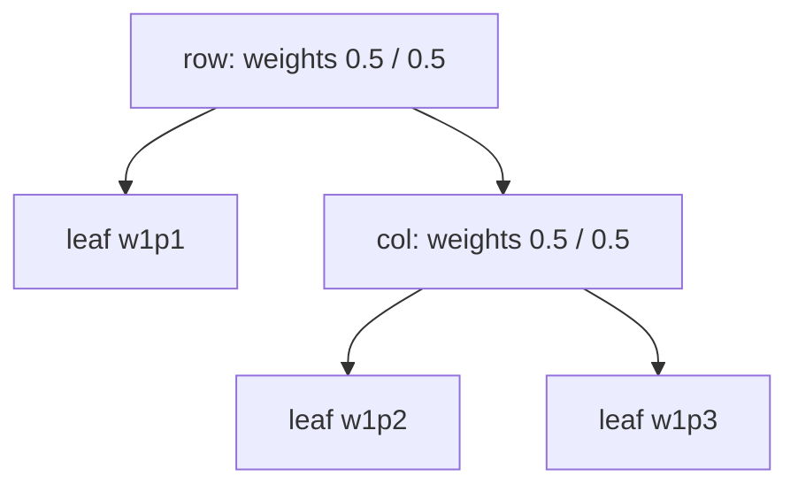

# Layout

Read this page to find how dm turns a window into cells, and where a change to
that arithmetic goes. `internal/layout` is the package that does the
arithmetic (`internal/layout/layout.go#package`). It is pure: a tree and a rect
in, one rect per pane out, and it draws nothing.

## The words

| word | means |
| --- | --- |
| session | one named tree of panes with its own server and state directory |
| workspace | a named set of windows |
| window | one arrangement of panes |
| pane | one program with a terminal of its own |
| cell | one terminal column on one row |
| rect | `{X, Y, W, H}` in cells, counted from the screen's top left |
| pane box | one pane's rect: a border cell, the content and a border cell |
| sidebar | the client's left column |
| client | a process attached to a terminal, which draws and types |
| server | the process that owns the state, the panes and the tree |
| pty | the pseudo-terminal pair tying a program to its terminal |
| tree order | the depth-first order of the leaves |

## The split tree

`layout.Node` is the whole structure (`internal/layout/layout.go#Node`). A node
with `Pane` set is a leaf, and `Pane` is a pane id. A node with `Dir` set and
two or more `Kids` is a split. `Dir` is `"row"` for kids side by side and
`"col"` for kids stacked, and `Kids` sit in draw order.

No node holds exactly one kid. `SplitLeaf`, `PruneLeaf` and `ApplyPreset` keep
that rule, and the pane set stays exactly as it was.

Pane ids are addressable: `w1p1` is window 1 pane 1
(`internal/session/state.go#Window.NewPaneID`). A window of `w1p1` beside a
column of `w1p2` over `w1p3`:

Each label names `Dir` then `Sizes`, so `w1p1` is left of the other two and
`w1p2` above `w1p3`.

## Sizes

`Sizes` holds one weight per kid (`internal/layout/layout.go#Node.Sizes`). A
weight is a share, not a count, so `{1, 1}` and `{0.5, 0.5}` describe the same
split. An absent `Sizes` means equal kids.

`SplitLeaf` replaces the leaf `target` with that leaf plus a new pane
(`internal/layout/layout.go#SplitLeaf`). `left` and `up` put the new pane first,
and `right` and `down` put it last. `left` and `right` make a `row`, and `up`
and `down` make a `col`. `ratio` is the existing pane's share, and 0 or 1 falls
back to half.

## Rects

The server takes each axis of the screen from the largest attached client
(`internal/server/server_view.go#server.fitToClientsLocked`). A small client
cannot shrink the view of the rest. A size under 20 columns or 5 rows is
refused, and the last size stands.

`PaneAreaForWithTabBar` returns the pane area
(`internal/layout/layout.go#PaneAreaForWithTabBar`). The area starts below the
tab bar, right of the sidebar, and stops above the status bar.

No pane rect is stored. The tree, its `Sizes`, the pane cols and rows
(`internal/session/state.go#PaneState`, `internal/session/state.go#State.Cols`)
and the window flags (`internal/session/state.go#Window`) persist in
`state.json`. A rect is computed from them on every frame.

## The sidebar column

`EffectiveRail` clamps a requested width to what the screen can give
(`internal/layout/layout.go#EffectiveRail`). `MaxRail` is a third of the screen,
capped at 46 (`internal/layout/layout.go#MaxRail`). `DefaultRail` is 34
(`internal/layout/layout.go#DefaultRail`). `CollapsedRail` is 6: five content
cells and the drag strip (`internal/layout/layout.go#CollapsedRail`).

A stored width of 0 hides the sidebar, and a stored width of 1 to 5 opens as 6.
The width is clamped when it is used, not when it is stored, so a wider terminal
restores a wider sidebar (`internal/server/server_view.go#server.setRail`). The
server subtracts the sidebar from the left before the first pane box. The
client paints those columns with the project, workspace, window and pane rows.

The status bar holds the last row, and the control row holds the one above it.
Item rows draw in rows 0 to `Rows-3` (`internal/rail/rail.go#DrawRail`). One
page of items is `Rows-2` rows high (`internal/rail/rail.go#ClampOffset`). The
drag strip is the sidebar's last column above the control row.

A press on the drag strip starts a drag
(`internal/client/client_input.go#railGripAt`). The drag runs from 6 columns up
to `MaxRail`, and a width the drag already asked for is not sent again
(`internal/client/client_input.go#tui.railDragTo`). A press that never moved
sends nothing. Hiding the sidebar belongs to the key `prefix b`, not to a drag.

## The reserved rows

`TabBarRows` is 1 (`internal/layout/layout.go#TabBarRows`). `tabBarRect` gives
row 0, to the right of the sidebar, one row high
(`internal/client/render_tabbar.go#tabBarRect`). A screen under 3 rows gives an
empty tab bar rect.

A tab is its label plus one padding cell on each side. Its width is clamped
between `tab-min-width` and `tab-max-width`, and never under 3 cells
(`internal/client/render_tabbar.go#tabCells`,
`internal/keymap/config_model.go#Config.TabMaxWidth`). The two bounds default to
8 and 20 cells. Tabs run left to right, and a tab that does not fit is dropped.

The status bar holds the last row and writes at most `cols` cells
(`internal/client/render_bar.go#drawBar`). Its pinned block is anchored to the
last column, and its gutter stands between the two blocks.

The pane area is therefore `{sidebar, 1, cols-sidebar, rows-2}`. The reserved
rows come out before any pane box, so the area height never goes negative.

## Borders and padding

Two neighbouring pane boxes are adjacent. The divider between them is one
border cell from each, so the visible gap is a 2 cell strip
(`internal/layout/layout.go#PadRect`). A pane box needs `2*(1+pad)+1` cells for
one content column (`internal/layout/layout.go#InsetBox`).

`InsetBox` gives a leaf its content: one border cell on each side, then `pad`
cells. A pane box under 3 cells keeps its size, and one too small for its
padding keeps the border and drops the padding.

`pad` is the `padding` node of `config.kdl`, an integer of 0 to 4 that defaults
to 0 (`internal/keymap/config_model.go#Config.Padding`).

A divider drag keeps each side at `5+2*pad` cells: two border cells, three
content cells and the padding twice
(`internal/server/server_mutate.go#server.resizeSplit`). A split too narrow for
two such pane boxes goes back to half and half.

## Cell counts

`SplitSizes` turns weights into integer counts
(`internal/layout/layout.go#SplitSizes`). Each kid takes the floor of its
proportional share, and the largest remainders take the spare cells, lowest
index first on a tie.

Every kid is floored at 1. An overshoot that floor causes is reclaimed from the
largest counts, so the counts sum to the space. A space too small for one cell
per kid gives every kid 1.

`ChildBoxRects` raises the space to the kid count, so the boxes extend past the
area (`internal/layout/layout.go#ChildBoxRects`). Three equal panes give 16, 15
and 15 in 46 cells, and 4, 3 and 3 in 10.

A terminal of 200x24 with a sidebar of 34 gives the area `{34, 1, 166, 22}`. An
`even-horizontal` root of three leaves splits 166 into 56, 55 and 55. At pad 0
the first content rect is `{35, 2, 54, 20}`. The divider between the first two
panes is `{89, 1, 2, 22}` (`internal/layout/layout.go#PadRect`).

`paneRectsLocked` is the server's layout: the pane area, the zoom override and
one rect per pane (`internal/server/server_view.go#server.paneRectsLocked`).
`syncSizes` pushes each pane's width and height into its pane daemon, which
applies them to the pty and the terminal grid
(`internal/server/server_view.go#server.syncSizes`). The snapshot carries one
rect per pane to the client (`internal/wire/wire.go#Snapshot`,
`internal/wire/wire.go#PaneInfo`).

## Preset layouts

A preset rebuilds the tree over the window's pane ids. `ApplyPreset` implements
five (`internal/layout/layout.go#ApplyPreset`):

| preset | tree it builds |
| --- | --- |
| `even-horizontal` | one row of equal widths |
| `even-vertical` | one column of equal heights |
| `main-horizontal` | `panes[0]` on top at half the height, the rest side by side under it |
| `main-vertical` | `panes[0]` on the left at half the width, the rest stacked beside it |
| `tiled` | a row-major grid of `n` panes over an area `w` wide and `h` tall, with `rows = ceil(sqrt(n*h/w))` rows (`internal/layout/layout.go#presetTiled`) |

These names are values of the `layout` field in a `select-layout` request.
The layout palette draws its preview from the same `ApplyPreset` output, so a
preset cannot look one way in the panel and another on the screen
(`internal/client/layout_switcher.go#paintLayoutPreview`).
`selectLayout` applies one and stores it in `Window.Layout`, the window's preset
name (`internal/server/server_mutate.go#server.selectLayout`). A window with
fewer than two panes refuses.

For `select-layout`, the value `next` walks `presetOrder` and wraps to the first
name when none is stored (`internal/server/server_mutate.go#presetOrder`). A
split, close, swap or move empties `Window.Layout`, so `next` starts over. A
preset rebuild stores its own name, and a divider resize keeps it.

## Zoom

`paneRectsLocked` overwrites the zoomed pane's rect with `InsetBox` of the whole
pane area (`internal/server/server_view.go#server.paneRectsLocked`). Every
sibling keeps its own rect.

The zoom lives in server memory, never in `state.json`. A focus, split, close,
window or workspace change clears it
(`internal/server/server_mutate.go#server.afterMutation`). `synchronize-panes`
does not, because a sync toggle is not a new layout
(`internal/server/server_rpc.go#server.handleReq`).

## Synchronize panes

`Window.Sync` is the window flag (`internal/session/state.go#Window`), and
`synchronize-panes` toggles it
(`internal/server/server_mutate.go#server.synchronizePanes`). While the flag is
on, every write frame aimed at one pane of the window reaches every live pane of
it. So does every key, in tree order, the target included
(`internal/server/server_mutate.go#server.writeTo`).

## Swap and move

`Swap` exchanges the pane ids of two leaves and nothing else
(`internal/layout/layout.go#Swap`). Every rect keeps its shape, so the focused
pane keeps its id, its focus and the other rect. `swap-panes` also takes a
direction, and then swaps with the pane `focus-dir` would reach
(`internal/server/server_mutate.go#server.swapByDir`).

`Move` prunes the leaf, then splits the pane named by `target` with the moved
pane as the new sibling at half the space
(`internal/layout/layout.go#Move`). `PruneLeaf` collapses a parent left with one
kid and drops its weight (`internal/layout/layout.go#PruneLeaf`). The moved pane
takes the focus, and both verbs empty `Window.Layout`.

`Neighbor` reads a direction off the rects the server computed, never off what
the client drew (`internal/layout/layout.go#Neighbor`). A tie goes to the upper
pane for a sideways move and to the leftmost for a vertical one.

## Saving

Only the server mutates the tree, under `s.mu`, and every mutation ends in a
save. The server saves each mutating RPC through `mutation`
(`internal/server/server_mutate.go#server.mutation`). `afterMutation` then
clears the zoom, resizes the panes and pushes the snapshot, so one call ends
every layout change (`internal/server/server_mutate.go#server.afterMutation`).

`Move` writes the new root back through the caller's pointer. A caller of
`PruneLeaf` assigns the returned root.

## The saved tree

`Window` holds `Root`, `Focus`, `Layout` and `Sync`
(`internal/session/state.go#Window`), and `state.json` carries the whole shape.
That file is `<state>/sessions/<session>/state.json`, with `<state>` at
`$DM_STATE`, else `$XDG_STATE_HOME/dm`, else `~/.local/state/dm`
(`internal/paths/paths.go#StatePathAt`).

A start reads the file, then adopts the panes whose socket answers
(`internal/server/server_core.go#Run`). A pane that does not answer starts again
with the same id, argv and name
(`internal/server/server_core.go#server.ensurePane`). A window with no tree gets
a fresh pane and the focus.

A pane that exits is pruned. The focus moves to the pane at the same index in
tree order, or to the last one
(`internal/server/server_view.go#server.paneExited`). Id counters only grow, so
a closed id never returns (`internal/session/state.go#State.NewWorkspaceID`,
`internal/session/state.go#Window.NewPaneID`).

## Floating panes

A floating pane is a client overlay and never enters the tree
(`internal/panel/float.go#FloatingPane`). It holds an explicit `Rect`, which the
client centres. The width is `cols-8`, capped at 110, or `cols-2` when that
computed width is under 10. The height is `rows-4`, or `rows-2` when that
computed height is under 3. The rect is then clamped inside the screen
(`internal/client/client_float_cmd.go#floatRect`). The server runs the pane's
process, and the client sizes it.

The shelf holds shelved panes, and `prefix F` opens it as a floating pane. Its
box takes `shelf-size` percent of the pane area, 80 by default, and lands in the
middle of it. The sidebar, the tab bar and the status bar stay visible
(`internal/client/client_shelf.go#centeredShelfRect`). A panel draws its border
one cell outside its rect, so that share is the whole box and its interior gives
up two cells each way.

A focused pane too small for the strip and a row of screen falls back to that
centred box. Under `shelf-layout "pane"` the box sits over the focused pane,
inset one cell. Its border then lands on the pane's own frame
(`internal/client/client_shelf.go#shelfRectFor`).

## Where to add

A new preset needs a `case` in `ApplyPreset` and a builder beside `presetMain`
(`internal/layout/layout.go`). It also needs the name in `presetOrder`
(`internal/server/server_mutate.go#presetOrder`). The palette needs a row in
`layoutPresetNames`, `layoutRowCount` and `layoutCustomRow`
(`internal/client/layout_switcher.go`), and the `layout` flag text needs the
name (`internal/clidoc/man.go`).

A new layout verb needs the request fields on `Msg`, the wire envelope both
directions speak (`internal/wire/wire.go#package`). It also needs the tree
mutation in `internal/server/server_mutate.go`. It needs a `case` in `handleReq`
that wraps the mutation in `s.mutation` then `s.afterMutation`
(`internal/server/server_rpc.go#server.handleReq`). The action then needs a row
in `internal/clidoc/actions.go`, `manActionNames`
(`internal/clidoc/man.go#manActionNames`) and `llmsActionGroups`
(`internal/clidoc/llms.go#llmsActionGroups`). A bindable
verb also needs a keymap action. Then run `dm man`, `dm llms` and `dm html`.

## See also

[The entry point](01-entry-point.md), [the server](04-server.md), [the
client](06-client.md).
