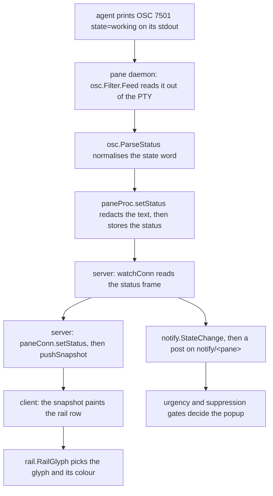

# Surfaces: the box, the notify branch and pane status

Words first. The *box* is one append-only log per session, a *frame* is one message over the socket the client
attaches to, and an *entry* is one line of the box. A *session* is one directory under dm's state directory, one
`state.json` and one server process (`internal/paths/paths.go#StateDir`). A *workspace* is a named set of *windows*, and a
window is one arrangement of panes the workspace shows at a time (`internal/session/state.go#Workspace`). A *pane* is one
terminal in that arrangement, run by a daemon of its own, and its id is a window number plus a pane number: `w3p1`
is window 3, pane 1 (`internal/session/state.go#State.Panes`). A *client* is the TUI the operator attaches. The *rail* is
the sidebar that client draws. A *glyph* is the one character the rail paints for a pane. A *cursor* is a log
position a reader has already handled.

This page follows one report outward: what the box stores, what reaches the desktop, and the glyph it becomes.

## The box is a durable log

`internal/box` is the package that owns the log. A *poster* is any caller that appends an entry: a pane, the CLI, a
plugin, the server itself. A poster names a topic and a state, and the server stamps the sequence and the time.
Three reads look at the log, and none consumes an entry: *list* (`msg-list`: the entries that match, newest first),
*wait* (`msg-wait`: block until one entry matches), *subscribe* (`msg-sub`: a stream of frames). The `msg-*` names
are wire requests; the CLI verbs are `dm msg list`, `dm msg wait` and `dm msg sub`.

Two caps bound the log: `MaxEntries` 1000 and `MaxBytes` 256 KiB, and `State.TrimBox`
(`internal/session/state.go#State.TrimBox`) drops the oldest entries until both fit. Outside the caps, the only removal a
request makes is `msg-clear` (`box.ClearReq`, `internal/box/box.go#ClearReq`), which drops the entries it names, and it never resets
the sequence. `clear` is also an OSC 7501 pane word, defined below, so the action and the word are two different
things.

## An entry and its key

`box.Entry` (`internal/box/box.go#Entry`). Every field travels, because the tags carry no `omitempty`, so a reader can
tell an empty key from a missing one. A field may still be empty: `from` is empty when the poster is not a pane, and
`body` is empty in the normal case.

| field | meaning | rule |
| --- | --- | --- |
| `seq`, `at` | log sequence from 1, UTC post time to the second | set by the server |
| `from` | the posting pane's id, `w3p1` | empty unless the poster is a pane; else `box.PaneIDShape` (`internal/box/box.go#PaneIDShape`) checks the shape and the server looks the id up in the session tree, the panes of the layout in `State` (`internal/session/state.go#State`) |
| `key` | the topic | 128 bytes (`MaxKey`) |
| `state` | `note`, `working`, `blocked`, `done` or `error` | one of five, `internal/box/box.go#States` |
| `msg` | the summary line a list prints | 2000 bytes (`MaxMsg`) |
| `body` | the long text `dm msg show` prints raw | 16 KiB (`MaxBody`) |

`CheckText` (`internal/box/box.go#CheckText`) caps the bytes, demands valid UTF-8 and refuses control characters, because an entry
prints on one row.

A key is a flat string of at most 128 bytes, and the code never parses a hierarchy. A *branch* is a prefix of a key,
such as `lane/`, and a read names one exact key or one branch: `key` and `keyPrefix` are two fields of every read
request, and naming both is an error (`box.CheckTopic`, `internal/box/box.go#CheckTopic`). `box.Match` (`internal/box/box.go#Match`) applies up to
three checks and changes nothing: the exact `key`, the `keyPrefix` as a `strings.HasPrefix`, and the `afterSeq`
cursor. So a list, a wait and a subscribe all see the same entries. `box.ParseReq` (`internal/box/box.go#ParseReq`) is the one decoder
the server calls for a box request: it builds the request, rejects an unknown field and validates the values.

Three branches are convention, and the repository README (`README.md:1239`, `README.md:1303`) shows their use:
`lane/<id>`, `msg/<name>`, `reply/<pane>`. A fourth, `plugin/<name>/...`, is reserved for plugins
(`PLUGINS.md:117`), the `...` meaning any depth. One branch belongs to the code: `box.NotifyPrefix` is `notify/`,
and `box.IsNotifyTopic` (`internal/box/box.go#IsNotifyTopic`) is the check a *renderer* runs to decide whether it renders the entry. A
renderer is one surface that turns entries into what the operator sees: a popup, the rail, or the desktop notifier.

## The store, its waiters and its watches

The log lives in the state file, `state.json` in the session directory, fields `State.Box` and `State.BoxSeq`
(`internal/session/state.go#State.Box`). `s` is the server (`internal/server/server_core.go#server`), which holds the state
as `s.st` and guards it with the mutex `s.mu`. `boxStoreLocked` (`internal/server/server_box.go#server.boxStoreLocked`) appends, trims,
wakes the waiters, saves and broadcasts `{"type":"box"}`, all under `s.mu`; a failed save keeps the entry in memory
and returns the error. That frame is one `wire.Msg` (`internal/wire/wire.go#Msg`), the one envelope struct every
frame uses. `LoadStateAt` (`internal/session/state.go#LoadStateAt`) drops the rows that fail `Entry.Validate` (`internal/box/box.go#Entry.Validate`) instead of the
whole box.

`boxWait` (`internal/server/server_box.go#server.boxWait`) blocks with no lock held. It reads the log for a matching entry under `s.mu`,
registers a `boxWaiter` before unlocking, and re-checks on every wakeup. A post nudges each waiter into a one-slot
channel; a full slot drops the nudge, so the re-check plus `boxPollWait` (`internal/server/server_box.go#boxPollWait`) bounds the loss: a
missed nudge costs one 100ms poll, and the same poll peeks at the unix socket the client attached on, so a client
that hung up frees its waiter.

`msg-wait` carries a topic filter, a cursor and an optional state: `key` or `keyPrefix` for the topic, `afterSeq`
the cursor, and `state` when the wait names one state. Without `afterSeq` the wait returns the newest entry under
the topic, but only when its state satisfies the wait: a *status board*, the newest-wins read. With `afterSeq` it
returns the oldest entry past the cursor: a *stream*, so a subscribing client sees every entry once, in order.
`boxSub` (`internal/server/server_box.go#server.boxSub`) is that stream: it delivers into the server's per-client queue (`client.deliver`,
`internal/server/server_core.go#client.deliver`), and a full queue rolls the cursor back and ends the stream with `errBoxGone`, so a reconnect
resumes at that entry.

A read from a pane leaves a *watch*: one registry entry holding the pane, its filter, the highest `seq` served and
whether it is parked (`box.Watch`, `internal/box/box.go#Watch`). A watch is *parked* while the read it belongs to still blocks: a
`msg-wait` that has not returned, or a `msg-sub` still streaming. The registry lives in server memory only.
`boxExpireLocked` (`internal/server/server_box.go#server.boxExpireLocked`) drops a watch whose pane left the session tree (the workspaces, windows and
panes in `State`, `internal/session/state.go#State`) and an unparked one older than `boxWatchTTL`, ten minutes; a parked watch never
ages out, and a change pushes `{"type":"watch"}`. That watch is not the pane watcher, which is `watcherLoop`
(`internal/server/server_core.go#server.watcherLoop`), one loop per pane daemon connection.

## Notify: a policy over the log

A desktop notification is not a box feature. `notify/` keys are ordinary entries, and the server's notify renderer
turns them into desktop notifications. The *bridge* is the producer: the server function that posts a pane state
report on `notify/<pane>` (`internal/server/notify_server.go#server.notifyPaneState`). Three gates decide a popup.

1. The transition gate. `notify.StateChange` (`internal/notify/notify.go#StateChange`) fires only when the new state
   differs from the old and is `blocked`, `done` or `error`. The server's pane connection reader, `watchConn`
   (`internal/server/server_core.go#server.watchConn`), applies the gate before it posts, so a program that reports `blocked` every second
   posts once. That gate is the dedupe: a repeat is not a change.
2. The urgency gate. `notify.Urgent` (`internal/notify/notify.go#Urgent`) admits `blocked` and `error` only. A `done` entry is
   logged and never interrupts, so an entry can pass one gate and fail the other.
3. The suppression gate. `notifyBoxEntryLocked` (`internal/server/server_box.go#server.notifyBoxEntryLocked`) stays silent when the topic names the
   pane the operator is looking at: the form `notify/<pane>`, with that pane focused in the active window
   (`operatorSeesLocked`, `internal/server/notify_server.go#server.operatorSeesLocked`). A bare `notify/` names no pane.

The box is a log with no opinion about a desktop, so the policy lives apart: `internal/box` imports the standard
library only and never shells out, while the notify package owns the `notify-send` call (`notify.Send`,
`internal/notify/notify.go#Send`). A host with no `notify-send` logs the failure and keeps the entry. The client applies the same
suppression rule to its toasts (`internal/client/client_notify.go#tui.notifySuppress`): a toast is the popup the client raises for a
`notify/` entry it has not seen, and it drops the toast for the focused pane.

## OSC 7501 and pane status

An *agent* is a program running in a pane that reports its own state, such as `pi`. It reports on its own stdout
with an escape sequence: `ESC ] 7501 ; state=working:app=pi:msg=<base64> ST`, terminated by `ST` or BEL. The payload
is `key=value` pairs separated by `:`, so `app` is the reporting program's name, and `msg` is base64 so a message
can carry a `:` without splitting the pair list. `osc.Filter.Feed` (`internal/osc/osc.go#Filter.Feed`) sits in the pane
daemon's read loop (`paneProc.readLoop`, `internal/pane/pane.go#paneProc.readLoop`), the loop that reads the pane's pseudoterminal
(the PTY). The filter holds a partial sequence between reads and passes every other byte through. `handleOSC`
(`internal/osc/osc.go#Filter.handleOSC`) matches `oscPrefix` (`internal/osc/osc.go#oscPrefix`) and calls `Status`.

`osc.ParseStatus` (`internal/osc/osc.go#ParseStatus`) accepts three shapes: the keyed form above, the JSON form
`{"state":"working","message":"done"}` that dm accepted before, and a bare state word such as `blocked`.
`knownState` (`internal/osc/osc.go#knownState`) is the closed set a pane can report: `idle`, `working`, `blocked`, `done`, `error`,
`unknown`. `normaliseState` (`internal/osc/osc.go#normaliseState`) maps `clear` and any unknown word to `unknown`, so a report can never put
free text into a word the rail prints. `clear` is the report format's removal word: nothing is left of the report,
so the pane shows `unknown`. The sets differ on purpose: `idle` and `clear` are not box states, `note` is not a pane
status, and the bridge posts only `blocked`, `done` and `error`.

## From a sequence to a glyph

The *pane daemon* owns one pane's PTY (`paneProc`, `internal/pane/pane.go#paneProc`), and it *redacts* the status text: it
replaces every secret value the session registered with a marker (`scrubber.redactText`,
`internal/pane/scrub.go#scrubber.redactText`), and [Secrets](09-secrets.md) owns how one is registered. The server's `paneConn` is
its record of the connection to that daemon, and `pushSnapshot` (`internal/server/server_view.go#server.pushSnapshot`) broadcasts the *snapshot*,
the whole layout, focus and pane list a client draws from. `RailGlyph` (`internal/rail/rail.go#RailGlyph`) reads one glyph
and colour per state from `theme.States` (`internal/theme/theme.go#Theme.States`), the map a `states` block in the theme file
(`$XDG_CONFIG_HOME/dm/themes/<name>.kdl`, `internal/theme/theme.go#LoadThemeFile`) overrides. Every state has a Nerd Font form
except `shell`, the state of a pane that runs a shell with no agent to report. On the full rail a pane row is six cells
of indent and the pane's name, and the state glyph sits alone in the rail's last content cell: it is the row's only
icon. A project, workspace or window row rolls its members' worst state up to that same cell. A pane that never
reported and a pane whose state is unknown leave the cell blank, because `RailRow` (`internal/rail/rail.go#RailRow`)
draws nothing there rather than a question mark about nothing. `RailMark` (`internal/rail/rail.go#RailMark`) draws the
agent mark, the two-cell prefix a thin rail row and a shelf row keep: an agent icon, the bar glyph an agent gets on a
plain terminal, or a shell icon for a pane with no agent.

## Where to add the next one

- A new box state starts at `box.States` (`internal/box/box.go#States`) and stops there: the decoder, `box.ParseState`
  (`internal/box/box.go#ParseState`), its error text and the schema enum (`box.Schema`, `internal/box/box.go#Schema`) all read that slice, and
  `box.ValidateReq` (`internal/box/box.go#ValidateReq`) accepts its name.
- A new pane status starts at `knownState` (`internal/osc/osc.go#knownState`), then needs a `states` entry in the
  theme file (`theme.States`, `internal/theme/theme.go#Theme.States`) and a decision about `notify.StateChange`.
- A new notification rule goes in `notify.Urgent`, in `notify.StateChange` or in `notifyBoxEntryLocked`,
  never in `internal/box`.

## See also

- [The protocol](03-protocol.md) for the envelope every box request rides in.
- [The server](04-server.md) for the lock `s.mu` and what it guards.
- [The pane](05-pane.md) for the read loop the OSC filter sits in.
- [The client](06-client.md) for its snapshot apply and the toast it raises.
- [Secrets](09-secrets.md) for the redaction a status message passes through.
