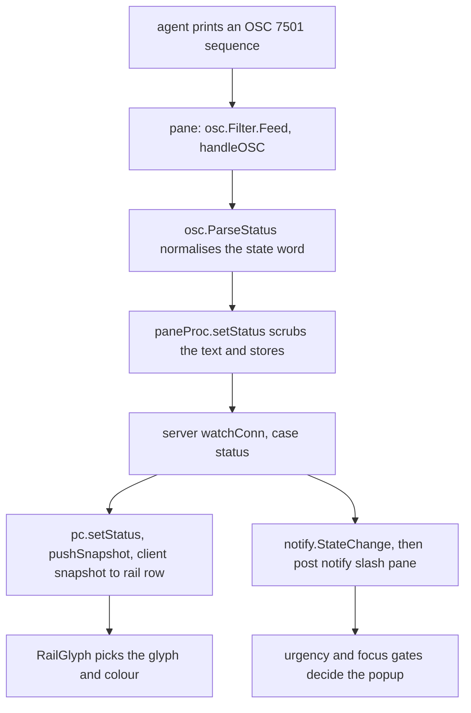

# Surfaces: the box, the notify bus and pane status

This page answers how a pane reports outward: what the box stores, which entries
reach the desktop, and how one sequence from an agent becomes a glyph.

## The box is a durable message bus, not a chat log

`internal/box` is one append-only log per session. A poster names a topic and a
state, and the server stamps a sequence and a time. A reader filters by exact
topic or topic prefix plus a cursor, and every reader sees the whole log.

It is not a chat log: no threads, no edits, no reply chain, no per-reader inbox.
It is not a queue: a read consumes nothing, so a list, a wait and a repeat return
the same entries. A clear is the only removal outside the caps, and it never
resets the sequence.

## What one entry is

`box.Entry` (`internal/box/box.go:46`). Every field is always present, so a
reader tells an empty key from a missing one.

| field | meaning | bound |
| --- | --- | --- |
| `seq`, `at` | log sequence from 1, and UTC post time to the second | server owned |
| `from` | posting pane id such as `w3p1`, shape checked then looked up | optional |
| `key` | the topic | 128 bytes (`MaxKey`) |
| `state` | `note`, `working`, `blocked`, `done` or `error` | closed set, `box.go:86` |
| `msg` | the one line under the topic | 2000 bytes (`MaxMsg`) |
| `body` | long text under the line, the only field that may hold a newline | 16 KiB (`MaxBody`) |

`CheckText` (`box.go:422`) caps the bytes, demands valid UTF-8 and refuses
control characters, because an entry prints on one row. `MaxEntries` 1000 and
`MaxBytes` 256 KiB bound the log, and `State.TrimBox`
(`internal/session/state.go:392`) drops the oldest until both fit.

## The key grammar

A key is a flat string of at most 128 bytes, and the code never parses a
hierarchy. `box.Match` (`box.go:407`) tests one exact key, one
`strings.HasPrefix`, one cursor. `key` and `keyPrefix` are exclusive on a read.

Three branches are convention and README.md owns their use: `lane/<id>`,
`msg/<name>`, `reply/<pane>`. A fourth, `plugin/<name>/...`, is reserved in
`PLUGINS.md:117`. One branch belongs to the code: `box.NotifyPrefix` is
`notify/`, and `box.IsNotifyTopic` (`box.go:39`) is the whole test a renderer
runs. `box.ParseReq` (`box.go:283`) is the one decoder.

## The store

The log lives in the state file: `State.Box` and `State.BoxSeq`
(`internal/session/state.go:132`). `boxStoreLocked`
(`internal/server/server_box.go:35`) appends, trims, wakes the waiters, saves and
broadcasts `{"type":"box"}`, all under `s.mu`; a failed save keeps the entry in
memory and returns the error. `LoadStateAt` (`state.go:260`) drops the rows that
fail `Entry.Validate` (`box.go:460`) instead of the whole box.

## Waiters, subscribers and watches

`boxWait` (`internal/server/server_box.go:313`) blocks with no lock held. It
checks under `s.mu`, registers a `boxWaiter` before unlocking, and re-checks on
every wakeup. A post nudges every waiter into a one-slot channel; a full slot
drops the nudge, and the re-check plus the 100ms poll bounds the loss.

Without `afterSeq` the wait reads the newest entry under the topic and only its
state satisfies it: a status board. With `afterSeq` it returns the oldest entry
past the cursor: a stream. `boxSub` (`server_box.go:387`) is that second shape;
on a full client queue it rolls the cursor back and ends with `errBoxGone`, so a
reconnect resumes at that entry.

A read from a pane leaves a watch: pane, filter, highest `seq` served, parked
(`box.Watch`, `box.go:63`). The registry is server memory only, rebuilt by fresh
reads. `boxExpireLocked` (`server_box.go:212`) drops a watch whose pane left the
tree and an unparked one older than `boxWatchTTL`, ten minutes; a parked watch
never ages out. Any change pushes `{"type":"watch"}`.

## Notify: a policy over the log

A desktop notification is not a box feature. `notify/` keys are ordinary
entries, and one renderer watches the branch. Three gates decide a popup.

1. The transition gate. `notify.StateChange` (`internal/notify/notify.go:21`)
   fires only when the new state differs from the old and is `blocked`, `done`
   or `error`. The pane watch loop applies it
   (`internal/server/server_core.go:1003`) before it posts, so a program that
   reports `blocked` every second posts once. That is the dedupe.
2. The urgency gate. `notify.Urgent` (`notify.go:37`) admits `blocked` and
   `error` only. A `done` entry is logged and never interrupts, so an entry can
   pass one gate and fail the other.
3. The suppression gate. `notifyBoxEntryLocked`
   (`internal/server/server_box.go:66`) stays silent when the topic names the
   pane the operator is looking at. A bare `notify/` topic names no pane.

The policy lives apart because the box is a log with no opinion about a desktop.
`internal/box` imports the standard library only: it logs an entry on a host with
no `notify-send`. The prefix is the only link, and the client applies the same
suppression rule to its own toasts (`internal/client/client_notify.go:41`).

## OSC 7501 and pane status

An agent reports on its own stdout with
`ESC ] 7501 ; state=working:app=pi:msg=<base64> ST`, terminated by `ST` or BEL.
`osc.Filter.Feed` (`internal/osc/osc.go:48`) sits in the pane's read loop. It
holds a partial sequence between reads, consumes the ones it handles, and passes
every other byte through. `handleOSC` (`osc.go:105`) matches `oscPrefix`
(`osc.go:46`) and calls `Status`.

`osc.ParseStatus` (`osc.go:276`) accepts the keyed form plus the older JSON and
bare forms. `knownState` (`osc.go:254`) is the closed set a pane can report:
`idle`, `working`, `blocked`, `done`, `error`, `unknown`. `normaliseState`
(`osc.go:265`) maps `clear` and any unknown word to `unknown`, so a report can
never put free text into a word the rail prints. The sets differ on purpose:
`idle` and `clear` are not box states, `note` is not a pane status, and the
bridge casts only `blocked`, `done` and `error`
(`internal/server/notify_server.go:21`).

## From a sequence to a glyph

`RailGlyph` (`internal/rail/rail.go:465`) reads one glyph and colour per state
from `theme.States` (`internal/theme/theme.go:170`), with a Nerd Font form for
every state but `shell`. `RailMark` (`rail.go:476`) draws the agent mark, and a
shell that never reported gets a blank cell.

## A lane and dungeon

Dungeon gives each lane one line to run when it finishes: a box post on
`lane/<unit>` with state `done` and the report path as the message. The parent
reads that branch with `--prefix lane/` and its own cursor, so it maps an entry
back to a unit without polling a screen.

## Where to add the next one

- A new topic is a string: post it, filter it, write the convention down.
- A new box state starts at `box.States` (`box.go:86`) and stops there. The
  parser, the error text, the schema enum and `ValidateReq` all read that slice.
- A new pane status starts at `knownState` (`internal/osc/osc.go:254`), then
  needs a `theme.states` entry for its glyph and a decision about
  `notify.StateChange`.
- A new notification rule goes in `notify.Urgent` for a new interrupting state,
  in `notify.StateChange` for a new transition, and in `notifyBoxEntryLocked`
  for a new suppression rule. None of the three belongs in `internal/box`.

## See also

- [The protocol](03-protocol.md) for the envelope the box rides in.
- [The server](04-server.md) for the lock the box work is done under.
- [The pane](05-pane.md) for the read loop the filter sits in.
- [The client](06-client.md) for the float, the toast and the snapshot apply.
- [Secrets](09-secrets.md) for the redaction a status message passes through.
