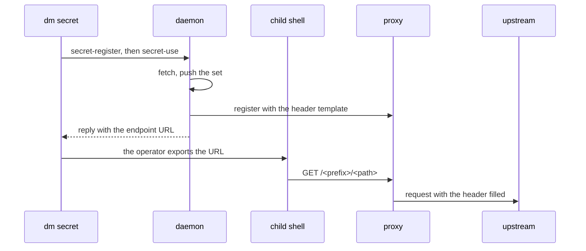

# Secrets

What this page answers: how a credential gets from a store into a program without landing on a channel
another program reads by accident, and the file that enforces each rule.

The words to know. A store is a command that prints a value on stdout: `op` (1Password) or `pass`. The
daemon is the session server, the process that owns one session's state, and a session is one named run of
it, with its state under `$DM_STATE/sessions/<name>/` (`internal/paths/paths.go#SessionDirAt`). A pane is one
terminal: a pane daemon (`dm __pane`) that owns a pseudo terminal (pty), a VT screen (a terminal emulator,
a grid of cells, `internal/vt`) and a scroll ring, a fixed-size copy of the pty's output. A child is any
process the daemon or a pane starts: a shell, a store command. A client is a program on a daemon's
socket. A channel is any place a byte is read again. The wire is the JSON envelope (`wire.Msg`,
`internal/wire/wire.go#Msg`); a reply is the daemon's answer to one request.

## The threat model: every program is the attacker

The person at the keyboard is not the adversary. Every program runs as the same user, so any child can
read the daemon's `/proc/<pid>/environ` and its memory. `internal/pane/env.go#Env` says so: the environment
rule "narrows a shell's environment for accidents. It is not a secrecy boundary." A memory read is
deliberate, not an accident: a program that reads it chose to, and dm stops nothing there. This page guards
the accidental channel: a screen, the ring, a shell history, argv, a child's env, a log, the state file
(`state.json`, `internal/paths/paths.go#StatePathAt`), a reply body. A value on any of them is the loss. The claim
is never that a value cannot be found, only that it sits on no channel a program reads unasked
(`internal/secrets/secrets.go#package`).

## The forms

A registered secret is a record, not a value: the state file holds an address; the value lives only in
memory, in the registry (`internal/secrets/secrets.go#Registry`), until fetched. A register request writes one
`session.Secret` record (`internal/session/secret.go#Secret`): a name, the store (`tool`), the address
(`reference`), the upstream base and header template, and extra env entries, the tool configuration a
store reads to find itself (`GNUPGHOME` for `pass`); that list is an allowlist (`secretEnvKeys`,
`internal/session/secret.go#secretEnvKeys`), so an entry is never a value. Four verbs follow: `dm secret register`,
`hydrate`, `sync`, `type`. The first three leave something durable; the fourth does not.

| form | action | what it produces | what it never does |
| --- | --- | --- | --- |
| register | `secret-register` (`internal/server/server_secrets.go#server.secretRegister`) | one record in `state.json`: name, tool, reference, upstream, header, extra env | fetch, hold or name the value |
| hydrate | `secret-hydrate` (`internal/server/server_secrets.go#server.secretHydrate`) | a file at the `--to` path with mode 0600, owner read and write only, a live value in the registry, the value in every pane's set | start the proxy |
| sync | `secret-sync` (`internal/server/server_sync.go#server.secretSync`), from a `.dm-secrets.kdl` mapping | records from the mapping's `secret` blocks, values from its `file` blocks | fetch, ride the proxy, write a file |
| type | `secret-type` (`internal/server/server_secrets.go#server.secretType`) | the value as keystrokes in a pane's pty | ride the proxy, or reach a pane that has not taken the set |

The set is the value list every pane redacts; the daemon pushes it to every pane in a `set-secrets` frame.
The mapping is KDL, the node format the keymap and theme files also use (`internal/kdl`): a `secret` block
is a top-level node naming one record and carrying its fields, a `file` block one naming a path to read
(`internal/server/server_sync.go#parseSecretsMapping`). `checkSecretShape` (`internal/server/server_secrets.go#checkSecretShape`) runs
`session.Secret.Validate` and `proxy.Validate` before anything is stored, so a bad reference, a missing
`{}` slot (the placeholder the proxy fills with the value) or an upstream without a header (or the
reverse) is refused at register time; a sync block answers to the same check. `hydrate` writes and renames
a fresh 0600 file (`internal/secrets/secrets.go#Hydrate`), and `sync` never fetches: a file block donates each
line's text after the first `=` to redact.

`secret-type` refuses a newline or a control byte, because the pty delivers LF as Enter: a multi-line
value would submit its first line and run the rest as shell commands (`secretTypeShape`,
`internal/server/server_secrets.go#secretTypeShape`), and it refuses when any pane the keystrokes reach lacks the set.
A reference is an address: `op://Personal/github/token` names an `op` vault item, `pass` a store path. The
value lives in the daemon's registry, the proxy's header and the pane's set; it dies with either process.

## Redaction: the rules and where they run

Redaction is a stage in the pane's output path: the last filter a chunk, one read of the pty of at most 32
KiB, passes before publish, the one step that feeds it to the screen, the ring and every client
(`publishLocked`, `internal/pane/pane.go#paneProc.publishLocked`). The stage is a `scrubber` in `internal/pane/scrub.go`,
wired in `readLoop` (`internal/pane/pane.go#paneProc.readLoop`). The OSC filter runs first, then the scrub, then publish.
OSC is the terminal escape family that sets a title, a colour or a dm status message, and the filter
decodes it out of the stream (`internal/osc/osc.go#Filter`). Everything downstream draws redacted bytes: the
screen, the ring, a broadcast (`bytes` frame) and a read-back (`read` reply).

- Bounds live in one place: 4 bytes minimum, 4096 maximum, 256 values (`internal/pane/scrub.go#MinSecretLen`), and
  the daemon warns with the same constants, naming the secret and its length, never the value
  (`secretBoundsWarning`, `internal/server/server_secrets.go#secretBoundsWarning`).
- Replacement keeps the length, one `*` per value byte (`internal/pane/scrub.go#writeRedacted`), because the pane's
  output is addressed by byte position: a published byte count, the anchor a client's copy starts from and
  the offsets a yank returns are all positions in that stream.
- Matching is leftmost-longest. A proper prefix of a longer value is held back until the next chunk
  (`redactInto`, `internal/pane/scrub.go#redactInto`). A value with a newline is matched in its CRLF form too,
  because the pty rewrites LF to CRLF on the way out (`valueForms`, `internal/pane/scrub.go#valueForms`). The OSC
  7501 status message and its app name are scrubbed by `redactText` (`internal/pane/scrub.go#scrubber.redactText`), outside
  the stream, because the filter decodes them first.

## The proxy: the value stays in the daemon

`internal/proxy` binds a loopback port the kernel picks (`127.0.0.1:0`, `internal/proxy/proxy.go#New`) and
mints a random 16-byte prefix per secret (`internal/proxy/proxy.go#Proxy.Register`). The daemon holds the value; the
header template names its slot, `Authorization: Bearer {}`. The upstream is pinned: a request only goes to
the base URL stored at register time. No code puts the endpoint into a child: `secret-use` replies with
the URL (`internal/server/server_secrets.go#server.secretUse`), `dm secret use` prints it on the operator's stdout
(`internal/cli/cli.go#secretUseVerb`), and the operator exports it into a shell under a name the program reads. The
program's request to that URL is the ride: `forward` (`internal/proxy/proxy.go#entry.forward`) rebuilds the upstream
URL from the pinned base plus the path after the prefix, copies the inbound headers except the injected
one, and fills the header. The upstream must be https, or plain http to the loopback (`checkUpstream`,
`internal/proxy/proxy.go#checkUpstream`); the template carries one header, exactly one `{}` and no CR or LF
(`fillTemplate`, `internal/proxy/proxy.go#fillTemplate`).

## The trust rule for a sync mapping

`dm secret sync` reads `./.dm-secrets.kdl` unless `--from` names a path, and sends the daemon an absolute
path plus a trust verdict: a boolean saying the mapping may register secrets and read files anywhere
(`internal/cli/cli.go#secretSyncVerb`). The CLI computes it with `mappingTrusted` (`internal/cli/cli.go#mappingTrusted`): true
when the operator typed `--trust`, or when the mapping resolves under the config directory,
`$XDG_CONFIG_HOME/dm` when set and `~/.config/dm` otherwise (`mappingUnderConfigDir`,
`internal/server/server_sync.go#mappingUnderConfigDir`). The daemon takes a sent verdict: `secretSyncTrusted` returns the wire
value whenever it is set (`internal/server/server_sync.go#secretSyncTrusted`), and `Trust` is optional
(`internal/wire/wire.go#Msg`). A request with no verdict is decided by path; `dm exec` sends none, taking
one raw JSON body from its argument (`internal/cli/cli.go#Run`). Any socket client can therefore mark a
repo mapping trusted. The path rule is the CLI's default verdict, and the daemon enforces whichever branch
the verdict names. An untrusted mapping registers no secret blocks: it cannot give the proxy an upstream to
attach the operator's store value to, and it reads files only under its own directory
(`checkFileConfined`, `internal/server/server_sync.go#checkFileConfined`).

## What a pane inherits

The daemon builds a pane's environment once, in `paneCmd` (`internal/pane/pane.go#paneCmd`), from an allowlist
(`Env`, `internal/pane/env.go#Env`). A name passes when it is on the keep list (`paneEnvKeep`,
`internal/pane/env.go#paneEnvKeep`): PATH, HOME, USER, LOGNAME, SHELL, TERM, TERM_PROGRAM, COLORTERM, LANG, TZ,
TMPDIR, WAYLAND_DISPLAY, DISPLAY, SSH_AUTH_SOCK, XAUTHORITY, DM_STATE. It also passes when the name starts with `LC_` or
`XDG_`, or ends in `_SOCK` while the value is an absolute path and the name is not credential-shaped.
Credential-shaped means the name carries a word from `secretEnvHints` (`internal/pane/env.go#secretEnvHints`): TOKEN,
SECRET, PASSWD, PASSWORD, CREDENTIAL, API_KEY, PRIVATE_KEY, AUTH, COOKIE.

Everything else is dropped, so a pane never inherits `OP_SERVICE_ACCOUNT_TOKEN`, the 1Password token the
daemon reads from its own environment to run `op`, nor any registered value. A plugin pane is the
exception: [PLUGINS.md](../../PLUGINS.md) declares a plugin, a program the daemon starts, and the env pairs
it declares are appended after the allowlist (`internal/pane/pane.go#paneCmd`); only a `DM_` name is refused
(`internal/keymap/config_parse.go#checkPluginEnv`). A pane never inherits `DM_PANE` or `DM_SESSION` either: `Env`
drops both and appends the pane's own ids last (`internal/pane/env.go#Env`), so the shell reads the ids it
was spawned with. The environment is built once per pane and never rebuilt, so turning redaction off does
not change it.

## The toggle

`toggle-secrets` is answered on both sockets: the daemon's own, `$DM_STATE/sessions/<name>/server.sock`
(`internal/paths/paths.go#ServerSockAt`), and the pane's, `$DM_STATE/sessions/<name>/panes/<id>.sock`. The daemon's
case (`internal/server/server_rpc.go#server.handleReq`) refuses a client that has not sent the attach frame, the
interactive client's first request (`internal/server/server_core.go#client`). It resolves the focused pane,
the pane a window marks as focus (a window is a layout of panes, `internal/session/state.go#Window`),
forwards the request to the pane and answers with the state the pane landed on. The pane flips the
scrubber's `off` switch (`scrubber.toggle`, `internal/pane/scrub.go#scrubber.toggle`). Off is a human's view of the
pane: bytes pass through untouched and the set stays, so a push during the reveal updates the list without
turning the stage back on. On is the repair: the stage scrubs from the next chunk, and `scrubPaintedLocked`
(`internal/pane/pane.go#paneProc.scrubPaintedLocked`) rewrites what the reveal published. It rescrubs the ring, flushes the pending
cluster (the last grapheme the terminal has not placed yet), scrubs the grid (the pane's screen), and
broadcasts one `scrub` frame with a fresh screen snapshot, so every client restores a redacted picture. It
is a convenience, not a control: an agent, a script that drives the socket, can attach and flip it. The
shell's own history file holds whatever `secret type` typed, and no stage rewrites it.

## Invariants a change must not break

| invariant | file that enforces it |
| --- | --- |
| A record never carries a value, and its env is tool config only | `internal/session/secret.go` |
| A value never rides argv, the store child's environment or an error string, and a hydrate file is a fresh 0600 regular file | `internal/secrets/secrets.go` |
| A pane's env is allowlisted, plus a plugin's declared pairs, and `DM_PANE` is never inherited | `internal/pane/env.go`, `internal/server/server_plugin.go` |
| Redaction runs before publish and keeps the stream length | `internal/pane/scrub.go`, `internal/pane/pane.go` |
| A pane waits for the set before its shell, bounded by a 250 ms grace (`internal/pane/pane.go#spawnGrace`) and a 30 s backstop (`internal/pane/pane.go#adoptDeadline`) | `internal/pane/pane.go` (`awaitAdopt`, `internal/pane/pane.go#paneProc.awaitAdopt`) |
| A typed value is refused on a control byte, and a reply, log line or warning names the secret, never the value | `internal/server/server_secrets.go` |
| The proxy injects a request header only, follows no redirect, refuses a non-loopback peer | `internal/proxy/proxy.go` |
| An untrusted mapping registers no secret and reads only under its own directory | `internal/server/server_sync.go` |

## Where a new tool is added

1. `internal/session/secret.go`: the constant beside `ToolOp`, and a `Validate` case for its shape.
2. `internal/server/server_secrets.go`: a case in `secretTool` with the binary, the argument template and
   its `Inherit` list, the names copied from the daemon's environment (`internal/secrets/secrets.go#Tool`).
   The value never goes in `Args`; `toolInherit` is the shared base set.
3. `internal/session/secret.go`: extend `secretEnvKeys` if the tool needs a configuration name. That list
   is a positive allowlist, so an entry is the permission.
4. `internal/cli/cli.go`: the tool check in `secretRegisterVerb`; `internal/clidoc/clidoc.go` holds the help.

## See also

- [The protocol](03-protocol.md), for the `set-secrets` push frame.
- [The server](04-server.md), for the action switch and the mutation path.
- [The pane](05-pane.md), for the PTY loop the scrub stage sits in.
