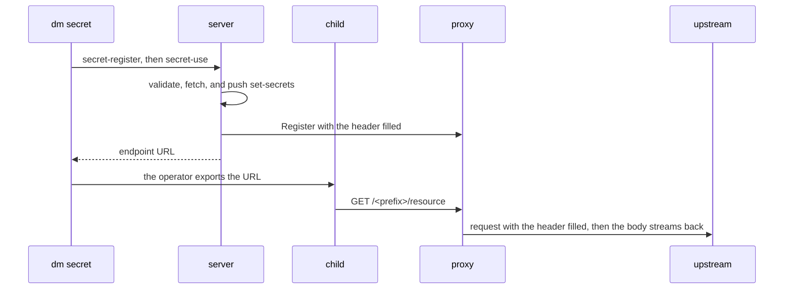

# Secrets

What this page answers: how a credential gets from a store into a program without landing on a channel
another program reads by accident, and the file that enforces each rule.

## The threat model: the process is the attacker

The person at the keyboard is not the adversary. Every program runs as the same user, so any child can
read the daemon's `/proc/<pid>/environ` and its memory. `internal/pane/env.go:32` says so: the environment
rule "narrows a shell's environment for accidents. It is not a secrecy boundary." A value printed on a
screen, echoed into a scrollback ring, typed into a shell history, carried in argv, exported into a child,
written to a log, stored in the state file or returned in a reply body is the loss. The claim is never
that a value cannot be found, only that it sits on no channel a program reads without asking
(`internal/secrets/secrets.go:1`).

## The forms

A registered secret is a record, not a value: the state file holds an address, so the value exists only in
memory after a fetch. Three verbs produce something durable and `secret type` spends one.

| form | action | what it produces | what it never does |
| --- | --- | --- | --- |
| register | `secret-register` (`internal/server/server_secrets.go:496`) | one `session.Secret` in `state.json`: name, tool, reference, upstream, header, extra env | fetch, store or name the value |
| hydrate | `secret-hydrate` (`internal/server/server_secrets.go:771`) | a 0600 file at `--to`, a live value in the registry, the value in every pane's list | start the proxy |
| sync | `secret-sync` (`internal/server/server_sync.go:269`) | records from the mapping's `secret` blocks, values from its `file` blocks | fetch, ride the proxy, write a file |
| type | `secret-type` (`internal/server/server_secrets.go:924`) | the value as keystrokes in a pane's pty | ride the proxy, or reach a pane whose set was not pushed first |

`checkSecretShape` (`internal/server/server_secrets.go:531`) runs `session.Secret.Validate` and
`proxy.Validate` before anything is stored, so a bad reference, a missing `{}` slot or a one-sided pairing
is refused at register time. `hydrate` writes a fresh 0600 file and renames it into place
(`internal/secrets/secrets.go:119`). `sync` never fetches: a `file` block donates everything after the
first `=` on each line as a redaction value.

`secret-type` refuses a newline or a control byte, because the pty reads LF as Enter (`secretTypeShape`,
`internal/server/server_secrets.go:980`). It also refuses when any pane the keystrokes reach lacks the set.

A reference is an address, not a value: `op://Personal/github/token`, a `pass` store path. The value lives
in the in-memory registry (`internal/secrets/secrets.go:76`), the proxy's filled header, and the pane's
list, and dies with the process.

## Redaction: the rules and where they run

The stage is `internal/pane/scrub.go`, wired as the last output filter in `readLoop`
(`internal/pane/pane.go:891`): the OSC filter runs first, then the scrub, then publish, so the screen, the
ring, every broadcast and every read-back draw redacted bytes.

- Bounds live in one place: 4 bytes minimum, 4096 maximum, 256 values (`internal/pane/scrub.go:33`), and
  the server warns with the same constants (`secretBoundsWarning`, `internal/server/server_secrets.go:453`).
- Replacement keeps the length, one `*` per value byte (`internal/pane/scrub.go:358`), because produced
  counts, anchors and yank offsets are positions in that stream.
- Matching is leftmost-longest. A match that is a proper prefix of a longer value is held back until the
  next chunk (`redactInto`, `internal/pane/scrub.go:312`). A value with a newline is also matched in its
  CRLF form, because the pty rewrote it (`valueForms`, `internal/pane/scrub.go:128`).
- Status message and app title are scrubbed by `redactText` (`internal/pane/scrub.go:248`), outside the stream.

## The proxy: the value stays in the daemon

`internal/proxy` listens on `127.0.0.1:0` and mints a random 16-byte path prefix per secret
(`internal/proxy/proxy.go:107`). The daemon holds the value, and the header template names its slot:
`Authorization: Bearer {}`. No code puts the endpoint into a child: `secret-use` replies with the URL
(`internal/server/server_secrets.go:688`), `dm secret use` prints it to the operator's stdout
(`internal/cli/cli.go:997`), and the pane allowlist drops it, so the operator exports it by hand. The URL
is a capability: whoever can read it can use it, and each use mints a new prefix and revokes the old one
(`internal/server/server_secrets.go:727`).

`forward` (`internal/proxy/proxy.go:300`) rebuilds the upstream URL from the pinned base plus the path
after the prefix, copies the inbound headers except the injected one, and sets the header with the value
filled in. The upstream must be https, or plain http to the loopback (`checkUpstream`, `:179`), and the
template names one header, holds exactly one `{}` and carries no CR or LF (`fillTemplate`, `:203`).

## The trust rule for a sync mapping

`dm secret sync` reads `./.dm-secrets.kdl` unless `--from` names a path, and sends an absolute path plus a
trust verdict (`internal/cli/cli.go:1051`). The CLI computes that verdict with its own copy of the rule,
`mappingTrusted` (`internal/cli/cli.go:1083`): true when the operator typed `--trust` or when the mapping
resolves under the config directory, `$XDG_CONFIG_HOME/dm`, else `~/.config/dm`
(`mappingUnderConfigDir`, `internal/server/server_sync.go:228`).

The server takes the sender's verdict: `secretSyncTrusted` returns the wire value whenever it is set
(`internal/server/server_sync.go:251`), and `Trust` is optional (`internal/wire/wire.go:56`). `dm exec`
unmarshals its body into the request (`internal/cli/cli.go:572`), so any socket client can mark a repo
mapping trusted. Trust is the CLI's default; the server enforces the branch the verdict names.

The default is the config directory because a mapping comes from a clone, a checkout or a directory some
tool wrote into. An untrusted mapping registers no secret blocks, so it cannot pin an upstream for the
operator's store value, and it reads files only under its own directory (`checkFileConfined`, `:491`).

## What a pane inherits

The server builds a pane's environment once, in `paneCmd` (`internal/pane/pane.go:606`), from an allowlist
(`Env`, `internal/pane/env.go:38`). A name passes when it is on the short keep list, or starts with `LC_`
or `XDG_`, or is a `*_SOCK` name whose value is an absolute path and whose name is not credential-shaped.
Everything else is dropped, so a pane never inherits `OP_SERVICE_ACCOUNT_TOKEN` or a registered value. A
plugin pane is the exception: its block's declared pairs are appended after the allowlist, and only a
`DM_` name is refused (`internal/server/server_plugin.go:118`, `internal/keymap/config_parse.go:690`).
It never inherits `DM_PANE` or `DM_SESSION`: those are appended last, so a child reports the ids it was
spawned with. The environment is built once and never rebuilt, so a toggle cannot change it.

## The toggle

`toggle-secrets` exists on both sockets. The server's case (`internal/server/server_rpc.go:261`) refuses
an unattached client, resolves the focused pane, forwards to the pane and answers with the state the pane
landed on. The pane flips `scrubber.off` (`internal/pane/scrub.go:138`).

Off is a human's window into the pane: bytes pass through untouched and the value list stays, so a push
during the reveal updates the list without turning the stage back on. On is the repair. The stage scrubs
from the next chunk, and `scrubPaintedLocked` (`internal/pane/pane.go:985`) rewrites what the reveal
published: it rescrubs the ring, flushes the pending cluster, scrubs the grid, and broadcasts one `scrub`
frame with a fresh screen snapshot, so every client restores a redacted picture. It is a convenience, not
a control: an agent that can reach the socket can flip it.

## What redaction does not cover

The shell's own history file holds whatever `secret type` typed, and no stage rewrites it.

## Invariants a change must not break

| invariant | file that enforces it |
| --- | --- |
| A record never carries a value, and its env is tool config only | `internal/session/secret.go` |
| A value never rides argv, a tool's output tail or an error string, and a hydrate file is a fresh 0600 regular file | `internal/secrets/secrets.go` |
| A pane's env is allowlisted, plus a plugin block's declared pairs, and `DM_PANE` is never inherited | `internal/pane/env.go`, `internal/server/server_plugin.go` |
| Redaction runs before publish and keeps the stream length | `internal/pane/scrub.go`, `internal/pane/pane.go` |
| A pane waits for the set before its shell, bounded by a 250 ms grace (`internal/pane/pane.go:749`) and a 30 s backstop (`:757`) | `internal/pane/pane.go` (`awaitAdopt`) |
| A typed value is refused on a control byte, and a reply, log line or warning names the secret, never the value | `internal/server/server_secrets.go` |
| The proxy injects a request header only, follows no redirect, refuses a non-loopback peer | `internal/proxy/proxy.go` |
| An untrusted mapping registers no secret and reads only under its own directory | `internal/server/server_sync.go` |

## Where a new tool is added

1. `internal/session/secret.go`: the constant beside `ToolOp`, and a `Validate` case for its shape.
2. `internal/server/server_secrets.go`: a case in `secretTool` with the binary, the argument template and
   its `Inherit` list. The value never goes in `Args`. `toolInherit` is the shared set; a tool that needs
   a credential adds one name to its own `Inherit`.
3. `internal/session/secret.go`: extend `secretEnvKeys` if the tool needs a configuration name. That list
   is a positive allowlist, so an entry is the permission.
4. `internal/cli/cli.go`: the tool check in `secretRegisterVerb`, and `internal/clidoc/clidoc.go` for the
   help text.

## See also

- [The protocol](03-protocol.md), for the `set-secrets` and `secret-cover` frames.
- [The server](04-server.md), for the action switch and the mutation path.
- [The pane](05-pane.md), for the PTY loop the scrub stage sits in.
