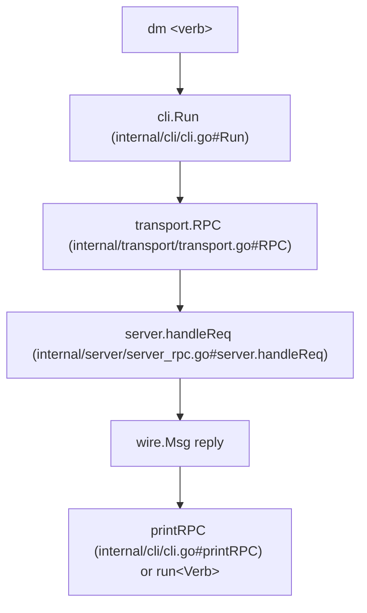
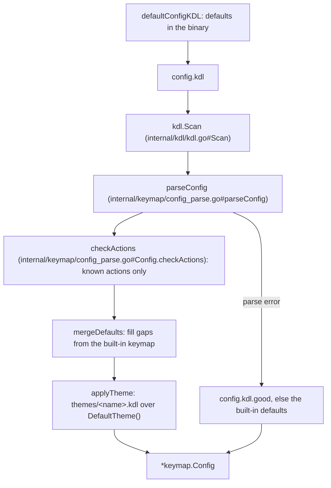

# Config and the CLI surface

This page answers where a verb, a config node and a rendered page live, and
where a change goes. Read it to add a verb, a config node, a theme key or an
action.

`dm` is a command line: a verb is the first word after `dm` (`dm split`,
`dm attach`). Every verb is one row in a Go table, and `help` is the one word
answered before the table (`main.go#main`). `dm attach`, or the bare `dm`,
starts the TUI client and creates the session if needed. Every config file is a
patch over a built-in default. The table holds 58 rows: `dm help` prints them,
and `dm <verb> -h` prints one verb's flags.

## The verb path

`internal/wire` is the socket contract: one `Msg` envelope
(`internal/wire/wire.go#Msg`) per message in each direction. It carries `Type`
(`req` or `resp`), the action name, the target and the result JSON. An action
is one named command the server runs (`split`, `focus`, `write-to`).
`internal/transport` is the CLI side: `RPC` dials the session, sends one `Msg`,
and returns the reply.

## One table, four surfaces

`cliCommands` (`internal/clidoc/clidoc.go#cliCommands`) holds 58 rows, including
the subverbs of `layout`, `msg`, `ask`, `secret` and `plugin`. A subverb is a row
whose name is two words. The group verb `msg` hands its first argument to the
`msg post` and `msg list` rows.

A row (`cliCommand`, `internal/clidoc/clidoc.go#cliCommand`) carries `name`,
`aliases`, `args`, `summary`, `flags`, `example`, `group` and `extra`. The field
`extra` is an alternate usage line with its own summary. `cliGroups`
(`internal/clidoc/clidoc.go#cliGroups`) fixes nine groups in render order:
Sessions, Layouts, Panes, Windows and workspaces, Observe, Message box, Ask,
Secrets, Docs.

`(*cmdFlags).parse` (`internal/cli/cli.go#cmdFlags.parse`) asks the row which
flags to register, so a verb gets exactly its own flags. A missing `register`
case panics (`internal/cli/cli.go#cmdFlags.register`). The table generates no
shell completion.

| renderer | function | surface |
| --- | --- | --- |
| usage text | `UsageText` (`internal/clidoc/clidoc.go#UsageText`) | `dm help`, one row per verb under its group header, and `VerbHelp` (`internal/clidoc/clidoc.go#VerbHelp`) for `dm <verb> -h` |
| man page | `ManPage` (`internal/clidoc/man.go#ManPage`) | roff from the rows, the action examples and the `configdoc` tables |
| teaching page | `LLMsText` (`internal/clidoc/llms.go#LLMsText`) | one markdown page, with actions packed by `llmsActionGroups` |
| html page | `HTMLPage` (`internal/clidoc/html.go#HTMLPage`) | one self-contained page, painted from `theme.DefaultTheme()` |

`dm help` prints a summary only when the row fits 42 columns (`usageMaxWidth`,
`internal/clidoc/clidoc.go#usageMaxWidth`). It then prints a closing block with
one example request. The fields `dm exec` sets on a `Msg` are
`action`, `target`, `msg` (text) and `enter` (return). `internal/configdoc`
holds the config surface as plain data: the node table, the environment table,
the file list, the action descriptions and the theme keys.

## The docs check

Three snapshots hold the generated pages. The tests compare the committed file
byte for byte. A row that changes a rendered page fails until the snapshot is
regenerated.

| snapshot | command | test |
| --- | --- | --- |
| `docs/dm.1` | `go run . man -o docs/dm.1` | `TestManPageMatchesSnapshot` (`internal/cli/man_test.go#TestManPageMatchesSnapshot`) |
| `docs/llms.txt` | `go run . llms -o docs/llms.txt` | `TestLLMSTextMatchesSnapshot` (`internal/cli/llms_test.go#TestLLMSTextMatchesSnapshot`) |
| `docs/dm.html` | `go run . html -o docs/dm.html` | `TestHTMLPageMatchesSnapshot` (`internal/cli/html_test.go#TestHTMLPageMatchesSnapshot`) |

The site is a second check. `scripts/docs-site.sh` stages the published pages
into `.site/` from a git-tracked allowlist, then runs `zensical build`
(`mkdocs.yml` sets `strict: true`). The build fails on a broken link, or on a
page that is staged but missing from the nav. A new page in `docs/internals`
therefore needs a nav entry in `mkdocs.yml`, and nothing else. `make docs-site`
runs the same script. The pages workflow publishes the site at
`https://darkmage.dev/dm/`, and `mkdocs.yml` sets `site_url`.

`PLUGINS.md` is the plugin contract by hand. It covers a program in a pane, the
declaration, the environment, the message log topics and the example under
`examples/`.

## Adding a verb

Do these in order. The row and the flag plumbing must agree, or the tests fail.

1. Insert the row in its group's contiguous run in `cliCommands`
   (`internal/clidoc/clidoc.go#cliCommands`).
   `TestGroupsAreCompleteAndOrdered`
   (`internal/clidoc/clidoc_test.go#TestGroupsAreCompleteAndOrdered`) fails an
   appended row.
2. Land the flag plumbing and the row together: the `cmdFlags` field
   (`internal/cli/cli.go#cmdFlags`), the `register` case
   (`internal/cli/cli.go#cmdFlags.register`), and `withValue`
   (`internal/cli/cli.go#withValue`).
3. Fill the row's `name`, `aliases`, `args`, `summary`, `flags`, `example` and
   `group`.
4. Add a `case "<verb>":` in `Run` (`internal/cli/cli.go#Run`): `newFlagsAt`,
   `c.parse`, `c.extraArg`, then `run<Verb>(c)` or `transport.RPC`.
5. Print the answer: `printRPC` (`internal/cli/cli.go#printRPC`) for JSON, or a
   `run<Verb>` helper.
6. Add the flag tests: `fieldFlag`
   (`internal/cli/verb_flags_test.go#fieldFlag`), `flagDefaults`
   (`internal/cli/verb_flags_test.go#flagDefaults`) and the `verbOf` alias map
   (`internal/cli/verb_flags_test.go#TestEveryVerbReadsOnlyDeclaredFlags`). The
   alias map links a `Run` label to its table row.
7. A subverb is a row whose name has a space. Add its case to the group verb's
   dispatcher: `runBox` for `msg` (`internal/cli/cli.go#runBox`), `runSecret` for
   `secret` (`internal/cli/cli.go#runSecret`), `runPlugin` for `plugin`
   (`internal/cli/cli.go#runPlugin`).
8. For a new action, change `wire.Msg` (`internal/wire/wire.go#Msg`),
   `handleReq` (`internal/server/server_rpc.go#server.handleReq`) and
   `s.mutation` (`internal/server/server_mutate.go#server.mutation`). Then add
   the name to `manActionNames` (`internal/clidoc/man.go#manActionNames`),
   `actionExamples` (`internal/clidoc/actions.go#actionExamples`) and
   `llmsActionGroups` (`internal/clidoc/llms.go#llmsActionGroups`).
9. For a new key, change `builtinActions`
   (`internal/keymap/actions.go#builtinActions`), `defaultConfigKDL`
   (`internal/keymap/config_parse.go#defaultConfigKDL`) and
   `configdoc.ActionDesc` (`internal/configdoc/tables.go#ActionDesc`), which
   describes one action.
10. Set `manDate` (`internal/clidoc/man.go#manDate`) to today. The man page
    prints it in `.TH`, and the snapshot compares byte for byte.
11. Regenerate the three snapshots with the commands in the check table.
    `docs/llms.txt` stays under 500 lines, guarded by `TestLLMSTextStaysOnePass`
    (`internal/cli/llms_test.go#TestLLMSTextStaysOnePass`). A row that takes the
    page to 500 means cutting a paragraph in `LLMsText`
    (`internal/clidoc/llms.go#LLMsText`).

## The config files

All three paths are KDL: a text config of nodes and braces. A node is a name, an
optional quoted string, and an optional `{ }` block of child nodes
(`internal/kdl`). The prefix key is the one the TUI client keeps for itself. The
bytes before it go to the pane. The next key is read as a binding from the
current mode, not as text (`internal/client/client_input.go#tui.processInput`).
`prefix "ctrl+b"` sets it.

| path | role |
| --- | --- |
| `$XDG_CONFIG_HOME/dm/config.kdl`, or `$HOME/.config/dm/config.kdl` when `XDG_CONFIG_HOME` is unset | keymap, prefix and options; written on first attach with mode 0600, in a directory created 0700 |
| `$XDG_CONFIG_HOME/dm/themes/<name>.kdl` | palette, accents, glyphs, state styles |
| `$XDG_CONFIG_HOME/dm/config.kdl.good` | the last text that parsed, kept as a fallback |

`defaultConfigPath` (`internal/keymap/config_load.go#defaultConfigPath`) picks
the path. An attach writes the file when it is missing
(`internal/client/client_model.go#attachConn`).

The node table is data: `configdoc.ConfigNodes`
(`internal/configdoc/tables.go#ConfigNodes`) holds every node, its value, its
default and its effect. `dm man` and `dm html` print it. `dm html` opens every
table here, with the keymaps and the theme keys, as one page in the browser.

## Load order and overrides

A missing file gives the built-in defaults. `<name>` is the `theme` node of
`config.kdl`, and `applyTheme` reads `themes/<name>.kdl`
(`internal/theme/theme.go#LoadThemeFile`). A bound action the built-in set does
not know (`internal/keymap/actions.go#builtinActions`) is a load error.

The file is a patch, not a replacement: every node and theme key is optional. A
`keymap` block names one mode and may repeat. An action the file leaves out
takes its built-in key when that key is free. `mergeDefaults` drops a default
whose key is bound, and one that is the prefix in `main`
(`internal/keymap/config_parse.go#mergeDefaults`). `"none"` unbinds one action,
and a duplicate action in one mode is an error.

On a reload, a broken file costs one toast and the client keeps the running
keymap and theme. On a load, a parse error falls back to `config.kdl.good`, the
last text that parsed, when that copy exists. A failed theme read keeps the
built-in theme.

The reload key, `ctrl+r` by default, re-reads `config.kdl` and the theme file it
names (`internal/client/client_keys.go#tui.reload`). It also asks the server to
re-read the same file, because the server owns `padding` and `default-fold`
(`internal/server/server_rpc.go#server.handleReq`). A `padding` change resizes
every pane. A `history-lines` change resizes every pane's scrollback buffer in
place and drops the cached replay.

## The keymap model

A config holds the prefix key and one mode per name. A mode is one set of
bindings, chosen by what has the keyboard. It carries an action-to-key-name map,
the byte sequences that fire each action, and the actions the file unbound.
`Match` (`internal/keymap/config_model.go#Config.Match`) gives a longer binding
priority, and reports `Partial` while the bytes so far begin a longer binding.

Nine modes are configurable, in `keymapOrder`
(`internal/keymap/config_model.go#keymapOrder`). Each name is followed by the
`Match` call that reads it.

| mode | what has the keyboard | reader |
| --- | --- | --- |
| `main` | the panes | `internal/client/client_input.go#tui.armedKey` |
| `menu` | the right-click menu | `internal/client/client_keys.go#tui.menuKey` |
| `picker` | the session picker | `internal/client/client_keys.go#tui.pickerKey` |
| `switcher` | the dashboard | `internal/client/client_keys.go#tui.switcherKey` |
| `layout` | the layout palette | `internal/client/layout_switcher.go#tui.layoutKey` |
| `scroll` | scrollback | `internal/client/client_input.go#tui.scrollKey` |
| `rename` | the rename prompt | `internal/client/client_input.go#tui.renameKey` |
| `box` | the message log | `internal/client/client_floats.go#tui.boxKey` |
| `help` | the keymap view | `internal/client/client_floats.go#tui.keymapKey` |

A `keymap` block outside `keymapOrder` is an error
(`internal/keymap/config_parse.go#parseKeymaps`). Three more configs are errors:
a key that names an unknown sequence, a duplicate action in one mode, and a
`main` binding on the prefix bytes. The prefix arms before `main` sees the key,
so that binding would never fire unarmed. `send-prefix` is the one action that means the prefix bytes.

A key name resolves through `KeySequences`
(`internal/keymap/config_model.go#KeySequences`). One printable character is one
key. `ctrl+` takes one letter. The named sequences are `esc`, `enter`, `tab`,
`space`, `backspace`, `up`, `down`, `left`, `right`, `pgup`, `pgdn`, `shift-tab`
and `prefix`. A key with two terminal encodings binds both, which is why `enter`
is CR and LF.

A binding line in `main` may carry a help tag: `"zoom-pane" "z" help "Layout"`
(`internal/keymap/config_parse.go#parseKeymaps`). The tag moves that row to the
named section of the armed help box, and an untagged row keeps its built-in
section. The five built-in names are Layout, Pane, Window, Session and Utility,
and the client derives them from the action label
(`internal/client/render_modal.go#helpCategory`). Any other name is a custom
section, and it takes the Utility colour
(`internal/client/render_modal.go#helpSectionColor`). The tag moves a row the
help box already lists, and never adds one
(`internal/keymap/config_model.go#Config.HelpEntries`).

## Commands and plugins

A `command` block is a named shell text. `run` is required, one non-empty quoted
string, and the name matches `[A-Za-z0-9_-]+` in at most 32 bytes
(`internal/keymap/config_parse.go#checkCommandName`). Bind `command:<name>` in a
keymap. The key opens a floating pane on the focused pane's folder and runs the
text through `/bin/sh -c`
(`internal/server/server_float.go#server.openFloat`).

Each of these is a config error that names its line: a duplicate command name, a
second `run`, or a missing `run`. So is an unknown key inside the block, or a
name that collides with a built-in action
(`internal/keymap/config_parse.go#findCommands`). So is a binding to a
`command:<name>` the file does not define.

A `plugin` block declares a program the server starts. Bind `plugin:<name>` to a
key. [PLUGINS.md](../../PLUGINS.md) holds the contract, and a `DM_` name in a
plugin's env is refused (`internal/keymap/config_parse.go#checkPluginEnv`).

## The theme file

`theme.Theme` (`internal/theme/theme.go#Theme`) holds an 11-colour `Palette` for
the sidebar and the status bar. It also holds six workspace `Accents`, the
structural `Glyphs`, one `StateStyle` per pane state, and the fixed `RailMarks`.
The states are `working`, `idle`, `blocked`, `done`, `error`, `unknown` and
`shell`. A theme file takes four blocks: `palette`, `accents`, `glyphs` and
`states`.

The `config.kdl` `theme` node names one file, at most once, and its name matches
`[A-Za-z0-9_-]+` (`internal/theme/theme.go#CheckThemeName`). No node keeps the
built-in theme. Every block and every key is optional, so a theme names only
what it changes.

An unknown or duplicate block or key fails the load. So does a colour that is
not `#rrggbb`, or a glyph that is not one rune of one cell. The error names the
line. A missing or malformed theme file toasts the error, and dm runs on the
built-in theme.

An explicit theme glyph wins over the Nerd Font icon, and a state glyph replaces
both forms. The agent and shell marks stay compiled in and are not themeable
(`RailMark`, `internal/rail/rail.go#RailMark`).

Colours are explicit RGB, so a theme may map an entry to a colour that fails
contrast. The built-in palette passes WCAG AA, and `TestRailContrast`
(`internal/client/dm_test.go#TestRailContrast`) guards it. A user theme is not
checked for contrast, only for form.

Every theme key, its block and its built-in value is data:
`configdoc.ThemeKeys` (`internal/configdoc/tables.go#ThemeKeys`).
`configdoc.ThemeSampleKDL` (`internal/configdoc/tables.go#ThemeSampleKDL`) holds
a sample file that names every key at its built-in value. Pasted as a theme, it
paints the built-in theme.

## The KDL scanner

`internal/kdl` is a scanner, not a parser: `kdl.Scan`
(`internal/kdl/kdl.go#Scan`) turns text into identifiers, strings and braces.
The keymap parser, the theme parser and the secret mapping reader in
`internal/server/server_sync.go` all read it. The subset is frozen at a node
name, an optional quoted string and a `{ }` block. Each reader rejects what it
does not know.

## The release environment

Two environment variables belong to shipping, not to `config.kdl`. Both are read
outside the config parser. The startup update check asks the first before it
decides to refresh (`internal/client/update.go#shouldCheck`), and the release
reader asks the second once, in `NewReader`
(`internal/release/release.go#NewReader`).

| variable | default | effect |
| --- | --- | --- |
| `DM_NO_UPDATE_CHECK` | unset | any value stops the attach's background release check (`internal/client/update.go#updateSkipEnv`). It does not suppress a notice already cached; [Shipping](12-release.md) has the rule. |
| `DM_RELEASE_API` | `https://api.github.com/repos/ladydascalie/dm/releases` (`internal/release/release.go#DefaultAPI`) | names the releases base that `dm upgrade` and the startup check read. It is the one extension point a test points at a stub (`internal/release/release.go#APIEnv`). |

## Where changes go

A new verb is `cliCommands` plus a `Run` case: steps 1 to 6 above, then 10 and
11. A new key is `internal/keymap/actions.go`, `defaultConfigKDL` and
`configdoc.ActionDesc`. A new config node is `parseConfig`
(`internal/keymap/config_parse.go#parseConfig`) and `configdoc.ConfigNodes`. A
new theme key is `internal/theme/theme.go` (field, default, setter), then
`configdoc.ThemeKeys` and `configdoc.ThemeSampleKDL`. The first is the key list;
the second is a sample file that names every key.

## See also

- [Entry point](01-entry-point.md), [Lifecycle](02-lifecycle.md), [The protocol](03-protocol.md), [The server](04-server.md)
- [The pane](05-pane.md), [The client](06-client.md), [Layout](07-layout.md), [Surfaces](08-surfaces.md), [Secrets](09-secrets.md)
