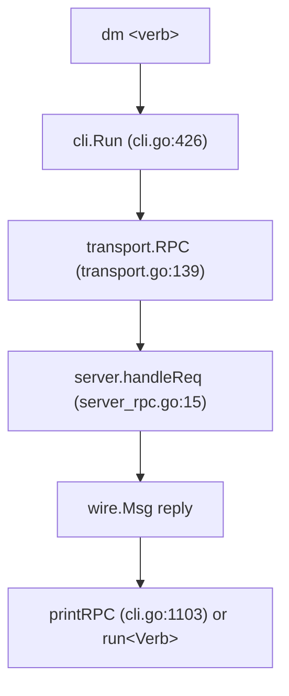
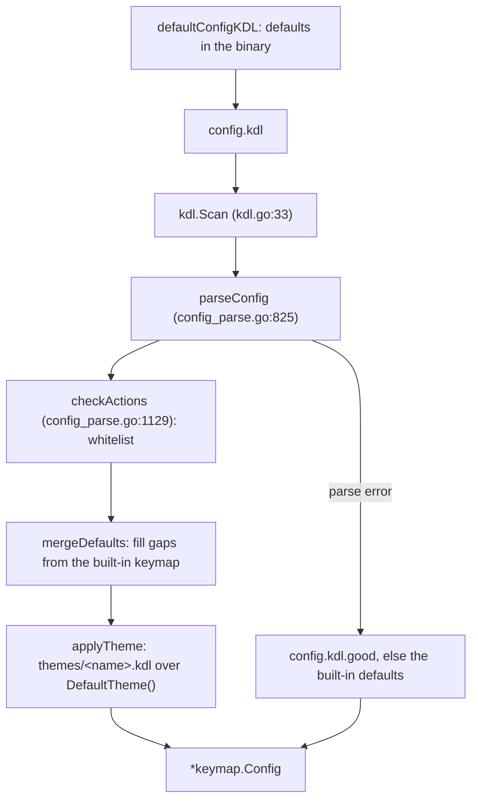

# Config and the CLI surface

Every verb is one row in a Go table, and every config file is a patch over a
built-in default. This page names that table, the four surfaces it renders, the
gate, the recipe, and the config, keymap and theme files.

## The path of one verb

## One table, four surfaces

`internal/clidoc/clidoc.go:68` holds `cliCommands`, 45 rows including the `msg`,
`secret` and `plugin` subverbs. The usage text, the man page, `llms.txt` and the
HTML page all render from it. `(*cmdFlags).parse` (`internal/cli/cli.go:109`)
asks the row which flags to register, so a verb gets exactly its own flags; a
missing `register` case panics (`cli.go:332`). The table generates no shell completion.

A row (`cliCommand`, `clidoc.go:30`) carries `name`, `aliases`, `args`, `summary`,
`flags`, `example`, `group` and `extra`. `cliGroups` (`clidoc.go:53`) fixes seven
groups: Sessions, Panes, Windows and workspaces, Observe, Message box, Secrets, Docs.

## The renderers

- `UsageText` (`clidoc.go:620`): `dm help`, a 40-column limit, then the `dm exec`
  shape. `VerbHelp` (`clidoc.go:651`) is `dm <verb> -h`.
- `ManPage` (`internal/clidoc/man.go:101`): roff from the rows, the actions and the `configdoc` tables.
- `LLMsText` (`internal/clidoc/llms.go:161`): one markdown page, actions packed by `llmsActionGroups`.
- `HTMLPage` (`internal/clidoc/html.go:295`): one self-contained page, painted from `theme.DefaultTheme()`.

## The docs gate

Three tests compare a committed snapshot byte for byte.

| snapshot | command | gate |
| --- | --- | --- |
| `docs/dm.1` | `go run . man -o docs/dm.1` | `TestManPageMatchesSnapshot` (`internal/cli/man_test.go:13`) |
| `docs/llms.txt` | `go run . llms -o docs/llms.txt` | `TestLLMSTextMatchesSnapshot` (`internal/cli/llms_test.go:32`) |
| `docs/dm.html` | `go run . html -o docs/dm.html` | `TestHTMLPageMatchesSnapshot` (`internal/cli/html_test.go:16`) |

## Recipe: add a verb end to end

Do these in order. The row and the flag plumbing must agree, or the tests fail.

1. Insert the row in its group's contiguous run in `cliCommands` (`clidoc.go:68`);
   `TestGroupsAreCompleteAndOrdered` (`clidoc_test.go:162`) fails an appended row.
2. Land the flag plumbing and the row together: `cmdFlags` field (`cli.go:30`),
   `register` case (`:265`), `withValue` spellings (`:406`). A row flag with no
   `register` case panics at `parse` (`:332`); reading a missing field does not compile.
3. Add the row's `name`, `aliases`, `args`, `summary`, `flags`, `example` and
   `group`. The flags are the register cases above.
4. Add `case "<verb>":` in `Run` (`cli.go:426`): `newFlagsAt`, `c.parse`,
   `c.extraArg`, then `run<Verb>(c)` or `transport.RPC`.
5. Print: `printRPC` (`cli.go:1103`) for JSON, or a `run<Verb>` helper.
6. Flag tests: `fieldFlag` (`verb_flags_test.go:131`), `flagDefaults` (`:96`) and
   the alias map (`:243`) for a case label. Add `internal/cli/<verb>_test.go`.
7. A subverb is a row whose name has a space. Add its case to `runBox`
   (`cli.go:1150`), `runSecret` (`:883`) or `runPlugin` (`:1180`).
8. New action: `wire.Msg` (`wire.go:17`), `handleReq` (`server_rpc.go:15`),
   `s.mutation` (`server_mutate.go:300`), then `manActionNames` (`man.go:64`),
   `actionExamples` (`actions.go:16`) and `llmsActionGroups` (`llms.go:137`).
9. New key: `builtinActions` (`keymap/actions.go:12`), `defaultConfigKDL`
   (`config_parse.go:867`), `configdoc.ActionDesc`.
10. Move `manDate` (`internal/clidoc/man.go:16`) before you regenerate.
11. Regenerate the three snapshots with the gate commands. If the llms page
    reaches 476 lines, cut a paragraph in `LLMsText` (`internal/clidoc/llms.go:161`).
    Touch `README.md` only when the user-facing story changes.

## The config files

| path | format | role |
| --- | --- | --- |
| `$XDG_CONFIG_HOME/dm/config.kdl` (or `$HOME/.config/dm`) | KDL subset | keymap, prefix and options; written on first attach |
| `$XDG_CONFIG_HOME/dm/themes/<name>.kdl` | KDL subset | palette, accents, glyphs, state styles |
| `$XDG_CONFIG_HOME/dm/config.kdl.good` | KDL subset | the last text that parsed, kept as a fallback |

## Load order and the override rule

`keymap.LoadDefaultPath` (`config_load.go:49`) delegates to `LoadDefaultFrom`
(`config_load.go:115`). A missing file gives the built-in defaults.

The file is a patch, never a replacement. Every node and theme key is optional,
and a `keymap` block names one mode and may repeat. An action the file leaves out
takes its built-in key when that key is free; `mergeDefaults` drops a default
whose key is already bound or, in `main`, sits on the prefix, so the action stays
unbound (`config_parse.go:1212`, `:1218`). `"none"` unbinds one; a duplicate
action in one mode is an error. A parse failure falls back to `<path>.good` before
the built-in defaults (`saveGoodConfig`, `config_load.go:90`).

## The keymap model

A loaded config holds the prefix key and one mode per name. A mode carries an
action to key-name map, the byte sequences that fire each action, and the actions
the file unbound. `Match` (`internal/keymap/config_model.go:327`) gives a longer
binding priority over a shorter one, and reports `Partial` while the bytes so far
are a prefix of a longer binding. `mergeDefaults` fills the gaps it can.

Nine scopes are configurable, in `keymapOrder` (`config_model.go:409`): `main`
(`client_input.go:661`), `menu` (`client_keys.go:343`), `picker` (`:491`),
`switcher` (`:549`), `layout` (`layout_switcher.go:151`), `scroll`
(`client_input.go:950`), `rename` (`client_input.go:2805`), `box`
(`client_floats.go:227`) and `help` (`:334`). A mode outside `keymapOrder` is an
error (`config_parse.go:262`).

## The theme and its palette

`theme.Theme` (`internal/theme/theme.go:54`) holds an 11-colour `Palette` for the
rail and status bar, six workspace `Accents`, the structural `Glyphs`, and one
`StateStyle` per pane state (`working`, `idle`, `blocked`, `done`, `error`,
`unknown`, `shell`). `RailMarks` are fixed and are not theme keys. The file
accepts four blocks: `palette`, `accents`, `glyphs`, `states`.

Colours are explicit RGB, not palette slots: a theme may map a slot to a colour
that fails contrast. The built-in palette passes WCAG AA, and `TestRailContrast`
guards it; a user theme is not validated (`theme.go:121`). A colour must be
`#rrggbb`, a glyph one cell wide, and unknown or duplicate keys are errors.

## Why KDL is tokenised by one shared package

`internal/kdl` is a scanner, not a parser. `kdl.Scan` (`internal/kdl/kdl.go:33`)
turns text into identifiers, quoted strings and braces, skips comments, and stamps
every token with its line and a `Bol` flag for the first token on a line. Three
readers consume it: the keymap parser, the theme parser, and the secret-mapping
reader in `internal/server/server_sync.go`.

The subset is frozen on purpose. There are no KDL types, numbers, annotations or
slashdash entries: anything else scans as an identifier, and each reader rejects
what it does not know. One scanner keeps the escape, comment and line-number rules
the same for every file dm reads. Each package owns its grammar.

## Where the next thing goes

- Next verb: `cliCommands` plus a `Run` case, steps 1 and 2 above.
- Next key: `internal/keymap/actions.go`, `defaultConfigKDL`, `configdoc.ActionDesc`.
- Next theme key: `internal/theme/theme.go` (field, default, setter), then `configdoc.ThemeKeys` and `configdoc.ThemeSampleKDL`.

## See also

- [Entry point](01-entry-point.md), [Lifecycle](02-lifecycle.md), [The protocol](03-protocol.md), [The server](04-server.md)
- [The pane](05-pane.md), [The client](06-client.md), [Layout](07-layout.md), [Surfaces](08-surfaces.md), [Secrets](09-secrets.md)
