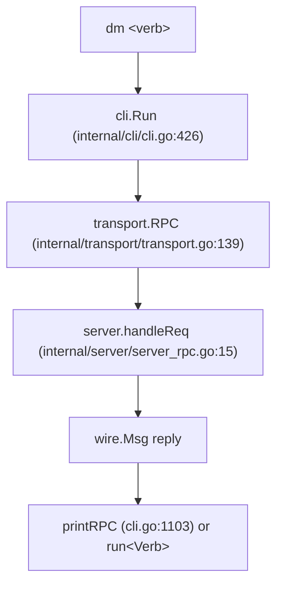
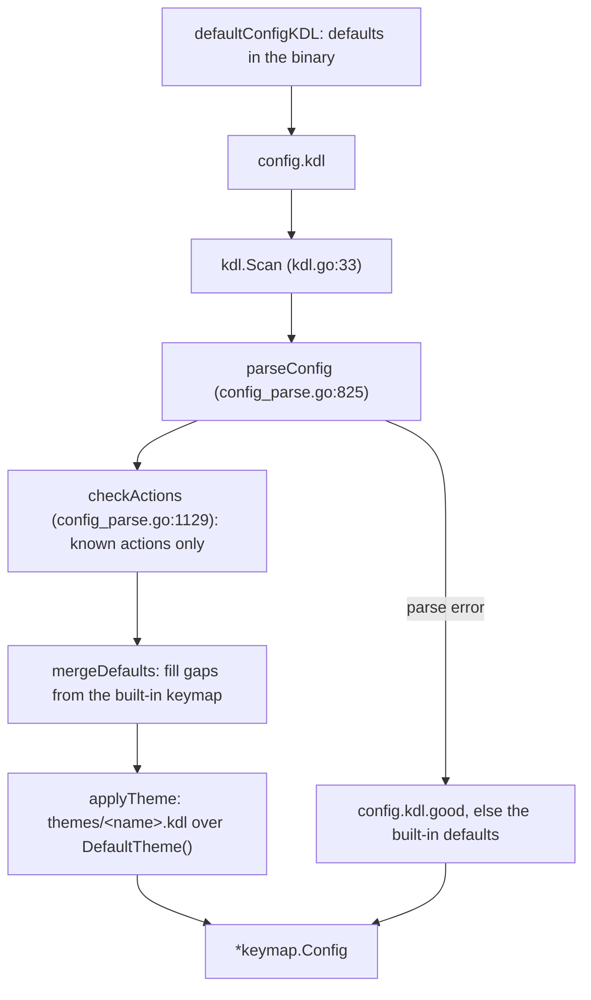

# Config and the CLI surface

`dm` is a durable terminal multiplexer: a session is a named server that owns panes, and a pane is one
program's screen; the TUI client is the terminal view that draws them. `dm` is also a command line: a
verb is the first word after `dm` (`dm split`, `dm attach`), every verb is one row in a Go table, and
`help` is the one word answered before the table (`main.go:27`). `dm attach` (or the bare `dm`) starts
the TUI client, creating the session if needed. Every config file is a patch over a built-in default.
The table holds 45 rows: `dm help` prints them, `dm <verb> -h` prints one verb's flags.

## The path of one verb

`internal/wire` is the socket contract: one `Msg` envelope (`wire.go:17`) per message, both
directions, carrying `Type` (`req`/`resp`), the action name, the target and the result JSON. An
action is one named command the server runs (`split`, `focus`, `write-to`). `internal/transport` is
the CLI side: `RPC` dials the session, sends one `Msg`, returns the reply.

## One table, four surfaces

`internal/clidoc/clidoc.go:68` holds `cliCommands`, 45 rows including the `msg`, `secret` and
`plugin` subverbs. A subverb is a row whose name is two words, so the group verb `msg` hands its
first argument to the `msg post`, `msg list` rows. The usage text, man page, `llms.txt` and HTML page
all render from it. `(*cmdFlags).parse` (`internal/cli/cli.go:109`) asks the row which flags to
register, so a verb gets exactly its own flags; a missing `register` case panics (`cli.go:332`). The
table generates no shell completion.

A row (`cliCommand`, `clidoc.go:30`) carries `name`, `aliases`, `args`, `summary`, `flags`, `example`,
`group` and `extra`, an alternate usage line with its own summary. `cliGroups` (`clidoc.go:53`) fixes
seven groups: Sessions, Panes, Windows and workspaces, Observe, Message box, Secrets, Docs.

## The renderers

- `UsageText` (`clidoc.go:620`): `dm help`, one row per verb under its group header, a summary only
  when the row fits 40 columns, then a closing block with one example request, the fields `dm exec`
  sets on a `Msg`: `action`, `target`, `msg` (text) and `enter` (return).
  `VerbHelp` (`clidoc.go:651`) is `dm <verb> -h`.
- `ManPage` (`internal/clidoc/man.go:101`): roff from the rows, the action examples and the `configdoc`
  tables (`internal/configdoc`, the config surface as plain data).
- `LLMsText` (`internal/clidoc/llms.go:161`): one markdown page, actions packed by `llmsActionGroups`.
- `HTMLPage` (`internal/clidoc/html.go:295`): one self-contained page, painted from `theme.DefaultTheme()`.

## The docs gate

Three tests compare the snapshot byte for byte: the columns are the snapshot, the command that
regenerates it, and the test that fails when the two drift.

| snapshot | command | gate |
| --- | --- | --- |
| `docs/dm.1` | `go run . man -o docs/dm.1` | `TestManPageMatchesSnapshot` (`internal/cli/man_test.go:13`) |
| `docs/llms.txt` | `go run . llms -o docs/llms.txt` | `TestLLMSTextMatchesSnapshot` (`internal/cli/llms_test.go:32`) |
| `docs/dm.html` | `go run . html -o docs/dm.html` | `TestHTMLPageMatchesSnapshot` (`internal/cli/html_test.go:16`) |

## Recipe: add a verb end to end

Do these in order. The row and the flag plumbing must agree, or the tests fail.

1. Insert the row in its group's contiguous run in `cliCommands` (`clidoc.go:68`);
   `TestGroupsAreCompleteAndOrdered` (`clidoc_test.go:162`) fails an appended row.
2. Land the flag plumbing and the row together: `cmdFlags` field (`internal/cli/cli.go:29`),
   `register` case (`:265`), `withValue` (`:406`).
3. Add the row's `name`, `aliases`, `args`, `summary`, `flags`, `example` and `group`.
4. Add `case "<verb>":` in `Run` (`cli.go:426`): `newFlagsAt`, `c.parse`, `c.extraArg`, then
   `run<Verb>(c)` or `transport.RPC`.
5. Print: `printRPC` (`cli.go:1103`) for JSON, or a `run<Verb>` helper.
6. Flag tests: `fieldFlag` (`internal/cli/verb_flags_test.go:131`), `flagDefaults` (`:96`) and the
   `verbOf` alias map (`:243`), which maps a `Run` label to its table row; add `internal/cli/<verb>_test.go`.
7. A subverb is a row whose name has a space. Add its case to the group verb's dispatcher: `runBox`
   for `msg` (`cli.go:1150`), `runSecret` for `secret` (`:883`), `runPlugin` for `plugin` (`:1180`).
8. New action: `wire.Msg` (`internal/wire/wire.go:17`), `handleReq`
   (`internal/server/server_rpc.go:15`), `s.mutation` (`internal/server/server_mutate.go:300`), then
   `manActionNames` (`internal/clidoc/man.go:64`), `actionExamples` (`internal/clidoc/actions.go:16`)
   and `llmsActionGroups` (`internal/clidoc/llms.go:137`).
9. New key: `builtinActions` (`internal/keymap/actions.go:12`), `defaultConfigKDL`
   (`internal/keymap/config_parse.go:867`) and `configdoc.ActionDesc` (`internal/configdoc/tables.go:184`,
   the description of one action).
10. Set `manDate` (`internal/clidoc/man.go:16`) to today: the man page prints it in `.TH`, and the
    snapshot compares byte for byte.
11. Regenerate the three snapshots with the gate commands. `docs/llms.txt` is held at 475 lines so one
    page stays readable in a single pass; a row that makes it 476 means cutting a paragraph in
    `LLMsText` (`internal/clidoc/llms.go:161`).

## The config files

All three paths are KDL: a text config of nodes and braces, where a node is a name, an optional quoted
string, and an optional `{ }` block of child nodes (`internal/kdl`). The prefix key is the one the TUI
client keeps for itself: the bytes before it go to the pane, and the next key is read as a binding
from the current mode, not as text (`internal/client/client_input.go:597`). `prefix "ctrl+b"` sets it.

| path | format | role |
| --- | --- | --- |
| `$XDG_CONFIG_HOME/dm/config.kdl` (`$HOME/.config/dm/` when `XDG_CONFIG_HOME` is unset) | KDL subset | keymap, prefix and options; written on first attach |
| `$XDG_CONFIG_HOME/dm/themes/<name>.kdl` | KDL subset | palette, accents, glyphs, state styles |
| `$XDG_CONFIG_HOME/dm/config.kdl.good` | KDL subset | the last text that parsed, kept as a fallback |

`defaultConfigPath` (`internal/keymap/config_load.go:33`) picks the path. The first attach writes the
file when it is missing (`internal/client/client_model.go:678`).

## Load order and the override rule

A missing file gives the built-in defaults. `<name>` is the `theme` node of `config.kdl`: `applyTheme`
reads `themes/<name>.kdl` (`internal/theme/theme.go:498`). A bound action the built-in set does not
know (`internal/keymap/actions.go:12`) is a load error.

The file is a patch, not a replacement: every node and theme key is optional, and a `keymap` block
names one mode and may repeat. An action the file leaves out takes its built-in key when that key is
free; `mergeDefaults` drops a default whose key is bound or is the prefix in `main`
(`config_parse.go:1212`, `:1218`). `"none"` unbinds one, and a duplicate action in one mode is an error.

## The keymap model

A config holds the prefix key and one mode per name. A mode is one set of bindings, chosen by what has
the keyboard: the panes for `main`, the menu for `menu`, and the message box for `box` (the keyed log
`dm msg` writes to). It carries an action to key-name map, the byte sequences that fire each action,
and the actions the file unbound. `Match` (`internal/keymap/config_model.go:327`) gives a longer
binding priority, and reports `Partial` while the bytes so far begin a longer binding.

Nine modes are configurable, in `keymapOrder` (`internal/keymap/config_model.go:409`); each name is
followed by the `Match` call that reads it. In `internal/client`: `main` (`client_input.go:665`),
`menu` (`client_keys.go:343`), `picker` (`:491`), `switcher` (`:549`), `layout`
(`layout_switcher.go:151`), `scroll` (`client_input.go:950`), `rename` (`client_input.go:2805`), `box`
(`client_floats.go:227`) and `help` (`client_floats.go:334`). A `keymap` block outside `keymapOrder` is
an error (`internal/keymap/config_parse.go:262`).

## The theme and its palette

`theme.Theme` (`internal/theme/theme.go:54`) holds an 11-colour `Palette` for the rail and status bar,
six workspace `Accents`, the structural `Glyphs`, and one `StateStyle` per pane state (`working`, `idle`,
`blocked`, `done`, `error`, `unknown`, `shell`). The rail is the column beside the panes that lists the
project, its workspaces, windows and panes (`internal/rail`). `RailMarks` are fixed, and the file takes
four blocks: `palette`, `accents`, `glyphs`, `states`.

Colours are explicit RGB: a theme may map a palette entry to a colour that fails contrast. The built-in
palette passes WCAG AA, and `TestRailContrast` (`internal/client/dm_test.go:331`) guards it; a user
theme is not checked for contrast (`internal/theme/theme.go:121`), only for form: a colour must be
`#rrggbb`, a glyph one cell wide, and a duplicate key is an error.

## Why KDL is tokenised by one shared package

`internal/kdl` is a scanner, not a parser: `kdl.Scan` (`internal/kdl/kdl.go:33`) turns text into
identifiers, strings and braces. The keymap parser, the theme parser and the secret-mapping reader in
`internal/server/server_sync.go` read it. The subset is frozen: a node name, an optional quoted string,
a `{ }` block, and nothing else, so each reader rejects what it does not know.

## Where the next thing goes

A new verb is `cliCommands` plus a `Run` case, steps 1 to 6 above, then 10 and 11. A new key is
`internal/keymap/actions.go`, `defaultConfigKDL` and `configdoc.ActionDesc`. A new theme key is
`internal/theme/theme.go` (field, default, setter), then `configdoc.ThemeKeys`
(`internal/configdoc/tables.go:418`) and `configdoc.ThemeSampleKDL` (`tables.go:475`): the theme-key
list, and a sample file that names every key.

## See also

- [Entry point](01-entry-point.md), [Lifecycle](02-lifecycle.md), [The protocol](03-protocol.md), [The server](04-server.md)
- [The pane](05-pane.md), [The client](06-client.md), [Layout](07-layout.md), [Surfaces](08-surfaces.md), [Secrets](09-secrets.md)
