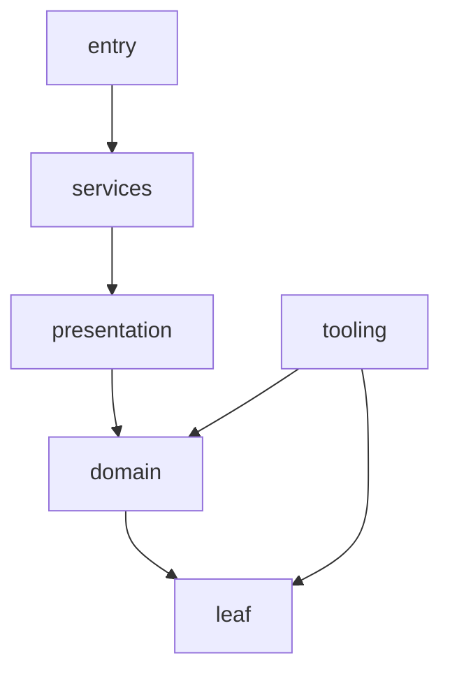

# Layers

dm splits into six layers, and every package sits in exactly one of them. Read
this page to place a new package and to find the test that rejects a cross-layer
import.

## The model

The model is the layer data in `internal/arch/arch.go#Layers`. Top to bottom:
`entry > services > presentation > domain > leaf`. `tooling` is a side branch
that reads the model and the package graph, and no package imports it.

A layer may import itself and the layers below it, never upward. The tree holds
53 packages, 49 of them under `internal/`, and 169 import edges between them.



Each arrow is the shortest form of an allowed import: one layer to the layer
below it, plus `tooling` to `domain` and `leaf`. The two `tooling` arrows carry
no edge, because the model lets a tool read domain types and no tool does.

| Layer | May import | Packages |
| --- | --- | --- |
| entry | entry, services, presentation, domain, leaf, tooling | `dm`, `cmd/dm-wasm`, `cmd/esctest-harness` |
| services | services, presentation, domain, leaf | `internal/cli`, `internal/client`, `internal/pane`, `internal/proxy`, `internal/server`, `internal/transport`, `internal/websession`, `internal/webui` |
| presentation | presentation, domain, leaf | `internal/boxview`, `internal/clidoc`, `internal/configdoc`, `internal/esctest`, `internal/hintbar`, `internal/keymapview`, `internal/palette`, `internal/panel`, `internal/rail`, `internal/segment`, `internal/shot`, `internal/switcher`, `internal/testutil`, `internal/ui` |
| domain | domain, leaf | `internal/ask`, `internal/box`, `internal/keymap`, `internal/layout`, `internal/layoutdoc`, `internal/notify`, `internal/osc`, `internal/secrets`, `internal/session`, `internal/theme`, `internal/vt`, `internal/wire` |
| leaf | nothing | `blackbox`, `internal/browser`, `internal/cells`, `internal/kdl`, `internal/lesson`, `internal/paths`, `internal/provision`, `internal/ptyspawn`, `internal/push`, `internal/redact`, `internal/release`, `internal/version`, `internal/webshell`, `internal/wlabel` |
| tooling | tooling, domain, leaf | `internal/arch`, `internal/archdoc` |

The Packages column drops the `dm/` module prefix, so `blackbox` is
`dm/blackbox`. `internal/archdoc` checks this table against the model, so a
stale row fails `go test ./internal/archdoc`.

The table is the rule, not the graph. A row may name a layer that no arrow joins
directly: `entry` reaches `domain` and `leaf` down the chain, and `entry` may
import `tooling` although no arrow draws it. Most arrows carry many real edges,
and the generated page counts every one.

## Layer placement

The entry layer is the composition root. `main.go`, `cmd/dm-wasm` and
`cmd/esctest-harness` decide which process starts and which packages run inside
it. `cmd/dm-wasm` is the browser build: it runs the client with a fake session
and nothing native. Entry may import anything, so its row lists the whole stack.

A service owns the things that block. `internal/server` accepts the socket,
`internal/pane` owns a child process and a pty, and `internal/client` renders
into a terminal. `internal/cli` parses the command line, and `internal/transport`
dials the session socket. `internal/proxy` serves the loopback capability
endpoint, and `internal/webui` serves the phone page. No package below entry
imports a service.

A service may not import entry either. `main.go#main` and
`cmd/esctest-harness/main.go#main` are `package main`, so the go tool refuses
that import. The model repeats the ban for a future entry point that is not a
program.

Presentation turns state into output. Eight packages draw the screen:
`internal/panel`, `internal/rail`, `internal/switcher`, `internal/boxview`,
`internal/hintbar`, `internal/keymapview`, `internal/segment` and `internal/ui`.
The other six do not draw. `internal/clidoc` renders the help, man and llms text,
and `internal/configdoc` holds the config surface as plain data.
`internal/esctest` drives the escape harness, `internal/palette` filters the
command palette rows, and `internal/shot` rasterises a cell grid to a PNG.
`internal/testutil` holds the test helpers.

A presentation package may not import a service. A view that would dial the
socket is a build failure, not a review comment. Services may import
presentation, because `internal/client` paints the rows that `internal/palette`
filters (`internal/client/command_palette.go#paintPaletteRows`) and renders with
`internal/boxview` and `internal/ui`.

Domain holds the state, the data types and the rules that need no screen:
`internal/wire`, `internal/session`, `internal/layout`, `internal/layoutdoc`,
`internal/vt`, `internal/theme`, `internal/keymap`, `internal/box`,
`internal/notify`, `internal/osc` and `internal/secrets`. A domain package may
not import presentation.

A wire message can carry a `*vt.Snapshot` (`internal/wire/wire.go#Msg`). Each
snapshot row carries `SnapshotCell` values
(`internal/vt/snapshot.go#SnapshotRow`), because `vt` is a domain package too. A
frame on the socket, one length-prefixed JSON message
(`internal/wire/wire.go#WriteMsg`), never carries a `boxview` or a `panel`.

Leaf packages import nothing from the module, and the table lists them. Most are
primitives used from everywhere. An import out of a leaf would close a cycle
through most of the tree, the most expensive cycle in the model.
`internal/browser` opens a URL in the default browser.

`internal/push` is Web Push on the standard library alone. It carries the VAPID
key pair, the subscription store, the RFC 8291 payload and the RFC 8292 headers.
`internal/provision` links the extension file and the skill directory into
one harness. The link rules then stay harness-free, and pi is one adapter file.

The tooling layer is offline. `internal/arch` runs the Go toolchain and holds
the model, and `internal/archdoc` renders the docs from it. Neither runs in
`dm`, so neither may reach into services or presentation.

## Running the test

`TestArchitecture` (`internal/arch/arch_test.go#TestArchitecture`) shells out to
the Go toolchain. `internal/arch.Load` finds the module root with `go env GOMOD`
(`internal/arch/arch.go#moduleRoot`) and runs
`go list -f '{{.ImportPath}} {{join .Imports " "}}' ./...` in it
(`internal/arch/arch.go#load`).

It reads the package list and the non-test imports from that one command. It
caches them for the test process and stops. The test needs the Go toolchain and a
`go.mod`, and it does not compile the code.

The test reads non-test imports only. `internal/arch.Load` runs `go list`
without `-test`, so an import that only a test file makes stays invisible to it.
Closing that gap is a separate change, with its own fallout. The test brings one
dependency, `github.com/arch-go/arch-go`, imported by the test file alone, so no
arch-go code reaches the `dm` binary.

```
go test ./internal/arch -count=1
```

The test builds one arch-go rule per layer: `ShouldOnlyDependsOn` with the union
of the packages the layer may import, or `ShouldNotDependsOn` for the leaf. The
patterns are anchored with `^...$`, because arch-go matches a pattern unanchored
and `dm/internal/box` would then also match `dm/internal/boxview`.

A failure names the importing package, the forbidden import and the rule. If
`internal/panel` imported `internal/cli`, the test would print:

```
dm/internal/panel imports dm/internal/cli
  rule: layer presentation may import only presentation, domain, leaf
```

The test also fails when the model and the tree disagree about which packages
exist. It fails again when a rule selects no package at all.

## What the test misses

- **Test-only and dead packages.** `internal/shot` is imported by three test
  files and by no other file. Nothing imports `internal/redact` at all. The test
  reads non-test imports, so it sees no edge for either and flags neither.
- **Test imports.** `dm/blackbox` sits in the leaf, and its test files import
  `dm/internal/cells`, `dm/internal/notify`, `dm/internal/vt` and
  `dm/internal/wire`. The leaf forbids those imports and the test cannot see
  them, because the graph is built without `-test`.
- **Cycles.** arch-go deprecated `CyclesRule` in v1.4.0. The tree is a DAG, and
  the test would not notice a cycle between two packages of one layer.
- **Direction inside a layer.** Two domain packages may import each other. The
  test guards the boundary between layers only.
- **External modules.** The rules constrain internal imports only.
- **A wrong placement.** The model is written by hand. A package placed one
  layer too high passes until a reader compares the table with the code.

## Adding a package

1. Add the package to the lowest layer that satisfies its imports, in
   `internal/arch/arch.go#Layers`.
2. Run `go test ./internal/arch -count=1`. An unassigned package fails there and
   prints its own import path.
3. Run `make docs-internals`. Then update the table on this page until
   `go test ./internal/archdoc -count=1` passes.

## The generated page

`docs/internals/generated/package-graph.md` holds the layer table again, and a
mermaid flowchart of the graph collapsed to one node per layer. A node counts
the imports whose two ends sit in that layer. An arrow counts the imports
between two layers. Open [the package graph](generated/package-graph.md).
`make docs-internals` rewrites the file with the `-update` flag of the archdoc
test.

## See also

- [The package graph](generated/package-graph.md)
- [The entry point](01-entry-point.md)
- [The protocol](03-protocol.md)
- [The server](04-server.md)
- [The client](06-client.md)
- [Internals index](README.md)
