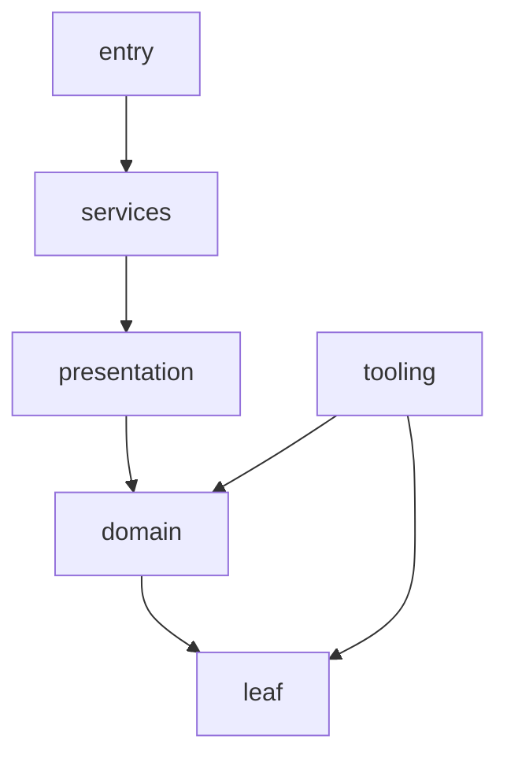

# Layers

The module splits into six layers, and every package sits in exactly one of
them. A layer may import itself and the layers below it, never upward. The
model is the layer data in `internal/arch/arch.go:39`. The package graph is the
tree's real imports: 122 edges, which `internal/arch.Load` reads. A Go test,
`TestArchitecture` (`internal/arch/arch_test.go:17`), turns each layer into an
import rule and fails on a violation; that test is the gate. `internal/archdoc`
groups the graph's edges by the model and renders the generated page. No
reviewer reads them all; the gate does.

## The model

Top to bottom: `entry > services > presentation > domain > leaf`. `tooling` is a
side branch: it reads the model and the package graph, and no package imports it
today. The entry row allows a future entry point to import it.



Each arrow is the shortest form of an allowed import: one layer to the layer
below it, plus `tooling` to `domain` and `leaf`. The table below repeats the
model, so a row may name a layer no arrow joins directly: `entry` reaches
`domain` and `leaf` down the chain, and `entry` may import `tooling` although
no arrow draws it. An arrow is an allowed import, not a real edge. Most arrows
carry many real edges, and the generated page counts every one of them. The two
`tooling` arrows carry none today: the model lets a tool read domain types.

| Layer | May import | Packages |
| --- | --- | --- |
| entry | entry, services, presentation, domain, leaf, tooling | `dm`, `cmd/dm-wasm`, `cmd/esctest-harness` |
| services | services, presentation, domain, leaf | `internal/cli`, `internal/client`, `internal/pane`, `internal/proxy`, `internal/server`, `internal/transport`, `internal/websession`, `internal/webui` |
| presentation | presentation, domain, leaf | `internal/boxview`, `internal/clidoc`, `internal/configdoc`, `internal/esctest`, `internal/keymapview`, `internal/palette`, `internal/panel`, `internal/rail`, `internal/segment`, `internal/shot`, `internal/switcher`, `internal/testutil`, `internal/ui` |
| domain | domain, leaf | `internal/box`, `internal/keymap`, `internal/layout`, `internal/layoutdoc`, `internal/notify`, `internal/osc`, `internal/secrets`, `internal/session`, `internal/theme`, `internal/vt`, `internal/wire` |
| leaf | nothing | `blackbox`, `internal/browser`, `internal/cells`, `internal/kdl`, `internal/lesson`, `internal/paths`, `internal/ptyspawn`, `internal/redact`, `internal/webshell`, `internal/wlabel` |
| tooling | tooling, domain, leaf | `internal/arch`, `internal/archdoc` |

The Packages column drops the `dm/` module prefix, so `blackbox` is `dm/blackbox`.
`internal/archdoc` checks this table against the model, so a stale row fails
`go test ./internal/archdoc`. The model is the only copy that matters.

## Why each layer sits where it sits

**entry** is the composition root. `main.go`, `cmd/dm-wasm` and
`cmd/esctest-harness` decide which process starts and which packages run inside
it. `cmd/dm-wasm` is the browser spike: it runs the client with a fake session
and nothing native. Entry may import anything, so its row lists the whole stack.

**services** own the things that block. `internal/server` accepts the socket,
`internal/pane` owns a child process and a pty, `internal/client` renders into a
terminal, `internal/cli` parses the command line, `internal/transport` dials the
session socket, `internal/proxy` serves the loopback capability endpoint, and
`internal/webui` serves the phone page. No package below entry imports a
service. A service may not import entry either: `main.go:1` and
`cmd/esctest-harness/main.go:5` are `package main`, so the go tool already
refuses that import, and the model repeats the ban so a future entry point that
is not a program keeps it.

**presentation** turns state into output. Seven packages draw the screen:
`internal/panel`, `internal/rail`, `internal/switcher`, `internal/boxview`,
`internal/keymapview`, `internal/segment`, `internal/ui`. The other six do not:
`internal/clidoc` renders the help, man and llms text, `internal/configdoc`
holds the config surface as plain data, `internal/esctest` drives the escape
harness, `internal/palette` filters the command palette rows, `internal/shot`
rasterises a cell grid to a PNG, `internal/testutil` holds the test helpers. A
presentation package may not import a service, so a view that would dial the
socket is a build failure, not a review comment. Services may import
presentation: `internal/client` paints the rows that `internal/palette` filters
(`internal/client/command_palette.go:502`) and renders with `internal/boxview`
and `internal/ui`.

**domain** holds the state, the data types and the rules that need no screen:
`internal/wire`, `internal/session`, `internal/layout`, `internal/layoutdoc`,
`internal/vt`, `internal/theme`, `internal/keymap`, `internal/box`,
`internal/notify`, `internal/osc`, `internal/secrets`. A domain package may not
import presentation. A wire message can carry a `*vt.Snapshot`
(`internal/wire/wire.go:85`) and each snapshot row carries `SnapshotCell`
values (`internal/vt/snapshot.go:48`), because `vt` is a domain package too. A
wire frame, one length-prefixed JSON message on the socket
(`internal/wire/wire.go:252`), never carries a `boxview` or a `panel`.

**leaf** packages import nothing from the module: `internal/cells`,
`internal/paths`, `internal/kdl`, `internal/browser`, `internal/wlabel`,
`internal/redact`, and `dm/blackbox`. Most are primitives used from everywhere,
so an import out of a leaf would close a cycle through most of the tree: the
most expensive cycle in the model. `internal/browser` is a standalone tool: it
opens a URL in the default browser.

**tooling** is offline. `internal/arch` runs the Go toolchain and holds the
model, `internal/archdoc` renders the docs from it. Neither runs in `dm`, so
neither may reach into services or presentation.

## How to run the gate

The gate shells out to the Go toolchain. `internal/arch.Load` finds the module
root with `go env GOMOD` (`internal/arch/arch.go:198`) and runs
`go list -f '{{.ImportPath}} {{join .Imports " "}}' ./...` in it
(`internal/arch/arch.go:176`). It reads the package list and the non-test
imports from the stdout of that one command, caches them for the test process,
and stops. The gate needs the Go toolchain and a `go.mod`; it does not compile
the code. Its only new dependency is `github.com/arch-go/arch-go`, imported by
the test file alone, so no arch-go code reaches the `dm` binary.

```
go test ./internal/arch -count=1
```

The gate builds one arch-go rule per layer: `ShouldOnlyDependsOn` with the union
of the packages the layer may import, or `ShouldNotDependsOn` for the leaf. The
patterns are anchored with `^...$`, because arch-go matches a pattern unanchored
and `dm/internal/box` would then also match `dm/internal/boxview`.

A failure names the importing package, the forbidden import and the rule. If
`internal/panel` imported `internal/cli`, the gate would print:

```
dm/internal/panel imports dm/internal/cli
  rule: layer presentation may import only presentation, domain, leaf
```

The gate also fails when the model and the tree disagree about which packages
exist, and when a rule selects no package at all.

## What the gate cannot catch

- **Test-only and dead packages.** `internal/shot` is imported by two test
  files and by no non-test file, and `internal/redact` is imported by nothing
  at all. The gate reads non-test imports, so it sees no edge for either and
  flags neither.
- **Test imports.** The rules read the non-test import list. `dm/blackbox`
  sits in the leaf, and its test files import `dm/internal/cells`,
  `dm/internal/notify`, `dm/internal/vt` and `dm/internal/wire`. The leaf
  forbids those imports and the gate cannot see them.
- **Cycles.** arch-go deprecated `CyclesRule` in v1.4.0. The tree is a DAG
  today; the gate would not notice a cycle between two packages of one layer.
- **Direction inside a layer.** Two domain packages may import each other. The
  gate only guards the boundary between layers.
- **External modules.** The rules constrain internal imports only.
- **A wrong placement.** The model is written by hand. A package placed one
  layer too high passes until a reader compares the table with the code.

## Adding a package

1. Add the package to the lowest layer that satisfies its imports, in
   `internal/arch/arch.go:39`.
2. Run `go test ./internal/arch -count=1`. An unassigned package fails there and
   prints its own import path.
3. Run `make docs-internals`. Then update the table on this page until
   `go test ./internal/archdoc -count=1` passes.

## The generated page

`docs/internals/generated/package-graph.md` holds the layer table again and a
mermaid flowchart of the graph collapsed to one node per layer. A node counts
the imports whose two ends sit in that layer; an arrow counts the imports
between two layers. The page lists 40 packages, 37 of them under `internal/`,
and 122 import edges, each one counted once in a node or on an arrow. Open
[the package graph](generated/package-graph.md).
`make docs-internals` rewrites the file with the `-update` flag of the archdoc
test.

## See also

- [The package graph](generated/package-graph.md)
- [The entry point](01-entry-point.md)
- [The protocol](03-protocol.md)
- [The server](04-server.md)
- [The client](06-client.md)
- [Internals index](README.md)
