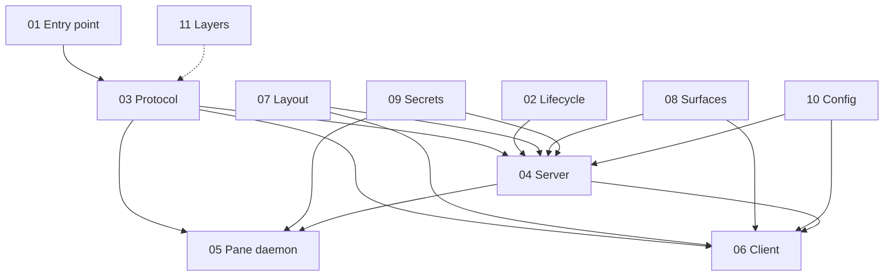

# Internals: how dm is built

This tree explains how dm is built, not how to use it. README.md owns usage,
flags, keys and examples. Each page here answers one question about the code,
names the files that answer it, and says where the next change goes. Start with
this page, pick a stop from the reading order, and follow the links at the foot
of each page.

## What this tree is for

dm is one Go binary that runs as three processes: a client, a session server and
a pane daemon per pane. They share a unix socket protocol and a state file, and
nothing else. That split is the first thing the tree teaches, because it decides
where a change belongs. The pages then follow the code in the order the code
runs: entry, state, protocol, server, pane, client, layout, the side systems,
the CLI and config, and the layer gate.

The audience is a Go developer who has never seen this repo. Every claim cites
a file and a line. The tree does not restate README.md, does not document a
generated snapshot by hand, and does not claim behaviour that no source supports.

## Reading order

Read the numbered path from the top. The reason beside each stop says what the
page unlocks. You do not need every page for every change. You do need 01 to 03
before any change that crosses a process.

1. [Entry point](01-entry-point.md). Read first because the answer to "which
   process runs this code" decides everything else. One binary, three roles,
   and the sockets between them.
2. [Lifecycle and state](02-lifecycle.md). Read second because session,
   workspace, window and pane are the nouns every later page uses. This page
   also names what each teardown word destroys.
3. [The protocol](03-protocol.md). Read third because every cross-process call
   is a message. The frame, the envelope and the full action matrix live here.
4. [The server](04-server.md). Read fourth because the server owns the
   authoritative state. This page shows the twelve files that divide that work.
5. [The pane daemon](05-pane.md). Read fifth because the pane owns the PTY and
   the screen. This page explains the process that outlives the server.
6. [The client](06-client.md). Read sixth because it is the largest package and
   the one that turns frames into a screen. The loop, the damage diff, and the
   overlay layer.
7. [Layout](07-layout.md). Read seventh because a window is a tree and a rect.
   This page gives the arithmetic from terminal size to pane cells.
8. [Surfaces](08-surfaces.md). Read eighth for the outward paths: the box, the
   notify bus and the OSC 7501 status that reaches the rail.
9. [Secrets](09-secrets.md). Read ninth before you pass a credential to a
   child. This page states the threat model and the redaction rule.
10. [Config and the CLI surface](10-config.md). Read tenth when you add a verb,
    a key or a theme key. The CLI table is the single source for four outputs.
11. [Layers](11-layers.md). Read last as the map of the map. It is the rule set
    that the other pages must not violate, and the generated graph sits beside
    it.

## Every page

| Page | Question it answers |
| --- | --- |
| [01 Entry point](01-entry-point.md) | Which word starts which process, and who spawns whom? |
| [02 Lifecycle and state](02-lifecycle.md) | What does the state file hold, and what does each teardown word destroy? |
| [03 The protocol](03-protocol.md) | What bytes cross the socket, and how do I add one message? |
| [04 The server](04-server.md) | What does the server own, and how does it stay concurrent? |
| [05 The pane daemon](05-pane.md) | How does one process turn a PTY into a screen, a ring and a status? |
| [06 The client](06-client.md) | How does the TUI turn frames into a screen and keys into requests? |
| [07 Layout](07-layout.md) | How does a window become cells, and how does a split round? |
| [08 Surfaces](08-surfaces.md) | How does the box store a message, and how does a status become a glyph? |
| [09 Secrets](09-secrets.md) | How does a credential reach a program without leaking? |
| [10 Config and the CLI surface](10-config.md) | Where is the verb table, and how do the config files load? |
| [11 Layers](11-layers.md) | Which layer may import which, and what enforces it? |
| [Generated package graph](generated/package-graph.md) | What is the package graph? Generated, not written by hand. |

## The systems and the page that owns each box

Each box is a system and the page that owns it. An arrow means the tail needs
the head. The map is a reading aid. The layer rules in 11, not these arrows, are
the enforced contract.



## Commands that keep the tree honest

The pages rot when the code moves. Four checks catch that. Run them before you
hand a change over.

| Command | What it proves |
| --- | --- |
| `go test ./internal/arch/...` | Every package sits in one layer and no import points upward. A failure names the importer, the import and the rule. |
| `go test ./internal/archdoc/...` | The generated graph is current and the table in 11 matches the model. |
| `make docs-internals` | Rewrites `docs/internals/generated/package-graph.md` from `internal/arch`. Run it after a package move. |

The fourth check is the docs snapshot gate. It compares the three committed
files under `docs/` with the CLI table:

```sh
go test ./internal/cli -run 'TestManPageMatchesSnapshot|TestLLMSTextMatchesSnapshot|TestHTMLPageMatchesSnapshot'
```

A failure prints the command that rewrites the stale file: `dm man -o
docs/dm.1`, `dm llms -o docs/llms.txt` or `dm html -o docs/dm.html`. Follow
that message. Do not edit a snapshot by hand.

## See also

- [The repository README](../../README.md) for usage, flags, keys and examples.
- [The plugin contract](../../PLUGINS.md) for the program side of a pane.
- [Layers](11-layers.md) for the model that links this tree to the gate.
- [The generated package graph](generated/package-graph.md) for the current edges.
