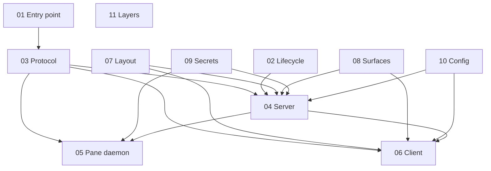

# How dm is built

This tree explains how dm is built, not how to use it. [The repository
README](../../README.md) owns usage, flags, keys and examples. Each page here
answers one question about the code, names the files that answer it, and says
where the next change goes. Start on this page, pick a stop from the reading
order, and follow the links at the foot of each page.

## What this covers

dm is one Go binary that runs as one of five process roles: the CLI and the
client it becomes on an attach, the session server, one pane daemon per pane,
the terminal probe, and the one-shot release check that an attach leaves
behind. The three long-lived roles share a unix socket protocol and a state
file, and nothing else. That split decides where a change belongs.

The pages follow the code in the order the code runs: entry, state, protocol,
server, pane, client, layout, surfaces and secrets, the CLI and config, the
layer test, and shipping and harnesses.

Four nouns sit under that split. A session is one state file. A workspace is a
record in it, a window is a record in a workspace, and a window holds a split
tree whose leaves are panes. A pane runs one program in a pseudo-terminal. A
pseudo-terminal, or PTY, is the terminal device a program reads keys from and
writes output to: the pane daemon holds the master end and the program holds the
slave end (`internal/pane/pane.go#paneProc.startShell`). [Lifecycle and
state](02-lifecycle.md) defines the four nouns, and says what each teardown word
destroys: `kill`, `reset`, `purge` and `reap`.

The audience is a Go developer who has never seen this repo. Every page cites
the file and the declaration behind each claim, so you can check the claim
against the tree. The tree does not restate README.md, does not document a
generated snapshot by hand, and does not claim behaviour that no source
supports.

## How to cite

Every claim cites `path#symbol`: the file from the module root, a `#`, then the
declaration in it. `internal/pane/pane.go#paneProc` is a type, a method is
`Type.Method` (`internal/session/state.go#State.Save`), a struct field is
`Type.Field` (`internal/session/state.go#PaneState.App`), and a file's package
clause or package comment is `#package`. A bare `server_core.go` names a file
whose base name is unique in the tree.

No citation carries a line number. A line moves when someone inserts a function
above the cited one, and the symbol does not, so the symbol is the anchor.

`TestCitations` (`internal/archdoc/archdoc_test.go#TestCitations`) reads every
page under `docs/internals` and fails on a token that names a missing file, or
a symbol its file does not declare. It matches `.go` tokens only, so a markdown
line reference passes the check without proving anything. Reviewers hold that
rule by hand.

## Reading order

Read the numbered path from the top. The reason beside each stop says what the
page unlocks. You do not need every page for every change. You do need 01 to 03
before any change that crosses a process.

1. [Entry point](01-entry-point.md). Which word starts which of the five roles,
   who spawns whom, and where the files live. Read it to learn which process
   runs the code you are changing.
2. [Lifecycle and state](02-lifecycle.md). The four nouns, the state file and
   its only writer, and what each teardown word destroys. Read it before you
   add a field the server saves.
3. [The protocol](03-protocol.md). Every cross-process call is a message. The
   frame, the envelope and the full action matrix live here, so a new request
   starts here.
4. [The server](04-server.md). The server owns the authoritative state. This
   page divides that work across its files, and says how the parts stay
   concurrent.
5. [The pane daemon](05-pane.md). The pane owns the PTY and the screen. The
   screen is the terminal emulator the pane builds from PTY bytes
   (`internal/vt/term.go#Term`). The scrollback buffer is the fixed-size byte
   buffer that holds recent output (`internal/pane/pane.go#scrollRing`). Read it
   to change what a pane keeps or shows.
6. [The client](06-client.md). The largest package, and the one that turns
   frames into a screen and keys into requests. Read it to add a key action, an
   overlay or a screen strip.
7. [Layout](07-layout.md). A window is a split tree and a rect. A rect is a cell
   rectangle on screen, an origin and a width and height counted in cells
   (`internal/layout/layout.go#Rect`). Read it to change how a terminal size
   becomes pane cells.
8. [Surfaces](08-surfaces.md). What leaves a pane: the message log any pane may
   append to (`internal/box/box.go#package`), the desktop notification a log
   entry can become (`internal/notify/notify.go#SystemNotify`), and the OSC 7501
   status a program reports about itself (`internal/osc/osc.go#oscPrefix`). Read
   it before you add a way out of a pane.
9. [Secrets](09-secrets.md). Read it before you pass a credential to a child.
   The threat model and the redaction rule live here.
10. [Config and the CLI surface](10-config.md). Read it when you add a verb, a
    default key binding or a theme key. One CLI table feeds four outputs: the
    help text, the man page, `docs/llms.txt` and `docs/dm.html`
    (`internal/clidoc/clidoc.go#package`, `internal/clidoc/html.go#HTMLPage`).
11. [Layers](11-layers.md). The layer model and the test that enforces it. Read
    it before you add a package or an import, and read the generated graph
    beside it.
12. [Shipping](12-release.md). How a release is built and versioned, and how a
    binary updates itself. Read it before you cut a tag or change the update
    check.
13. [Harnesses](13-harnesses.md). What an agent harness must provide, and what
    a second one costs. Read it before you add one.

Where a change lands follows the same split. 05 owns the bytes a pane produces
and the screen model over them. 06 owns what the client paints, and the handler
a bound key runs. 08 owns what leaves the pane toward the message log, the
desktop or the sidebar. A key binding splits the same way: a row in the keymap,
which maps each action to its keys, and a handler in 06. A new binding lands in
10, and new behaviour in 06.

## Every page

| Page | Question it answers |
| --- | --- |
| [01 Entry point](01-entry-point.md) | Which word starts which process, and who spawns whom? |
| [02 Lifecycle and state](02-lifecycle.md) | What does the state file hold, and what does each of the four teardown words destroy? |
| [03 The protocol](03-protocol.md) | What bytes cross the socket, and how do I add one message? |
| [04 The server](04-server.md) | What does the server own, and how does it stay concurrent? |
| [05 The pane daemon](05-pane.md) | How does one process turn a PTY into a screen, a scrollback buffer and a status? |
| [06 The client](06-client.md) | How does the TUI turn frames into a screen and keys into requests? |
| [07 Layout](07-layout.md) | How does a window become cells, and how does a split round? |
| [08 Surfaces](08-surfaces.md) | How does the message log store a message, and how does a status become a glyph? |
| [09 Secrets](09-secrets.md) | How does a credential reach a program without leaking? |
| [10 Config and the CLI surface](10-config.md) | Where is the verb table, and how do the config files load? |
| [11 Layers](11-layers.md) | Which layer may import which, and what enforces it? |
| [12 Shipping](12-release.md) | How is a release built and versioned, and how does a binary update itself? |
| [13 Harnesses](13-harnesses.md) | What must an agent harness provide, and what does a second one cost? |
| [Generated package graph](generated/package-graph.md) | What is the package graph? Generated, not written by hand. |

## Page map

Each node is one page and the system it owns. An arrow means the tail needs the
head. The map is a reading aid. The layer rules in 11, not these arrows, are the
enforced contract. They judge packages, not pages, so 11 draws no arrow of its
own.

## Checks that catch drift

Pages rot when the code moves. These checks catch the drift in the tree, in the
pages that mirror it, and in the CLI snapshots. Run them before you hand a
change over.

| Command | What it proves |
| --- | --- |
| `go test ./...` | The tree builds and every unit and integration test passes. |
| `go test ./internal/arch/...` | Every package sits in one layer and no import points upward. A failure names the importer, the import and the rule. |
| `go test ./internal/archdoc/...` | The generated graph is current, the table in 11 matches the model, and every citation in this tree resolves to a declaration. |
| `go test ./internal/cli -run MatchesSnapshot` | The three committed CLI documents under `docs/` match the CLI table. |

The integration tests in `blackbox/` run the built binary against a temporary
state directory. They cover the pane that survives a server kill, split and
close, zoom and sidebar resize, window and workspace switching, the JSON action
path, OSC 7501 status, the message log CLI and desktop notifications.

`make docs-internals` proves nothing: it rewrites
`docs/internals/generated/package-graph.md` from `internal/arch`. Run it after a
package move, then run the archdoc check to confirm the rewrite.

A failing snapshot test prints the command that rewrites the stale file: `dm man
-o docs/dm.1`, `dm llms -o docs/llms.txt` or `dm html -o docs/dm.html`. Follow
that message. Do not edit a snapshot by hand.

## See also

- [The repository README](../../README.md) for usage, flags, keys and examples.
- [The plugin contract](../../PLUGINS.md) for the program side of a pane.
- [Layers](11-layers.md) for the model that links this tree to the layer test.
- [The generated package graph](generated/package-graph.md) for the current edges.
