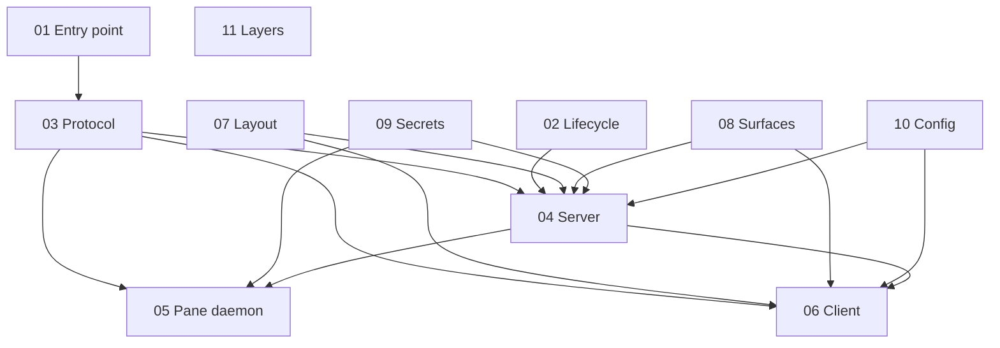

# Internals: how dm is built

This tree explains how dm is built, not how to use it. [The repository
README](../../README.md) owns usage, flags, keys and examples. Each page here
answers one question about the code, names the files that answer it, and says
where the next change goes. Start with this page, pick a stop from the reading
order, and follow the links at the foot of each page.

## What this tree is for

dm is one Go binary that runs as three processes: a client, a session server and
a pane daemon per pane. They share a unix socket protocol and a state file, and
nothing else. That split is the first thing the tree teaches, because it decides
where a change belongs. The pages then follow the code in the order the code
runs: entry, state, protocol, server, pane, client, layout, surfaces and
secrets, the CLI and config, and the layer gate.

Four nouns sit under that split. A session is one state file, a workspace is a
record in it, a window is a record in a workspace, and a window holds a tree
whose leaves are panes. A pane runs one program in a PTY. A PTY, or
pseudo-terminal, is the terminal device a program reads keys from and writes
output to: the pane daemon holds the master end, the program holds the slave
end, and keys and output cross between them (`internal/pane/pane.go#paneProc.startShell`,
`internal/pane/pane.go#paneProc`). 02 defines the four nouns and says what each
teardown word destroys: `kill`, `reset`, `purge` and `reap`.

The audience is a Go developer who has never seen this repo. Every page below
cites the file and the declaration behind each claim, so you can check the claim
against the tree. The tree does not restate README.md, does not document a
generated snapshot by hand, and does not claim behaviour that no source
supports.

## How a citation is written

Every claim cites `path#symbol`: the file from the module root, a `#`, then the
declaration in it. `internal/pane/pane.go#paneProc` is the type, a method is
`Type.Method` (`internal/session/state.go#State.Save`), a struct field is
`Type.Field` (`internal/session/state.go#PaneState.App`), and a file's package
clause or package comment is `#package`. A bare `server_core.go` names a file
whose base name is unique in the tree.

The line number is deliberately absent. It is not an anchor: the next commit
that inserts a function above the cited one moves it, and the citation then
points at unrelated code. The symbol is the anchor, and `TestCitations` in
`internal/archdoc` resolves every citation in this tree: the file must exist and
the symbol must be declared in it. A `path:line` token fails the same test.

## Reading order

Read the numbered path from the top. The reason beside each stop says what the
page unlocks. You do not need every page for every change. You do need 01 to 03
before any change that crosses a process.

1. [Entry point](01-entry-point.md). Read first because the answer to "which
   process runs this code" decides everything else. One binary, three roles,
   and the sockets between them.
2. [Lifecycle and state](02-lifecycle.md). Read second because session,
   workspace, window and pane are the nouns every later page uses. This page
   also names what each of the four teardown words destroys.
3. [The protocol](03-protocol.md). Read third because every cross-process call
   is a message. The frame, the envelope and the full action matrix live here.
4. [The server](04-server.md). Read fourth because the server owns the
   authoritative state. This page shows the twelve files that divide that work.
5. [The pane daemon](05-pane.md). Read fifth because the pane owns the PTY and
   the screen. The screen is the terminal emulator the pane builds from PTY
   bytes (`internal/vt/term.go#Term`), and the scroll ring is the fixed-size byte
   buffer that holds the recent output (`internal/pane/pane.go#scrollRing`). This
   page explains the process that outlives the server.
6. [The client](06-client.md). Read sixth because it is the largest package and
   the one that turns frames into a screen. The loop, the damage diff, and the
   overlay layer.
7. [Layout](07-layout.md). Read seventh because a window is a tree and a rect.
   A rect is a cell rectangle on screen (`internal/layout/layout.go#Rect`): an
   origin and a width and height counted in cells. This page gives the
   arithmetic from terminal size to pane cells.
8. [Surfaces](08-surfaces.md). Read eighth for the outward paths: the box, the
   notify bus and the OSC 7501 status that reaches the rail. The box is a
   per-session log any pane may append to (`internal/box/box.go#package`), the notify
   bus is the `notify/` branch of that log, where an entry may become a desktop
   popup that the server draws with `notify-send`
   (`internal/notify/notify.go#SystemNotify`), the rail is the sidebar the client draws
   (`internal/rail/rail.go#DrawRail`), and OSC 7501 is the terminal escape sequence a
   program prints to report its own status (`internal/osc/osc.go#oscPrefix`).
9. [Secrets](09-secrets.md). Read ninth before you pass a credential to a
   child. This page states the threat model and the redaction rule.
10. [Config and the CLI surface](10-config.md). Read tenth when you add a verb,
    a default key binding or a theme key. The CLI table is the single source
    for four outputs: the help text, the man page, `docs/llms.txt` and
    `docs/dm.html` (`internal/clidoc/clidoc.go#package`,
    `internal/clidoc/html.go#HTMLPage`).
11. [Layers](11-layers.md). Read last as the map of the map. It is the rule set
    that the other pages must not violate, and the generated graph sits beside
    it.

Where a change lands follows the same split: 05 for the bytes a pane produces
and the screen model over them, 06 for what the client paints and for the
handler a bound key runs, 08 for what leaves the pane toward the box, the
desktop or the rail. A key binding splits the same way: a row in the keymap,
which maps each action to its keys, and a handler in 06. A new binding lands in
10, new behaviour in 06.

## Every page

| Page | Question it answers |
| --- | --- |
| [01 Entry point](01-entry-point.md) | Which word starts which process, and who spawns whom? |
| [02 Lifecycle and state](02-lifecycle.md) | What does the state file hold, and what does each of the four teardown words destroy? |
| [03 The protocol](03-protocol.md) | What bytes cross the socket, and how do I add one message? |
| [04 The server](04-server.md) | What does the server own, and how does it stay concurrent? |
| [05 The pane daemon](05-pane.md) | How does one process turn a PTY into a screen, a ring and a status? |
| [06 The client](06-client.md) | How does the TUI turn frames into a screen and keys into requests? |
| [07 Layout](07-layout.md) | How does a window become cells, and how does a split round? |
| [08 Surfaces](08-surfaces.md) | How does the box store a message, and how does a status become a glyph? |
| [09 Secrets](09-secrets.md) | How does a credential reach a program without leaking? |
| [10 Config and the CLI surface](10-config.md) | Where is the verb table, and how do the config files load? |
| [11 Layers](11-layers.md) | Which layer may import which, and what enforces it? |
| [Generated package graph](generated/package-graph.md) | What is the package graph? Generated, not written by hand. |

## The systems and the page that owns each

Each node is one page and the system it owns. An arrow means the tail needs the
head. The map is a reading aid. The layer rules in 11, not these arrows, are the
enforced contract. They judge packages, not pages, so 11 draws no arrow of its
own.



## Commands that keep the tree honest

Pages rot when the code moves. Two checks catch the drift in the tree and in the
pages that mirror it. Run them before you hand a change over.

| Command | What it proves |
| --- | --- |
| `go test ./internal/arch/...` | Every package sits in one layer and no import points upward. A failure names the importer, the import and the rule. |
| `go test ./internal/archdoc/...` | The generated graph is current, the table in 11 matches the model, and every citation in this tree resolves to a declaration. |

`make docs-internals` proves nothing: it rewrites
`docs/internals/generated/package-graph.md` from `internal/arch`. Run it after a
package move, then run the archdoc check to confirm the rewrite.

A third check is the docs snapshot gate. It checks the CLI snapshots, not the
internals tree: it compares the three committed files under `docs/` (the man
page, `llms.txt` and the HTML page) with the CLI table:

```sh
go test ./internal/cli -run 'TestManPageMatchesSnapshot|TestLLMSTextMatchesSnapshot|TestHTMLPageMatchesSnapshot'
```

A failure prints the command that rewrites the stale file: `dm man -o
docs/dm.1`, `dm llms -o docs/llms.txt` or `dm html -o docs/dm.html`. Follow
that message. Do not edit a snapshot by hand. The citation check reads pages 01
to 11 and this page; the snapshot gate checks the CLI pages, not this tree.

## See also

- [The repository README](../../README.md) for usage, flags, keys and examples.
- [The plugin contract](../../PLUGINS.md) for the program side of a pane.
- [Layers](11-layers.md) for the model that links this tree to the layer gate.
- [The generated package graph](generated/package-graph.md) for the current edges.
