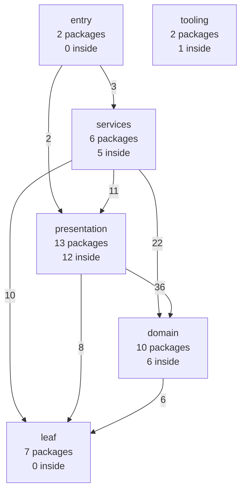

# Package graph

*Generated by `internal/archdoc` from the layer model in `internal/arch/arch.go`. Do not edit this file. Run `make docs-internals` to rewrite it.*

40 packages. 37 of them sit under `internal/`. Internal edges: 122.

## Layers

A layer may import itself and every layer it names. `entry` may import the whole stack.

| Layer | May import | Packages |
| --- | --- | --- |
| entry | entry, services, presentation, domain, leaf, tooling | `dm`, `cmd/esctest-harness` |
| services | services, presentation, domain, leaf | `internal/cli`, `internal/client`, `internal/pane`, `internal/proxy`, `internal/server`, `internal/transport` |
| presentation | presentation, domain, leaf | `internal/boxview`, `internal/clidoc`, `internal/configdoc`, `internal/esctest`, `internal/keymapview`, `internal/palette`, `internal/panel`, `internal/rail`, `internal/segment`, `internal/shot`, `internal/switcher`, `internal/testutil`, `internal/ui` |
| domain | domain, leaf | `internal/box`, `internal/keymap`, `internal/layout`, `internal/notify`, `internal/osc`, `internal/secrets`, `internal/session`, `internal/theme`, `internal/vt`, `internal/wire` |
| leaf | nothing | `blackbox`, `internal/browser`, `internal/cells`, `internal/kdl`, `internal/paths`, `internal/redact`, `internal/wlabel` |
| tooling | tooling, domain, leaf | `internal/arch`, `internal/archdoc` |

## The graph at layer level

The tree draws 122 imports. At one node per package that is a
hairball, so this diagram collapses it to layers and counts the edges.
A node carries the package count and the imports inside the layer. An
arrow carries the imports leaving the layer, into the layer it points at.
The table above names every package, so the counts are traceable, and
`go test ./internal/arch/...` is the edge list that matters.

