# Package graph

*Generated by `internal/archdoc` from the layer model in `internal/arch/arch.go`. Do not edit this file. Run `make docs-internals` to rewrite it.*

40 packages. 37 of them sit under `internal/`. Internal edges: 122.

## Layers

A layer may import itself and every layer it names. `entry` may import the whole stack.

| Layer | May import | Packages |
| --- | --- | --- |
| entry | entry, services, presentation, domain, leaf, tooling | `dm`, `cmd/esctest-harness` |
| services | services, presentation, domain, leaf | `internal/cli`, `internal/client`, `internal/pane`, `internal/proxy`, `internal/server`, `internal/transport` |
| presentation | presentation, domain, leaf | `internal/boxview`, `internal/clidoc`, `internal/configdoc`, `internal/esctest`, `internal/keymapview`, `internal/palette`, `internal/panel`, `internal/rail`, `internal/segment`, `internal/shot`, `internal/switcher`, `internal/testutil`, `internal/ui` |
| domain | domain, leaf | `internal/box`, `internal/keymap`, `internal/layout`, `internal/notify`, `internal/osc`, `internal/secrets`, `internal/session`, `internal/theme`, `internal/vt`, `internal/wire` |
| leaf | nothing | `blackbox`, `internal/browser`, `internal/cells`, `internal/kdl`, `internal/paths`, `internal/redact`, `internal/wlabel` |
| tooling | tooling, domain, leaf | `internal/arch`, `internal/archdoc` |

## Graph

One node per package, grouped by layer. An arrow is one internal import,
read from `go list ./...`. Test imports are not drawn: the toolchain does not
report them for a package.

```mermaid
flowchart TD
  subgraph l_entry["entry"]
    p_dm["dm"]
    p_dm_cmd_esctest_harness["cmd/esctest-harness"]
  end
  subgraph l_services["services"]
    p_dm_internal_cli["internal/cli"]
    p_dm_internal_client["internal/client"]
    p_dm_internal_pane["internal/pane"]
    p_dm_internal_proxy["internal/proxy"]
    p_dm_internal_server["internal/server"]
    p_dm_internal_transport["internal/transport"]
  end
  subgraph l_presentation["presentation"]
    p_dm_internal_boxview["internal/boxview"]
    p_dm_internal_clidoc["internal/clidoc"]
    p_dm_internal_configdoc["internal/configdoc"]
    p_dm_internal_esctest["internal/esctest"]
    p_dm_internal_keymapview["internal/keymapview"]
    p_dm_internal_palette["internal/palette"]
    p_dm_internal_panel["internal/panel"]
    p_dm_internal_rail["internal/rail"]
    p_dm_internal_segment["internal/segment"]
    p_dm_internal_shot["internal/shot"]
    p_dm_internal_switcher["internal/switcher"]
    p_dm_internal_testutil["internal/testutil"]
    p_dm_internal_ui["internal/ui"]
  end
  subgraph l_domain["domain"]
    p_dm_internal_box["internal/box"]
    p_dm_internal_keymap["internal/keymap"]
    p_dm_internal_layout["internal/layout"]
    p_dm_internal_notify["internal/notify"]
    p_dm_internal_osc["internal/osc"]
    p_dm_internal_secrets["internal/secrets"]
    p_dm_internal_session["internal/session"]
    p_dm_internal_theme["internal/theme"]
    p_dm_internal_vt["internal/vt"]
    p_dm_internal_wire["internal/wire"]
  end
  subgraph l_leaf["leaf"]
    p_dm_blackbox["blackbox"]
    p_dm_internal_browser["internal/browser"]
    p_dm_internal_cells["internal/cells"]
    p_dm_internal_kdl["internal/kdl"]
    p_dm_internal_paths["internal/paths"]
    p_dm_internal_redact["internal/redact"]
    p_dm_internal_wlabel["internal/wlabel"]
  end
  subgraph l_tooling["tooling"]
    p_dm_internal_arch["internal/arch"]
    p_dm_internal_archdoc["internal/archdoc"]
  end
  p_dm --> p_dm_internal_cli
  p_dm --> p_dm_internal_clidoc
  p_dm --> p_dm_internal_pane
  p_dm --> p_dm_internal_server
  p_dm_cmd_esctest_harness --> p_dm_internal_esctest
  p_dm_internal_archdoc --> p_dm_internal_arch
  p_dm_internal_boxview --> p_dm_internal_box
  p_dm_internal_boxview --> p_dm_internal_cells
  p_dm_internal_boxview --> p_dm_internal_keymap
  p_dm_internal_boxview --> p_dm_internal_layout
  p_dm_internal_boxview --> p_dm_internal_panel
  p_dm_internal_boxview --> p_dm_internal_theme
  p_dm_internal_boxview --> p_dm_internal_ui
  p_dm_internal_boxview --> p_dm_internal_vt
  p_dm_internal_boxview --> p_dm_internal_wire
  p_dm_internal_cli --> p_dm_internal_box
  p_dm_internal_cli --> p_dm_internal_browser
  p_dm_internal_cli --> p_dm_internal_cells
  p_dm_internal_cli --> p_dm_internal_clidoc
  p_dm_internal_cli --> p_dm_internal_client
  p_dm_internal_cli --> p_dm_internal_paths
  p_dm_internal_cli --> p_dm_internal_session
  p_dm_internal_cli --> p_dm_internal_transport
  p_dm_internal_cli --> p_dm_internal_wire
  p_dm_internal_clidoc --> p_dm_internal_configdoc
  p_dm_internal_clidoc --> p_dm_internal_keymap
  p_dm_internal_clidoc --> p_dm_internal_theme
  p_dm_internal_client --> p_dm_internal_box
  p_dm_internal_client --> p_dm_internal_boxview
  p_dm_internal_client --> p_dm_internal_browser
  p_dm_internal_client --> p_dm_internal_cells
  p_dm_internal_client --> p_dm_internal_configdoc
  p_dm_internal_client --> p_dm_internal_keymap
  p_dm_internal_client --> p_dm_internal_keymapview
  p_dm_internal_client --> p_dm_internal_layout
  p_dm_internal_client --> p_dm_internal_palette
  p_dm_internal_client --> p_dm_internal_panel
  p_dm_internal_client --> p_dm_internal_rail
  p_dm_internal_client --> p_dm_internal_segment
  p_dm_internal_client --> p_dm_internal_switcher
  p_dm_internal_client --> p_dm_internal_theme
  p_dm_internal_client --> p_dm_internal_transport
  p_dm_internal_client --> p_dm_internal_ui
  p_dm_internal_client --> p_dm_internal_vt
  p_dm_internal_client --> p_dm_internal_wire
  p_dm_internal_client --> p_dm_internal_wlabel
  p_dm_internal_configdoc --> p_dm_internal_keymap
  p_dm_internal_configdoc --> p_dm_internal_theme
  p_dm_internal_esctest --> p_dm_internal_vt
  p_dm_internal_keymap --> p_dm_internal_kdl
  p_dm_internal_keymap --> p_dm_internal_theme
  p_dm_internal_keymap --> p_dm_internal_wlabel
  p_dm_internal_keymapview --> p_dm_internal_cells
  p_dm_internal_keymapview --> p_dm_internal_keymap
  p_dm_internal_keymapview --> p_dm_internal_layout
  p_dm_internal_keymapview --> p_dm_internal_panel
  p_dm_internal_keymapview --> p_dm_internal_ui
  p_dm_internal_keymapview --> p_dm_internal_vt
  p_dm_internal_keymapview --> p_dm_internal_wire
  p_dm_internal_osc --> p_dm_internal_wire
  p_dm_internal_palette --> p_dm_internal_ui
  p_dm_internal_pane --> p_dm_internal_osc
  p_dm_internal_pane --> p_dm_internal_paths
  p_dm_internal_pane --> p_dm_internal_vt
  p_dm_internal_pane --> p_dm_internal_wire
  p_dm_internal_panel --> p_dm_internal_cells
  p_dm_internal_panel --> p_dm_internal_layout
  p_dm_internal_panel --> p_dm_internal_theme
  p_dm_internal_panel --> p_dm_internal_vt
  p_dm_internal_rail --> p_dm_internal_layout
  p_dm_internal_rail --> p_dm_internal_segment
  p_dm_internal_rail --> p_dm_internal_theme
  p_dm_internal_rail --> p_dm_internal_wire
  p_dm_internal_rail --> p_dm_internal_wlabel
  p_dm_internal_segment --> p_dm_internal_cells
  p_dm_internal_segment --> p_dm_internal_theme
  p_dm_internal_server --> p_dm_internal_box
  p_dm_internal_server --> p_dm_internal_kdl
  p_dm_internal_server --> p_dm_internal_keymap
  p_dm_internal_server --> p_dm_internal_layout
  p_dm_internal_server --> p_dm_internal_notify
  p_dm_internal_server --> p_dm_internal_pane
  p_dm_internal_server --> p_dm_internal_paths
  p_dm_internal_server --> p_dm_internal_proxy
  p_dm_internal_server --> p_dm_internal_rail
  p_dm_internal_server --> p_dm_internal_secrets
  p_dm_internal_server --> p_dm_internal_session
  p_dm_internal_server --> p_dm_internal_theme
  p_dm_internal_server --> p_dm_internal_vt
  p_dm_internal_server --> p_dm_internal_wire
  p_dm_internal_session --> p_dm_internal_box
  p_dm_internal_session --> p_dm_internal_layout
  p_dm_internal_session --> p_dm_internal_paths
  p_dm_internal_shot --> p_dm_internal_cells
  p_dm_internal_shot --> p_dm_internal_theme
  p_dm_internal_shot --> p_dm_internal_vt
  p_dm_internal_switcher --> p_dm_internal_cells
  p_dm_internal_switcher --> p_dm_internal_keymap
  p_dm_internal_switcher --> p_dm_internal_layout
  p_dm_internal_switcher --> p_dm_internal_panel
  p_dm_internal_switcher --> p_dm_internal_rail
  p_dm_internal_switcher --> p_dm_internal_segment
  p_dm_internal_switcher --> p_dm_internal_theme
  p_dm_internal_switcher --> p_dm_internal_ui
  p_dm_internal_switcher --> p_dm_internal_vt
  p_dm_internal_switcher --> p_dm_internal_wire
  p_dm_internal_testutil --> p_dm_internal_keymap
  p_dm_internal_testutil --> p_dm_internal_layout
  p_dm_internal_testutil --> p_dm_internal_segment
  p_dm_internal_testutil --> p_dm_internal_session
  p_dm_internal_testutil --> p_dm_internal_vt
  p_dm_internal_testutil --> p_dm_internal_wire
  p_dm_internal_theme --> p_dm_internal_cells
  p_dm_internal_theme --> p_dm_internal_kdl
  p_dm_internal_transport --> p_dm_internal_paths
  p_dm_internal_transport --> p_dm_internal_wire
  p_dm_internal_ui --> p_dm_internal_cells
  p_dm_internal_ui --> p_dm_internal_layout
  p_dm_internal_ui --> p_dm_internal_theme
  p_dm_internal_vt --> p_dm_internal_cells
  p_dm_internal_wire --> p_dm_internal_layout
  p_dm_internal_wire --> p_dm_internal_vt
```

